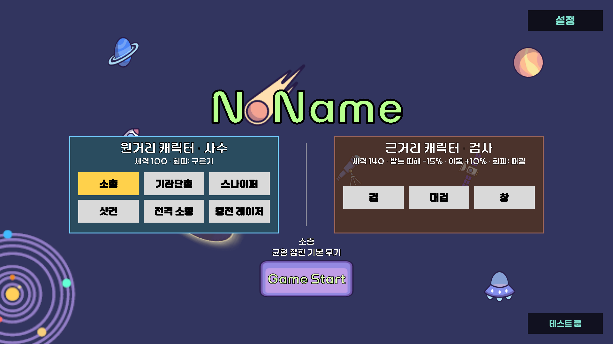
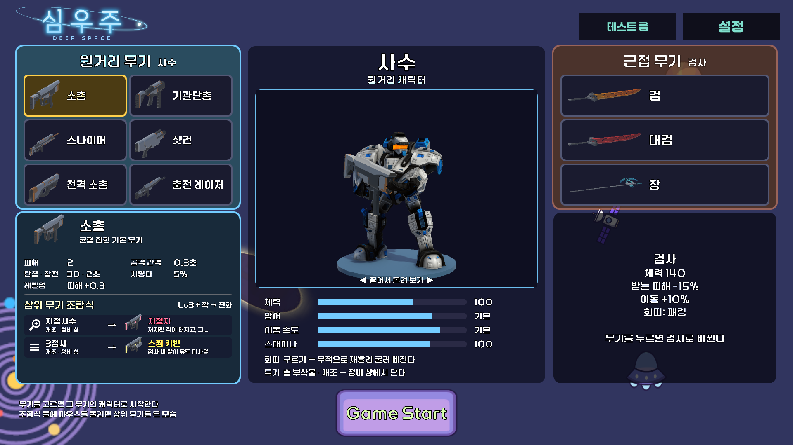
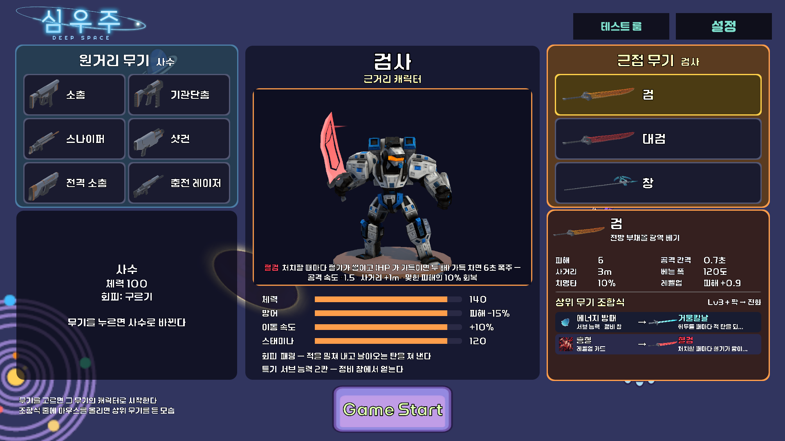

# 로비 선택 화면 설계 — 캐릭터 · 무기 · 조합식

> 작성 2026-10-13 · 기준 브랜치 `player` · **상태: 구현 완료 (2026-10-14)** — 6장 정할 것에 사용자 답을 받아 배치를 바꿔 만들었다 (3장 · 4장 · 5장)
>
> 요청: "게임을 시작할 때 지금은 무기만 선택해서 들어가는 단조로운 구조 — 다른 뱀서라이크처럼 캐릭터와 무기를 고르고, 캐릭터 모델링이 보이거나
> 이 무기는 어떤 능력 · 조합식이 있는지 보여 주면 좋겠다. 게임 이름 · 뒷배경은 아직 정하지 않았으니 크기만 줄여 공간을 확보하는 방향으로"

---

## 1. 바꾸기 전 로비

- 큰 제목 "NoName" 이 화면 가운데 위를 차지하고, 그 아래 **사수 · 검사 두 영역에 무기 버튼** (사수 6 · 검사 3) — 무기를 누르면 그 캐릭터로 정해진다 (`CharacterSelectUI`, 우리 도구 `CharacterSetup` 10번이 지은 배치)
- 아래에 고른 무기 이름 · 한 줄 설명, "Game Start" · 오른쪽 위 "설정" · 오른쪽 아래 "테스트 룸"

| 아쉬운 점 | 왜 |
|---|---|
| 캐릭터를 고르는 맛이 없다 | 무기 버튼이 곧 캐릭터 — 캐릭터는 영역 제목 한 줄 (체력 · 회피) |
| 캐릭터가 안 보인다 | 모델 · 초상이 없다 |
| 무기 정보가 한 줄뿐 | 수치 · 레벨업 · 부착물 / 서브 능력 · **상위 무기 조합식**을 판에 들어가서야 안다 (조합식 판은 무기를 얻은 뒤 6초) |
| 공간 | 아직 정하지 않은 제목 · 배경이 화면의 절반 가까이를 쓴다 |

## 2. 다른 뱀서라이크 — 대략의 공통점

| 게임 (예) | 고르는 것 | 보여 주는 것 |
|---|---|---|
| 뱀파이어 서바이버즈 | 캐릭터 격자 → 시작 | 초상 · 시작 무기 · 능력치 보너스 한 줄 · 잠긴 캐릭터는 실루엣 |
| 브로테이토 | 캐릭터 → 다음 화면에서 무기 → 난이도 | 캐릭터 특성 목록 · 무기 수치 |
| 20 Minutes Till Dawn | 캐릭터 · 무기 (· 룬)를 한 화면에서 | 캐릭터 능력 · 무기 수치 · 특징 |
| 소울스톤 서바이버즈 · 홀스 오브 토먼트 | 캐릭터 (3D) | 가운데 3D 모델이 대기 동작 · 스킬 · 무기 설명 |

공통 패턴 — **왼쪽 목록 · 가운데 큰 그림(모델) · 오른쪽 상세**, 잠긴 칸은 "???", 고른 조합을 아래에 요약하고 큰 시작 버튼. 우리 게임은 여기에 **상위 무기 조합식**(무기 + 짝 → 상위 무기)을 미리 보여 주는 것이 차별점이 된다.

---

## 3. 새 화면 (만든 모습)

> 배치 시험 화면 캡처 (1920 × 1080). 가운데 모델 · 손 무기는 실시간 3D (게임과 같은 플레이어 프리팹 · 애니메이터).

### 3-1. 배치 — 사용자 결정 (2026-10-14)

> "가운데 모델은 3D · 상위 무기 조합식은 특정 무기를 선택하면 한쪽에 작게 · 캐릭터는 중앙에, 좌우로 원거리 무기와 근접 무기가 나눠져서 선택 · 다음 캐릭터용(???)은 없어도 된다 · 테스트 룸 버튼은 옮기고"

| 자리 (1920 × 1080) | 무엇 | 데이터 |
|---|---|---|
| **위 (높이 ~110)** | 왼쪽 **게임 제목 "심우주"** (그림 `Sprites/UI/LobbyTitle.png`, 높이 96 — 2026-10-15) · 오른쪽 **[테스트 룸] [설정]** | 원래 "NoName" 글자 + 혜성은 `TitleLogo` 묶음 안에 꺼 둠 |
| **왼쪽 (폭 540)** | **원거리 무기 · 사수** — 무기 6종 (2열 × 3줄, 아이콘 + 이름). 제목을 누르면 사수 첫 무기 | `CH_Gunner.startWeapons` |
| **가운데 (폭 720)** | **캐릭터 이름 · 역할 → 3D 미리보기** (고른 무기를 든 모델 · 끌어서 돌리기 · 캐릭터 색 받침) → **능력치 막대** 체력 · 방어 · 이동 속도 · 스태미나 (두 캐릭터 중 좋은 쪽 대비) → 회피 · 특기 한 줄 | `CharacterData` |
| **오른쪽 (폭 540)** | **근접 무기 · 검사** — 무기 3종 (1열 × 3줄, 아이콘을 눕혀 크게) | `CH_Swordsman.startWeapons` |
| **고른 쪽 아래** | **무기 상세 + 상위 무기 조합식 (작게)** — 무기를 고르면 그 무기 쪽(왼쪽/오른쪽) 칸 아래로 판이 옮겨 온다 | `WeaponData` · `EvolutionCatalog` (3-3) |
| **반대쪽 아래** | 다른 캐릭터 소개 (이름 · 요약 줄마다 · "무기를 누르면 ○○로 바뀐다") | `CharacterData.summary` |
| **아래** | 가운데 **[Game Start]** (원래 버튼을 옮김) · 왼쪽 도움말 두 줄 | |

- **게임 이름 "심우주"** (2026-10-15 사용자 결정) — 로고 초안 7종 중 사용자가 고른 ① 궤도(Orbit 폰트 · 궤도 고리 · DEEP SPACE)를 넣었다. 초안은 바탕화면 `캡스톤2 ppt 폴더/중간보고서/타이틀 로고 초안/`. 다른 안으로 바꾸려면 그 PNG 를 `Assets/Sprites/UI/LobbyTitle.png` 로 덮어쓰고 도구를 다시 돌린다 (파일을 지우면 원래 "NoName" 글자로 돌아간다)
- 배경은 그대로 — 행성 · 우주선 그림이 판 뒤로 비친다
- "???" 다음 캐릭터 칸은 두지 않았다 (사용자 결정)
- 테스트 룸 버튼은 **오른쪽 위 설정 옆**. 설정 버튼은 크기 맞춤 방식이 다른 캔버스에 있어 16:9 가 아니면 크기 · 자리가 어긋난다 → 로비 화면이 매 프레임 설정 버튼의 화면 좌표로 크기 · 높이를 맞춘다 (4:3 에서 겹치던 것을 시험으로 잡음)

### 3-2. 흐름

1. **무기**를 누른다 → 그 무기의 캐릭터가 함께 정해진다 (`CharacterSelection`) → 가운데 이름 · 능력치 · 받침 색 · 손 무기 · 자세가 바뀌고, 상세 판이 그 쪽 아래로 옮겨 온다
2. **칸 제목**(원거리 무기 · 근접 무기)을 누르면 그 캐릭터의 첫 무기
3. **조합식 줄에 마우스를 올린다** → 가운데 모델이 **그 상위 무기**(`W_EVO_*` — 발광 그대로)를 들고, 미리보기 아래에 상위 무기 이름 · 설명 전체가 나온다. 떼면 원래 무기로
4. 모델을 **끌면 돈다** — 캐릭터가 바뀌면 처음 각도로
5. **[Game Start]** → 고른 캐릭터 · 무기로 Stage1 (기존 `LobyManager.StartGame`)
6. 판이 끝나 **로비로 돌아오면 마지막 선택**을 되살린다 (`CharacterSelectUI` 재사용)

### 3-3. 무기 상세 · 조합식에 보이는 것

**상세** — 아이콘 · 이름 · 설명 + 수치 6칸 (무기 데이터의 Lv1 값, 종류별)

| 종류 | 보이는 수치 |
|---|---|
| 총 | 피해(샷건은 "1.4 × 8발") · 공격 간격 · 탄창 · 장전 · 관통 / 유도 / 퍼짐 중 하나 · 치명타 · 레벨업 |
| 전격 소총 | 피해 · 공격 간격 · 탄창 · 장전 · 연쇄 · 치명타 · 레벨업 |
| 충전 레이저 | 피해 · 공격 간격 · 탄창 · 장전 · 사거리 · 치명타 · 레벨업 |
| 근접 | 피해 · 공격 간격 · 사거리 · 베는 폭 · 치명타 · 레벨업 |

- 레벨업 = 레벨당 오르는 것 ("피해 +0.3" · 샷건 "탄 +1")

**상위 무기 조합식** — 조합 안내 HUD(`ComboHud`)와 **같은 규칙** (공용: `EvolutionCatalog.CollectFor` · `WeaponEvolutionData.PairIcon` · `PairWhere` · `AvailableTo`)

- 줄 하나 = **[짝 그림] 짝 이름 + 얻는 곳** → **[상위 무기 그림] 이름(테마 색) + 한 줄 (짧게)**
- 얻는 곳: "개조 · 정비 창" / "서브 능력 · 정비 창" / "레벨업 카드" (팀원 스킬 짝)
- 그 캐릭터가 가질 수 없는 짝은 숨긴다 · 조합이 없는 무기(스나이퍼 · 창)는 "이 무기의 상위 무기는 준비 중이다"
- 위에 "Lv3 + 짝 → 진화"

| 무기 | 조합식 줄 (시험에서 확인) |
|---|---|
| 소총 | 지정사수 → 처형자 · 3점사 → 스웜 카빈 |
| 기관단총 | 이중 탄창 → 회전 기관포 |
| 샷건 | 슬러그 → 공성포 · 파이어볼(레벨업 카드) → 용의 포효 |
| 스나이퍼 | (준비 중) |
| 전격 소총 | 연쇄 번개(레벨업 카드) → 뇌운 |
| 충전 레이저 | 분광 프리즘 → 프리즘 노바 · 과충전 → 태양창 |
| 검 | 에너지 방패(서브 능력) → 거울칼날 · 흡혈(레벨업 카드) → 혈검 |
| 대검 | 블랙홀(레벨업 카드) → 중력 대검 |
| 창 | (준비 중) |

### 3-4. 캐릭터 3D 미리보기 (`LobbyCharacterPreview`)

- **무대** — 로비 카메라에 안 보이는 먼 곳(0, −500, −800)에 받침 · 전용 카메라를 실행 중에 만들고, 그 카메라가 **RenderTexture**(가운데 칸 × 1.5, MSAA 4)에 찍은 그림을 RawImage 로 보여 준다. 빛은 장면의 해(Directional Light)를 그대로 쓰고, 카메라를 빛이 오는 쪽에서 35° 비켜 둔다 (얼굴에 3/4 빛)
- **모델** — 게임과 같은 **Player 프리팹**을 꺼진 그릇 안에 꺼내 (Awake 가 안 돈다) **그림에 필요 없는 것을 모두 뗀 뒤** 켠다: 스크립트(양손 쥐기 `MeleeTwoHandGrip` 만 남김) · 물리 · 소리, 태그도 `Untagged` (HUD 들이 "Player" 태그로 모형을 잡지 않게). 따로 만든 모형 프리팹이 없어 플레이어 모델 · 애니메이터가 바뀌어도 저절로 따라간다
- **게임과 같은 방식으로 보여 준다**
  - 몸 색: `CharacterLoadout.SwapBodyMaterial` (게임과 같은 함수)
  - 무기: `WeaponController.FindSocket` 으로 찾은 소켓에 무기 프리팹을 로컬 0 으로 (무기 스크립트는 떼고 발광 `EvolvedGlow` · `EvolvedOrbit` 만)
  - 자세: ShootLayer / MeleeLayer 무게 · `MeleeStyle` (게임의 `ApplyUpperBodyLayers` · `ApplyStyle` 과 같다)
  - 양손 무기(대검 · 창): `MeleeTwoHandGrip.SetPreviewGrip` — 무기 프리팹의 자루 구간(`MeleeWeapon.TryGetLeftGripLocal`)을 받아 왼손이 자루를 쥔다 (시험: IK 1.00)
- 애니메이터는 `UnscaledTime` — 일시정지한 채 로비로 와도 움직인다
- 대검 · 중력 대검처럼 긴 무기는 대기 자세에서 칼끝이 위로 조금 잘린다 (게임 자세 그대로)
- **주의** — 사수 · 검사 모두 `CharacterData.bodyMaterial` 이 비어 있어 **게임에서도 같은 몸 색**이다. 미리보기는 받침 색 · 무기 · 자세로만 갈린다 (6장)

---

## 4. 만든 것

### 4-1. 지킨 것

- **Core `LobyManager` · `GameAppManager` 는 고치지 않았다** — 무기 버튼은 `LobyManager.SelectWeapon(index)`, 시작은 원래 버튼(`StartGame`), 화면은 `OnSelectionChanged` 를 듣는다. 도구는 `selectableWeapons` 값만 채운다 (사수 6 → 검사 3)
- 로비 씬은 **우리 도구로만** 다시 짓는다. 장면에 원래 있던 것(로고 · 시작 · 테스트 룸 버튼)은 자리만 옮긴다
- 수치 · 문구는 데이터에서. 화면 문구(회피 · 특기 설명 등)는 `LobbyScreen` 의 칸 (인스펙터에서 고칠 수 있다)

### 4-2. 파일

| 파일 | 하는 일 |
|---|---|
| `Scripts/Player/Lobby/LobbyScreen.cs` | 화면 전체 — 버튼 강조 · 가운데 이름 · 능력치 · 상세 판(고른 쪽으로 옮김) · 조합식 줄 · 마우스 올림 → 상위 무기 미리보기 · 반대쪽 소개 · 테스트 룸 버튼을 설정 옆에 맞춤 |
| `Scripts/Player/Lobby/LobbyCharacterPreview.cs` | 3D 무대 · RenderTexture · 모델 꺼내기(스크립트 떼기) · 몸 색 · 무기 들기 · 자세 · 양손 쥐기 · 끌어서 돌리기 |
| `Scripts/Player/Lobby/LobbyHover.cs` | 마우스 올림 · 내림 알림 (조합식 줄) |
| `Editor/LobbySetup.cs` | 도구 **`Tools / 로비 / 선택 화면 만들기`** (배치 `LobbySetup.RunBatch`) — 화면 루트 `LobbyScreen` 을 매번 새로 짓는다 · 예전 `CharacterSelect` 를 지운다 · 로고 묶기(제목 그림 `Sprites/UI/LobbyTitle.png` 가 있으면 그것으로) · 버튼 옮기기. 둥근 판 그림 `Sprites/UI/LobbyRound.png` · 받침 머티리얼 `Prefabs/Lobby/LobbyPedestal.mat` 은 없을 때만 만든다 |
| `Editor/CharacterSetup.cs` 10번 | "10. 로비 선택 화면" → `LobbySetup.Build()` 에 맡긴다 (예전 두 칸 배치 코드는 지움) |
| `Editor/TestRoomSetup.cs` | 테스트 룸 버튼을 만들 때 자리도 오른쪽 위 설정 옆으로 |

고친 우리 코드 (공용 함수만 더함 — 동작은 그대로)

| 파일 | 더한 것 |
|---|---|
| `WeaponEvolutionData` · `EvolutionCatalog` | `PairIcon` · `PairWhere` · `AvailableTo(검사?)` · `CollectFor` — `ComboHud` 에 있던 조합식 줄 규칙을 옮겨 로비와 같이 쓴다 |
| `ComboHud` | 위 공용 함수를 쓴다 (결과 같음) |
| `CharacterLoadout` | `DefaultBodyMaterial` · `SwapBodyMaterial(root, from, to)` (몸 색 바꾸기를 정적 함수로) |
| `WeaponController` | `FindSocket(socket)` |
| `MeleeWeapon` | `TryGetLeftGripLocal` (자루 구간) |
| `MeleeTwoHandGrip` | `SetPreviewGrip` — WeaponController 없이 자루 구간을 받는 입구 |
| `GameSettingsUI` | `Instance` · `LobbyButtonRect` |

### 4-3. 다시 짓기

- 로비 화면을 바꾸면 `Tools / 로비 / 선택 화면 만들기` 를 다시 돌린다 (몇 번 돌려도 같은 결과). 화면 문구 · 색을 인스펙터에서 고쳤다면 다시 지을 때 처음 값으로 돌아간다 — 바꿀 값은 `LobbyScreen` 의 기본값을 고친다
- 캐릭터 시작 무기를 바꾸면 다시 돌린다 (버튼 · `selectableWeapons` 를 다시 채운다)

---

## 5. 검증 (배치 시험 2026-10-14 — 115 통과)

시험 사본 `Logs/evo_resume/kept_LobbyTest.cs` (실행할 때만 `Assets/Editor/_LobbyTest.cs` 로, 결과 `Logs/lobby/result.txt` · 캡처 `Logs/lobby/*.png`)

| 묶음 | 확인한 것 |
|---|---|
| 배치 | 예전 두 칸 배치가 지워졌다 · `selectableWeapons` = 사수 6 → 검사 3 · 테스트 룸 버튼이 오른쪽 위 설정 버튼 왼쪽에 같은 높이로 (4:3 배치 화면에서도) · 로고가 작게 묶였다 |
| 기본 선택 | 처음엔 소총 · 사수 · 모델이 소총을 오른손 소켓에 든다 · 모델에 남은 스크립트는 양손 쥐기뿐 · 물리 없음 · "Player" 태그 없음 · 로비에 `PlayerMove` · `WeaponController` 가 생기지 않는다 · 3D 그림에 캐릭터가 보인다 (배경 아닌 픽셀 17%) |
| 무기 9종 (버튼 클릭) | 고른 무기 · 캐릭터 · 상세 판 쪽(왼쪽/오른쪽) · 조합식 줄 수(카탈로그와 같음) · 모델 손 무기 · 상체 레이어 · `MeleeStyle` · 대검 · 창은 왼손 IK 1.00 · 조합식 없으면 "준비 중" · 반대쪽 아래 다른 캐릭터 소개 |
| 조합식 줄 마우스 | 소총 2 · 검 2 · 대검 1 · 전격 소총 1 줄 — 올리면 상위 무기 모형 + 이름 · 설명, 떼면 원래 무기 |
| 조작 | 끌면 돈다 (60°) · 오른쪽 제목 → 검 · 캐릭터가 바뀌면 처음 각도 |
| 시작 · 복귀 | 대검으로 시작 → Stage1 · 플레이어가 대검 · 검사 · 미리보기 무대는 로비와 함께 사라짐 → 로비로 돌아오면 대검 · 검사가 골라져 있고 무대는 하나 |

**손 확인 (에디터)** — 로비에서 실제 마우스로: 조합식 줄 올리기 · 모델 끌기 · 버튼 눌림 색 · 설정 창 열고 닫기 · 창 크기를 16:10 · 21:9 로 바꿔 겹침 보기

---

## 6. 정한 것 · 남은 것

| # | 정할 것 | 결정 |
|---|---|---|
| 6-1 | 가운데 3D vs 2D 초상 | **3D** (사용자) |
| 6-2 | 조합식 공개 범위 | **다 보여 준다** — 고른 무기 쪽 아래에 작게 (사용자: "특정 무기를 선택 시 한쪽에 작게") |
| 6-3 | 캐릭터 외형 (지금 같은 몸 · 같은 색) | **남음** — 두 캐릭터 모두 `bodyMaterial` 이 비어 있다. 같은 에셋 팩의 `PBR.mat` · `Polyart.mat` 이나 색만 바꾼 머티리얼을 검사 `bodyMaterial` 에 넣으면 게임 · 로비 모두 바뀐다 (코드 수정 없음) |
| 6-4 | "???" 다음 캐릭터 칸 | **두지 않는다** (사용자) |
| 6-5 | 테스트 룸 버튼 위치 | **오른쪽 위 설정 옆** (사용자) |
| 6-6 | 로비 씬 공유 | 로비 씬(`Loby.unity`)을 우리 도구로 다시 지었다 — 팀원이 같은 씬을 고치면 병합 충돌이 날 수 있으니 미리 알릴 것 |

설계 때 넣었다가 뺀 것: 왼쪽 캐릭터 카드 · 초상 그림 (캐릭터가 가운데 3D 로) · 키보드 조작(←→ · Enter — 나중에) · 고를 때 튀는 연출 · UI 소리.

참고: 처음 시안 `images/lobby-redesign.png` (왼쪽 캐릭터 카드 배치 — 채택 안 됨), 바꾸기 전 로비 `images/lobby-current.png`.
