# 상위 무기 계획 — 무기 × 개조 · 서브 능력 조합으로 막판 화력 만들기

> 작성 2026-10-08 · 기준 브랜치 `player` (커스터마이징 0 ~ 6단계 완료 상태)
>
> **구현 (2026-10-09)**: **1차 4종(처형자 · 프리즘 노바 · 거울칼날 · 중력 대검) 구현 · 검증 완료 — 16장.** 진행 중 정한 것: 모든 무기 최대 레벨 3 · **Lv3 + 짝 장비가 있기만 하면 진화** (3 · 9 · 13장의 처음 추천보다 16-1 이 우선)
>
> **시험**: 테스트 룸 위쪽 금색 구역(밟으면 진화) · 아래쪽 무리 표적, `Tools / 상위 무기 시험` 창 — **16-7** · 직접 확인할 것: [상위무기-인게임-테스트.md](상위무기-인게임-테스트.md)
>
> **성격**: 1 ~ 15장은 계획 (2차 · 3차는 아직). 수치는 처음 값이고 테스트 룸 · 실제 판에서 맞춘다.
>
> 관련: [재미요소-확장-조사.md](재미요소-확장-조사.md) (한 판 완결형 전제 · 엘리트 상자) · [커스터마이징-구현계획.md](커스터마이징-구현계획.md) (부착물 · 개조 · 서브 능력 변형) · [00-핵심-정리.md](00-핵심-정리.md)

---

## 0. 한눈에

**규칙 한 줄 — "최대 레벨 무기 + 짝 장비 = 상위 무기"**

| 캐릭터 | 무기 | 짝 장비 | 상위 무기 수 |
|---|---|---|---|
| 사수 | 총 6종 Lv5 | 그 총의 **개조** (A · B 갈래마다 다른 상위 무기) | 12 |
| 검사 | 근접 3종 Lv5 | **서브 능력** Lv2 이상 (그랩 훅 · 에너지 방패) | 6 |
| 공통 | 드론 Lv5 | 캐릭터 장비 (사수 = 유탄 발사기 · 검사 = 에너지 방패) | 2 |
| 공통 | — | **작은 조합** — 장비 두 개가 만나면 자동으로 켜지는 보너스 (중반) | 7 |

- 상위 무기는 **판 안에서만** — 해금 · 도감 없이, 조합표는 판 중에 보인다 (한 판 완결형 전제)
- 얻는 곳: 조건을 채우면 **다음 보상 카드에 반드시 한 장** + 정비 창 (+ 엘리트 상자가 생기면 상자)
- 목표 시점: **Stage 3 ~ 보스전** — 판의 마지막 몇 분을 압도적으로
- 모습 · 공격 이펙트: 모델(안 쓰던 Futura 검 B · GunPack 모델) + 강조 부위 발광 + 상위 무기 전용 이펙트 — 컨셉 그림 · 에셋 조사는 **14 · 15장**

**1차 추천 4종** — 두 캐릭터 · 두 서브 능력 · 두 종류의 짝(개조 · 서브 능력)을 고르게 덮는다

| 상위 무기 | 조합 | 한 줄 | 비용 |
|---|---|---|---|
| **처형자** | 소총 Lv5 + 지정사수 | 적을 처치하면 터지고, 그 폭발이 또 터진다 — 도미노 | 중 |
| **프리즘 노바** | 충전 레이저 Lv3 + 분광 프리즘 | 빛 세 줄기(R · G · B)가 적 사이를 튕긴 뒤 하나로 모여 2초간 쭉 쏜다 (2026-10-10 변경) | 중 |
| **거울칼날** | 검 Lv5 + 에너지 방패 | 휘두르면 탄을 되돌리고, 네 번째마다 초승달 검기 3개 | 중 |
| **중력 대검** | 대검 Lv5 + 그랩 훅 | 내려찍은 자리에 중력장 — 빨아들이고 터뜨린다 | 중 |

---

## 1. 왜 · 목표

### 1-1. 지금 판의 성장 곡선

```
화력
 │                                            ★ 상위 무기 (여기가 비어 있다)
 │                                     ╭──────
 │                         ╭───────────╯  Lv5 + 부착물 5 + 개조
 │             ╭───────────╯  부착물 · 서브 능력
 │  ╭──────────╯  무기 레벨업
 │──╯
 └──────────────────────────────────────────────▶ 시간
   Stage1         Stage2          Stage3        보스
```

- 지금은 무기 Lv5 + 개조에서 성장이 멈춘다. 마지막 정비 뒤 보스전까지 **새로 터지는 순간이 없다**
- 뱀서라이크의 "막판" 쾌감은 무기가 **질적으로 바뀌는 순간**(진화)과 그 뒤 화면을 덮는 화력에서 온다

### 1-2. 목표

| 목표 | 기준 |
|---|---|
| 막판 화력 | 같은 무기 Lv5 + 개조 대비 **단일 대상 ×2 · 무리 ×4** 이상 (처음 목표, 측정 후 조정) |
| 화려함 | 상위 무기마다 **한눈에 다른** 고유 연출 — 색 · 모양 · 소리 |
| 빌드 목표 | 판 중에 "이번 판은 이걸 노린다" — 레벨업 · 부착물 · 서브 능력을 고르는 이유 |
| 두 캐릭터 | 사수는 **개조**, 검사는 **서브 능력** — 이미 고른 것이 진화의 열쇠가 된다 |
| 한 판 완결 | 판 밖 해금 없음. 조합표를 판 중에 보여 준다 |

---

## 2. 조사 — 다른 게임의 상위 무기

| 게임 | 장치 | 조건 | 가져올 것 |
|---|---|---|---|
| **Vampire Survivors** | 진화 | 무기 최대 레벨 + 지정 패시브 → 10분 이후 상자에서 | "최대 레벨 + 짝" 규칙 · 상자를 여는 순간의 연출 |
| Vampire Survivors | 유니온 | 무기 두 개를 합쳐 하나로 (칸이 빈다) | 드론처럼 칸이 따로인 무기에 참고 |
| **HoloCure** | 콜라보 | 최대 레벨 무기 두 개 → 콜라보 무기 | 조합 결과를 미리 보여 주는 표 |
| **Deep Rock Galactic: Survivor** | 오버클럭 | 무기 레벨 단계마다 공격 방식 선택 | **우리 개조가 이 자리** — 개조 갈래가 진화 갈래로 이어진다 |
| **Enter the Gungeon** | 시너지 | 특정 총 + 아이템이 같이 있으면 자동 발동 · 파란 화살표 표시 | 작은 조합은 **자동 발동 + 알림** (7장) |
| **Hades** | 듀오 축복 | 두 신의 축복을 갖추면 열린다 | 서로 다른 계열(무기 × 서브 능력)이 만나는 결합 |

- 공통점: ① 조건이 **보인다** ② 바뀌는 순간을 **크게 연출**한다 ③ 같은 칸을 차지해 관리가 늘지 않는다
- 우리 사정: 개조(무기마다 2갈래)와 서브 능력 변형(A · B)이 이미 있어서, **이미 고른 갈래가 진화 갈래가 된다** — 새 선택지를 늘리지 않고 기존 선택의 무게를 키운다

---

## 3. 공통 규칙

### 3-1. 조건

| 대상 | 조건 (모두 진화 데이터의 값 — 코드 수정 없이 바꾼다) |
|---|---|
| 사수 총 | 그 총 **최대 레벨(Lv3)** + 그 총에 **개조**(A 또는 B)가 달려 있으면 — 갈래마다 다른 상위 무기 |
| 검사 근접 무기 | 그 무기 **최대 레벨(Lv3)** + **서브 능력을 가지고 있으면** (Lv1 이상) |
| 드론 | 드론 **최대 레벨(Lv3)** + 사수: 가진 총 중 하나에 유탄 발사기 / 검사: 에너지 방패 |

- **2026-10-09 결정** — 모든 무기의 최대 레벨을 5 → 3 으로 낮추고(레벨당 강화량 그대로), 짝 장비는 "있기만" 하면 된다 (16-1). 처음 계획은 Lv5 + 서브 능력 Lv2 였다
- 개조는 Lv3 부터 달 수 있으므로 사수는 "Lv3 에 개조를 사면 곧바로 진화 가능"이다

### 3-2. 얻는 곳

| 곳 | 방식 |
|---|---|
| **보상 카드** | 조건을 채운 무기가 있으면 다음 보상 카드 중 **한 장은 반드시 진화 카드** (무료) — 다른 카드를 고르면 이번엔 넘어간다 |
| **정비 창** | 장비 줄에 **진화 상품** (가격 0 ~ 소액) — 마지막 정비에서 조건을 채운 경우 보스 전에 받을 수 있게 |
| 엘리트 상자 | 상자가 생기면 (재미요소 문서 8-2 A) 상자에서도 — 뱀서라이크 원형에 가장 가깝다 |

- 진화는 **고를 수 있다** — 원래 무기가 더 좋으면 받지 않아도 된다
- 상위 무기는 판이 끝나면 사라진다 (판 밖에 남지 않음)

### 3-3. 바뀌는 것 · 남는 것

| 항목 | 처리 |
|---|---|
| 무기 칸 | **같은 칸**에서 바뀐다. 손에 들고 있었으면 바로 든다 |
| 레벨 | 5 그대로 (최대) — 레벨업 · 강화 후보에서 저절로 빠진다. 표시는 `Lv5` 대신 `★` |
| 레벨업 카드로 받은 범용 강화 | 그대로 다시 적용 (새 무기를 얻을 때와 같다) |
| 부착물 5부위 (사수) | **그대로 옮긴다** — 진화 뒤에도 커스터마이징이 이어진다 |
| 개조 (사수) | 상위 무기가 **이어받고 칸은 잠긴다** ("상위 무기" 표시) — 수치가 두 번 들어가지 않게 |
| E 능력 (사수 하부) | 그대로 · 쿨타임 이어받기 |
| 서브 능력 (검사) | 칸 · 레벨 · 변형 그대로. 상위 무기가 그 능력을 **함께 쓰는** 동작을 더한다 |
| 원래 무기 | 다시 얻을 수 없다 — 보상 · 정비 창이 "이미 가진 무기"로 본다 |

### 3-4. 한 판에 몇 개

- 제한은 두지 않는다. 현실적으로 **손 무기 1 + 드론 1** 정도 — 사수는 총을 4개까지 들지만 쏘는 것은 손에 든 하나라서 주력 총 하나를 진화시키는 것이 보통이다
- 둘 이상 조건이 맞으면 보상 카드에 진화 카드가 여러 장 나올 수 있다 (최대 2장, 나머지 칸은 보통 보상)

### 3-5. 조합표를 보여 주는 곳 — 판 안에서 끝나게

| 곳 | 보이는 것 |
|---|---|
| 장비 HUD 상세 (Z) | 무기마다 "Lv5 + 개조(분광 프리즘) → 프리즘 노바" · 지금 채운 조건에 체크 |
| 정비 창 | 진화 열쇠인 개조 · 서브 능력 카드에 작은 **"진화 열쇠"** 표시 + 결과 이름 |
| 무기 칸 · HUD | 조건을 채우면 무기 칸 테두리가 빛난다 (Gungeon 파란 화살표처럼) |
| 일시정지 화면 (나중) | 조합표 한 장 — 20종 전체 |

---

## 4. 사수 상위 무기 — 총 × 개조 (12종)

> 개조 A · B 마다 다른 상위 무기. 개조의 성격을 **끝까지 밀어붙인** 모양이다.

| 총 | 개조 | 상위 무기 | 동작 (처음 값) | 화력 포인트 | 연출 | 비용 |
|---|---|---|---|---|---|---|
| 소총 | 3점사 | **스웜 카빈** | 점사 3발이 **유도 소형 미사일** — 발마다 다른 적을 쫓아가 반경 1.2m 폭발 (60%) | 무리에 고르게 퍼지는 폭발 | 연기 꼬리 · 작은 폭발 연쇄 | 중 |
| 소총 | 지정사수 | **처형자** ★1차 | 탄으로 적을 처치하면 그 자리 **폭발** (반경 2m · 탄 피해 ×1.2) — 폭발로 죽은 적도 다시 터진다 (3단까지) | 한 발로 무리가 도미노처럼 | 주황 폭발이 파도처럼 번진다 | 중 |
| 기관단총 | 이중 탄창 | **회전 기관포** | 장전이 없다 (탄창 무한). 쏘는 동안 연사가 2초에 걸쳐 ×1 → ×3 (멈추면 1초에 걸쳐 내려감) · 굵은 예광탄 | 화면을 가르는 탄 줄기 | 총구 불꽃 · 탄피 분수 · 예광탄 | 중 |
| 기관단총 | 난사 | **파편 폭풍** | 명중할 때마다 파편 2개가 가까운 적 2명에게 튄다 (40%, 파편은 다시 튀지 않는다) | 연사 × 파편 = 그물 | 짧은 불꽃 선이 사방으로 | 하 |
| 샷건 | 슬러그 | **공성포** | 슬러그가 굵은 포탄 — 관통 무제한 · 맞은 적마다 반경 1.5m 폭발 (60%) · 사거리 끝 큰 폭발 (반경 3m) · 2m 밀치기 | 한 줄을 통째로 날린다 | 총구 충격파 고리 · 빛나는 포탄 · 연속 폭발 · 큰 흔들림 | 중 |
| 샷건 | 용의 숨결 | **용의 포효** | 산탄 대신 **화염 방사** — 정면 6m · 50° 에 0.1초마다 피해 + 화상. 화상 중에 죽은 적은 주변 2m 에 불을 옮긴다 | 무리를 태우며 번진다 | 화염 입자 원뿔 · 불붙은 적 | 중상 |
| 스나이퍼 | 레일건 | **궤도 레일캐논** | 화면 끝까지 닿는 **굵은 빔** (폭 1.2m · 관통 무제한), 0.4초 뒤 빔 자리를 따라 폭발 (2타 · 50%) | 한 줄을 두 번 지운다 | 흰 파랑 굵은 빔 · 잔상 · 뒤따르는 폭발 줄 | 중 |
| 스나이퍼 | 반자동 | **다중 표적** | 맞힌 적에게 표식 (3초). 5발마다 표식 있는 적 최대 6명에게 **동시에 자동 사격** (치명타 확정) | 여러 적을 한꺼번에 처형 | 붉은 조준 표식 · 동시 섬광 6줄 | 중 |
| 전격 소총 | 과부하 코일 | **폭풍 코일** | 연쇄 8 · 연쇄 거리 ×1.5. 연쇄된 적마다 20% 확률로 **낙뢰** (반경 1.5m · ×2) | 화면을 덮는 번개 그물 | 굵어진 전격선 · 하늘에서 떨어지는 낙뢰 | 하 ~ 중 |
| 전격 소총 | 방전 | **뇌운** | 장전할 때 방전 (반경 6m) + 장전이 끝날 때까지 주변 8m 의 적에게 **낙뢰 초당 4회** (×1.5 · 경직 0.3초) | 장전 시간이 오히려 공격 시간 | 플레이어 위 먹구름 · 연속 낙뢰 | 중 |
| 충전 레이저 | 분광 프리즘 | **프리즘 노바** ★1차 | 한 발 = ① **분산** 1초 — 빨강 · 초록 · 파랑 빛이 전방 적 사이를 튕기며 작은 피해 (빛마다 4명 · ×0.4) → ② **수렴** 0.3초 — 총구로 모인다 → ③ **방사** 2초 — 세 색이 꼬인 굵은 빔, 커서를 천천히 따라간다 (0.1초마다 ×0.35). 탄 1발 (2026-10-10 변경 — 처음엔 사방 8줄기) | 흩었다 모아서 쓸어 담는다 | RGB 빛 · 꼬리 → 흰 섬광 → 꼬인 빛기둥 | 중 |
| 충전 레이저 | 과충전 | **태양창** | **충전 지연이 있고, 오래 모을수록 사거리가 늘어나는 한 방**짜리 거대 즉발 빔 + 지나간 자리 화상 (2026-10-10 사용자 요청 — 구현 때 반영). 프리즘 노바(흩었다 모아 쓸기)와 겹치지 않게 유지 빔은 쓰지 않는다 | 멀리까지 한 줄을 지운다 | 총구에 빛이 모이며 앞으로 뻗는 예고선 → 굵은 흰 금빛 기둥 · 바닥 그을음 | 중 |

**재사용 · 새로 만들 것**

| 상위 무기 | 있는 것을 쓴다 | 새로 만든다 |
|---|---|---|
| 스웜 카빈 | 폭발탄(`ExplodeOnHitEffect`) · 점사 | 탄 유도 (`Bullet` 에 방향 꺾기) |
| 처형자 | 폭발탄 | **처치 신호** — 명중 알림 뒤 대상이 죽었는지 (`Bullet` 은 피해를 준 뒤 알림을 보내 확인할 수 있다) |
| 회전 기관포 | 이중 탄창 | 연사 배율을 실행 중 바꾸는 통로 (매 프레임 스탯을 다시 계산하지 않게) |
| 파편 폭풍 | 튕김탄(`BounceOnHitEffect`) — 대상 수만 2 | — |
| 공성포 | 슬러그 · 폭발 · 밀치기(`CombatFx.Push`) | 사거리 끝 폭발 |
| 용의 포효 | 화상(`BurnTicker`) · 기둥 판정 | 부채꼴 연속 판정 · 화염 입자 · 불 옮기기 |
| 궤도 레일캐논 | 빔 그리기(충전 레이저) · 구간 판정(`FindEnemiesAlong`) | 늦게 터지는 폭발 줄 |
| 다중 표적 | `TargetMarker` 프리팹 · `FxLine` | 표식 관리 |
| 폭풍 코일 | 연쇄 수 데이터 · 전격탄(`ArcOnHitEffect`) · `vfx_Electricity_01` | 연쇄된 적마다 명중 알림 (지금은 첫 적만 — 상위 무기만 켠다, 기존 부착물 밸런스가 바뀌지 않게) |
| 뇌운 | 방전(`ReloadDischargeEffect`) | 장전 중 낙뢰 (`Tick`) |
| 프리즘 노바 | 충전 빔 · 구간 판정(`FindEnemiesAlong`) · `FxLine` | 한 발 주기(`PrismNovaBurst` — 빛 이동 · 수렴 · 유지 빔 · 틱 판정), 발사 중 다음 발 막기(`WeaponBase.IsBusy`) |
| 태양창 | 충전 빔 · 충전 표시 · 프리즘 노바의 유지 빔 그리기 | 충전량 → 사거리 (예: 충전 0 → 8m, 다 모으면 30m) · 예고선이 앞으로 뻗는다 · 화상 자국 |

---

## 5. 검사 상위 무기 — 근접 무기 × 서브 능력 (6종)

> 서브 능력의 동작이 **평타 안으로 들어온다**. 서브 능력 자체는 칸에 그대로 있고 따로 쓸 수 있다.

| 무기 | 서브 능력 | 상위 무기 | 동작 (처음 값) | 화력 포인트 | 연출 | 비용 |
|---|---|---|---|---|---|---|
| 검 | 그랩 훅 | **사슬검** | 휘두르기가 **사슬 채찍** — 사거리 3 → 6m · 부채꼴 120 → 150° · 대상 5 → 10. 세 번째 휘두르기마다 맞은 적 중 가장 먼 3명을 내 앞으로 끌어온다 | 넓게 휘감고, 끌어와서 다시 벤다 | 청록 사슬이 호를 그리며 휘날린다 | 중 |
| 검 | 에너지 방패 | **거울칼날** ★1차 | 휘두를 때마다 정면 몬스터 탄을 **되돌린다** (반사판과 같다). 네 번째 휘두르기마다 **초승달 검기 3개**가 부채꼴로 날아간다 (8m · 관통 · 공격력 ×2) | 원거리 적까지 베어 넘긴다 | 푸른 초승달 · 되돌아가는 탄 | 중 |
| 대검 | 그랩 훅 | **중력 대검** ★1차 | 내려찍은 자리에 **중력장** 1.2초 — 반경 6m 적을 중심으로 빨아들이고, 끝날 때 붕괴 폭발 (반경 3m · 공격력 ×2) | 모으고 터뜨린다 (블랙홀) | 보라 소용돌이 · 끌려가는 적 · 안으로 접히는 폭발 | 중 |
| 대검 | 에너지 방패 | **성채 대검** | 내려찍기가 **360° 충격파** (반경 5m · 공격력 ×1.5 · 2m 밀치기 · 경직 0.8초). 방패로 막은 피해를 모아 다음 내려찍기에 더한다 (막은 피해 ×3, 최대 공격력 ×5) | 둘러싸여도 한 번에 정리 | 바닥 균열 고리 · 먼지 · 큰 흔들림 | 중 |
| 창 | 그랩 훅 | **천공창** | 찌르기 끝에서 **빛의 창**이 10m 더 뻗는다 (관통 무제한 · 공격력 ×1.2). 빛의 창 끝에 맞은 적은 내 앞까지 끌려온다 | 한 줄 관통 + 끌어와서 다음 찌르기 | 빛나는 창 잔상 · 끌려오는 선 | 하 ~ 중 |
| 창 | 에너지 방패 | **팔랑크스** | **방패를 든 채 공격할 수 있다** (원래는 멈춘다) — 드는 동안 찌르기 속도 ×2.5. 방패를 떼면 6m 돌격 찌르기 (지나간 적 모두 공격력 ×3) | 막으며 찌르는 요새 → 돌격 | 빠른 찌르기 잔상 · 돌격 궤적 | 중 |

**서브 능력 변형과 엮기 (2차 · 선택)** — 고른 변형이 상위 무기에 작은 차이를 준다

| 상위 무기 | 변형 연동 예 |
|---|---|
| 사슬검 | 작살 → 끌어오는 적 5명 · 충격 와이어 → 사슬에 경직 0.3초 |
| 중력 대검 | 작살 → 중력장 반경 ×1.3 · 충격 와이어 → 붕괴 폭발에 경직 1초 |
| 천공창 | 넘기기 → 끌어온 적을 내 뒤로 · 추격 → 내가 빛의 창 끝으로 날아간다 |
| 거울칼날 | 반사판 → 되돌린 탄 피해 ×2 · 강화 방벽 → 검기 4개 |
| 성채 대검 · 팔랑크스 | 방패 돌진 → 돌격 거리 ×1.5 · 방패 던지기 → 떼면 원반 대신 상위 무기 동작 (13장 결정) |

**재사용 · 새로 만들 것**

| 상위 무기 | 있는 것을 쓴다 | 새로 만든다 |
|---|---|---|
| 공통 | 근접 판정(`MeleeWeapon.ApplyHits`) | **휘두르기 신호** · 근접 명중 알림 (지금은 칼에 명중 알림이 없다 — 사수 몫만 했다) |
| 사슬검 | 끌기(`EnemyShove.MoveTo`) · `FxLine` | 사슬 곡선 그리기 |
| 거울칼날 | 반사(`DeflectedProjectile`) · 구간 판정 | 검기 (날아가는 판정 — 방패 원반과 같은 방식) |
| 중력 대검 | 끌기 · 폭발 | 소용돌이 텍스처 (도구가 그린다) |
| 성채 대검 | 충격 방출기 고리 · 밀치기 | 막은 피해 기록 (`ShieldAbility` 에서 알림) |
| 천공창 | 구간 판정 · 끌기 | — |
| 팔랑크스 | 방패 돌진 · 구간 판정 | 방패를 든 채 공격 허용 (`ShieldAbility` · `WeaponController.SuppressFiring` 관계) |

---

## 6. 드론 상위 (2종) — 캐릭터마다

| 캐릭터 | 조합 | 상위 무기 | 동작 (처음 값) | 연출 | 비용 |
|---|---|---|---|---|---|
| 사수 | 드론 Lv5 + 유탄 발사기 (가진 총 중 하나) | **폭격 편대** | 드론 1 → 3기, 탄 대신 **소형 폭탄**을 떨군다 (반경 1.5m · ×3) | 폭탄 낙하선 · 폭발 | 중 — 유탄 포탄(`AB_GrenadeLauncher` 의 Shell) · 폭발 재사용 |
| 검사 | 드론 Lv5 + 에너지 방패 | **위성 방벽** | 드론이 가까이(반경 2m) 돌며 닿은 몬스터 탄을 막고, 부딪힌 적에게 피해 (×2) · 밀치기 | 반투명 방패를 단 드론 · 막을 때 번쩍 | 중 — 반사판 판정 · 밀치기 재사용 |

---

## 7. 작은 조합 — 자동 발동 (중반)

> 상위 무기보다 작고 이르다. 장비 두 개가 만나면 **자동으로** 켜지고 알림만 띄운다 (Gungeon 시너지). 무기를 바꾸지 않는다.

| 캐릭터 | 조합 | 이름 | 효과 (처음 값) |
|---|---|---|---|
| 사수 | 유탄 발사기 + 소이탄 | **네이팜 유탄** | 착탄 자리 3초 불바다 (반경 2.5m · 들어온 적 화상) |
| 사수 | 유탄 발사기 + 전격탄 | **EMP 유탄** | 폭발에 경직 1.5초 |
| 사수 | 총검 돌격 + 폭발탄 | **폭파 돌격** | 돌진 끝에서 폭발 (반경 2.5m) |
| 사수 | 충격 방출기 + 전격탄 | **테슬라 노바** | 밀쳐낸 적 모두에게 전격 |
| 사수 | 충격 방출기 + 소이탄 | **화염 고리** | 밀쳐낸 적 모두 화상 |
| 검사 | 그랩 훅 + 에너지 방패 | **방패 받기** | 방패를 든 채 그랩 — 끌려온 적이 방패에 부딪혀 경직 +1초 · 피해 |
| 검사 | 패링 + 반사판 (방패 Lv2 A) | **거울 패링** | 패링으로 되돌린 탄 피해 ×2 |

- 사수 조합은 **같은 총**에 달린 하부 + 탄 기준 (E 능력은 든 총의 하부라서)
- 켜질 때: 화면 위 짧은 알림 "조합 발동 — 네이팜 유탄" · 장비 HUD 해당 줄에 작은 표시
- 비용: 대부분 **하** — 이미 있는 효과(화상 · 전격 · 폭발 · 경직)를 E 능력 쪽에서 부른다
- **2026-10-11 구현** — 7종 모두 · 켜질 때 알림 · 장비 HUD 표시, 주무기를 얻으면 조합식을 보여 주는 HUD 와 함께 (16-9)

---

## 8. 연출 — 화려하게, 그러나 읽히게

### 8-1. 진화하는 순간 (약 1.4초, 실제 시간 기준)

| 시점 | 일어나는 일 |
|---|---|
| 0.0 | 진화 카드를 고르면 카드 창이 닫힌다 |
| 0.0 ~ 0.3 | 화면이 하얗게 번쩍 · 카메라가 플레이어 쪽으로 살짝 당겨진다 · 무기가 빛에 싸인다 |
| 0.3 | 무기 모델 교체 · 화면 위 배너 **"상위 무기 — 프리즘 노바"** · 전용 소리 |
| 0.3 ~ 0.9 | 시간이 느리게(0.2배) 흐르며 플레이어 주변 4m **충격파** — 적을 밀어낸다 (숨 돌릴 틈 + 볼거리) |
| 0.9 ~ 1.4 | 시간 1배로 돌아오고 배너가 줄어들어 무기 칸으로 들어간다 |

- ⚠ 시간 배율은 카드 · 정비 · 설정창도 쓴다 — 연출 중에 창이 열리면 **창 쪽이 이긴다**. 구현 때 누가 시간을 돌려놓는지 확인

### 8-2. 상위 무기 공통 표시

| 신호 | 내용 |
|---|---|
| 무기 모델 | 같은 모델 + **발광 재질** · 크기 ×1.15 · 은은한 빛 입자 |
| 탄 · 빔 색 | 상위 무기마다 고유 색 — 처형자 진홍 · 프리즘 무지개 · 폭풍 코일 흰 파랑 · 중력 보라 · 거울칼날 청록 (20종 전체는 14-5) |
| 등급 색 | **백금(흰 금빛) + 빛이 흐르는 테두리** — 부착물 등급(초록 · 노랑 · 빨강)과 헷갈리지 않게 움직임으로 구분 |
| HUD | 무기 칸 테두리 빛남 · 이름 앞 ★ · 레벨 대신 ★ |
| 소리 | 발사음에 저음 한 층 · 큰 처치 때 짧은 울림 |
| 화면 흔들림 | 상위 무기 전용 값 — 작은 효과가 많아도 **상한**을 둔다 (멀미 방지) |

### 8-3. 재료

> 모델 후보 · 발광 재질 · 상위 무기별 공격 이펙트 · 받을 수 있는 에셋은 **14 · 15장**에 자세히 있다.

| 있는 것 | 쓰는 곳 |
|---|---|
| `FxLine` (선 연출) · 충격파 고리 · 불똥 (패링 · 부착물 작업에서 만든 것) | 빔 · 사슬 · 낙뢰 · 파편 · 충격파 |
| GabrielAguiar Free Quick Effects (`vfx_Electricity_01` · `vfx_Explosion_01` · `vfx_Impact_01` 등) | 낙뢰 · 폭발 — 스킬 쪽과 같이 쓰므로 **복사해서 색만 바꾼다** |
| `TargetMarker` · `Hit` · `FLASH` 프리팹 | 표식 · 타격 · 섬광 |
| Kenney Impact · Sci-fi 소리 (CC0) | 진화 · 발사 · 폭발 |

| 새로 만들 것 | 방법 |
|---|---|
| 초승달 검기 · 소용돌이 · 바닥 균열 고리 텍스처 | **도구가 그린다** (패링 · 방패면 텍스처와 같은 방식 — 라이선스 걱정 없음) |
| 발광 재질 | 무기 재질 복사 + Emission. 빛 번짐은 URP 볼륨의 Bloom 이 게임 씬에서 켜져 있는지 확인 (`Settings/DefaultVolumeProfile` 에 Bloom 이 있다) |
| 화염 · 먹구름 입자 | 도구가 파티클 시스템을 만든다 |

### 8-4. 가독성 · 성능 한도

| 위험 | 한도 |
|---|---|
| 처치 폭발 연쇄 폭주 | 연쇄 **3단** · 프레임당 폭발 최대 8개 (넘치면 다음 프레임) |
| 낙뢰 · 파편 선이 너무 많다 | 동시에 그리는 선 최대 40개 · `FxLine` 풀 |
| 우리 효과가 적 탄을 가린다 | 우리 효과는 알파 낮게 · 짧게, 적 탄은 진한 색 그대로 (재미요소 문서 7장) |
| 끌기 · 중력장이 내비메시를 벗어남 | 끌기는 지금처럼 `NavMeshAgent.Move` 로만 — 벽 너머로 끌려오지 않는다 |
| 프레임이 끊길 때 판정을 건너뜀 | 날아가는 판정(검기 · 돌격)은 지금처럼 **구간 판정** |

---

## 9. 밸런스 · 시점

### 9-1. 언제 닿나

| 경로 | 지금 |
|---|---|
| 무기 레벨 | 보상 카드(같은 무기 = 레벨업) · 정비 창 무기 강화 — 정비는 한 판에 3번 (Stage 1 · 2 · 3 뒤) |
| 개조 | 무기 Lv3 (= 최대) · 정비 창 30 코인 |
| 서브 능력 | 정비 1회 (새 능력 25) 또는 보상 카드 |

- 예상 시점 (최대 레벨 3 기준): 주력 무기에 집중하면 **Stage 2 ~ 3** — 상위 무기를 쓰는 시간이 처음 계획(보스전)보다 길다
- ⚠ **측정 필요** — 너무 이르면 진화 데이터의 필요 레벨 · 짝 장비 레벨(`requiredAbilityLevel`)을 올린다 (코드 수정 없음)

### 9-2. 목표 수치 (처음 값)

| 구분 | 목표 |
|---|---|
| 단일 대상 | 같은 무기 Lv5 + 개조 대비 ×2 |
| 무리 (적 10명 이상) | ×4 이상 — 화면 정리가 **눈에 보이는** 차이 |
| 보스전 | 상위 무기가 있는 판 60 ~ 90초 · 없는 판 2 ~ 3분 — 보스 체력은 보스 담당과 |
| 측정 | 테스트 룸 DPS 측정 (무리 과녁 배치 추가) |

### 9-3. 조절 손잡이 — 전부 에셋

| 바꿀 것 | 고칠 곳 |
|---|---|
| 진화 조건 (레벨 · 서브 능력 레벨 · 짝) | 진화 데이터 `EVO_*` |
| 상위 무기 수치 (피해 · 반경 · 연쇄 · 갈래) | 상위 무기 데이터 `WD_EVO_*` · 동작 에셋 `AE_EVO_*` |
| 연출 (색 · 소리 · 배너 문구) | 진화 데이터 |
| 작은 조합 효과 | 조합 데이터 `SYN_*` |

---

## 10. 구현 구조

### 10-1. 데이터

**진화 데이터 `WeaponEvolutionData`** (ScriptableObject, `Scripts/Data/Evolutions/EVO_*`)

| 칸 | 뜻 | 예 |
|---|---|---|
| `from` | 원래 무기 | `WD_ChargeLaser` |
| `requiredLevel` | 무기 레벨 | 5 |
| `requiredAttachment` | 그 무기에 달린 부착물 (사수 개조) | `MOD_Laser_Prism` |
| `requiredSubAbility` · `requiredAbilityLevel` | 서브 능력 · 레벨 (검사) | `SA_Grapple` · 2 |
| `requiredAnyGunAttachment` | 가진 총 중 하나에 달린 부착물 (사수 드론) | `AT_GrenadeLauncher` |
| `result` | 상위 무기 데이터 | `WD_EVO_PrismNova` |
| `title` · `flavor` · `color` · `sound` | 배너 · 카드 문구 · 연출 | |

- 목록은 `EvolutionCatalog` 하나 (`Resources` 에서 읽는다)

**상위 무기 데이터 `WD_EVO_*`** — 원래 무기와 **같은 종류의 데이터**(ProjectileWeaponData · ChargeBeamWeaponData · MeleeWeaponData …)로 만든다

| 추가 칸 (`WeaponData`) | 뜻 |
|---|---|
| `innateEffects` | 무기에 처음부터 붙은 동작 목록 — **부착물 동작(`AttachmentEffect`)을 그대로 쓴다** |
| `evolvedFrom` | 원래 무기 — "이미 가진 무기" 판단 · 조합표 표시 |
| `isEvolved` | HUD · 상점이 ★ 로 그린다 |

### 10-2. 동작 — 부착물 통로를 넓힌다

| 할 일 | 내용 |
|---|---|
| 고유 동작 | `WeaponBase` 가 부착물 동작과 **같은 방식으로** `innateEffects` 를 붙인다 (`AttachmentRuntime` — `OnHit` · `OnReloadStarted` · `Tick`) |
| 새 신호 2개 | `OnFire(방향)` — 쏘거나 휘두르는 순간 (검기 · 중력장 · 미사일) / `OnKill(대상)` — 명중 뒤 대상이 죽었을 때 (처형자 · 용의 포효) |
| 근접 명중 알림 | `MeleeWeapon.ApplyHits` 에서 맞은 적마다 `NotifyHit` — 지금은 칼에 없다 |
| 연쇄 명중 알림 | `ChainBeamWeapon` 이 연쇄 대상마다 알림 — **상위 무기만** (기존 전격 소총 + 부착물 밸런스를 바꾸지 않게) |
| 새 동작 에셋 | `AE_EVO_*` — 처치 폭발 · 중력장 · 검기 · 사슬 · 낙뢰 · 화염 방사 … (상위 무기마다 0 ~ 2개) |

### 10-3. 무기 바꾸기 — `WeaponController.Evolve`

| 순서 | 내용 |
|---|---|
| 1 | 원래 무기의 칸 위치 · 손에 든 상태 · 부착물 · 하부 능력(쿨타임)을 적어 둔다 |
| 2 | 상위 무기를 만들어 **같은 칸**에 넣는다 (레벨 5 · 범용 강화 다시 적용 — `Acquire` 와 같은 순서) |
| 3 | 부착물 5부위를 옮겨 단다 · 개조 칸은 "상위 무기"로 잠근다 |
| 4 | 원래 무기를 지운다 · 들고 있었으면 상위 무기를 든다 |
| 5 | `GameEvents.OnWeaponsChanged` (이미 있는 신호) → HUD · 무기 칸 갱신 |
| 6 | 연출 (8-1) |

- `Find(원래 무기)` 가 상위 무기를 돌려주게 해서, 보상 · 정비 창이 원래 무기를 다시 내놓지 않는다

### 10-4. 얻는 곳

| 곳 | 구현 |
|---|---|
| 보상 카드 | `EvolutionReward` (`StageReward` 상속) — 진화 하나를 맡는 카드. 보상 풀에 **"먼저 뽑기"** 칸 하나를 더한다 (`StageReward.Guaranteed` → `StageRewardPool.GetRandom` 이 그런 보상을 먼저 넣고 나머지를 무작위로) |
| 정비 창 | `EvolutionSource` (`ShopOfferSource`) — 조건을 채운 진화를 장비 줄에. 칸 진열은 `Stock` 으로 진화를 앞에 |
| 조건 확인 | 카드 · 정비 창을 **열 때** 확인한다 — 새 신호를 만들지 않는다. HUD 의 "진화 가능" 빛은 장비 HUD 가 갱신될 때 같이 |

- 보상 매니저 · 풀은 플레이어 쪽에서 만든 파일이라 팀 협의 없이 고칠 수 있다

### 10-5. 화면

| 화면 | 할 일 |
|---|---|
| 진화 카드 | 백금 테두리 · "원래 무기 → 상위 무기" 그림 두 개 · 한 줄 설명 |
| 장비 HUD | 무기 칸 빛남 · ★ · Z 상세에 조합 조건 체크 |
| 정비 창 | 진화 열쇠 표시 (개조 · 서브 능력 카드) · 진화 상품 |
| 연출 | `EvolutionCinematic` — `Resources` 프리팹을 실행 중 생성 (씬 수정 없음) |

### 10-6. 편집기 도구

- `Tools / 커스터마이징 / 상위 무기 만들기` (`EvolutionSetup`) — 진화 데이터 · 상위 무기 데이터 · 프리팹(발광 재질 · 빛 입자) · 동작 에셋 · 보상 카드 · 텍스처를 **없을 때만** 만든다 (기존 도구 규칙 — 손으로 고친 수치를 덮어쓰지 않는다)

### 10-7. 파일 (예상)

| 구분 | 파일 |
|---|---|
| 새 스크립트 | `Scripts/Player/Evolution/` — `WeaponEvolutionData` · `EvolutionCatalog` · `EvolutionService`(조건 확인) · `EvolutionCinematic` · `Effects/` 상위 무기 동작들, `Scripts/Stage/Reward/EvolutionReward`, `Scripts/Shop/EvolutionSource`, `Editor/EvolutionSetup` |
| 고칠 것 (플레이어) | `WeaponData` (`innateEffects` · `evolvedFrom`) · `WeaponBase` (고유 동작 · `OnFire` · `OnKill`) · `AttachmentEffect` (새 신호) · `WeaponController` (`Evolve` · `Find`) · `MeleeWeapon` (명중 알림) · `ChainBeamWeapon` · `ChargeBeamWeapon` (갈래 각도 · 빔 유지) · `Bullet` (유도) · `EquipmentHud` · 정비 창 장비 판 |
| 고칠 것 (보상) | `StageReward` (`Guaranteed`) · `StageRewardPool` (먼저 뽑기) |
| 에셋 | `Data/Evolutions/EVO_*` · `Data/Weapons/WD_EVO_*` · `Prefabs/Weapons/EVO_*` · `Data/Attachments/Effects/AE_EVO_*` · `Stage/Rewards/RW_EVO_*` |
| **고치지 않을 것** | `Enemy*` · `Boss*` · `GameManager` · `GameEvents` · 씬 · 스킬 · 업그레이드 |

### 10-8. 팀에 알릴 것

| 담당 | 내용 |
|---|---|
| 몬스터 · 보스 | 끌기 · 경직(`Enemy.ApplyShock`) · 밀치기 사용이 늘어난다 (적 코드는 그대로). 보스 체력은 상위 무기 기준으로 함께 본다 |
| 스킬 · 업그레이드 | 상위 무기는 레벨이 최대라 레벨업 후보에서 빠진다 — 업그레이드 쪽에서 무기 레벨을 따로 보는 곳이 있으면 `isEvolved` 를 보면 된다. 스킬 시너지 카드(재미요소 문서 4-2)를 만들면 **같은 연출 규칙**(배너 · 백금색)을 쓰면 좋다 |

---

## 11. 단계

| 단계 | 내용 | 기간 (예상) |
|---|---|---|
| **1차** | 틀 — 진화 데이터 · `Evolve` · 고유 동작 통로 · 새 신호 2개 · 보상 카드(먼저 뽑기) · 정비 창 · HUD 표시 · 연출 + **상위 무기 4종** (처형자 · 프리즘 노바 · 거울칼날 · 중력 대검) + 모습 (발광 셰이더 · 마스크 도구 · 4종 모델 · 전용 이펙트, 14장) | 7 ~ 9일 |
| **2차** | 무기마다 하나씩 더 — 스웜 카빈 또는 공성포 · 회전 기관포 · 궤도 레일캐논 · 폭풍 코일 · 사슬검 · 천공창 (→ **9개 무기 모두 상위 무기 하나 이상**) + 작은 조합 7종 | 5 ~ 7일 |
| **3차** | 나머지 갈래 (파편 폭풍 · 용의 포효 · 다중 표적 · 뇌운 · 태양창 · 성채 대검 · 팔랑크스) · 드론 2종 · 서브 능력 변형 연동 · 일시정지 조합표 | 여유가 있으면 |

- **2026-10-11** — 2차 · 3차의 상위 무기 16종(드론 2종 포함) · 작은 조합 7종 · 조합 안내 HUD 까지 구현 (16장). 남은 것은 서브 능력 변형 연동 · 일시정지 조합표
- 1차의 4종만으로 **두 캐릭터 모두** 시연할 수 있다 — 사수(소총 · 충전 레이저) · 검사(검 · 대검), 짝은 개조 2 · 서브 능력 2

---

## 12. 검증 계획

배치 모드 임시 테스트 (기존 방식 — 멈춘 과녁, 가상 키보드), 확인 뒤 지운다.

| 분류 | 확인할 것 |
|---|---|
| 조건 | 소총 Lv4 + 지정사수 → 진화 없음 · Lv5 → 보상 카드에 진화 카드 반드시 1장 · 정비 창에 진화 상품 · 검 Lv5 + 방패 Lv1 → 없음 · Lv2 → 있음 |
| 바꾸기 | 같은 칸 · 손에 든 상태 · 부착물 5부위 그대로 · 개조 칸 잠금 · E 쿨타임 이어받기 · 범용 강화 그대로 · 원래 무기가 보상 · 정비에 다시 안 나옴 |
| 동작 | 처형자 — 처치 폭발 → 이웃 처치 → 연쇄 3단에서 멈춤 / 프리즘 노바 — 빔 8줄기 · 사방 과녁 모두 맞음 / 거울칼날 — 몬스터 탄 되돌림 · 네 번째 휘두르기 검기 3개 · 8m 과녁 맞음 / 중력 대검 — 6m 과녁이 중심으로 · 붕괴 폭발 피해 |
| 연출 | 진화 연출 중 카드 · 정비 창이 열려도 시간이 올바르게 돌아온다 · 충격파로 적이 밀린다 |
| 성능 | 적 70마리 + 처형자 연쇄 · 프리즘 노바 연사에서 프레임 (프로파일러) |
| 기존 | 사수 53 · 검사 29 항목 회귀 (임시 테스트를 다시 만들어) · `TestRoomValidation` 통과 |

---

## 13. 결정이 필요한 것

> 2026-10-08 사용자 결정 — 거절 가능 · 개조 칸 잠금 · 조건은 **최대 레벨(3) + 짝 장비 있기만** · 받는 방식 보상 카드 + 정비 창 (16-1). 나머지는 아직 열려 있다.

| 질문 | 추천 | 이유 |
|---|---|---|
| 진화를 거절할 수 있나 | ✔ **결정: 있다** — 보상 카드에서 다른 카드를 고르면 넘어간다 | 원래 무기를 좋아하는 사람도 있다. 다음 카드에 다시 나온다 |
| 개조 칸 | ✔ **결정: 상위 무기가 이어받고 잠근다** | 개조 수치가 두 번 들어가거나, 진화 뒤 개조를 바꿔 다른 갈래가 되는 꼬임을 막는다 |
| 검사 조건 | ✔ **결정: 서브 능력 있기만 (Lv1)** · 무기 최대 레벨 3 | (처음 추천은 Lv2) |
| 방패를 떼었을 때 (방패 Lv3 변형 vs 성채 대검 · 팔랑크스) | **상위 무기 동작이 우선** | 떼는 순간 동작이 둘이면 읽히지 않는다 |
| 이름 | 한글 이름 + 필요하면 영문 부제 | 지금 무기 · 부착물이 한글 이름이다 |
| 보스 체력 | 상위 무기 판 기준으로 보스 담당과 조정 | 보스전이 너무 짧아지면 마지막 클라이맥스가 사라진다 |
| 작은 조합을 넣을지 | 2차에 — 상위 무기 틀이 먼저 | 비용은 작지만 알림 · HUD 표시가 상위 무기와 같은 틀을 쓴다 |
| GunPack 출처 | 받은 사람에게 확인 → 안 되면 Quaternius Sci-Fi Modular Gun Pack (CC0) 으로 | 상위 총 후보 8개가 이 팩에 있다 (14-3) |
| 이펙트 팩을 받을지 | 1차는 **받지 않고** 가진 것으로, 부족하면 Cartoon FX Remaster Free · Slash Effects FREE | Asset Store 팩은 쓰는 팀원이 각자 계정에 추가해야 한다 (15-3) |
| Bloom | 게임 씬 볼륨에서 켜져 있는지 확인 · 꺼져 있으면 씬 담당과 | 발광이 번지지 않으면 상위 무기 표시가 반감된다 (14-4) |

---

## 14. 모습 · 공격 이펙트 — 한눈에 다른 무기로

> 요청: "상위 무기로 바뀌면 무기 모습과 공격 이펙트도 확실히 바뀌었으면" — 아이디어와 쓸 수 있는 에셋 (2026-10-08 추가). 에셋 조사는 15장.

### 14-1. 원칙 — 네 겹 중 최소 셋을 바꾼다

| 겹 | 바뀌는 것 | 어디서 보이나 | 비용 |
|---|---|---|---|
| ① 실루엣 | 다른 모델 · 크기 ×1.15 ~ 1.4 · **부속 오브젝트**(떠 있는 결정 · 코일 · 다총열) | 진화 순간 · HUD 아이콘 · 정비 창 | 중 |
| ② 재질 | **강조 부위만 발광** + 상위 무기 고유 색 + 흐르는 빛 띠 | 게임 화면 (Bloom 이 켜져 있으면 멀리서도) | 하 |
| ③ 공격 | 탄 · 빔 · 휘두르기 궤적 · 타격 · 처치 연출을 상위 무기 전용으로 | **게임 화면 — 가장 잘 보인다** | 중 |
| ④ 소리 · 몸 | 발사음 저음 층 · 캐릭터 발밑 고리 · 손 주변 빛 입자 | 게임 화면 | 하 |

- ⚠ 탑다운 카메라에서 손에 든 무기는 **수십 화소**밖에 안 된다. 모델만 바꾸면 게임 중에는 거의 못 느낀다 — **③ 공격 이펙트와 ② 발광이 주인공**이고, 모델(①)은 진화 순간 · 아이콘 · 정비 창에서 "새 무기"를 알리는 몫
- 색 규칙: 상위 무기마다 **테마 색 하나 + 흰 중심** (빛의 가운데는 흰색, 가장자리가 테마 색) — 같은 무기의 모델 · 탄 · 궤적 · 타격 · 고리를 모두 같은 색으로 묶는다

### 14-2. 컨셉 그림 — 진화 전 → 후

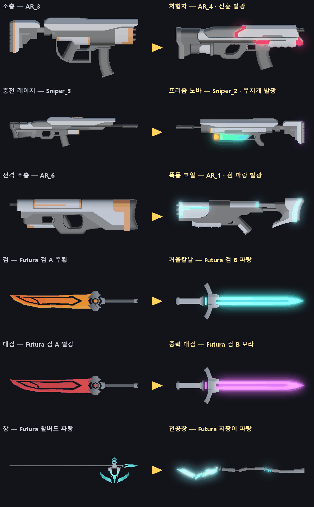

- 만든 방법: 프로젝트의 모델을 그대로 렌더링하고(왼쪽), 오른쪽은 **안 쓰는 후보 모델**의 강조 부위 색을 바꾸고 빛 번짐을 합성했다. 실제 게임의 Bloom 결과와는 다를 수 있다 — 방향을 보여 주는 그림
- 검은 넓적한 칼날(검 A) → **에너지 검신(검 B)** 으로 바뀌어 실루엣 차이가 가장 크다. 총은 같은 팩이라 실루엣이 비슷해서 **발광 색과 부속**으로 차이를 만들어야 한다

### 14-3. 모델 — 이미 가진 팩에서 고른다 (새로 받지 않아도 된다)

**Futura 원본 zip** (`Desktop/NoName_Proj/Futura Weapons.zip`) — 84개 중 5개만 쓰고 있다

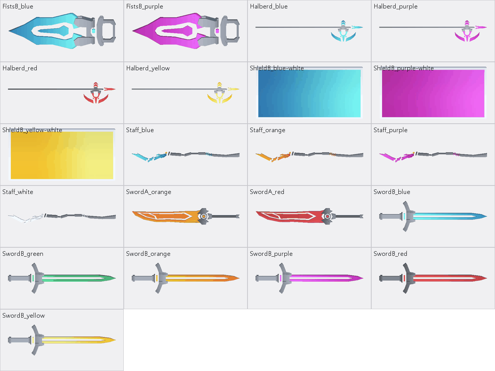

| 원래 | 상위 무기 | 후보 모델 | 이유 |
|---|---|---|---|
| 검 (검 A 주황) | 거울칼날 · 사슬검 | **검 B** 파랑 · 초록 | 넓적한 칼날 → 가드 달린 에너지 검신. 실루엣이 확 바뀐다 |
| 대검 (검 A 빨강, 크게) | 중력 대검 · 성채 대검 | **검 B** 보라 · 노랑을 대검 크기로 + 검신 두께 ×1.6 (축별 크기) | 검 B 는 가늘어서 그대로면 대검답지 않다 — 두께를 키운다 |
| 창 (할버드 파랑) | 천공창 | **지팡이** 파랑 (끝에 결정) | 할버드는 색만 다른 변형이라 차이가 작다 |
| 창 | 팔랑크스 | 할버드 빨강 + 왼팔에 **방패 B** (직사각 방벽) | 방패 B 는 평평한 판 — 탑실드 모양으로 쓴다 |
| 그랩 갈고리 (주먹 A) | 사슬검의 사슬 끝 | **주먹 B** (큰 칼날 모양) | |

- 라이선스는 지금 쓰는 Futura 모델과 같은 조건 (⚠ 정식 문구 없음 — `MODEL_LICENSES.md`)

**GunPack** — 20개 중 6개만 쓰고 있다 (소총 AR_3 · 기관단총 SMG_1 · 샷건 Grenade_2 · 스나이퍼 Sniper_1 · 충전 레이저 Sniper_3 · 전격 소총 AR_6)

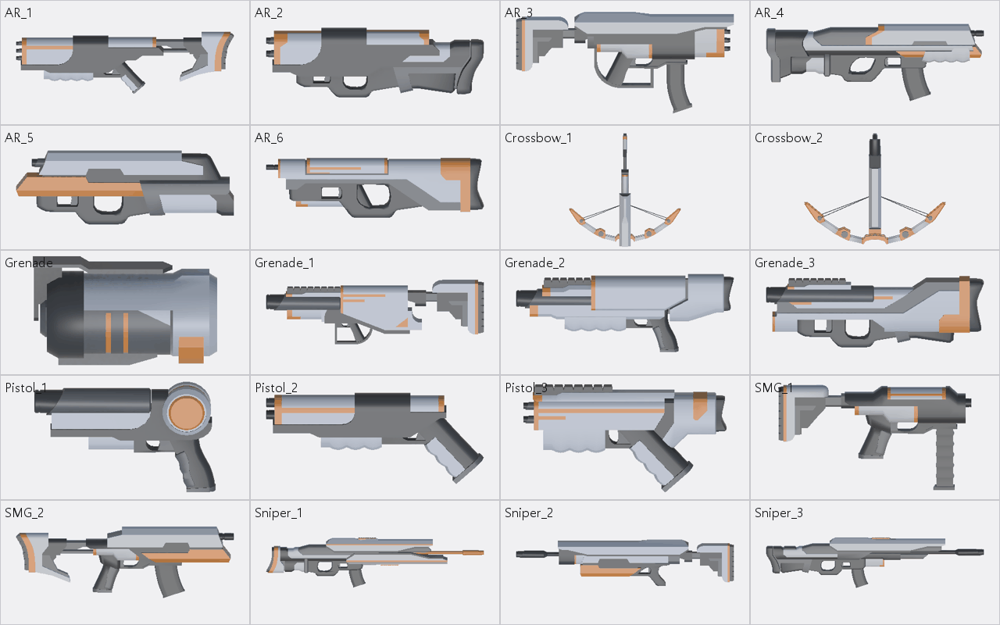

| 원래 (모델) | 상위 무기 | 후보 모델 + 부속 |
|---|---|---|
| 소총 (AR_3) | 처형자 / 스웜 카빈 | **AR_4** (탄창 달린 묵직한 몸통) / AR_2 + 총열 아래 미사일 포드 |
| 기관단총 (SMG_1) | 회전 기관포 / 파편 폭풍 | **AR_5** (두꺼운 몸통) + 다총열 뭉치 / SMG_2 |
| 샷건 (Grenade_2) | 공성포 / 용의 포효 | **Grenade_3** + 큰 포구 / Grenade_1 + 화염 노즐 · 연료통 |
| 스나이퍼 (Sniper_1) | 궤도 레일캐논 / 다중 표적 | **Sniper_2** + 위아래 레일 두 줄 / Sniper_2 + 큰 조준경 |
| 전격 소총 (AR_6) | 폭풍 코일 / 뇌운 | **AR_1** (뼈대 개머리판 — 코일을 감기 좋다) + 전기 코일 고리 |
| 충전 레이저 (Sniper_3) | 프리즘 노바 / 태양창 | Sniper_2 + **떠 있는 프리즘 결정 3개** / Sniper_3 + 총구 앞 큰 집광 고리 |

- 안 쓰는 모델: AR_1 · AR_2 · AR_4 · AR_5 · Grenade_1 · Grenade_3 · SMG_2 · Sniper_2 (권총 3종 · 석궁 2종 · Grenade 는 작거나 모양이 맞지 않는다)
- 팩 전체가 **회색 + 주황 강조**라 실루엣만으로는 구분이 약하다 → 발광 색(14-4)과 부속(아래)이 필요하다
- ⚠ GunPack 은 **출처 미상** (`MODEL_LICENSES.md`) — 상위 무기에 더 쓰기 전에 받은 사람에게 확인. 확인이 안 되면 CC0 팩으로 바꾸는 길이 15-2 에 있다

**부속 오브젝트** — 모델이 없어도 실루엣을 바꾼다 (도구가 기본 도형으로 만든다)

| 부속 | 상위 무기 | 만드는 법 |
|---|---|---|
| 총구 둘레를 도는 프리즘 결정 3개 | 프리즘 노바 | 팔면체 메시 · 무지개 발광 · 충전할 때 빨리 돈다 |
| 총열에 감긴 코일 고리 + 번쩍이는 전기 | 폭풍 코일 · 뇌운 | 링 메시 + `FxLine` 지그재그 |
| 다총열 뭉치 (쏠 때 회전) | 회전 기관포 | 원기둥 6개 — 연사 배율에 맞춰 회전 속도 |
| 위아래 레일 두 줄 + 충전 빛 | 궤도 레일캐논 | 상자 2개 · 쏘기 전 빛이 앞으로 흐른다 |
| 검신 둘레를 떠도는 파편 · 중력 고리 | 중력 대검 | 파티클 + 링 |
| 손잡이에서 늘어진 사슬 마디 | 사슬검 | 작은 상자 연결 (휘두를 때 사슬로 늘어난다) |
| 왼팔 직사각 방벽 | 팔랑크스 | Futura 방패 B |

### 14-4. 재질 — 강조 부위만 빛나게

| 할 일 | 내용 |
|---|---|
| **발광 마스크** | 도구가 텍스처에서 강조색 칸(GunPack 주황 · Futura 색칸)만 골라 흰색, 나머지는 검은색인 마스크를 만든다 → Emission 맵. 몸통 회색은 빛나지 않는다 (컨셉 그림처럼) |
| 상위 무기 재질 | 원래 재질 복사 + 강조색을 테마 색으로 + Emission (HDR 강도 2 ~ 4) |
| 흐르는 빛 띠 | 셰이더 하나(`EvolvedGlow`, Shader Graph) — 마스크 위로 밝은 띠가 1.5초마다 지나간다. 상위 무기 공통 표시 (8-2 의 "빛이 흐르는 테두리"와 같은 느낌) |
| 진화 순간 | 같은 셰이더의 **디졸브** — 새 모델이 손잡이 쪽에서 끝 쪽으로 빛나며 나타난다 (8-1 의 0.0 ~ 0.3초) |
| Bloom | HDR 색이 번지려면 게임 씬의 URP 볼륨에 Bloom 이 켜져 있어야 한다 — **확인 필요** (`Settings/DefaultVolumeProfile` 에 Bloom 항목이 있다). 문턱값이 1 근처면 HDR 강도가 1 을 넘는 것만 번져 UI · 바닥과 섞이지 않는다 |
| 캐릭터 | 상위 무기를 든 동안 발밑에 테마 색 고리 · 손 주변 작은 빛 입자 — 탑다운에서 무기보다 잘 보인다 |

### 14-5. 공격 이펙트 — 상위 무기별

**1차 4종 — 자세히**

| 상위 무기 (색) | 쏘기 · 휘두르기 | 맞을 때 | 특수 · 처치 | 소리 |
|---|---|---|---|---|
| **처형자** (진홍) | 총구 진홍 섬광 · 짧고 굵은 탄 꼬리 | 작은 진홍 불똥 | 처치하면 적 자리에 진홍 고리가 0.15초 **안으로 줄어든 뒤** 폭발(빛 · 파편). 연쇄는 0.08초씩 늦게 터뜨려 **도미노가 눈에 보이게** | 저음 "쿵" 한 층 · 연쇄마다 음 높이 반음씩 올림 |
| **프리즘 노바** (무지개) | 무기 둘레를 돌던 결정 3개가 빨강 · 초록 · 파랑 **빛**이 되어 꼬리를 끌며 전방 적 사이를 튕긴다 → 총구로 빨려 들어가 흰 섬광 → 세 색이 흰 중심을 감고 도는 **굵은 빔 2초** (커서를 따라 휘두른다) | 빛이 맞힌 자리 · 빔에 맞은 자리에 색 고리 | 수렴 순간 섬광 · 흔들림 | 빛 발사음 → 차오르는 소리 → 큰 레이저 |
| **거울칼날** (청록) | 검신 길이의 청록 궤적 | 청록 불똥 | 되돌린 탄이 청록으로 바뀌고 꼬리가 생긴다. 네 번째 휘두르기 — **반투명 초승달 검기 3개**가 날아가며 조금씩 커지고, 지나간 바닥에 얇은 자국 | 고음 "슝" |
| **중력 대검** (보라) | 보라 궤적 · 내려찍는 자리 바닥 충격 | 보라 불똥 | 바닥에 **회전하는 소용돌이 원판** + 안쪽으로 빨려드는 입자 · 끌려가는 적 뒤로 짧은 선 → 붕괴: 0.1초 안으로 줄어든 뒤 바깥으로 폭발 고리 | 저음 "웅" → "쾅" |

**나머지 16종 — 한 줄씩**

| 상위 무기 (색) | 쏘기 · 휘두르기 | 특수 · 처치 |
|---|---|---|
| 스웜 카빈 (주황) | 꼬리 연기를 단 소형 미사일 3발이 곡선을 그리며 흩어진다 | 작은 폭발 · 연기 |
| 회전 기관포 (노랑) | 총구 불꽃 + 굵은 예광탄 줄기 · 탄피 분수 — 연사가 오를수록 불꽃이 커진다 | 다총열 회전 · 오래 쏘면 총열이 붉어진다 |
| 파편 폭풍 (흰 주황) | 일반 탄 | 맞은 자리에서 불꽃 선 2줄이 옆 적으로 튄다 |
| 공성포 (금색) | 총구 충격파 고리 · 빛나는 큰 포탄 | 지나가며 연속 폭발 · 사거리 끝 큰 폭발 · 큰 흔들림 |
| 용의 포효 (주황 빨강) | 화염 원뿔 입자 · 바닥 그을음 | 불붙은 적 몸에 불꽃 · 옮겨붙을 때 불꽃 선 |
| 궤도 레일캐논 (흰 파랑) | 쏘기 전 레일에 빛이 앞으로 흐름 → 화면 끝까지 굵은 빔 · 잔상 | 0.4초 뒤 빔 자리를 따라 폭발 줄 |
| 다중 표적 (빨강) | 일반 탄 | 맞은 적 머리 위 붉은 조준 표식 → 5발째 6줄기 동시 섬광 |
| 폭풍 코일 (흰 파랑) | 굵어진 지그재그 전격선 · 연쇄마다 가지 | 하늘에서 떨어지는 낙뢰 · 착탄 섬광 |
| 뇌운 (남색) | 장전할 때 플레이어 머리 위 먹구름 | 구름에서 연속 낙뢰 |
| 태양창 (흰 금색) | 충전하는 동안 예고선이 앞으로 뻗어 나간다 → 다 모으면 한 방짜리 굵은 빛 기둥 | 바닥 그을음 자국 · 지나간 적 화상 |
| 사슬검 (초록) | 사슬이 호를 그리며 휘날리는 긴 궤적 | 끌려오는 적에 사슬 선 |
| 성채 대검 (노랑) | 노랑 궤적 | 바닥 균열 고리 · 먼지 · 큰 흔들림 · 막은 피해가 모일수록 검신이 밝아진다 |
| 천공창 (청록) | 찌르기 끝에서 빛의 창이 10m 뻗는다 (빠르게 늘었다 사라짐) | 끌려오는 적에 와이어 선 |
| 팔랑크스 (빨강) | 빠른 찌르기 잔상 여러 줄 | 돌격 궤적 · 부딪힌 적 불똥 |
| 폭격 편대 (주황) | 드론 3기 · 떨어지는 폭탄에 낙하선 | 폭발 |
| 위성 방벽 (청록) | 반투명 방패를 단 드론이 가까이 돈다 | 탄을 막을 때 방패면 번쩍 |

**공통 부품** — 한 번 만들어 여러 상위 무기가 나눠 쓴다

| 부품 | 쓰는 상위 무기 | 만드는 법 |
|---|---|---|
| 굵은 빔 (폭 · 흐르는 텍스처 · 끝 섬광) | 레일캐논 · 프리즘 · 태양창 · 천공창 | `FxLine` 확장 — 폭 곡선 · UV 스크롤 |
| 지그재그 전기 | 폭풍 코일 · 뇌운 · 테슬라 노바 | `FxLine` (전격 소총 것 재사용) + 세로 낙뢰 |
| 탄 꼬리 | 스웜 · 기관포 · 공성포 · 처형자 | 탄 프리팹에 `TrailRenderer` (탄 색 통로가 이미 있다) |
| 휘두르기 궤적 · 검기 | 근접 6종 | 초승달 메시 + 알파 텍스처 (도구가 그린다) 또는 15-1 의 Slash Effects FREE |
| 충격파 고리 · 바닥 균열 | 성채 대검 · 공성포 · 진화 순간 | 고리(충격 방출기 것) + 균열 텍스처 (도구가 그린다) |
| 폭발 | 처형자 · 스웜 · 공성포 · 폭격 | `vfx_Explosion_01` 복사 → 색만 바꿈, 또는 Cartoon FX Remaster Free |
| 화염 · 연기 | 용의 포효 · 회전 기관포 | 파티클 + Kenney Particle Pack 텍스처, 또는 Cartoon FX |
| 소용돌이 | 중력 대검 | 회전 원판 텍스처 (도구가 그린다) + 안쪽으로 가는 파티클 |
| 타격 섬광 | 전부 | 기존 `Hit` 프리팹 색 바꾸기, 또는 Hit Effects FREE |

### 14-6. 구현에 더할 것 (10장 보충)

| 할 일 | 내용 |
|---|---|
| 모습 데이터 | 상위 무기 데이터에 묶음 하나 — 모델 프리팹 · 크기 · 테마 색 · 발광 강도 · 부속 프리팹 · 탄 · 궤적 · 타격 · 처치 효과 · 소리. **테마 색 하나를 바꾸면 전부 따라 바뀌게** |
| 셰이더 | `EvolvedGlow` 하나 (URP Lit 바탕 + 마스크 발광 + 흐르는 띠 + 디졸브) |
| 도구 | `EvolutionSetup` 에 — 발광 마스크 · 상위 재질 · 부속 메시 · 초승달 / 소용돌이 / 균열 텍스처 · 프리팹 조립 (없을 때만 만든다) |
| 아이콘 | `WeaponIconRender` 에 상위 무기 추가 — 발광 재질 그대로 찍힌다 |
| 설정 | 설정창에 "효과 줄이기" (발광 · 파티클 절반) — 저사양 · 멀미 대비 (나중) |
| 검증 | 캡처 — 진화 전 · 후 · 1차 4종 공격 장면 / 적 70마리에서 프레임 |

---

## 15. 에셋 조사

> 무료 · URP 호환 · 라이선스가 분명한 것 위주. 2026-10-08 확인 — 버전 · 호환은 받기 전에 다시 볼 것.

### 15-1. 이펙트 (VFX)

| 팩 | 제작 · 곳 | 들어 있는 것 | 파이프라인 | 라이선스 · 가격 | 우리 쓰임 | 추천 |
|---|---|---|---|---|---|---|
| **Cartoon FX Remaster Free** | Jean Moreno · Asset Store | 폭발 · 연기 · 불 · 물 · 마법 · 전기 · 폭죽 등 50개 이상 + 변형. 전용 셰이더(UV 왜곡 · 디졸브), 카메라 흔들림 · 빛, Bloom 과 어울리는 HDR | 내장 · URP (2D · Forward) | Asset Store EULA · 무료 | 폭발 · 화염 · 전기 · 처치 연출 | ★ |
| **Slash Effects FREE** | Matthew Guz · Asset Store | 휘두르기 궤적 | 내장 · URP (2022.3.10 이상) | Asset Store EULA · 무료 · 12.9 MB | 근접 상위 무기 궤적 · 검기 | ★ |
| Hit Effects FREE | Matthew Guz · Asset Store | 타격 효과 | 내장 · URP | Asset Store EULA · 무료 · 12.4 MB | 상위 무기 타격 섬광 | |
| Status and Auras FREE | Matthew Guz · Asset Store | 상태 · 오라 | 내장 · URP | Asset Store EULA · 무료 · 4.4 MB | 상위 무기를 든 캐릭터 오라 · 발밑 고리 | |
| Magic Effects FREE | Hovl Studio · Asset Store | 마법 효과 | 내장 · URP · HDRP | Asset Store EULA · 무료 · 36.4 MB | 프리즘 · 소용돌이 참고 | |
| Particle Pack | Unity Technologies · Asset Store | 불 · 폭발 등 기본 효과 | URP (Unity 6 기준) | 무료 · 157 MB | 화염 · 폭발 | 크다 — 필요한 것만 |
| **Kenney Particle Pack** | Kenney | 파티클 그림 80장 (불 · 연기 · 마법 · 하트 · 불꽃 · 전기) + Unity 예제 | 텍스처라 무관 | **CC0** · 무료 | 우리 파티클의 텍스처 재료 | ★ |
| Zap VFX — Unity URP | Vefects · itch.io | 번개 7색 · 소리 포함 | **URP 만** · Unity 2023 이상 | 무료(원하는 만큼 지불) · ⚠ **라이선스 문구가 페이지에 없다** | 폭풍 코일 · 뇌운 | 확인 후 |
| (이미 있음) Free Quick Effects Vol. 1 | Gabriel Aguiar · Asset Store | 전기 · 폭발 · 충격 · 투사체 2 · 회오리 | URP | Asset Store EULA | 스킬 쪽이 쓰는 중 — **복사해서 색만 바꿔** 쓴다 | |
| (참고) Sword slashes PRO | Hovl Studio · Asset Store | 휘두르기 22종 + 콤보 11 | URP · HDRP | 유료 ($20) | 무료 팩이 부족할 때만 | |

- **URP 주의 (Cartoon FX)**: 재질 대부분이 URP 에셋의 **Depth Texture · Opaque Texture** 를 켜야 빌드에서 보인다 (에디터에서는 보이는데 빌드에서 안 보이는 함정)
- 무료 팩을 여러 개 섞으면 **화풍이 갈린다** — 한 팩(Cartoon FX)을 바탕으로 하고, 나머지는 색 · 크기를 맞춰 보탠다

### 15-2. 모델

| 팩 | 곳 | 들어 있는 것 | 라이선스 | 우리 쓰임 | 추천 |
|---|---|---|---|---|---|
| **Futura Weapon Pack** (이미 있음) | moisturizedfish · itch.io | 검 B · 지팡이 · 주먹 B · 방패 B 등 — 84개 중 79개 안 씀 | ⚠ 정식 문구 없음 (제작자 댓글로 허락) | 근접 상위 무기 전부 (14-3) | ★ |
| **GunPack** (이미 있음) | ? | 안 쓴 총 8개 (14-3) | ⚠ **출처 미상** | 사수 상위 무기 — 확인되면 | 확인 후 |
| Quaternius Sci-Fi Gun Pack | quaternius.com | SF 총 7종 — 권총 · 롱 권총 · 소총 · 저격총 · **번개총 · 광선총** 등 · FBX / OBJ / Blend · 텍스처 없음(단색 재질) | **CC0** | 폭풍 코일(번개총) · 프리즘 노바(광선총) | GunPack 대체 |
| **Quaternius Sci-Fi Modular Gun Pack** | quaternius.com | 부품 + 조립된 SF 총 78조각 · FBX / OBJ / glTF / Blend · 텍스처 없음 | **CC0** | 부속(총열 · 코일 · 조준경)을 떼어 붙이기 좋다 | ★ GunPack 대체 1순위 |
| Kenney Blaster Kit | kenney.nl | 블래스터 · 탄 · 탄창 · 소음기 등 40개 (v2.1) | **CC0** | 장난감 같은 화풍 — 우리와 다름 | 참고만 |

### 15-3. 받기 · 넣기 규칙

| 규칙 | 내용 |
|---|---|
| 받는 곳 | **공식 Asset Store · 제작자 페이지에서만**. 팩 이름으로 검색하면 무단 배포 사이트가 섞여 나온다 — 쓰지 않는다 |
| Asset Store 좌석 | Standard EULA 는 **좌석(사람) 단위** — 무료 팩도 에디터에서 쓰는 팀원은 각자 계정에 추가 (무료라 비용 없음) |
| 폴더 | 받은 위치 그대로 둔다 (외부 에셋 규칙). 상위 무기 프리팹 · 재질 · 복사본만 우리 폴더에 |
| 기록 | 모델은 `MODEL_LICENSES.md`, 이펙트는 같은 형식의 표에 한 줄 (팩 · 곳 · 라이선스 · 받은 날 · 쓰는 곳) |
| 표기 | CC0 는 의무 없음(권장). Futura 는 크레딧 권장 |

### 15-4. 추천 조합

| 단계 | 쓰는 것 | 새로 받을 것 |
|---|---|---|
| **1차 (바로)** | Futura 검 B · 지팡이 (이미 있음) · GunPack 안 쓴 모델 (확인 후) · 발광 마스크 도구 · `FxLine` · 고리 · Gabriel Aguiar 복사 | **없음** — 1차 4종은 가진 것으로 된다 |
| 더 화려하게 | + Cartoon FX Remaster Free (폭발 · 불 · 전기) · Slash Effects FREE (검 궤적) · Kenney Particle Pack (텍스처) | 무료 3개 |
| GunPack 확인 실패 시 | Quaternius Sci-Fi Modular Gun Pack 으로 총 6종 + 상위 총을 다시 맞춘다 | 무료 1개 (CC0) |

---

## 16. 구현 결과 — 상위 무기 20종 (1차 4종 2026-10-09 · 나머지 16종 2026-10-11)

> 요청: "1차 4종 끝까지" (2026-10-08 작성 → 중단 → 2026-10-09 재개). **처형자 · 프리즘 노바 · 거울칼날 · 중력 대검** 구현 · 검증 완료.
> 요청: "남은 상위무기 계획한대로 개발진행" (2026-10-11, 중단 → 재개). **나머지 16종** (총 10 · 근접 4 · 드론 2) 구현 · 검증 완료 — 4 · 5 · 6장 표의 상위 무기가 모두 들어갔다. 커밋은 하지 않았다.

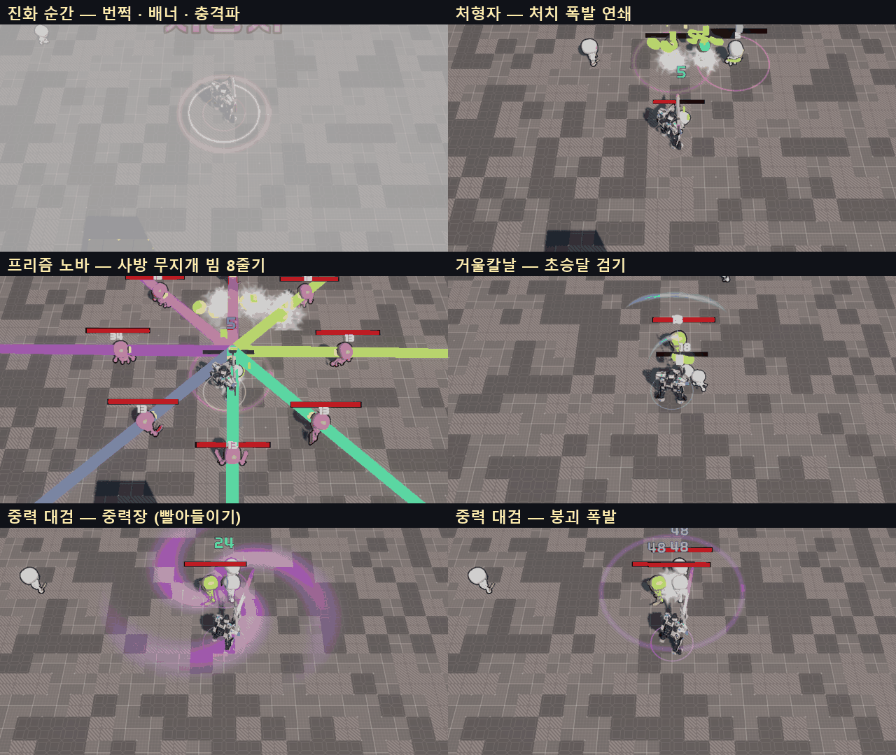

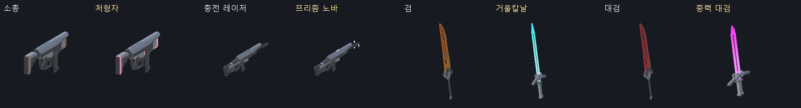

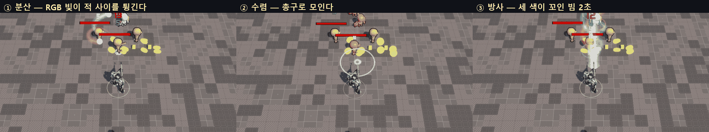

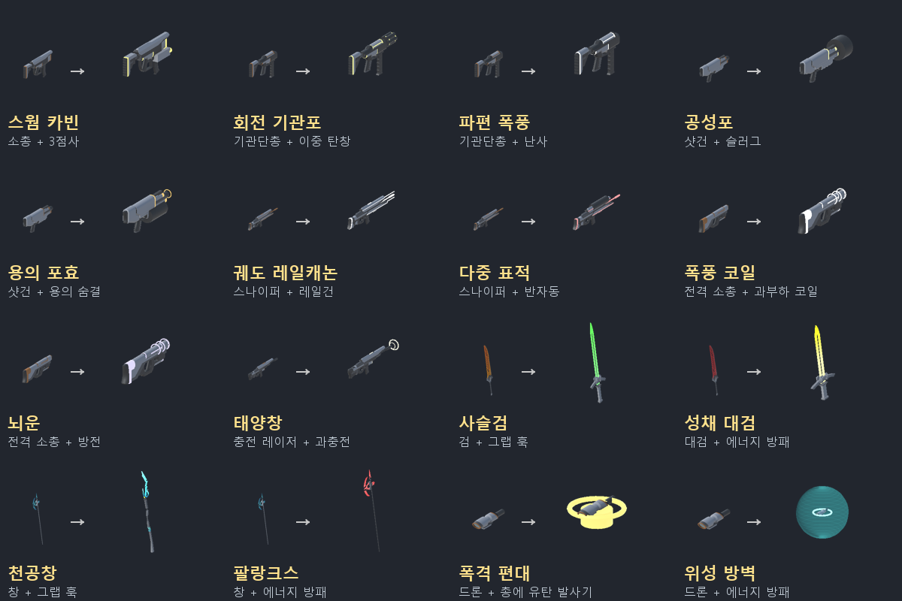

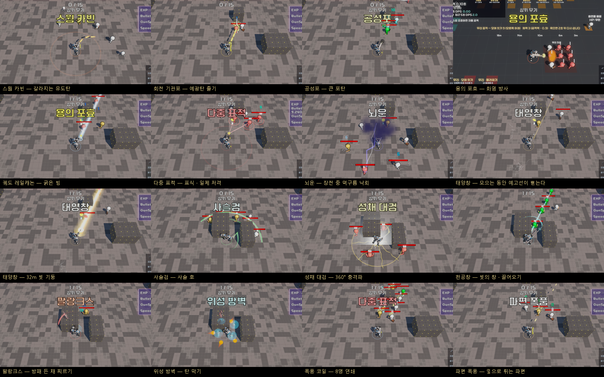

### 16-1. 정한 것 (사용자 결정 2026-10-08 — 3장 · 13장의 처음 추천보다 이것이 우선)

| 항목 | 결정 |
|---|---|
| **무기 최대 레벨** | **모든 무기 5 → 3** · 레벨당 강화량은 그대로 (진화 전 무기는 예전 Lv5 보다 약하고, 그 차이를 상위 무기가 메운다). `WD_*` 10개 · `WeaponData` 기본값 |
| **진화 조건** | **최대 레벨(Lv3) + 짝 장비가 "있기만" 하면** — 사수: 그 총에 개조 / 검사: 서브 능력 보유(Lv1 이상) / 폭격 편대: 가진 총 하나에 유탄 발사기 |
| 받는 방식 | 보상 카드 반드시 1장(최대 2장, 카드가 여러 장이면 한 장은 무작위) + 정비 창 무기 줄 맨 앞 (무료) · 거절 가능 |
| 개조 칸 | 상위 무기가 이어받고 잠금 — 개조는 그대로 달려 있고 바꿀 수 없다 |
| 연출 시간 | 슬로 모션은 쓰지 않는다 — 카드 · 정비 창의 시간 정지와 엉키지 않게. 시간이 다시 흐를 때(보통 다음 스테이지 시작) 연출된다 |

- 개조는 Lv3 부터라 사수는 **"Lv3 에 개조를 사면 곧바로 진화 가능"** 이다. 9-1 의 시점은 Stage 2 ~ 3 으로 당겨진다 (측정 필요)

### 16-2. 된 것

| 상위 무기 | 조합 | 동작 (지금 값) | 모습 |
|---|---|---|---|
| **처형자** | 소총 Lv3 + 지정사수 | 피해 ×1.25 · 치명타 +5%p. 탄으로 처치하면 0.15초 뒤 반경 2m 폭발(처치한 탄 피해 ×1.2) → 그 폭발로 죽은 적도 터진다 (3단, 단마다 ×0.85, 0.08초씩 늦게) | 소총 모델 · 주황 강조 → **진홍 발광** · ×1.1 · 진홍 탄 · 진홍 고리 + 폭발 |
| **프리즘 노바** | 충전 레이저 Lv3 + 분광 프리즘 | 피해 ×1.2. 한 발(탄 1발) = **① 분산 1초**: R · G · B 빛 3개가 전방 140° 의 적 사이를 튕기며 맞힌다 (빛마다 최대 4명 · 공격력 ×0.4) → **② 수렴 0.3초** → **③ 방사 2초**: 굵은 빔, 커서를 초당 120° 로 따라간다, 0.1초마다 빔 위 적 전부 ×0.35. 끝나면 충전을 처음부터 (2026-10-10 변경) | 무지개로 도는 발광 · **결정 3개가 빛이 되어 날아갔다 돌아온다** · 세 색이 꼬인 빔 |
| **거울칼날** | 검 Lv3 + 에너지 방패 | 피해 ×1.25. 휘두를 때마다 정면 150° · 사거리+1.2m 안 몬스터 탄을 되돌린다(공격력 ×1). 네 번째마다 **초승달 검기 3개** (8m · 관통 · 공격력 ×2) | **Futura 검 B(파랑) 에너지 검신** · 칼끝 궤적 · 청록 검기 |
| **중력 대검** | 대검 Lv3 + 그랩 훅 | 피해 ×1.2. 내려찍기마다 앞 3m 에 **중력장** 1.2초 — 반경 6m 적을 끌어와 경직 → 붕괴 폭발 반경 3m (공격력 ×2 · 경직 0.6초) | **Futura 검 B(보라) · 두께 ×1.7** · 칼끝 궤적 · 바닥 보라 소용돌이 |

**나머지 16종 (2026-10-11)** — 수치는 전부 에셋 (고유 동작 `Data/Evolutions/Effects/AE_EVO_*`, 무기 `Data/Weapons/WD_EVO_*`)

| 상위 무기 | 조합 | 동작 (처음 값) | 고유 동작 |
|---|---|---|---|
| 스웜 카빈 | 소총 + 3점사 | 점사 3발이 유도탄 — 가까운 적 4명을 돌아가며 쫓는다(초당 360°, 가까울수록 더 꺾음), 맞으면 반경 1.2m 폭발 60% · 피해 ×1.2 · 미사일 모양 탄 | `ExplodeOnHitEffect`(AE_EVO_SwarmBlast) + 데이터 `homingTurnRate` |
| 회전 기관포 | 기관단총 + 이중 탄창 | 탄창 무한(장전 없음) · 쏘는 동안 2초에 걸쳐 연사 ×3, 멈추면 1초에 내려감 · 다총열이 연사에 맞춰 돈다 · 굵은 예광탄 | `SpinUpEffect` |
| 파편 폭풍 | 기관단총 + 난사 | 명중마다 파편 2개가 4m 안 다른 적에게 (40%, 다시 튀지 않음) | `FragmentOnHitEffect` |
| 공성포 | 샷건 + 슬러그 | 관통 무제한 큰 포탄(사거리 약 15m) · 맞은 적마다 반경 1.5m 폭발 60% + 2m 밀치기 · 사거리 끝 반경 3m 큰 폭발(공격력 ×1.5) · 총구 충격파 | `SiegeShellEffect` |
| 용의 포효 | 샷건 + 용의 숨결 | 탄 대신 화염 방사 — 0.1초마다 정면 6m · 50° 피해 + 화상(공격력 ×2/초, 3초) · 화상 중 죽은 적은 2m 안에 불을 옮긴다 · 탄창 40 | `FlameConeEffect` + 데이터 `spawnProjectiles = false` |
| 궤도 레일캐논 | 스나이퍼 + 레일건 | 탄 대신 32m 굵은 빔(관통 무제한, 맞은 적마다 명중 알림) · 0.4초 뒤 빔 자리 폭발 줄(50%) | `RailLineEffect` + `spawnProjectiles = false` |
| 다중 표적 | 스나이퍼 + 반자동 | 맞힌 적에 붉은 조준 고리 3초 · 5발마다 표식 있는 적 최대 6명 동시 저격(치명타 확정) | `MarkVolleyEffect` |
| 폭풍 코일 | 전격 소총 + 과부하 코일 | 연쇄 8명 · 연쇄 거리 ×1.5 · 연쇄된 적마다 20% 낙뢰(반경 1.5m · ×2) | `LightningStrikeEffect` + 데이터 `notifyEveryChain` |
| 뇌운 | 전격 소총 + 방전 | 장전하는 동안 머리 위 먹구름 → 8m 안 적에게 초당 4번 낙뢰(×1.5 · 경직 0.3초) | `ThunderCloudEffect` |
| **태양창** | 충전 레이저 + 과충전 | **사용자 요청 반영** — 쿨다운이 끝나면 0.8초 더 모은다(충전 지연). 그동안 바닥 예고선이 **10m → 32m** 로 앞으로 뻗고, 다 모으면 굵은 흰 금빛 기둥 한 방(기둥 위 적 전부 · 화상 · 바닥 그을음 · 큰 흔들림). 모으는 동안 다른 발은 막힌다(`IsBusy`). `earlyReleaseRange`(기본 0 = 끔)를 켜면 적이 붙었을 때 모은 만큼만 일찍 쏜다 | `SunLanceBurst` + `ChargeBeamWeaponData.sunLance` |
| 사슬검 | 검 + 그랩 훅 | 사거리 6m · 150° · 대상 10 · 사슬 호 연출 · 세 번째 휘두르기마다 맞은 적 중 먼 3명을 앞으로 끌어옴 | `ChainWhipEffect` |
| 성채 대검 | 대검 + 에너지 방패 | 내려찍기가 360° 충격파(반경 5m · ×1.5 · 밀치기 2m · 경직 0.8초) · 방패로 막은 피해 ×3 을 모아(최대 공격력 ×5) 다음 충격파에 더함 | `BastionSlamEffect` (+ `ShieldAbility.OnAbsorbed`) |
| 천공창 | 창 + 그랩 훅 | 찌르기 끝에서 빛의 창이 10m 더(관통 · ×1.2) · 가장 먼 적을 앞으로 끌어옴 · Futura 지팡이 모델 | `LanceExtendEffect` |
| 팔랑크스 | 창 + 에너지 방패 | 방패를 든 채 찌르기 ×2.5 · 떼면 6m 돌격 찌르기(×3) · 붉은 잔상 · Futura 할버드 빨강 | `PhalanxEffect` + 데이터 `attackWhileShielding` |
| 폭격 편대 | 드론 + **가진 총 하나에** 유탄 발사기 | 드론 +2기 · 피해 ×1.3 · 탄이 폭탄(반경 1.5m · 100%) | `ExplodeOnHitEffect`(AE_EVO_BomberBlast) + 조건 `requiredAnyGunAttachment` |
| 위성 방벽 | 드론 + 에너지 방패 | 드론 +1기 · 반경 1.6m 로 빠르게 돈다 · 닿은 몬스터 탄을 밖으로 튕겨 냄 · 부딪힌 적 ×2 · 밀치기 | `SatelliteGuardEffect` |

16종의 모습 — 총은 원래 모델 + 테마 색 발광 + **기본 도형 부속** (미사일 포드 · 다총열 · 큰 포구 · 연료통 · 레일 · 조준경 · 코일 고리 · 집광 고리, `EvolutionSetupMore.AddGunParts`), 근접은 Futura 검 B 초록 · 노랑 / 지팡이 파랑 / 할버드 빨강, 드론은 발광 고리 + 폭탄통 / 반투명 방패 구. 탄도 테마 색.

공통

| 항목 | 내용 |
|---|---|
| 진화 순간 | 화면 번쩍 · 배너 "상위 무기 — 이름" · 충격파 고리 두 겹 · 주변 4.5m 적 밀치기 + 경직 · 화면 흔들림 · 소리 |
| 상위 무기를 든 동안 | 발밑 테마 색 고리 (숨 쉬듯) |
| HUD | 무기 칸 글자 **★** / 진화할 수 있으면 **"진화!"** · 장비 판 머리글 "· 진화 가능: 처형자" · 상세(Z)면 다음 목표 "→ 처형자 (Lv3 + 개조: 지정사수)" |
| 보상 · 정비 | 진화 카드는 보상 뽑기 6번 모두 들어왔다 · 정비 창 무기 줄 맨 앞 · 백금색 카드 |
| 넘겨받는 것 | 같은 칸 · 손에 든 상태 · 레벨 · 범용 강화 누적분 · 부착물 5부위 + 개조(잠김) · 하부 E 능력(오브젝트째 — 쿨타임 유지). 원래 무기는 "이미 가진 무기"로 다시 안 나온다 |

### 16-3. 계획과 달라진 점

| 항목 | 계획 | 구현 |
|---|---|---|
| 조건 | Lv5 + 개조 / 서브 능력 Lv2 | **Lv3 + 있기만** (16-1) |
| 총 모델 | GunPack 안 쓴 모델 (AR_4 · Sniper_2) | **원래 모델 + 발광 재질 + 부속(결정)** — GunPack 출처가 확인될 때까지 새 모델을 늘리지 않았다 |
| 슬로 모션 | 0.2배 시간 | 없음 — 화면 연출 · 충격파만 (시간 배율 충돌 방지) |
| 흐르는 빛 띠 · 디졸브 셰이더 | `EvolvedGlow` 셰이더 | **스크립트(`EvolvedGlow`)가 발광 밝기를 숨 쉬듯 바꾼다** · 무지개는 색상환을 돈다. 셰이더는 나중 |
| 근접 발광 | 마스크 발광 | 계획대로 — Futura 색상표에서 채도 높은 칸만 남긴 마스크(`EVO_FuturaGlowMask.png`) |
| 크기 튜닝 | — | 캡처를 보고 처형자 폭발 ×1.3 · 검기 폭 3 · 진홍 발광 1.6 으로 낮춤 (2.5 는 톤매핑에서 분홍으로 날아갔다) |
| 총 모델 (16종) | 14-3 의 GunPack 다른 모델 · 부속 메시 | **원래 모델 + 발광 + 기본 도형 부속** (원기둥 · 상자 · 고리 메시를 도구가 만든다) — 실루엣은 바뀌지만 모델링 수준은 아니다 |
| 용의 포효 · 궤도 레일캐논 | 산탄 대신 화염 / 굵은 빔 | 계획대로 — 무기 데이터의 `spawnProjectiles` 를 끄면 탄 없이 쏘는 알림 · 탄약 · 소리만 남고, 고유 동작이 공격한다. 레일 빔은 맞은 적마다 명중 알림을 보내 다른 부착물 효과도 돈다 |
| **태양창** (2026-10-10 사용자 요청) | 충전 빔 한 방 | **충전 지연 0.8초 + 그동안 사거리 10 → 32m**. 자동 공격 게임이라 "오래 누를수록"이 아니라 "쿨다운 뒤 정해진 지연 동안 늘어난다". 적이 붙으면 모은 만큼만 일찍 쏘는 옵션(`earlyReleaseRange`)은 만들어 두고 껐다 |
| 폭격 편대 | 탄 대신 소형 폭탄 낙하 (유탄 포탄 재사용) | 드론 탄이 **폭발탄** (반경 1.5m · 100%) — 떨어지는 폭탄 · 낙하선 연출은 아직 |
| 위성 방벽 | 닿은 몬스터 탄을 막는다 | 막고 **바깥으로 튕겨 낸다** (반사판 · 거울칼날과 같은 길) — 튕겨 낸 탄이 적을 맞힌다 |
| 팔랑크스 모습 | 할버드 빨강 + 왼팔 방패 B | 할버드 빨강만 — 방패는 에너지 방패 서브 능력의 방패 면이 보인다 |
| 다중 표적 표식 | `TargetMarker` 프리팹 | 무기마다 도는 붉은 고리(LineRenderer)를 돌려 쓴다 |
| **프리즘 노바 방식** (2026-10-10) | 사방 8줄기 즉발 빔 | **분산 → 수렴 → 2초 방사** — "적 사이를 튕기는 빔"(A) 과 비교해 B 를 골랐다: 모았다 터뜨리는 흐름이 더 기억에 남고, 전격 소총 · 튕김탄과 겹치지 않는다. A 의 장점(튕김)은 ① 분산의 빛이 맡는다. 예전 옵션(`extraBeams` · `beamsAllAround` …)은 코드에 남아 있고 데이터에서 껐다 |

### 16-4. 바꾸고 싶을 때

| 바꿀 것 | 고칠 곳 |
|---|---|
| 진화 조건 (레벨 · 짝 장비) · 카드 문구 · 배너 색 · 소리 · 정비 창 가격 | `Scripts/Data/Evolutions/EVO_*` |
| 상위 무기 수치 (피해 · 치명타 · 빔 갈래 · 빔 폭 …) | `Scripts/Data/Weapons/WD_EVO_*` |
| 프리즘 노바 한 발 (분산 · 수렴 · 방사 시간, 빛 수 · 색 · 튕김 수 · 피해, 빔 굵기 · 따라가는 속도 · 틱 피해) | `WD_EVO_PrismNova` 의 `prismBurst` 묶음 |
| 태양창 한 발 (모으는 시간 · 처음 · 끝 사거리 · 일찍 쏘기 · 피해 · 화상 · 굵기 · 그을음) | `WD_EVO_SunLance` 의 `sunLance` 묶음 |
| 유도 (스웜 카빈) · 탄 없이 쏘기 (용의 포효 · 레일캐논) · 연쇄마다 알림 (폭풍 코일) · 방패 든 채 공격 (팔랑크스) | 각 `WD_EVO_*` 의 `homingTurnRate` · `spawnProjectiles` · `notifyEveryChain` · `attackWhileShielding` |
| 총 부속 크기 · 자리 | 코드 — `EvolutionSetupMore.AddGunParts` (프리팹을 지우고 도구를 다시 돌린다) |
| 고유 동작 수치 (폭발 반경 · 연쇄 단 · 중력장 반경 · 검기 수 · 되돌리기 범위 …) | `Scripts/Data/Evolutions/Effects/AE_EVO_*` |
| 발광 세기 · 색 · 무지개 | 프리팹 `Prefabs/Weapons/W_EVO_*` 의 `EvolvedGlow`, 재질 `Prefabs/Evolution/EVO_*` |
| 배너 · 충격파 · 발밑 고리 | `Resources/Evolution/EvolutionFx` (도구가 매번 다시 만든다 — 수치는 `EvolutionPresenter` 기본값) |
| 새 상위 무기 | 고유 동작(`AttachmentEffect` 상속, `OnKill` · `OnAttack` · `OnHit` · `OnProjectileExpired` · `Tick`) → `WD_EVO_*`(원래 무기 복제 + `evolvedFrom` · `innateEffects` · `themeColor`) → `EVO_*` → `EvolutionCatalog` · 보상 카드 |
| 처음 값으로 되돌리기 | `Tools/커스터마이징/상위 무기 다시 만들기 (처음 값으로)` |

- `Tools/커스터마이징/상위 무기 만들기` 는 **없는 것만** 만든다 — 손으로 고친 수치를 덮어쓰지 않는다 (아이콘 · 연출 프리팹만 다시 만든다)

### 16-5. 파일

| 구분 | 파일 |
|---|---|
| 새 스크립트 | `Scripts/Player/Evolution/` — `WeaponEvolutionData` · `EvolutionCatalog` · `EvolutionService` · `EvolutionPresenter` · `EvolvedGlow` · `EvolvedOrbit` · `BladeTrail` · `Effects/` (`KillChainExplosionEffect` · `GravityWellEffect` · `GravityWell` · `MirrorEdgeEffect` · `CrescentWave`), `Scripts/Stage/Reward/EvolutionReward`, `Scripts/Shop/EvolutionSource`, `Editor/EvolutionSetup` · (2026-10-10) `Scripts/Player/Evolution/PrismNovaBurst` · `Scripts/Data/PrismBurstSettings` |
| 고친 — Data | `WeaponData` (진화 칸 · 최대 레벨 기본 3) · `ChargeBeamWeaponData` (사방 빔 · 무지개 · 예고선) · `WD_*` 10개 최대 레벨 3 |
| 고친 — Player | `AttachmentEffect` (`Killed` · `WeaponAttack` · `OnKill` · `OnAttack`) · `AttachmentData` (`Fits` 원래 무기 기준) · `WeaponBase` (고유 동작 · 잠금 · `InheritFrom`) · `WeaponController` (`Evolve` · `Find`) · `MeleeWeapon` · `Bullet` · `ChainBeamWeapon` · `ChargeBeamWeapon` · `WeaponSlotUI` · `EquipmentHud` |
| 고친 — 보상 · 정비 | `StageReward` (`Guaranteed`) · `StageRewardPool` (먼저 뽑기) · `ShopOffer` (`Evolution`) · `ShopCardView` (백금색) · `MaintenanceUI` (무기 줄) |
| 고친 — 도구 | `CharacterSetup` (`BuildMeleeVariant`) · `WeaponIconRender` (`RenderOnly`) |
| 에셋 | `Data/Weapons/WD_EVO_*` 4 · `Data/Evolutions/EVO_*` 4 · `Effects/AE_EVO_*` 3 · `Prefabs/Weapons/W_EVO_*` 4 · `Prefabs/Evolution/` (재질 4 · 마스크 · 소용돌이 · 결정 메시) · `Resources/Evolution/` (EvolutionCatalog · EvolutionFx) · `Stage/Rewards/RW_EVO_*` 4 (+ StageRewardPool) · `Resources/Shop/ShopSource_Evolution` (+ ShopCatalog 맨 앞) · `Sprites/WeaponIcons/WD_EVO_*` 4 · `FuturaWeapons/Models/Sword_B_Blue · Purple.fbx` |
| 새 스크립트 (2026-10-11) | `Scripts/Player/Evolution/Effects/` — `EvoStrikes`(낙뢰 · 폭발 · 끌기 공용) · `SpinUpEffect` · `FragmentOnHitEffect` · `SiegeShellEffect` · `FlameConeEffect` · `RailLineEffect` · `MarkVolleyEffect` · `LightningStrikeEffect` · `ThunderCloudEffect` · `ChainWhipEffect` · `BastionSlamEffect` · `LanceExtendEffect` · `PhalanxEffect` · `SatelliteGuardEffect`, `Scripts/Player/Evolution/SunLanceBurst`, `Scripts/Data/SunLanceSettings`, `Editor/EvolutionSetupMore` |
| 고친 것 (2026-10-11) | `WeaponBase` (`FireRateBoost` 연사 배율 · `NotifyProjectileExpired`) · `AttachmentEffect` (`OnProjectileExpired`) · `WeaponStats` · `Bullet` (유도 — 가까울수록 세게 꺾기 · 사거리 끝 알림) · `ProjectileWeaponData` · `ProjectileWeapon` (유도 목표 돌려 고르기 · `spawnProjectiles`) · `ChainBeamWeaponData` · `ChainBeamWeapon` (`notifyEveryChain`) · `ChargeBeamWeaponData` · `ChargeBeamWeapon` (`sunLance`) · `DroneWeapon` · `DroneUnit` (`Units` · 드론 탄 출처 = 무기 → 명중 효과가 돈다) · `MeleeWeaponData` (팔랑크스 칸) · `MeleeWeapon` (판정 지연 ÷ 연사 배율) · `ShieldAbility` (팔랑크스 · `OnAbsorbed` · 돌격 거리 · 배율) · `WeaponEvolutionData` (`requiredAnyGunAttachment`) · `EvolutionCatalog` · `EvolutionService` · `EquipmentHud` · `FxLine` (`Arc`) · `TestRoomManager` (문구) |
| 고친 도구 (2026-10-11) | `EvolutionSetup` (partial · 아이콘 20종) · `CharacterSetup.BuildMeleeVariant` (창 · 지팡이 — 넓은 끝이 머리, 원래 창처럼 자루 뒤쪽을 쥔다) · `WeaponIconRender.RenderOnly` (드론은 유닛 모델) · `WeaponGrantWindow` · `TestRoomEvolutionSetup` (3줄 배치) |
| 에셋 (2026-10-11) | `WD_EVO_*` 16 · `EVO_*` 16 · `AE_EVO_*` 15 · `RW_EVO_*` 16 · `W_EVO_*` 14 · `Prefabs/Weapons/DroneUnit_EVO_Bomber · Satellite` · `Prefabs/Evolution/` (발광 재질 12 · `EVO_Flame` · `EVO_Cloud` · `EVO_SoftDot` · `EVO_Torus` · 탄 `Bullet_EVO_Missile · Tracer · Shell`) · 아이콘 16 · `FuturaWeapons/Models/Sword_B_Green · Sword_B_Yellow · Staff_Blue · Halberd_Red.fbx` (`MODEL_LICENSES.md`) · `Scenes/TestRoom.unity` |
| **고치지 않은 것** | `Enemy*` · `Boss*` · `GameManager` · `GameEvents` · 씬 · 스킬 · 업그레이드 |

### 16-6. 검증

배치 모드 임시 테스트 (Stage1, 멈춘 과녁) — 확인 뒤 지웠다.

| 테스트 | 결과 | 확인한 것 |
|---|---|---|
| 상위 무기 · 사수 | **36 항목 통과** | 최대 레벨 3 · 개조 없으면 진화 불가 → 지정사수를 달면 가능 · HUD "진화 가능" · 칸 "진화!" · 보상 뽑기 6/6 · 정비 창 맨 앞 무료 · 교체(같은 칸 · Lv3 · 부착물 3부위 · E 능력 같은 오브젝트 · 개조 잠금 · 소총 다시 안 팜) · 연출 1회 · ★ · 처형자 연쇄 3단(1.5m 간격 적 셋이 차례로 죽고 4m 밖 적은 그대로) · 프리즘 노바 (2026-10-10 새 방식) — 발사하면 한 발 주기 시작 · 도는 동안 다음 발 없음 · 빛이 적 사이를 9 ~ 10번 튕김 · 뒤쪽 적은 안 노림 · 수렴 → 빔 · 빔이 커서를 제한된 속도로 따라감 · 약 2초(21틱) · 빔 피해 · 탄 1발 · 끝나면 충전부터 |
| 상위 무기 · 검사 | **25 항목 통과** | 방패 없으면 불가 → 방패 Lv1 이면 가능 · 보상 6/6 · 교체 · 칼끝 궤적 · 발광 · 연출 · 탄 되돌리기 1 · 검기 3개 · 정면선 밖 7m 적에 검기 피해 18.6 · 그랩 없으면 불가 · 중력장 생성 · 4m · 3.4m 적이 0.8 · 1.2m 까지 끌림 · 경직 · 9m 적은 그대로 · 붕괴 피해 48 |
| 기존 사수 커스터마이징 | 53 / 53 | 부착물 · E 능력 · 개조 (최대 레벨 3 에서도 그대로) |
| 기존 검사 서브 능력 변형 | 29 / 29 | 그랩 · 방패 변형 |
| `TestRoomValidation` | 통과 | |
| **나머지 16종 · 사수** (2026-10-11) | **87 항목 통과** | 20종 에셋 (조합 · 결과 · 보상 카드 · 풀 · 목록 · 아이콘 · 프리팹) · 사수로 10종 + 폭격 편대 진화 (짝을 실제로 채워서) · 유도탄이 3/4 적에게 갈라짐 · 기관포 ×3.0 · 장전 없음 · 다총열 회전 · 멈추면 ×1.0 · 파편이 옆 적에게 · 포탄 관통 폭발 3 + 사거리 끝 폭발이 줄 밖 적에 16.4 · 화염 0.1초 틱 · 화상 · 뒤 적 무사 · 불 옮김 · 레일 빔 1발 1탄 · 20m 까지 관통 · 폭발 줄 · 줄 밖 무사 · 탄 없음 · 표식 3 → 일제 저격 3 · 전격 8명 · 낙뢰 8 · 장전 중 먹구름 · 낙뢰 7 · 장전 끝나면 멈춤 · 태양창 모으는 동안 다른 발 없음 · 절반에 예고선 19.9m · 32m 발사 · 5 · 14 · 28m 적 피해 · 화상 · 줄 밖 무사 · 탄 1발 · 드론 5기 폭발탄 |
| **나머지 16종 · 검사** (2026-10-11) | **36 항목 통과** | 사슬검 6m · 5m 부채꼴 5/5 · 세 번째에 끌기 2 · 끌린 적 1.1m · 성채 대검 막은 20 → 60 모음 · 360° 충격파가 뒤 · 왼 · 오른쪽에 96 (×1.5 + 60) · 경직 · 비움 · 천공창 7 · 10 · 13.5m 관통 · 줄 밖 무사 · 13.5m 적이 1.1m 로 끌려옴 · 팔랑크스 방패 든 채 ×2.5 · 찌르기 3 · 떼면 4.1m 돌격 52 (×3) · 배율 원래대로 · 위성 방벽 4기 1.5m · 탄 4/6 막음 · 들이받기 |
| 1차 사수 · 1차 검사 · 사수 커스터마이징 · 검사 변형 (2026-10-11 다시) | 46 · 25 · 53 · 29 — 모두 통과 | 유도 · 연사 배율 · 근접 판정 지연 · 방패 · 드론 탄 출처를 바꾼 뒤에도 그대로 |

- 시험 중 잡은 버그 (2026-10-11): ① 유도탄이 표적 둘레를 맴돌기만 함 (회전 반경 약 2.7m) → 가까울수록 최대 ×5 로 꺾고 1m 안이면 곧장. ② 팔랑크스 — ×2.5 로 빨라진 다음 찌르기(0.36초)가 판정(0.42초) 전에 이전 찌르기를 버려 한 번도 안 맞음 → 근접 판정 지연을 연사 배율로 나눈다. ③ 화염이 밝은 바닥에서 안 보임 → 반투명 입자 · 18개. ④ 총 부속이 몸통에 묻힘 → 총 높이 기준 배치
- 기존 검사 테스트는 대화 기록에서 되살렸는데, 처음에는 방패 돌진 · 원반 2개가 실패했다 — 테스트의 플레이어 초기화에 회전 속도 0 이 빠져 플레이어가 돌면서 엉뚱한 쪽으로 던졌다 (예전에 고쳤던 것). 넣고 나니 통과 — 게임 코드 문제가 아니다
- 캡처: `Logs/evolution/gunner` · `Logs/evolution/sword` · (16종) `Logs/evolution2/gunner` · `Logs/evolution2/sword` (Logs 는 git 에 안 올라간다 — 문서용은 `images/evo-result.png` · `images/evo-result-16.png`)
- 임시 테스트 사본은 `Logs/evo_resume/` (`kept_*.cs` — `Assets/Editor/_이름.cs` 로 복사해 배치 모드로 돌리고 지운다)

### 16-7. 시험하는 법 — 테스트 룸 · Tools (2026-10-10)

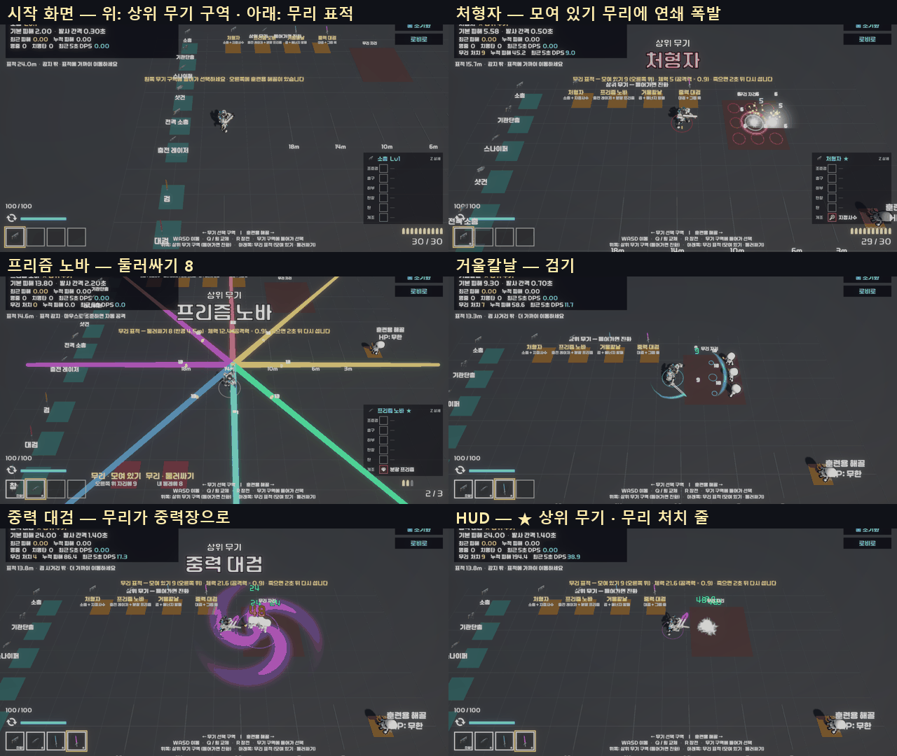

**테스트 룸** (로비 오른쪽 아래 "테스트 룸" 또는 TestRoom 씬을 바로 Play)

| 구역 | 하는 일 |
|---|---|
| **위쪽 금색 구역 — 상위 무기** (조합마다 하나, 20개를 7개씩 3줄 — 2026-10-11) | 들어가면 원래 무기를 들고 → 최대 레벨 → 짝 장비(개조 · 서브 능력)를 채우고 → 진화. 이미 진화했으면 꺼내 든다. 사수가 검사 조합을 밟으면 서브 능력 칸이 없으니 **짝 없이 시험 진화** (상위 무기 동작은 짝과 상관없다) |
| 왼쪽 무기 선반 (기존) | 진화한 무기를 가진 채 그 원래 무기를 밟으면 **원래 무기(Lv1)로 되돌린다** — 원래 · 상위 비교 |
| **아래쪽 빨간 구역 — 무리 표적** | "모여 있기" = 남동쪽 무리 자리(14, 0, −16 — 2026-10-12 넓힌 배치)에 3 × 3 (처형자 연쇄 · 검기 · 붕괴) / "둘러싸기" = 내 총구 둘레 반경 4.5m 에 8 (중력장 · 사방 시험). 프리즘 노바는 앞쪽 적을 노리므로 "모여 있기" 앞에서 본다. 같은 구역을 다시 밟으면 치운다 |
| 무리 표적 규칙 | 체력 = **손에 든 무기 공격력 × 0.9** (한 방에 쓰러져야 연쇄 · 붕괴가 보인다) · 죽으면 2초 뒤 제자리에 다시 선다 · 중력장에 끌린다 · 훈련용 해골 측정과 따로 센다 |
| HUD | 무기 줄에 "★ 상위 무기" · 무리가 있으면 "무리 처치 · 누적 피해 · 최근 5초 DPS" 한 줄 |

**Tools / 주무기 지급** (또는 **Tools / 상위 무기 시험** — 같은 창). Play 중 스테이지 · 테스트 룸 어디서나

| 버튼 | 하는 일 |
|---|---|
| [조건] | 원래 무기 · 최대 레벨 · 짝 장비만 채운다 — 실제 판의 **보상 카드 · 정비 창 진화 흐름**을 볼 때 (스테이지 클리어 · 정비 창을 열면 진화 카드가 나온다) |
| [진화] / [들기] | 이어서 바로 진화 (연출 포함) / 이미 진화했으면 꺼내 든다 |
| 상태 | "진화함" · "진화 가능" · "소총 Lv1/3 · 짝 없음" |

- **2026-10-12 테스트 룸을 넓혔다** (사용자 요청 — 지나다니다 옆 무기로 바뀐다): 방 36 × 26 → 60 × 48m, 무기 선반 간격 2.6 → 4.5m, 금색 구역 간격 3.6 × 2.7 → 5 × 4m, 해골 x 14 → 22. 자리 값은 `Editor/TestRoomLayout.cs` 한 곳 (TestRoomSetup · CharacterSetup · TestRoomEvolutionSetup · TestRoomValidation 이 같이 쓴다), 지금 장면에 옮기는 도구 `Tools / Test Room / 넓은 배치 적용` (장면을 다시 짓지 않는다 — 몇 번 돌려도 같다)
- 폭격 편대 구역은 손에 든 총(없으면 가진 총)에 유탄 발사기를 달고 진화한다. 총이 없는 검사는 짝 없이 시험 진화
- 총 · 근접 목록에서 상위 무기 데이터(`WD_EVO_*`)는 뺐다 — 레벨 1 · 부착물 없이 받으면 진화한 무기와 달라진다
- 진화 조합을 새로 만들면 `Tools / Test Room / 상위 무기 구역 추가` 를 한 번 더 돌린다 (테스트 룸 장면을 다시 짓지 않고 `EvolutionArea` 만 다시 만든다 — 대검 · 창 픽업은 그대로). Tools 창은 저절로 목록에 넣는다

| 구분 | 파일 |
|---|---|
| 새 스크립트 | `Scripts/TestRoom/` `TestEvolutionPickup` · `TestCrowdPad` · `TestRoomCrowd` · `TestRoomCrowdDummy`, `Scripts/Player/Evolution/IPullable`, `Editor/TestRoomEvolutionSetup` |
| 고친 것 | `EvolutionService` (`PrepareForTest`) · `WeaponController` (연습 선택에서 진화 무기 → 원래 무기, 교체 코드 정리) · `GravityWell` (IPullable 도 끈다) · `TestRoomManager` (진화 · 무리 큐) · `TestRoomHUD` · `WeaponGrantWindow` (상위 무기 칸) · `TestRoomSetup` (배치 함수를 internal 로 — 동작 그대로) |
| 에셋 | `Scenes/TestRoom.unity` (EvolutionArea · CrowdClusterPoint), `Prefabs/TestRoom/` EvolutionPickup · CrowdPad · CrowdSkeleton 프리팹 + 재질 3 |

검증 (임시 테스트, 확인 뒤 지움)

| 테스트 | 결과 |
|---|---|
| 테스트 룸 상위 무기 시험 | **23 항목 통과** — 구역 4 · 무리 구역 2 · 처형자 구역 → Lv3 + 지정사수 진화 · HUD ★ · 모여 있기 9 (체력 = 공격력 × 0.9) · 처형자 연쇄 처치 9 · 폭발 9 · 2초 뒤 다시 섬 · 소총 구역 → 원래 소총 Lv1 · [조건] 은 진화 없이 Lv3 + 개조 · 프리즘 노바 모여 있기 앞에서 한 주기에 5 처치 (빛 6번 · 빔 21틱) · 거울칼날 시험 진화(사수 — 방패 없이) · 검기 3 · 중력장이 무리를 끌어옴(3.2 → 0.7m) · 붕괴 9 처치 |
| `TestRoomValidation` | 통과 (121 항목) |
| 테스트 룸 (2026-10-11, 20개 구역) | **27 항목 통과** — 구역 20 · 처형자 연쇄 9 · 프리즘 노바 4 처치(빔 한 줄이 3 × 3 의 가운데 줄만 지나가 4 ~ 6 으로 흔들린다 — 기대를 4 로) · 거울칼날 · 중력 대검 그대로 · 용의 포효가 모여 있기를 3틱 만에 7 처치 · 폭격 편대 구역 → 드론 5기 · 천공창 구역 (사수 시험 진화) · 장면 자동 검증 통과 |
| 상위 무기 사수 · 검사 (16-6) | 다시 통과 — 검사는 한 번 실패(탄 되돌리기 타이밍 · 맵에 막힌 끌기) 뒤 두 번 연속 통과. 절차 생성 맵 · 타이밍에 따라 가끔 흔들리는 테스트다 |

- 처음 만든 무리 표적은 0.85배로 줄였더니 몸통 판정이 총구 높이보다 낮아 탄이 머리 위로 지나갔다 — 훈련용 해골 크기 그대로 둔다
- "둘러싸기" 가운데를 몸이 아니라 **총구 아래**로 잡는다 — 사방 빔이 총구에서 나가 몸 가운데 기준이면 8갈래 중 절반이 비껴갔다


### 16-8. 남은 것

- [ ] **손으로 해 보기** — 진화 시점(Lv3 이 언제 닿나), 상위 무기 화력 체감, 보스전 길이 (9-2 목표)
- [ ] 최대 레벨 3 의 영향 — 무기 강화 · 레벨업 보상이 일찍 끝나 보상 후보가 줄어드는지, 드론이 3기에서 멈추는 것이 괜찮은지
- [x] **작은 조합 7종** (7장) — 2026-10-11 구현 (16-9)
- [ ] 서브 능력 변형 연동 (5장 아래 표 — 작살 → 끌어오는 적 5명 등) · 일시정지 조합표 (11장 3차 — 조합 안내 HUD 가 무기마다 보여 주는 것을 한 화면에 모은 표)
- [ ] 폭격 편대 떨어지는 폭탄 · 낙하선 연출 (지금은 폭발탄) · 팔랑크스 왼팔 방패 B (14-3)
- [ ] 16종 수치는 처음 값 — 손으로 해 보고 조정 (`상위무기-인게임-테스트.md` 2-5 ~ 2-20 · 6장 표)
- [ ] GunPack 출처 확인 → 되면 처형자 · 프리즘 노바 모델을 AR_4 · Sniper_2 로 (14-3)
- [ ] 흐르는 빛 띠 · 디졸브 셰이더 (14-4) — 지금은 밝기만 숨 쉰다
- [x] **태양창** — 사용자 요청(2026-10-10) 충전 지연 + 그만큼 사거리 증가 → 2026-10-11 구현 (16-2 · 16-3)
- [ ] 팀에 알리기 — 보스 체력(상위 무기 기준), 무기 최대 레벨 3 (업그레이드 쪽에서 무기 레벨을 보는 곳이 있으면)
- [ ] 작은 조합 · 조합 안내 HUD 손으로 해 보기 — 알림 · 조합식 판이 전투를 가리지 않는지, 수치 (`상위무기-인게임-테스트.md` 2-21 · 1-5 · 6장)

### 16-9. 작은 조합 7종 · 조합 안내 HUD · 테스트 룸 연습 규칙 (2026-10-11)

> 요청: "작은 조합 7종 개발 · 주무기(검이나 총기류)를 먹었을 때 조합식에 해당되는 서브능력들을 표기해주는 HUD" · "테스트룸 안에서는 스테미나 무한, 여러 스킬 쿨타임 1초 정도로". 구현 · 검증 완료, 커밋 안 함.

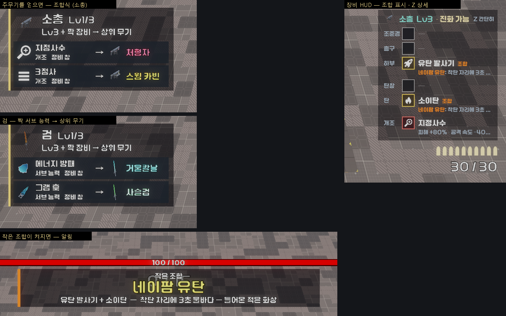

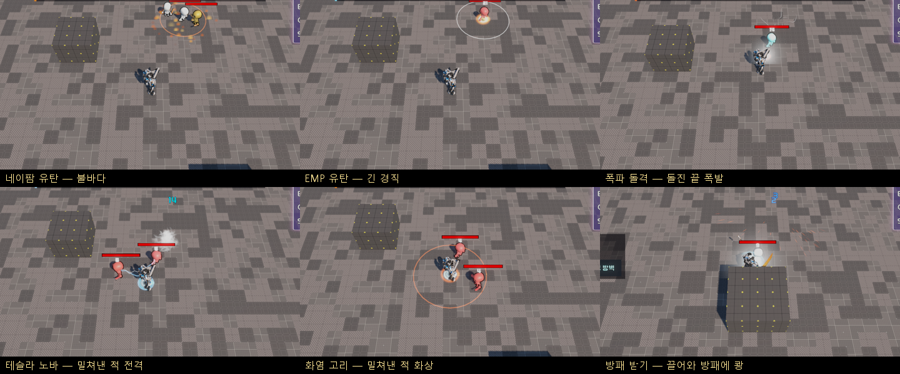

**작은 조합 7종** — 장비 두 개가 만나면 자동으로 켜진다 (무기는 그대로). 수치는 `Data/Synergies/SYN_*`, 목록은 `Resources/Evolution/SynergyCatalog`

| 조합 | 조건 | 효과 (처음 값) | 거는 곳 |
|---|---|---|---|
| 네이팜 유탄 | 같은 총에 유탄 발사기 + 소이탄 | 착탄 자리 3초 불바다 (반경 2.5m) — 안에 있거나 걸어 들어온 적 화상 (초당 공격력 × 1.5) | `GrenadeLauncherAbility` 폭발 → `FireField` |
| EMP 유탄 | 유탄 발사기 + 전격탄 | 폭발에 맞은 적 경직 1.5초 + 전격 줄기 | 〃 |
| 폭파 돌격 | 총검 돌격 + 폭발탄 | 돌진이 끝난 자리 앞에서 폭발 (반경 2.5m · 공격력 × 3 · 밀치기). 끊긴 돌진은 안 터진다 | `BayonetChargeAbility` |
| 테슬라 노바 | 충격 방출기 + 전격탄 | 밀쳐낸 적 모두에게 전격 (방출기 피해 × 2) · 경직 +0.5초 | `ShockEmitterAbility` |
| 화염 고리 | 충격 방출기 + 소이탄 | 밀쳐낸 적 모두 화상 4초 (초당 방출기 피해 × 1.5) · 불 고리 세 겹 | 〃 |
| 방패 받기 | 그랩 훅 + 에너지 방패 | **방패를 든 채 그랩을 쏠 수 있다** (서로 끊지 않는다) — 끌려온 적이 방패에 부딪혀 공격력 × 1.5 · 경직 +1초. 넘기기(뒤로)는 해당 없음 | `GrappleAbility` 끌기 끝 · `SubAbilitySlot` |
| 거울 패링 | 패링 + 방패 Lv2 A(반사판) | 패링으로 되돌린 탄 피해 × 2 · 고리 | `ParryController` |

- 효과 코드는 `SynergyEffects` 한 곳 — 능력이 동작하는 순간 "지금 이 조합이 켜져 있나"를 묻는다 (`SynergyCatalog.On(총, 종류)` · `For(플레이어, 종류)`). 사수 조합은 **그 E 능력을 주는 총**의 탄을 본다 (`SubAbility.SourceWeapon`)
- 경직이 있는 조합은 원래 경직에 **더한다** — 경직은 새로 거는 값으로 덮이므로, 짧은 경직을 걸면 오히려 줄어든다 (시험에서 잡음: 테슬라 노바가 충격 방출기 1초 경직을 0.5초로 줄였다)

**조합 안내 HUD** (`ComboHud` — `Resources/UI/ComboHud`, 장비 HUD 와 같이 게임 시작 때 생겨 씬을 넘어 산다)

| 화면 | 언제 · 무엇 |
|---|---|
| **조합식** (왼쪽 가운데) | 주무기(검 · 총 · 드론)를 **새로 얻으면 6초** — "[짝 그림] 에너지 방패 · 서브 능력 · 정비 창 → [상위 무기 그림] 거울칼날". 짝을 가지면 "가짐", 진화할 수 있으면 "진화 가능 — 거울칼날 (보상 카드 · 정비 창)". 캐릭터가 가질 수 없는 짝은 뺀다 (검사의 드론 → 위성 방벽만). 연달아 얻으면 2초 뒤 새 무기로 바뀐다. **장비 HUD 상세(Z)를 켜 두면** 지금 든 무기의 조합식을 계속 |
| **작은 조합 알림** (화면 위, 체력바 · 처치 수 아래) | 조합이 켜지면 "작은 조합 — 네이팜 유탄 / 유탄 발사기 + 소이탄 — 착탄 자리 …" 2.6초. 여럿이면 1.2초 뒤 다음 것으로. 진화 배너가 뜨는 동안은 기다린다 |
| **장비 HUD** (오른쪽 아래) | 조합에 든 두 줄 이름 옆에 "조합", 상세(Z)면 효과 줄 앞에 "네이팜 유탄: …". 머리글은 "소총 Lv3 · 진화 가능" 한 줄 (상위 무기 이름은 조합식이 보여 준다 — 판이 좁아 두 줄로 넘쳤다) |

- 보상 카드 · 정비 창이 시간을 멈춘 동안 생긴 안내 · 알림은 시간이 다시 흐를 때 (진화 연출과 같은 규칙)
- 같은 판(같은 플레이어)이 다음 스테이지로 넘어가도 이미 알린 무기 · 조합은 다시 알리지 않는다

**테스트 룸 연습 규칙** (`PracticeRules` — TestRoomManager 가 장면에 있는 동안만 켠다, 인스펙터 "Practice Rules")

| 항목 | 원래 | 테스트 룸 |
|---|---|---|
| 스태미나 | 달리면 준다 | 무한 |
| 쿨타임 — 그랩 · 방패(밀치기 · 돌진 · 던지기 · 부서진 뒤) · 유탄 · 총검 · 충격 방출기 · 패링 · 구르기 | 2.5 ~ 8초 | **1초 이하** (`practiceCooldown`) |

- 화면 아래 안내에 "연습 규칙 — 스태미나 무한 · 능력 쿨타임 1초". 팀원 쪽 자동 스킬(파이어볼 · 표창 …)은 레벨업으로 얻는 것이라 테스트 룸에 없고, 건드리지 않았다
- 테스트 룸에는 부착물을 달 곳이 없어 **`Tools / 상위 무기 시험` 창에 "작은 조합" 칸**을 더했다 — [갖추기] 가 손에 든 총(안 맞으면 맞는 총)에 두 부착물 / 서브 능력 둘 · 변형을 채운다 (`SynergyCatalog.PrepareForTest`)

**시험 중 잡은 버그** (작은 조합과 별개로 전부에 영향)

- **범위 판정이 바닥 타일에 막혀 적을 놓침** — 맵 바닥이 타일마다 충돌체(Ground 레이어)라, 반경이 크면 `CombatFx` 의 64칸 버퍼가 바닥으로 차 적이 빠졌다 (충격파 · 화염 · 중력장 · 폭발 등 범위 효과 전부). 바닥 레이어를 빼고 버퍼 256 으로. 전격 소총의 다음 연쇄 찾기(32칸 · 모든 레이어)도 같이
- 테슬라 노바 경직이 원래 경직을 줄임 → 더하기로 (위)

**파일**

| 구분 | 파일 |
|---|---|
| 새 스크립트 | `Scripts/Player/Synergy/` `SynergyData` · `SynergyCatalog` · `SynergyEffects` · `FireField`, `Scripts/Player/UI/ComboHud`, `Scripts/Player/PracticeRules`, `Editor/SynergySetup` (`Tools/커스터마이징/작은 조합 · 조합 안내 HUD 만들기`) |
| 고친 것 | `GrenadeLauncherAbility` · `BayonetChargeAbility` · `ShockEmitterAbility` · `GrappleAbility` · `ShieldAbility` · `SubAbility` (`SourceWeapon`) · `SubAbilitySlot` (방패 받기 · 서로 안 끊기) · `ParryController` · `PlayerMove` (연습 규칙) · `EquipmentHud` · `EquipmentRowView` (조합 표시 · 머리글 한 줄) · `EvolutionPresenter` (`IsPlaying`) · `CombatFx` · `ChainBeamWeapon` (바닥 레이어) · `TestRoomManager` · `TestRoomHUD` · `WeaponGrantWindow` (작은 조합 칸) |
| 에셋 | `Data/Synergies/SYN_*` 7 · `Resources/Evolution/SynergyCatalog` · `Resources/UI/ComboHud.prefab` |

**검증** (배치 임시 테스트, 확인 뒤 지움 — 사본 `Logs/evo_resume/kept_SynergyTest.cs`)

| 테스트 | 결과 |
|---|---|
| 작은 조합 · 사수 | **39 항목 통과** — 조합 7 · HUD 생김 · 실제 판은 연습 규칙 꺼짐 · 소총 조합식(지정사수 → 처형자 · 3점사 → 스웜 카빈, 정비 창) · 샷건을 얻으면 2초 뒤 샷건 조합식 · 다시 들어도 또 알리지 않음 · Lv3 + 지정사수 → "가짐" · 상세(Z)면 계속 · 네이팜(알림 · 장비 두 줄 표시 · 상세 줄 · 불바다 · 들어온 적도 화상 · 3초 뒤 꺼짐) · EMP(소이탄 없으면 불바다 없음 · 1초 뒤에도 경직) · 폭파 돌격(3m 돌진 끝 폭발 −14) · 테슬라 노바(밀쳐낸 둘 다 방출기 × 3 피해) · 화염 고리(전격탄 없으면 테슬라 없음 · 화상) |
| 작은 조합 · 검사 | **26 항목 통과** — 검 조합식(에너지 방패 → 거울칼날 · 그랩 훅 → 사슬검, 서브 능력 · 정비 창) · 드론 → 위성 방벽만 · 방패 받기(알림 · 두 줄 표시 · 방패를 든 채 그랩 · 끌려온 적 −12 · 1.4초 뒤에도 경직 · 방패 없으면 없음) · 거울 패링(방패 Lv2 A → 알림 · 되돌린 탄 9 → 18) |
| 테스트 룸 | **36 항목 통과** — 기존 + 연습 규칙 켜짐 · 스태미나 바로 참 · 유탄 쿨타임 1초 · 1초 뒤 다시 씀 · 구르기 쿨타임 1초 · [갖추기]로 네이팜 켜짐 · 사수에게 검사 조합 거절 · 알림 |
| 상위 무기 1차 · 16종 · 사수 커스터마이징 · 검사 변형 (다시) | 46 · 25 / 87 · 36 / 53 / 29 — 모두 통과 |

- 시험 쪽 함정 (게임 문제 아님): 자폭형 몬스터를 과녁에서 빼기만 하고 두면 플레이어를 쫓아와 돌진 · 판정을 가린다 → 끈다 / 맵 가장자리로 치우면 옮기기가 실패해 제자리에 남는다 → 실제로 멀어졌는지 본다 / 블록과 겹친 자리에 만든 몬스터 탄은 바로 사라진다 → 트인 자리에서

---

## 17. 참고

- Vampire Survivors — [Evolution (Wiki)](https://vampire.survivors.wiki/w/Evolution)
- HoloCure — [Collab (Wiki)](https://holocure.wiki.gg/wiki/Collab)
- Enter the Gungeon — [Synergy (나무위키)](https://en.namu.wiki/w/Enter%20the%20Gungeon/%EC%8B%9C%EB%84%88%EC%A7%80)
- Deep Rock Galactic: Survivor 오버클럭 · Hades 듀오 축복 · 그 밖의 게임 조사는 [재미요소-확장-조사.md](재미요소-확장-조사.md) 3장

**에셋 (15장)**

- [Cartoon FX Remaster Free — Asset Store](https://assetstore.unity.com/packages/vfx/particles/cartoon-fx-remaster-free-109565) · [제작자 페이지 (Qookie Games)](https://qookie.games/cartoon-fx-remaster-free/)
- Matthew Guz — [Slash Effects FREE](https://assetstore.unity.com/packages/vfx/particles/spells/slash-effects-free-295209) · [Hit Effects FREE](https://assetstore.unity.com/packages/vfx/particles/hit-effects-free-284613) · [Status and Auras FREE](https://assetstore.unity.com/packages/vfx/particles/spells/status-and-auras-free-289450)
- Hovl Studio — [Magic Effects FREE](https://assetstore.unity.com/packages/vfx/particles/spells/magic-effects-free-247933) · [Sword slashes PRO (유료)](https://assetstore.unity.com/packages/vfx/particles/sword-slashes-pro-173450)
- [Particle Pack — Unity Technologies](https://assetstore.unity.com/packages/vfx/particles/particle-pack-127325)
- Kenney — [Particle Pack](https://kenney.nl/assets/particle-pack) · [Blaster Kit](https://kenney.nl/assets/blaster-kit)
- [Zap VFX — Unity URP (Vefects)](https://vefects.itch.io/zap-vfx-unity-urp)
- [Free Quick Effects Vol. 1 — Gabriel Aguiar](https://assetstore.unity.com/packages/vfx/particles/free-quick-effects-vol-1-304424)
- Quaternius — [Sci-Fi Gun Pack](https://quaternius.com/packs/scifigun.html) · [Sci-Fi Modular Gun Pack](https://quaternius.com/packs/scifimodularguns.html)
- [Futura Weapon Pack (itch.io)](https://moisturizedfish.itch.io/futura-weapon-pack)
