# 플레이어 파트 정리

> 2026-11-11 기준 · 플레이어 문서 전체를 한 곳에 모았다 (옛 문서 15개는 지움 — git 이력과 부록에 있다)
> 수치는 프로젝트 데이터(에셋 · 프리팹)에서 확인한 값이다.

**같이 보는 문서 (같은 폴더)**
- [무기 개편 — 주무기 · 보조 무기](무기-개편-보조무기.md) — 11-10 ~ 11-11 개편 (주무기는 손에, 산 무기는 떠서 싸운다) · 시험 결과 · 남은 것
- [플레이어 사운드](플레이어-사운드.md) — 연결된 소리 전체 · 비어 있는 곳 · 개선 후보

**옛 문서를 찾을 때** — 코드 주석의 `커스터마이징-구현계획.md N-M` 은 **부록 A**, `상위무기-계획.md N-M` 은 **부록 B** 의 같은 번호다. 나머지 옛 문서는 맨 끝 **부록 C** 표.

**한 줄 요약** — 사수 · 검사 두 캐릭터가 로비에서 고른 **주무기 하나**를 손에 들고, 정비 창에서 산 무기는 몸 둘레에 **떠서 스스로 싸운다**. 부착물 · 서브 능력으로 키우고, 무기 Lv3 + 짝 장비로 상위 무기 12종으로 진화한다. 한 판으로 끝나는 게임이라 재미는 모두 **판 안**에 둔다.

---

## 1. 지금 상태

| 구분 | 내용 |
|---|---|
| **구현 · 검증 끝** | 이동 · 스태미나 · 구르기 · 자동 공격 · HUD / 무기 9종 + 드론 / 사수 · 검사 · 패링 · 근접 공격(양손 IK) / 스테이지 보상 · 재화 · 정비 창 / 총기 부착물(판매 13종) · 사수 E 능력 · 명중 효과 · 개조 / 검사 서브 능력 2종 · 변형 4 / 상위 무기 12종 · 작은 조합 7종 · 조합 안내 HUD / 로비 선택 화면 · 「심우주」 로고 / 테스트 룸 / 사운드 · 설정창 / 이벤트 겹침 버그 수정 / 스테이지 템포 · 보급 아이템 · 스킬 HUD · 카드 한글화 (11-05 ~ 11-08) |
| **구현 · 커밋 전** | 주무기 · 보조 무기 개편 (11-10 ~ 11-11) — 사수 보조 3칸 · 드론 무기 3종 · 검사 부유 무기 2칸 · 패링 연계 · 상위 무기 보조판 · HUD 구분 · 캐릭터 무기 제한 · 테스트 룸 보조 무기 구역 → [무기 개편](무기-개편-보조무기.md) |
| **계획 · 결정 대기** | 팀 피드백 반영(스킬 군중 처리 · 몬스터 2배 · 체력 배율 · 네임드 — 10장) · 무기 성장 · 경험치 · 코인 · 상위 무기 연출 · 사운드 빈자리 · 기능 · UI (11장) |
| **조사 · 제안만** | 엘리트 상자 · 판 결과 화면 · 작전 조건 · 세계관 · 튜토리얼 · 에너지 검신 (12장) |

## 2. 설계 원칙

- **한 판 완결형** — 판 밖 성장(영구 강화 · 해금 · 세이브) 없이, 약하게 시작해 판 끝에 압도적으로. 다시 하게 만드는 것은 "다음 판은 다를 것 같아서"
- **데이터 주도** — 수치는 코드가 아니라 ScriptableObject 에셋. 원본(`WeaponData`)은 실행 중 바꾸지 않고 누적값(`WeaponModifier`)을 `Compose()` 로 합성 — 무기 9종 · 상위 무기 12종 · 보조 무기 배율이 같은 구조
- **역할 나누기 (11-10 팀 피드백)** — 무기 = 한 마리를 세게, 스킬 = 여러 마리를 한꺼번에. 주무기가 주인공, 보조 무기는 거드는 화력
- **팀원 영역 비침범** — Enemy · Core · 팀원 씬은 꼭 필요할 때만 고치고 알린다. HUD · 설정창 · 정비 창은 `Resources` 프리팹을 실행 중 생성 (씬 병합 충돌 방지). 적은 공개 함수(경직 · 피해 · NavMeshAgent)로만 다룬다
- **도구는 데이터를 덮어쓰지 않는다** — 여러 번 실행해도 같은 결과, 직접 고친 수치는 유지 (예외는 9-3)
- **버튼마다 역할을 나눈다** — 패링 = 순간 · 반사 / 방패 = 지속 · 정면 / 그랩 = 거리 좁히기

---

## 3. 캐릭터 · 조작

| 항목 | 사수 | 검사 |
|---|---|---|
| 체력 · 받는 피해 · 이동 | 100 · 100% · 기본 | 140 · 85% · +10% |
| 스태미나 | 100 | 120 |
| 회피 (우클릭) | 구르기 — 0.75초 · 4m(달리면 5m) · 무적 · 다시 쓰기까지 4초 | 패링 (아래) |
| 주무기 (로비에서 고름) | 소총 · 기관단총 · 스나이퍼 | 검 · 대검 · 창 |
| 보조 무기 (정비 창에서 삼) | **3칸** — 남은 총 · 드론 무기(샷건 · 전격 · 레이저) · 기본 드론 | **2칸** — 남은 근접 무기 |
| 키우는 것 | 총기 부착물 6부위 · 하부 E 능력 | 서브 능력 2칸(E · F) · 레벨업 변형 |

- 플레이어 프리팹 하나 + 캐릭터 데이터(`Scripts/Data/Characters/CH_Gunner` · `CH_Swordsman`)로 나눈다
- 사수는 사수 무기만, 검사는 검사 무기만 얻는다 (드론은 사수 무기). 테스트 룸 픽업 · 구역은 예외
- 사수 · 검사 몸 색은 아직 같다 (`bodyMaterial` 비어 있음)

### 3-1. 조작

| 키 | 동작 |
|---|---|
| WASD · Space | 이동 · 점프 |
| Shift | 달리기 ×1.6 — 스태미나 초당 25 소모, 달리지 않으면 회복 (걸을 때 초당 8 · 멈추면 18) |
| 마우스 | 조준 — 공격은 사거리 안의 적에게 **자동** |
| 우클릭 | 회피 (사수 구르기 · 검사 패링) |
| R | 장전 (주무기만 — 보조 무기는 장전하지 않는다) |
| Q · 휠 | **쓰지 않음** (예전 무기 교체 — 보조 무기 방식에서는 손 무기를 바꾸지 않는다) |
| E · F | 사수: 하부 부착물 능력(E) / 검사: 서브 능력 1 · 2 |
| Z | 장비 HUD 상세 (효과 한 줄) |
| ESC | 설정창 (음량 · 일시 정지) |

키는 `Resources/Settings/KeyBindings` 에서 바꾼다.

### 3-2. 패링 (검사)

| 항목 | 값 |
|---|---|
| 판정 | 누른 뒤 0.2초 — 주변 2m + 커서 쪽 5m · 70° |
| 적 | 3m 밀쳐 내고 경직 |
| 탄 | 칼면 각도로 거울 반사 · 속도 ×1.4 · 피해 ×1.5 |
| 성공 보상 · 쿨타임 | 0.6초 무적 · 5초 (성공 · 헛침 같음) |
| **패링 연계 (11-10)** | 성공하면 떠 있는 근접 무기가 막은 방향으로 일제히 찌르고, 주무기의 다음 한 방은 확정 치명 (쿨다운도 비운다) |

---

## 4. 무기

### 4-1. 무기 9종 + 드론 (모두 최대 Lv3)

| 구분 | 무기 | 피해 · 간격 | 특징 | 쓰임 |
|---|---|---|---|---|
| 총 | 소총 | 2 · 0.3초 · 탄창 30 | 균형 잡힌 기본 무기 | 주무기 · 보조 |
| | 기관단총 | 1.33 · 0.12초 · 45 | 빠른 연사 · 넓은 퍼짐 | 주무기 · 보조 |
| | 스나이퍼 | 9 · 1.6초 · 5 | 적 3명 관통 | 주무기 · 보조 |
| | 샷건 | 1 × 8발 · 0.9초 · 6 | 가까이서 강함 | **드론 무기** (보조만) |
| | 전격 소총 | 2.4 · 0.5초 · 사거리 14m | 맞은 적 주위로 전기가 퍼짐 | **드론 무기** (보조만) |
| | 충전 레이저 | 9 · 2.2초 · 사거리 18m | 모았다가 일직선 관통 | **드론 무기** (보조만) |
| 근접 | 검 | 6 · 0.7초 · 3m · 120° | 부채꼴 베기 · 최대 5명 | 주무기 · 보조 |
| | 대검 | 16 · 1.4초 · 4m · 160° | 느리지만 넓은 양손 베기 (양손 IK) · 8명 | 주무기 · 보조 |
| | 창 | 9 · 0.9초 · 5m · 40° | 멀리 찌르기 · 4명 | 주무기 · 보조 |
| 드론 | 드론 | 2 · 0.8초 | 기본 드론 — 늘 동작 | 보조 (사수) |

- 칸: **주무기 1 + 보조** (사수 3 · 검사 2, 기본 드론도 보조 칸을 쓴다). 탄창 0 = 무제한(근접 · 드론) · 구르기 · 사망 시 장전 취소
- 보조 무기 세기: 피해 ×0.6 · 간격 ×1.33 (상위 무기 보조판 ×0.5 · ×1.4, 11-12 에 ×0.8 · ×0.7 에서 낮춤) — 자세히는 [무기 개편](무기-개편-보조무기.md)
- 원본(`WeaponData`)은 실행 중 바꾸지 않고, 레벨 · 카드 · 부착물 · 보조 배율은 누적값(`WeaponModifier`)에 쌓아 `Compose()` 로 합성한다

### 4-2. 원거리 첫 피해 (11-06, `a0e69b5`)

목표: Lv1 · 카드 없이 기본 몬스터(체력 10)를 한 방에 잡지 않게.

| 무기 | 피해 전 → 후 | 체력 10 몬스터 | 체력 18 (E) |
|---|---|---|---|
| 스나이퍼 | 12 → **9** | 2발 | 2발 |
| 충전 레이저 | 18 → **9** | 2발 | 2발 |
| 샷건 | 1.4 → **1** (× 8발) | 2번 | 3번 |
| 전격 소총 | 3.2 → **2.4** | 5발 | 8발 |
| 소총 · 기관단총 | 2 · 1.33 그대로 | 5 · 8발 | 9 · 14발 |

- 스나이퍼 · 레이저는 Lv2 부터 다시 한 방이다. 상위 무기(`WD_EVO_*`)와 레벨당 강화량은 그대로다.

### 4-3. 무기 DPS (한 명 기준 · 치명타 · 카드 뺌 — 스킬 기준선)

| 무기 | 피해 · 간격 | Lv1 DPS | Lv3 DPS | 특징 |
|---|---|---|---|---|
| 소총 | 2 · 0.3초 | 6.67 | 8.67 | — |
| 기관단총 | 1.33 · 0.12초 | 11.08 | 14.42 | — |
| 전격 소총 | 2.4 · 0.5초 | 4.80 | 6.80 | 주위 2명에게 전기 |
| 스나이퍼 | 9 · 1.6초 | 5.63 | 7.88 | 3명 관통 |
| 샷건 | 1 × 8발 · 0.9초 | 8.89 | 11.11 | 레벨마다 탄 +1 |
| 충전 레이저 | 9 · 2.2초 | **4.09** | **6.82** | 가장 약함 = 스킬 기준선 |
| 검 | 6 · 0.7초 | 8.57 | 11.14 | 최대 5명 |
| 대검 | 16 · 1.4초 | 11.43 | 14.86 | 최대 8명 |
| 창 | 9 · 0.9초 | 10.00 | 13.00 | 최대 4명 |

- 드론은 기준에서 뺐다. 보조 무기는 위 값 × 0.6 ÷ 1.33 (약 45%)
- 공격력 카드는 모든 무기 피해 **+10%** (곱해짐 — 2장 ×1.21 · 5장 ×1.61). 예전 +1 고정은 무기마다 효과가 크게 달랐다 (샷건 +100% · 소총 +50% · 스나이퍼 +11%)

---

## 5. 한 판의 흐름

```
로비 (캐릭터 · 주무기 선택)
 └ 스테이지 1 ─ 처치 40 ─┐
                        ├ 처치 목표 절반 → 정비 신호기 등장 → 주우면 중간 정비 (스테이지마다 1번)
                        └ 클리어 → 레벨업 카드 → "스테이지 클리어" → 보상 카드 1장 → 정비 창 → 다음 스테이지
 └ 스테이지 2 ─ 처치 55 (10초 뒤 특수 몬스터 F)
 └ 스테이지 3 ─ 처치 70 (15초 뒤 특수 몬스터 G)
 └ 인트로 → 보스 스테이지 (보스 체력 1000 — 11-12, 예전 300) → 엔딩
```

- 정비하는 동안 · 레벨업 카드 창이 열린 동안은 시간이 멈춘다
- 레벨업 · 클리어 · 사망이 겹치면 **'사망 > 클리어 > 레벨업'** 순서로 처리 (고치기 전 7개 실패 → 21개 통과)
- 코인은 몬스터 담당의 `Enemy.Die` → `GameEvents.OnEnemyDefeated` 로 떨어진다

### 5-1. 스테이지 템포 (11-05 시험 → 11-08 확정, `19024b3`)

| | 스테이지 1 | 스테이지 2 | 스테이지 3 | 보스 |
|---|---|---|---|---|
| 처치 목표 | 15 → **40** | 20 → **55** | 25 → **70** | (보스 처치) |
| 등장 간격 | 3 → **2.4초** | 2 → **1.6초** | 1 → **1.2초** | 3초 |
| 최대 몬스터 수 | 50 | 60 | 70 | 20 |
| **몬스터 체력 배율 (11-12)** | ×1 | **×3** | **×6** | ×2.5 (보스 스테이지 일반 몬스터 — 지금은 나오지 않음) |
| 특수 몬스터 | — | F 주술사 — 주위 15m 플레이어 연사 −23% (10초 뒤) | G 지원 — 주위 12m 몬스터 공격 속도 +20% · 이동 +15% (15초 뒤) | — |

- 몬스터는 한 번에 1마리, 4번에 1번꼴로 2마리. 등장 속도로 본 **최소 클리어 시간은 스테이지마다 약 70 ~ 80초** (처치 목표 ÷ 초당 등장 수) — 실제로는 이동 · 레벨업 · 정비 시간이 더해진다
- 스테이지 3 등장 간격은 개편안에서 1.5초로 늘렸다가, 11-06 시험 플레이 뒤 "조금 더 자주" 요청으로 1.2초
- 특수 몬스터 F · G 는 처치 목표에 들어가지 않는다
- 코인: 몬스터 코인 × **0.7** (`EconomySettings.coinMultiplier`, 소수는 확률로 반올림). 처치 수가 늘어 한 판 총량은 예전의 약 1.7배

### 5-2. 보급 아이템 (11-05)

| 아이템 | 나오는 조건 | 효과 |
|---|---|---|
| 자석 | 처치마다 2%. 30마리 동안 안 나오면 다음 처치에서 확정. 스테이지마다 최대 2개 | 반경 30m(사실상 화면 전체)의 경험치 · 코인을 끌어온다 |
| 힐팩 | 처치마다 3%. 체력 50% 이하면 확률 ×2. 스테이지마다 최대 3개 | 최대 체력의 25% 회복 |
| 정비 신호기 | 처치 목표의 **절반**에서 플레이어로부터 15 ~ 35m 떨어진 이동 가능한 바닥에 1개 | 주우면 그 자리에서 중간 정비 ("보급 정비" · "전투로 돌아가기" — 닫으면 같은 스테이지가 이어진다) |

- 떨어진 아이템은 25초 뒤 사라지고, 마지막 5초는 깜빡인다. 화면 밖 아이템 · 신호기는 플레이어 둘레 화살표로 방향을 알려 준다

### 5-3. 정비 창

| 줄 | 내용 |
|---|---|
| 무기 줄 | 새 무기 2 + 강화 1 + 진화 1 (진화는 무료 · 맨 앞). 새 무기 카드는 **보조 무기**(태그 "보조 무기" · "보조 · 드론") — **보조 칸이 차면 새 무기는 안 나오고, 빈 새 무기 칸만큼 강화 카드를 더 놓는다 (진화 카드가 있으면 강화 2장, 없으면 3장 — 무기 줄은 3장까지 보인다, 11-12)** |
| 장비 줄 | 사수 부착물 3 · 검사 서브 능력 3 (새 능력 25) |
| 크레딧 · 가격 | 몬스터 코인 + 클리어 보너스 10 · 15 · 20 · 가격은 스테이지마다 +10% · 새로고침 3부터(스테이지마다 +1 · 쓸 때마다 +2) · **보조 무기로 사는 새 무기는 ×0.6** (11-11 — Stage1 소총 · 검 12 ~ 레이저 22, `ShopCatalog.supportPriceMultiplier`, 강화 가격은 그대로) |
| 장착 | 부착물을 사면 달 총을 고른다 — 달 수 있는 총만 밝아지고 마우스를 올리면 바뀔 수치를 먼저 보여 준다. 보조 무기에는 개조 칸만 달 수 있다 (진화용) |
| 내 장비 판 | 주무기 · 보조 · 드론 표시와 빈 보조 칸 수 |

**상위 무기 빨리 얻기 (11-04)**
- ① **짝 보장** — 무기가 Lv3 인데 짝이 없으면 그 짝(개조 · 에너지 방패 · 스킬)이 장비 줄 앞자리에 늘 뜬다 (새로고침해도, `ShopSource_EvolutionPair`). 스킬 짝(흡혈 · 연쇄 번개 · 토네이도 · 표창 · 블랙홀)은 크레딧으로 사는 카드 (`ShopCatalog.skillPairPrice` 30)
- ② **바로 갖추기** — '상위 무기 바로 갖추기' 버튼 → 레벨과 상관없이 모자란 강화 · 짝을 채우고 즉시 진화. 값 = (남은 강화비 + 짝 값) × 1.5 (`ShopSource_EvolutionShortcut.markup`, 예: 소총 Lv1 → 처형자 86 · Lv3 이면 45 · 다 갖췄으면 0)
- 값은 `Resources/Economy/EconomySettings` · `Resources/Shop/ShopCatalog`

### 5-4. 레벨업 카드 (팀원 스킬 레벨 시스템 · 11-04 흐름 · 11-08 한글화 `e8ca838`)

- 경험치는 두 칸 — **레벨 게이지**(차면 레벨업, 필요량 10 에서 ×1.3 씩) · **보유 경험치**(HUD 'EXP', 카드를 살 때만 줄어듦)
- 레벨업하면 카드 3장 창 — 보유 경험치로 사는 작은 상점이라 여러 장 사도 되고 안 사도 된다. **'다음'을 누를 때까지 게임은 멈춘다** (`GameEvents.OnUpgradeClosed` → GameManager)
- 카드 비용 = 기본 비용 × 다음 레벨 (스킬 10 → 20 → … → 50). 최대 레벨: 스킬 5 · 표창 3 · 능력치 무제한 (`UpgradeData.maxLevel`) · 회복만 비용 고정 (`UpgradeData.fixedCost`)

| 카드 | 설명 (카드에 보이는 그대로) | 비용 |
|---|---|---|
| 파이어볼 | 4초마다 가까운 적에게 화염구 (피해 8) / 레벨마다 피해 +25% | 10 × 레벨 |
| 연쇄 번개 | 5초마다 번개가 적 3명에게 튄다 (피해 4) / 레벨마다 피해 +25% | 10 × 레벨 |
| 블랙홀 | 적을 4초간 끌어당겨 묶고 폭발 (피해 4) / 레벨마다 지속 +1초 | 10 × 레벨 |
| 토네이도 | 15초마다 7초간 적을 쫓는 회오리 (0.5초마다 1) / 레벨마다 피해 +25% | 10 × 레벨 |
| 표창 | 표창 3개가 12초간 몸 둘레를 돈다 (피해 1) / 레벨마다 표창 +1 | 10 × 레벨 |
| 전격 샷 | 4초마다 적 1명을 2초간 경직 / 레벨마다 경직 +1초 | 10 × 레벨 |
| 흡혈 | 무기로 적을 처치하면 체력 3 회복 / 레벨마다 회복 +1 | 10 × 레벨 |
| 공격력 | 모든 무기 피해 +10% | 2 × 레벨 |
| 이동 속도 | 이동 속도 +10% (기본 3 에 +0.3) | 2 × 레벨 |
| 최대 체력 | 최대 체력 +10 | 3 × 레벨 |
| 회복 | 체력 10 회복 / 여러 번 사도 비용 그대로 | **3 고정** |

- 카드 이름은 스킬 HUD 와 같은 한글 · 카드 창 문구도 한글 (`경험치 N` · `강화 성공!` · `경험치가 부족합니다`) · 설명 3줄까지 제 크기
- 쓰지 않던 테스트 카드 `A 2` · `A 3` 는 지웠다. 풀 밖의 `GunSpeed` 는 이름만 "탄속"

### 5-5. 스킬 밸런스 (11-08, `897927d`)

사용자 기준 (11-08): 스킬 DPS 는 메인 무기별 DPS 보다 낮게. 기준선은 가장 약한 무기(충전 레이저) Lv1 **4.09** · Lv3 **6.82**, 범위 스킬은 적 3마리가 함께 맞는다고 보고 합계로 잰다.

| 스킬 | 지금 효과 | 바꾼 것 | 3마리 합계 DPS Lv1 · 최대 (측정) | 예전 |
|---|---|---|---|---|
| 파이어볼 | 4초마다 한 명에게 8 · 레벨마다 +25% | 그대로 | 2.0 · 4.0 | 같음 |
| 연쇄 번개 | 5초마다 3명에게 4 · 레벨마다 +25% | 피해 10 → 4, 튀는 수 5 → 3 | 2.4 · 4.8 | 6.0 · 12.0 |
| 블랙홀 | 4초간 반경 5 끌어당겨 묶음 · 0.5초마다 1 · 폭발 4. 끝나고 12초 뒤 다시. 레벨마다 지속 +1초 · 반경 +1 | 폭발 10 → 4 | 2.7 · 3.0 | 기준선에 붙음 |
| 토네이도 | 15초마다 7초간 적을 쫓으며 반경 3 에 0.5초마다 1 · 레벨마다 +25% | 피해 2 → 1, 지속 10 → 7초, 레벨 성장 +1 → +25% (코드) | 2.9 · 5.9 | 8 · 24 |
| 표창 | 18초 중 12초 동안 3개가 반경 2.7 을 돎, 스칠 때 1 · 레벨마다 +1개 (최대 Lv3) | 피해 3 → 1 | 3.4 · 5.6 | 약 9.5 · 16 |
| 전격 샷 | 4초마다 한 명 2초 경직 · 레벨마다 +1초 | 그대로 (피해 없음) | — | — |
| 흡혈 | 무기로 처치하면 체력 3 회복 · 레벨마다 +1 | 반올림 버그 수정 (`c0d7c42`) | — | Lv2 · Lv3 둘 다 4 |

- 체력 10 몬스터를 스킬 한 방에 잡는 경우가 없어졌다. 측정: 몬스터 3마리를 플레이어 앞 2.7m 에 묶어 두고 게임 시간 40초 — 10항목 모두 기준선 미만
- 바꿀 곳: 스킬 수치 `Scripts/Upgrade/Effects/Skill/*Effect.asset` · 레벨 성장 각 `*Effect.cs` (`ScaleValue` = 레벨마다 +25%) · 다시 잴 때 `Logs/evo_resume/kept_SkillDpsTest.cs`
- ⚠ 11-10 팀 피드백으로 이 기준이 **"한 마리는 무기보다 약하게, 여러 마리 합계는 무기보다 세게"** 로 바뀔 예정 (10장)

### 5-6. 스킬 HUD (11-06, `ec819c7`)

- 왼쪽 위 "레벨업 스킬" 판에 얻은 순서대로 한 줄씩: 아이콘 · 이름 · 레벨 칸 · Lv (최대면 MAX). 새로 얻거나 레벨이 오르면 그 줄이 반짝인다
- 능력치 카드는 빼고 스킬만. 정비 창이 열려 있거나 죽으면 숨는다
- 프리팹 `Resources/UI/SkillHud` 는 `Tools / 레벨업 / 스킬 HUD 만들기` 가 만든다

### 5-7. 몬스터 (참고 — 몬스터 담당 영역)

| 몬스터 | 공격 | 체력 | 공격력 | 경험치 | 나오는 비율 |
|---|---|---|---|---|---|
| A | 근접 | 10 | 3 | 1 | 20% |
| B | 돌진 | 10 | 5 | 2 | 15% |
| C | 원거리 | 10 | 7 | 3 | 30% |
| D | 자폭 | 10 | 15 | 2 | 15% |
| E | 레이저 | 18 | 9 | 6 | 20% |
| F (스테이지 2 특수) | 주위 15m 플레이어 연사 −23% | 20 | 0 | 5 | 1마리 |
| G (스테이지 3 특수) | 주위 12m 몬스터 공격 속도 +20% · 이동 +15% | 20 | 0 | 5 | 1마리 |
| 보스 | — | **1000** (11-12, 예전 300 · 배율 없음 · 피해를 정수로 잘라 받음) | — | — | — |

- 표의 체력은 몬스터 데이터 값 — **11-12 부터 스테이지마다 ×1 · ×3 · ×6 (보스 스테이지 ×2.5)** 를 곱한다 (처음 ×1.5 · ×2.2 로 넣었다가 같은 날 사용자 결정으로 올림) (`StageData.enemyHealthMultiplier`, 체력바도 같은 기준). 보조 무기가 가득 차면 몬스터가 너무 쉽게 녹아서 넣었다 — 측정은 5-8

### 5-8. 몬스터가 녹는 속도 — 체력 배율 · 보조 너프 측정 (2026-11-12)

사수가 보조 3칸을 가득 채운 빌드로 스테이지마다 60초 (제자리 · 가장 가까운 적을 봄). 몬스터가 **처음 맞고 죽을 때까지 걸린 시간의 가운데값** (괄호: 맞자마자 0.3초 안에 죽은 비율). `Logs/evo_resume/kept_StageTtk.cs`

| 스테이지 · 빌드 | 바꾸기 전 | 체력 배율만 | 체력 배율 + 보조 너프 (지금) |
|---|---|---|---|
| Stage1 · 소총 Lv2 + 기관단총 · 스나이퍼 · 샷건 Lv1 | 0.46초 (44%) | 0.50초 (33%) | 0.48초 (0%) |
| Stage2 · 소총 Lv3 + 보조 Lv2 셋 | 0.64초 (14%) | 0.80초 (15%) | **1.07초 (0%)** |
| Stage3 · 소총 Lv3 + 회전 기관포 · 스나이퍼 · 공성포 Lv3 | 0.50초 (33%) | 1.12초 (0%) | **1.36초 (3%)** |

- 보조 너프 = 보조 피해 ×0.8 → 0.6 · 상위 보조판 ×0.7 → 0.5 (주무기는 그대로 — 뒤 스테이지에서는 체력 배율로 이미 약해진다)
- 분당 처치 수는 등장 속도에 묶여 거의 같다 — 대신 몬스터가 더 오래 살아 있어 위협이 된다
- 보조 3칸 합계 DPS (Lv1) — 사수 약 11.5 (소총의 1.7배, 예전 2.3배) · 검사 약 9.7 (검의 1.1배, 예전 1.5배)

**체력 배율 ×1 · ×3 · ×6 · 보스 1000 으로 올린 뒤 (11-12 사용자 결정)** — 같은 방식 60초, 레벨업 카드 · 스킬 · 부착물 없이 제자리 (`Logs/evo_resume/kept_HpCheck.cs`)

| 스테이지 (배율) | 보조 3칸 가득 — 녹는 시간 · 분당 처치 | 주무기만 (소총) — 녹는 시간 · 분당 처치 | 등장 속도 |
|---|---|---|---|
| Stage1 (×1) | 0.54초 · 13 | 1.14초 · 15 (Lv2) | 분당 25 |
| Stage2 (×3) | 2.28초 · 22 | 5.82초 · 12 (Lv3) | 분당 37.5 |
| Stage3 (×6) | **7.46초 · 25** (보조판 둘) | **38.7초 · 6** (Lv3) | 분당 50 |
| 보스 (1000) | **77초** (Stage3 빌드, 평균 DPS 12.9) | — | — |

- Stage2 · 3 은 처치 속도가 등장 속도보다 느려 몬스터가 쌓인다 — 보조 가득이어도 Stage3 처치 70 에 약 2분 50초
- 주무기만으로는 Stage3 몬스터 하나에 30초 넘게 걸린다 — 공격력 카드(장당 +10%) · 스킬 · 진화가 꼭 필요한 수준
- 보스는 계획안 목표(약 1분)에 가깝다

---

## 6. 커스터마이징

> 설계 · 단계별 구현 기록은 **부록 A** (옛 `커스터마이징-구현계획.md`)

### 6-1. 사수 — 총기 부착물 32종 (판매 13종)

**2026-10-31 간추림** — 상위 무기에 닿기 쉽게 정비 창 · 보상 카드에서 **19종을 뺐다**. 에셋은 그대로 (되살리려면 `Resources/Shop/ShopSource_Attachment` 목록에 다시 넣는다)
- 남김 13: 상위 무기 짝 개조 6(지정사수 · 3점사 · 이중 탄창 · 슬러그 · 과충전 · 분광 프리즘) · 하부 E 3(유탄 발사기 · 총검 돌격 · 충격 방출기) · 작은 조합 재료 탄 3(소이탄 · 전격탄 · 폭발탄) · 레이저 조준기
- 뺀 것 — 단순 수치 12: 2배율 스코프 · 정밀 광학장치 · 확장 총열 · 보정기 · 플라즈마 소음기 · 초크 · 확산기 · 수직 손잡이 · 확장 탄창 · 빠른 탄창 · 철갑탄 · 연쇄 증폭기
- 뺀 것 — 상위 무기 · 작은 조합과 연결 없음 7: 튕김탄 · 난사 · 용의 숨결 · 레일건 · 반자동 · 방전 · 과부하 코일
- 아래 표는 32종 전체 기록이다 (뺀 것 포함)

| 규칙 | 내용 |
|---|---|
| 부위 | 총마다 6칸 (조준경 · 총구 · 하부 · 탄창 · 탄 · 개조) — 같은 부위에 다시 달면 **교체** |
| 등급 (아이콘 테두리 색) | 🟩 **기본 5** — 대가 없음, 효과 작음 / 🟨 **균형 14** — 장점만큼 대가 / 🟥 **개조 13** — 공격 방식이 바뀜 |
| 개조 칸 | 그 총 전용 · **무기 Lv3 부터** · 총마다 둘 중 하나 |
| 하부 E 능력 | 하부에 유탄 발사기 · 총검 돌격 · 충격 방출기를 달면 **E 키 능력** — 주무기의 능력 |
| 보조 무기 | **개조 칸만** 달 수 있다 (진화용). 다른 부위 · E 능력은 주무기만 |
| 얻는 곳 | 정비 창 장비 줄 3칸 (판매 13종 중 무작위) · 스테이지 보상 카드 |
| 가격 | 기본 12 · 균형 18 (하부 E 22 · 충격 방출기 15) · 폭발탄 24 · 개조 30 — 스테이지마다 +10% |
| 못 다는 것 | 드론 · 근접 무기 (검사는 서브 능력으로 키운다) |

**달 수 있는 총** — 실탄 = 소총 · 기관단총 · 스나이퍼 · 샷건 / 전격 = 전격 소총 / 충전 = 충전 레이저 / 모든 총 = 6종 전부. 표의 "공격 간격 +10%" 는 **느려진다**는 뜻 (간격이 길어짐), "−5%" 면 빨라진다.

| 부위 | 이름 | 등급 | 효과 | 달 수 있는 총 | 가격 |
|---|---|---|---|---|---|
| 조준경 | 2배율 스코프 | 균형 | 치명타 확률 +10%p · 탄속 +6 · 공격 간격 +10% | 실탄 | 18 |
| | 정밀 광학장치 | 균형 | 치명타 배율 +1.0 · 공격 간격 +15% | 실탄 · 충전 레이저 | 18 |
| | 레이저 조준기 | 기본 | 치명타 확률 +5%p · 퍼짐 −30% · 총구에서 붉은 조준선 | 실탄 | 12 |
| 총구 | 확장 총열 | 균형 | 피해 +10% · 탄속 +8 · 공격 간격 +10% | 실탄 | 18 |
| | 보정기 | 기본 | 퍼짐 −30% · 공격 간격 −5% | 실탄 | 12 |
| | 플라즈마 소음기 | 균형 | 치명타 배율 +0.75 · 탄속 −3 | 실탄 | 18 |
| | 초크 | 기본 | 산탄 퍼짐 −45% | 샷건 | 12 |
| | 확산기 | 균형 | 산탄 +2발 · 퍼짐 +30% · 피해 −15% | 샷건 | 18 |
| 하부 | 수직 손잡이 | 기본 | 장전 시간 −20% | 모든 총 | 12 |
| | 유탄 발사기 | 균형 | **E** — 커서 쪽으로 유탄 · 반경 2.5m · 피해 = 총 공격력 ×5 · 쿨타임 6초 | 모든 총 | 22 |
| | 총검 돌격 | 균형 | **E** — 4m 돌진하며 찌르고 밀침 · 피해 ×4 · 돌진 중 무적 · 5초 | 모든 총 | 22 |
| | 충격 방출기 | 기본 | **E** — 주변 3m 밀치기 · 경직 1초 · 8초 | 모든 총 | 15 |
| 탄창 | 확장 탄창 | 균형 | 탄창 +50% · 장전 시간 +15% | 모든 총 | 18 |
| | 빠른 탄창 | 균형 | 탄창 −20% · 장전 시간 −35% | 모든 총 | 18 |
| 탄 | 철갑탄 | 균형 | 관통 +2 · 피해 −10% | 실탄 | 18 |
| | 소이탄 | 균형 | 맞은 적 화상 3초 (초당 피해의 25%) · 피해 −10% | 실탄 · 충전 레이저 | 18 |
| | 전격탄 | 균형 | 25% 확률로 옆 적에 전격 (피해 50%) · 피해 −10% | 실탄 | 18 |
| | 튕김탄 | 균형 | 맞은 적에서 가까운 적에게 한 번 튕김 · 피해 −15% | 실탄 | 18 |
| | 폭발탄 | **개조** | 명중 지점 반경 1.5m 폭발 (피해 40%) · 공격 간격 +25% | 실탄 | 24 |
| | 연쇄 증폭기 | 균형 | 전격 연쇄 +1 · 피해 −10% | 전격 소총 | 18 |

**개조 (12) — 총마다 2종 · 무기 Lv3 부터 · 30 크레딧**

| 총 | 이름 | 효과 | 상위 무기 짝 |
|---|---|---|---|
| 소총 | 지정사수 | 피해 ×1.8 · 관통 +1 · 공격 간격 ×1.67 (느리게 · 세게) | → **처형자** |
| | 3점사 | 한 번에 3발 · 공격 간격 ×2.2 | → **스웜 카빈** |
| 기관단총 | 이중 탄창 | 탄창 ×2 · 장전 시간 +60% | → **회전 기관포** |
| | 난사 | 공격 간격 −26% · 퍼짐 ×2 | — |
| 샷건 | 슬러그 | 산탄 대신 무거운 1발 · 피해 ×6 · 관통 +2 · 퍼짐 거의 없음 | → **공성포** |
| | 용의 숨결 | 산탄마다 화상 · 사거리 −40% | — |
| 스나이퍼 | 레일건 | 탄속 +120 · 모든 적 관통 · 장전 시간 +30% | — |
| | 반자동 | 공격 간격 ×0.5 (두 배 빠르게) · 피해 ×0.55 | — |
| 전격 소총 | 방전 | 장전을 시작할 때 주변 4m 전격 (공격력 ×2.5 · 경직) | — |
| | 과부하 코일 | 전격 연쇄 +2 · 피해 −15% | — |
| 충전 레이저 | 과충전 | 피해 ×2.2 · 공격 간격 ×1.5 | → **태양창** |
| | 분광 프리즘 | 빔이 3갈래 · 갈래마다 피해 ×0.5 | → **프리즘 노바** |

- 참고: 콜 오브 듀티 · 데스티니 2(부위마다 하나) · 딥 락 갤럭틱(등급 3색 · 오버클럭) — 부착물 하나가 DPS 를 10 ~ 15% 넘게 올리지 않게
- 수치를 바꾸려면 부착물 에셋(`AT_*` · `MOD_*`)의 `modifier` · `note` · `basePrice` · `minWeaponLevel` · `onlyFor` (코드 수정 없음) · 명중 효과 `Attachments/Effects/AE_*` · E 능력 `Prefabs/Attachment/AB_*`
- `Tools/커스터마이징/전체 만들기` 는 **없는 것만** 만든다 (고친 수치 유지) · 처음 값으로 되돌리려면 `기본값으로 되돌리기`

> **2026-11-02 보이는 크기를 판정에 맞춤** (판정 수치는 그대로, 총검 돌진만 3 → 4m): 유탄 0.24 → 0.55m · 꼬리 · 떨어질 자리 2.5m 예고 원 · 폭발 이펙트 · 비행 0.45 → 0.6초 / 네이팜 불 입자 2배 · 바닥 불빛 원판 / 총검 칼날 0.1×1.2m · 돌진 궤적 · 찌른 자리 고리 / 그랩 줄 0.08 → 0.15m · 갈고리 0.14 → 0.35m / 전격탄 줄기 0.05 → 0.14m + 흰 심 / 폭발탄 작은 폭발 이펙트 / 방패 진하게(0.55 → 0.72) · 테두리 빛 · 밀치기 부채꼴 / 작은 조합 알림은 화면 아래 가운데 0.85배. 점검 캡처 `Logs/newevo/subgun` · `subsword`

### 6-2. 검사 — 서브 능력 2칸 (레벨업마다 변형 A / B, 트라이포드 방식)

| 능력 | 기본 | Lv2 A / B | Lv3 A / B |
|---|---|---|---|
| E 그랩 훅 | 8m 와이어로 처음 닿은 적을 끌어와 경직 1초 · 쿨타임 7초(빗나가면 2초) · 보스면 내가 끌려감 | 작살(30° 안 2명 더) / 충격 와이어(경직 +1초 · 피해 ×2) | 넘기기(내 뒤 3m) / 추격(내가 날아가 베기 ×1.5) |
| F 에너지 방패 | 누르는 동안 정면 120° 막기 · 내구도 50 · 깨지면 4초 · 들면 이동 ×0.6 · 떼면 밀치기 | 반사판(정면 탄 되돌림) / 강화 방벽(내구도 90 · 회복 ×1.5) | 방패 돌진(5m · 무적) / 방패 던지기 |

- 정비 창 새 능력 25 크레딧 · 레벨업은 변형 A / B 를 나란히 진열
- 참고: Risk of Rain 2 로더(빗나가면 쿨타임 짧게) · 라인하르트 · DOOM(들면 느려짐) · Hades(밀치기)
- 수치 `Prefabs/SubAbility/SA_*` · 이름 · 가격 `Scripts/Data/SubAbilities/SA_*`

### 6-3. 작은 조합 7종 — 재료를 같이 갖추면 저절로

| 조합 | 재료 | 효과 |
|---|---|---|
| 네이팜 유탄 | 유탄 발사기 + 소이탄 | 착탄 자리에 3초 불바다 — 들어온 적 화상 |
| EMP 유탄 | 유탄 발사기 + 전격탄 | 폭발에 맞은 적 1.5초 경직 |
| 화염 고리 | 충격 방출기 + 소이탄 | 밀쳐낸 적 모두 화상 (4초) |
| 테슬라 노바 | 충격 방출기 + 전격탄 | 밀쳐낸 적 모두 전격 |
| 폭파 돌격 | 총검 돌격 + 폭발탄 | 돌진 끝에서 폭발 (반경 2.5m) |
| 거울 패링 (검사) | 패링 + 에너지 방패 반사판(Lv2 A) | 패링으로 되돌린 탄 피해 ×2 |
| 방패 받기 (검사) | 그랩 훅 + 에너지 방패 | 방패를 든 채 그랩 — 끌려온 적이 방패에 부딪혀 피해 · 경직 +1초 |

- 같은 총(검사는 캐릭터)에 재료를 다 달면 저절로 켜진다 · 켜지는 순간 화면 아래 가운데에 이름 · 재료 · 효과
- 효과는 `SynergyEffects` 한 곳 · 데이터 `Scripts/Data/Synergies/SYN_*` · 자세한 설계는 부록 B 7장 · 16-9

---

## 7. 상위 무기 12종

> 조사 · 설계 · 연출 · 구현 기록은 **부록 B** (옛 `상위무기-계획.md`)

### 7-1. 진화 규칙

| 항목 | 내용 |
|---|---|
| 조건 | 무기 **Lv3** (최대) + 짝 장비를 **가지고만 있으면** 된다 (개조는 그 총에 단 것 · 서브 능력은 Lv1 이상 · 팀원 스킬은 레벨업 카드로 얻은 것) |
| 나오는 곳 | 스테이지 보상 카드에 **반드시 1장** · 정비 창 무기 줄 **맨 앞 (무료)** · '상위 무기 바로 갖추기' |
| 보조 무기 | 보조 칸 무기도 진화한다 — 같은 자리에서 **연출 그대로 · 피해 ×0.5 · 간격 ×1.4** 로 계속 싸운다 (11-12 ×0.7 → ×0.5) |
| 선택 | 거절할 수 있다 · 진화하면 그 무기의 개조 칸은 잠긴다 |
| 연출 | 번쩍임 · 위에 "상위 무기 — 이름" · 충격파 · 무기 발광(색은 무기마다) |
| 로비 · HUD | 로비 조합식 줄 · 전투 중 조합 안내 HUD(왼쪽 위)에 짝 장비와 결과 |
| 목표 시점 | Stage 3 ~ 보스전 |

짝 장비: 사수 무기 전용 개조 6 · 검사 서브 능력 1 · 팀원 레벨업 스킬 5 (★ — 이름 · 동작이 스킬과 맞는 것, 팀원 코드는 고치지 않고 카드 종류로만 확인). 기준: 팀원 스킬과 컨셉이 겹치면 뺀다 · 연출은 화려하게, 그러나 읽히게.

### 7-2. 사수 8종

| 상위 무기 | 조합식 | 하는 일 | 핵심 수치 |
|---|---|---|---|
| **처형자** | 소총 + 지정사수 | 처치한 적이 터지고, 그 폭발에 죽은 적도 연쇄로 터진다 | 반경 2m · 피해 ×1.2 · 3단까지 (단마다 ×0.85) |
| **스웜 카빈** | 소총 + 3점사 | 점사 세 발이 유도 미사일 — 발마다 다른 적을 쫓아가 작은 폭발 | 폭발 반경 1.2m · 피해 ×0.6 |
| **회전 기관포** | 기관단총 + 이중 탄창 | 장전 없이 계속 쏜다 — 쏘는 동안 연사가 오른다 | 2초에 걸쳐 연사 ×1.5 (11-11, ×3 → ×1.5) · 멈추면 1초에 걸쳐 내려감 |
| **공성포** | 샷건 + 슬러그 | 적에게 부딪히면 그 자리에서 터지는 포탄 (11-03 — 예전엔 관통 무제한) · 아무도 못 맞히면 벽 · 사거리 끝에서 터진다 | 폭발 3m · 둘레 적에게 공격력 ×1.5 · 밀치기 |
| **뇌운** | 전격 소총 + 연쇄 번개 ★ | 장전하는 동안 머리 위 먹구름이 주변 적에게 낙뢰 (보조판은 장전이 없어 8초마다 2초) | 8m 안 · 초당 4번 · 피해 ×2 (11-11, ×1.5 → ×2) · 경직 0.3초 |
| **프리즘 노바** | 충전 레이저 + 분광 프리즘 | 빨강 · 초록 · 파랑 빛이 적 사이를 튕긴 뒤 하나로 모여 굵은 빔 — 빔이 나가는 동안 화면이 잘게 떨린다 (11-03, 보조판은 흔들림 없음) | 빛마다 4번 튕김 (×0.2) → 2초 빔 (0.1초마다 ×0.06) · 피해 21.6 (11-11, 빛 ×0.4 · 빔 ×0.35 에서 낮춤) |
| **태양창** | 충전 레이저 + 과충전 | 모으는 동안 사거리가 늘어나는 한 방 — 굵은 빛 기둥 + 화상 | 0.8초 모으기 · 10m → 32m · 화상 3초 · 피해 14 (11-11, 21.6 → 14) |
| **돌풍 저격총** | 스나이퍼 + 토네이도 ★ | 탄 둘레로 바람 나선, 지나간 길에 바람 — 길 위 적은 느려지고 계속 베인다 (10-31 · 11-01 연출 변경) | 2초 · 폭 1.8m · 길이 최대 14m(벽에서 끊김) · 이동 ×0.6 · 0.3초마다 ×0.1 (11-11, ×0.15 → ×0.1) · 동시 3줄 |

### 7-3. 검사 4종

| 상위 무기 | 조합식 | 하는 일 | 핵심 수치 |
|---|---|---|---|
| **혈검** | 검 + 흡혈 ★ | 처치마다 혈기가 쌓이고, 가득 차면 폭주 — 몸 둘레로 무작위 혈풍 난무 (11-03 붉은 초승달 검격 · 폭주 동안 칼끝 궤적 길고 붉게) | 처치 +10 (HP 가득이면 ×2) · 100 이면 6초 폭주 · 공격 속도 ×1.5 · 사거리 +1m · 맞힌 피해 10% 회복 · 폭주 시작 12줄 + 0.8초마다 6줄 (줄당 ×0.4) |
| **거울칼날** | 검 + 에너지 방패 | 휘두를 때마다 적 탄을 되돌리고, 네 번째 휘두르기마다 초승달 검기 3개 (11-03 빛무리 · 굵은 몸통 · 흰 심지 세 겹 + 잔상 4장, 폭 3.6m) | 되돌리기 150° · 탄 속도 ×1.4 · 검기 8m (초속 17m) · 피해 ×0.8 (11-11, ×2 → ×0.8) |
| **중력 대검** | 대검 + 블랙홀 ★ | 내려찍은 자리에 중력장 — 주변 적을 빨아들인 뒤 붕괴 폭발 (보조판도 내려찍기에서 연다) | 끌어당김 6m · 1.2초 · 붕괴 3m · 피해 ×0.6 (11-11, ×2 → ×0.6) · 경직 0.6초 · 피해 19.2 |
| **아킬레우스의 창** | 창 + 표창 ★ | 4번째 찌르기마다 창을 던진다 (손이 비고 공격 멈춤) — 꿰뚫고, 던진 거리 끝에서 캐릭터 둘레를 2바퀴 돈 뒤 손으로 (10-31 · 11-01 변경) | 6.5m · 꿰뚫기 ×1.5 · 2바퀴 1.4초 · 바퀴마다 ×0.5 (11-11, ×0.8 → ×0.5) · 돌아오기 ×1.0 · 한 번에 하나 |

- 상위 무기가 없는 무기: 드론 (스나이퍼 · 창은 10-31 추가 — 바탕: 원신 벤티의 바람 화살 · 하데스 「바라타」)

### 7-4. 원래 무기와 비교 (피해 · 간격)

| 상위 무기 | 원래 → 상위 |
|---|---|
| 처형자 | 소총 2 · 0.3초 → 4.2 · 0.3초 + 연쇄 폭발 (11-11, 2.5 → 4.2) |
| 스웜 카빈 | 소총 2 · 0.3초 → 4.4 · 0.3초 (3점사 미사일, 11-11 2.4 → 4.4) |
| 회전 기관포 | 기관단총 1.33 · 0.12초 · 탄창 45 → 1.46 · 0.12초 · 장전 없음 · 연사 최대 ×1.5 |
| 공성포 | 샷건 1 × 8발 · 0.9초 → 1.82 포탄 1발 · 0.9초 · 첫 적에서 3m 폭발 |
| 뇌운 | 전격 소총 2.4 · 0.5초 → 3.52 · 0.5초 + 장전 중 낙뢰 |
| 프리즘 노바 · 태양창 | 충전 레이저 9 · 2.2초 → 21.6 · 2.2초 / 14 · 1.54초 |
| 혈검 · 거울칼날 | 검 6 · 0.7초 → 9.5 (11-11, 6.9 → 9.5) / 7.5 · 0.7초 |
| 중력 대검 | 대검 16 · 1.4초 → 19.2 · 1.4초 + 중력장 |
| 돌풍 저격총 | 스나이퍼 9 · 1.6초 → 14.4 · 1.6초 + 바람길 |
| 아킬레우스의 창 | 창 9 · 0.9초 → 15.9 · 0.9초 (11-11, 10.8 → 15.9) + 4번째마다 던지기 (던진 약 2초 동안은 찌르지 않는다) |

### 7-4-1. DPS 측정 · 조정 (2026-11-11)

테스트 룸에서 손에 든 무기 하나만 Lv3 로 10초씩 쟀다 (`Logs/evo_resume/kept_EvoDps.cs`, 결과 `Logs/evodps/`). 한 마리 = 훈련 해골 · 튼튼 무리 = 9마리 모여 있기, 체력 무한 · 보통 무리 = 9마리, 체력 20, 죽으면 2초 뒤 다시 (처치 효과 포함).

**기준** — 한 마리 DPS 는 원래 무기 Lv3 의 ×1.6 ~ 2.2 · 튼튼 무리 DPS 는 100 안팎 (대검처럼 원래 넓게 베는 무기는 그 ×1.8 ~ 2.9). 상위 무기 한 발 피해가 원래 무기 Lv3 보다 낮아지지 않게.

| 원래 → 상위 | 한 마리 전 → 후 | 튼튼 무리 전 → 후 | 보통 무리 전 → 후 | 바꾼 것 |
|---|---|---|---|---|
| 충전 레이저 → 프리즘 노바 | 61.3 → **11.3** | 268.6 → **49.8** | 31.1 → 28.0 | 빛 조각 ×0.4 → 0.2 · 빔 틱 ×0.35 → 0.06 |
| 대검 → 중력 대검 | 40.8 → **27.4** | 307.2 → **195.8** | 64.0 → 46.6 | 붕괴 ×2 → 0.6 |
| 검 → 거울칼날 | 30.7 → **20.6** | 168.3 → **85.0** | 44.9 → 45.8 | 검기 ×2 → 0.8 |
| 기관단총 → 회전 기관포 | 34.8 → **19.2** | 45.5 → 23.1 | 20.7 → 15.8 | 연사 최대 ×3 → ×1.5 |
| 스나이퍼 → 돌풍 저격총 | 24.1 → 15.3 | 99.9 → **67.5** | 31.9 → 29.5 | 바람길 틱 ×0.15 → 0.1 |
| 충전 레이저 → 태양창 | 18.5 → **11.4** | 88.6 → 67.2 | 48.0 → 48.0 | 기본 피해 21.6 → 14 |
| 전격 소총 → 뇌운 | 12.0 → 12.7 | 18.1 → 17.6 | 11.4 → 11.8 | 낙뢰 ×1.5 → 2 (장전 중에만 — 10초 측정에는 거의 안 잡힘) |
| 소총 → 처형자 | 9.0 → **12.5** | 8.7 → 12.5 | 14.8 → 17.6 | 기본 피해 2.5 → 4.2 |
| 소총 → 스웜 카빈 | 8.4 → **14.0** | 10.1 → 17.4 | 10.3 → 16.3 | 기본 피해 2.4 → 4.4 |
| 검 → 혈검 | 13.9 → **22.6** | 47.0 → 62.1 | 40.0 → 40.0 | 기본 피해 6.9 → 9.5 |
| 창 → 아킬레우스의 창 | 18.9 → **29.8** | 89.1 → 120.9 | 32.6 → 30.6 | 기본 피해 10.8 → 15.9 · 궤도 ×0.8 → 0.5 |
| 샷건 → 공성포 | 6.0 → 6.0 | 98.9 → 99.1 | 45.4 → 45.4 | 그대로 (기준 안) |

- 원래 무기(Lv3) 측정값 — 소총 7.8 ~ 8.6 · 기관단총 5.9 ~ 6.2 · 스나이퍼 6.3 ~ 10.1 · 샷건 1.8 ~ 2.1 (7m 라 많이 빗나감) · 전격 6.5 · 레이저 6.0 ~ 8.2 · 검 10.9 ~ 11.7 · 대검 16.6 ~ 18.7 · 창 14.0 ~ 16.4 (10초라 느린 무기는 측정마다 조금씩 다르다)
- 남은 쏠림: 중력 대검 튼튼 무리 195.8 — 끌어모은 적을 대검이 한꺼번에 베기 때문 (보통 무리에서는 대검의 ×1.46). 더 낮추려면 끌어당김 반경 · 붕괴 배율
- 보조판은 피해 ×0.5 · 간격 ×1.4 라 위 값의 약 36% (11-12 부터)
- 바꿀 곳: 기본 피해 `WD_EVO_*` · 고유 효과 배율 `Evolutions/Effects/AE_EVO_*` · 프리즘 노바 빛 · 빔은 `WD_EVO_PrismNova` 의 prism

### 7-5. 데이터 · 도구 · 시험

| 무엇 | 위치 |
|---|---|
| 조건 (원래 무기 · 짝 · 이름 · 설명 · 색 · 진화 소리) | `Scripts/Data/Evolutions/EVO_*` → 목록 `Resources/Evolution/EvolutionCatalog` |
| 상위 무기 수치 | `Scripts/Data/Weapons/WD_EVO_*` (프리즘 노바 · 태양창의 빔 설정도 여기) |
| 고유 동작 수치 | `Scripts/Data/Evolutions/Effects/AE_EVO_*` |
| 모델 · 발광 | `Prefabs/Weapons/W_EVO_*` (EvolvedGlow) |
| 보상 카드 | `Scripts/Stage/Rewards/RW_EVO_*` |

- `Tools/커스터마이징/상위 무기 만들기` — 없는 것만 만든다 (고친 수치 유지) · `다시 만들기 (처음 값으로)` 는 되돌린다 · `상위 무기 소리 다시 넣기`
- 새 조합: 고유 동작(`AttachmentEffect`) → 원래 무기 데이터 복제 + `evolvedFrom` · `innateEffects` · `themeColor` → `EVO_*` → `EvolutionCatalog` → `Tools/Test Room/상위 무기 구역 추가`
- 시험: 테스트 룸 가운데 남쪽 금색 구역(들어가면 진화) · `Tools/상위 무기 시험` 창 · 자동 시험 사수 96 · 검사 26 · 혈검 28 · 테스트 룸 구역 45 · 돌풍 저격총 30 · 아킬레우스의 창 28 · 보조판 12종 (11-10 ~ 11-11)

---

## 8. 로비 선택 화면

- 왼쪽 원거리 주무기 **3** (소총 · 기관단총 · 스나이퍼) · 가운데 3D 캐릭터 · 오른쪽 근접 무기 3 — **무기를 고르면 캐릭터도 정해진다** (6주차의 버튼 두 칸 화면에서 바꿈 · 11-11 원거리 6 → 3)
- 3D 미리보기: 게임 플레이어를 화면 밖 무대에서 찍어(RenderTexture) 띄운다 · 끌어서 회전 · 조합식에 마우스를 올리면 그 상위 무기를 든 모습
- 고른 무기 쪽 아래에 수치 · 조합식 · 특기 (사수 "보조 무기 3칸 — 얻은 총이 떠서 스스로 쏜다" · 검사 패링 "성공하면 떠 있는 무기가 반격") · 테스트 룸 버튼은 오른쪽 위 설정 옆 · 「심우주」(DEEP SPACE) 궤도 로고 `Assets/Sprites/UI/LobbyTitle.png`
- 사용자 결정: 3D(2D 초상 아님) · 조합식 다 공개 · "???" 칸 없음 · 몸 색은 미정(`bodyMaterial` 비어 있음)
- 도구 `Tools/로비/선택 화면 만들기` — 매번 새로 짓는다 (인스펙터 수정은 사라짐 → 도구 기본값을 고친다) · `Loby.unity` 는 팀원 씬이기도 해서 병합 주의

---

## 9. 테스트 룸 · 도구 · 자동 시험

### 9-1. 테스트 룸 (60 × 48m)

| 구역 | 내용 |
|---|---|
| 무기 선반 | 무기 픽업 9 — 들어가면 그 무기를 **주무기로** (원래 주무기는 보조로, 드론 무기는 보조 칸) |
| 훈련 해골 | HP 무한 · 5초 DPS · 누적 피해 |
| 상위 무기 구역 (가운데 남쪽, 금색 12) | 들어가면 진화 — 훈련 해골 · 무리 자리 옆 |
| **보조 무기 구역 (11-11, 남쪽 가운데 4 × 3)** | 1줄 총(소총 · 기관단총 · 스나이퍼 · 기본 드론) · 2줄 드론 무기(샷건 · 전격 · 레이저) + **보조 칸 진화** · 3줄 근접(검 · 대검 · 창) + **보조 비우기**. 들어가면 보조 칸에 (이미 있으면 레벨업 · 가득하면 마지막 칸을 바꾼다 · 캐릭터 제한 없음) · `Tools/Test Room/보조 무기 구역 추가` |
| 무리 표적 | H 로 체력 튼튼 ↔ 한 방 |
| 커스터마이징 구역 (11-02, 북쪽) | 판매 부착물 13 (부착물 7 · 개조 6) · 서브 능력 Lv · 변형 10칸, 들어가면 장착 — 맞지 않는 무기면 맞는 총으로 바꿔 들고, 개조는 Lv3 까지 올려 준다 · `Tools/Test Room/커스터마이징 구역 추가` |
| 연습 규칙 | 스태미나 무한 · 능력 쿨타임 1초 |

- 자리 값은 `Editor/TestRoomLayout.cs` 한 곳 (보조 무기 구역 `SupportTopZ` −15 · `RowStep` 3.6 · `StartX` −5 · `StepX` 4.5)

### 9-2. 도구 · 자동 시험

- **Tools 메뉴 약 50개** (편집기 스크립트 약 28개) — 캐릭터 · 무기 · HUD · 보상 · 상점 · 커스터마이징 · 로비 · 테스트 룸 · 사운드 · `Tools/상위 무기 시험` 창(무기 · 조합 바로 지급)
- **자동 시험** — 배치 모드로 플레이를 자동 진행해 `Logs/…/result.txt` + 화면 캡처. 10-28 까지 13분야 864항목, 11-06 ~ 11-08 오류 · 템포 · 스킬 시험, 11-10 ~ 11-11 보조 무기 시험 (→ [무기 개편](무기-개편-보조무기.md) 9장). 시험 원본은 `Logs/evo_resume/kept_*.cs` (git 밖)
- 배치 화면은 640×480(4:3)이라 16:9 에서 안 보이던 버튼 겹침도 시험에서 잡혔다

| 시험 (11-06 ~ 11-08) | 확인하는 것 |
|---|---|
| `kept_ErrorFixTest.cs` | NavMesh 밖 복구 · 블랙홀 · 자폭 코루틴 · 씬 전환 중 연쇄 번개 (18항목) |
| `kept_PoolGhostTest.cs` | 풀 이중 반납 · 유령 몬스터 (고치기 전 FAIL 재현 → 고친 뒤 PASS) |
| `kept_PoolWarnTest.cs` | 씬 5개 풀 등록 · 스테이지 1 ~ 보스 동안 Pool not found 0 |
| `kept_SkillDpsTest.cs` | 스킬 5종 Lv1 · 최대 DPS 가 기준선 미만 |
| `kept_CardTest.cs` | 카드 이름 · 비용 · 공격력 % · 이동 속도 · 회복 비용 고정 · 카드 창 캡처 |
| `kept_BFixCheck.cs` · `kept_MonsterFxParts.cs` | 흡혈 레벨 · 이펙트 재질 · 죽음 이벤트 / 몬스터 이펙트 전후 렌더 |
| `kept_SkillHudTest.cs` · `kept_TempoTest.cs` | 스킬 HUD · 무기 첫 피해 / 템포 · 코인 · 보급 |
| `kept_MonsterBugTest.cs` | 몬스터 A 시체 · 몬스터 G 재질 |

### 9-3. 다시 돌리면 덮이는 도구 — 주의

| 도구 | 문제 | 대처 |
|---|---|---|
| `Tools/Test Room/테스트 룸 구성` | 처음부터 다시 지어 대검 · 창 픽업 · 상위 무기 · 보조 무기 구역 · 무리 표적이 빠진다 | **돌리지 않는다** · 필요하면 `CharacterSetup` → `넓은 배치 적용` + 구역 추가 도구들 |
| `LobySelectSetup` · `StageRewardSetup` 1번 | 예전 로비 배치 · 보상 풀에서 대검 · 창 빠짐 | `CharacterSetup` 재실행 |
| `WeaponAssetSetup` 8 · 9번 | 검 길이 · 가로베기가 예전으로 | 〃 |
| `SoundManagerSetup` · `무기 발사 · 장전 소리 연결` | 배경음 · 무기 소리가 도구 값으로 | `BgmSetup` 재실행 / 도구 목록을 함께 고친다 ([플레이어 사운드](플레이어-사운드.md) 11장) |
| `CharacterSetup` | 무기 프리팹 · `Loby.unity` 의 내부 ID 만 바뀐다 | 의도한 변경이 아니면 `git checkout` |
| `Tools/로비/선택 화면 만들기` | 인스펙터에서 고친 로비 배치가 사라진다 | 도구 기본값을 고친다 |

---

## 10. 팀 피드백 반영 계획 (11-10, 구현 전 — 보조 무기 개편만 먼저 함)

### 10-1. 받은 피드백

- **스킬 화력을 올리고, 몬스터가 더 많이 나왔으면 좋겠다.**
- **역할을 나누자** — 무기 → 한 마리를 세게 (일반 · 네임드 · 보스, 안정적인 지속 화력) / 스킬 → 여러 마리를 한꺼번에 (범위 · 연쇄 · 지속 피해 · 군중 제어 · 동시 처치)
- **흐름** — 초반에는 레벨업이 빨라 스킬을 금방 모으고, 중후반에는 네임드 몬스터와 체력 증가로 **무기를 강화하라는 압박**
- 플레이어 쪽 답: **주무기 1 + 스스로 싸우는 보조 무기** (11-10 ~ 11-11 구현 → [무기 개편](무기-개편-보조무기.md))

| | 지금 (11-08) | 바꿀 방향 |
|---|---|---|
| 스킬 기준 | 모든 스킬이 **가장 약한 무기보다 약하게** | **한 마리 기준으로는 무기보다 약하게, 여러 마리 합계로는 무기보다 세게** |
| 스킬 모양 | 파이어볼 · 전격 샷은 한 명만. 연쇄 번개는 레벨이 올라도 튀는 수 그대로 | 모든 공격 스킬이 **여러 마리** |
| 몬스터 수 | 1.2 ~ 2.4초마다 1마리 (가끔 2마리) | **약 2배** — 한 번에 1 ~ 3마리 |
| 몬스터 체력 | 스테이지가 올라가도 같음 | 스테이지마다 **×1 → ×1.5 → ×2.2** (계획안) → 11-12 **×1 · ×3 · ×6** 으로 넣음 |
| 강한 몬스터 | 특수 몬스터 F · G 만 (공격 안 함) | **네임드 몬스터** — 체력이 매우 높고 보상이 큼 |
| 레벨업 속도 | 스테이지 1 에 약 5번, 2 · 3 에 2번씩 | 스테이지 1 에 약 **7번**, 뒤로 갈수록 느리게 |

### 10-2. 판단 기준 (조정 뒤 측정)

| 항목 | 기준 | 비교 대상 |
|---|---|---|
| 스킬 · 한 마리 DPS | 같은 단계 **가장 약한 무기보다 낮게** | 무기 Lv1 4.1 · Lv3 6.8 (충전 레이저) |
| 스킬 · 6마리 합계 DPS | 같은 단계 **보통 무기 한 마리 DPS보다 높게** | 소총 Lv1 6.7 · Lv3 8.7 |
| 무기 · 네임드 처치 시간 | 강화한 무기로 **10 ~ 20초**, 스킬만으로는 그 2 ~ 3배 이상 | 10-4 |
| 스테이지 길이 | 등장 속도로 본 최소 **약 75초** | 10-4 |

- 스킬 기준은 **주무기 기준**으로 둔다. 보조 무기 합계로 기준을 올리지 않는다

### 10-3. 스킬 조정안 (스킬 담당)

| 스킬 | 지금 | 제안 | 한 마리 DPS Lv1 → 최대 | 6마리 합계 Lv1 → 최대 |
|---|---|---|---|---|
| 파이어볼 | 4초마다 한 명에게 8 | **터질 때 반경 2.5m 범위 피해** · 3초마다 · 피해 8 (레벨마다 +25%) | 2.7 → 5.3 | 16 → 32 |
| 연쇄 번개 | 5초마다 3명에게 4 | 4초마다 **6명**에게 6 · **레벨마다 튀는 수 +1** · 피해 +25% | 1.5 → 3.0 | 9 → 18 (10마리면 30) |
| 블랙홀 | 0.5초마다 1 · 폭발 4 · 끝나고 12초 뒤 다시 | 0.5초마다 **2** · 폭발 **10** · 끝나고 **10초** 뒤 다시 | 1.9 → 2.3 | 11 → 14 + 묶기 |
| 토네이도 | 15초마다 7초 · 0.5초마다 1 · 반경 3 | **12초마다 8초** · 0.5초마다 **2** · 반경 **3.5** · 레벨마다 +25% | 2.7 → 5.3 | 16 → 32 |
| 표창 | 3개 · 피해 1 | 피해 **3** (레벨마다 표창 +1, 최대 5개) | 3.2 → 5.3 | 19 → 32 |
| 전격 샷 | 한 명 2초 경직 · 피해 없음 | 맞은 적과 **주위 3명**을 경직 · 피해 3 | 0.8 | 3 + 4명 경직 |
| 흡혈 | 처치할 때 3 회복 | 그대로 | — | — |

- 공격력 카드는 **무기에만** 적용되는 것을 유지한다 — 무기를 키우는 이유가 남는다
- 11-08 스킬 약화(`897927d`)를 새 기준으로 다시 올리는 것이라 카드 설명 문구도 함께 바꾼다
- 표창은 떠 있는 보조 무기와 모양이 구분되게 (표창 = 돌며 스침 · 보조 = 제자리에서 뛰쳐나감)

### 10-4. 몬스터 · 템포 조정안 (몬스터 · 스테이지 · 보스 담당)

| | 스테이지 1 | 스테이지 2 | 스테이지 3 |
|---|---|---|---|
| 한 번에 나오는 수 | 1 → **1 ~ 2** | 1 → **1 ~ 3** | 1 → **2 ~ 3** |
| 등장 간격 | 2.4 → **1.8초** | 1.6 → **1.3초** | 1.2 → **1.0초** |
| 초당 등장 (평균) | 0.52 → **0.83** | 0.78 → **1.54** | 1.04 → **2.5** |
| 최대 몬스터 수 | 50 → **80** | 60 → **100** | 70 → **120** |
| 처치 목표 | 40 → **60** | 55 → **110** | 70 → **180** |
| 최소 클리어 시간 | 약 77 → **72초** | 약 70 → **71초** | 약 67 → **72초** |
| 체력 배율 | ×1.0 | **×1.5** | **×2.2** (보스 스테이지 일반 몬스터 ×2.5) — 11-12 실제로는 **×1 · ×3 · ×6** |

**네임드 몬스터 (새 기능)** — 스테이지 2 · 3 처치 목표 30% · 60% · 90% 에서 1마리씩. 일반 몬스터 A ~ E 중 하나를 1.5배 크기 · 금색 테두리 · 이름표. 체력 **150 · 220**, 공격 ×1.5 · 이동 ×0.9, 보상 코인 · 경험치 ×8 · 힐팩 확정

| 네임드 220 처치 | DPS | 시간 |
|---|---|---|
| 소총 Lv3 + 공격력 카드 3장 | 약 11.5 | 약 19초 |
| 기관단총 Lv3 + 카드 3장 | 약 19 | 약 12초 |
| 스킬만 (한 마리 DPS 3 ~ 5) | 3 ~ 5 | 45 ~ 70초 |

- 보스 체력 300 → **800 (첫 값)** — 중후반 무기로 약 1분. 측정한 뒤 정한다 → 11-12 **1000** 으로 넣음
- ⚠ 위 계산은 **보조 무기 개편 전** 기준이다. 보조 무기 화력이 더해졌으니 네임드 · 보스 처치 시간은 다시 잰다 ([무기 개편](무기-개편-보조무기.md) 9장의 한 판 비교)

### 10-5. 경험치 · 코인 (플레이어 쪽 데이터)

| 항목 | 지금 | 제안 | 이유 |
|---|---|---|---|
| 첫 레벨업 필요 경험치 | 10 | **6** | 초반에 스킬을 빨리 모으게 |
| 레벨마다 필요량 증가 | ×1.3 | **×1.4** | 뒤로 갈수록 느리게 — 스테이지별 레벨업 약 7 · 2 · 3번 |
| 코인 배율 | ×0.7 | **×0.5** | 처치 수가 약 2배가 되면 한 판 코인을 지금의 약 1.5배로 |
| 정비 창 가격 | 무기 20 ~ 36 · 스테이지마다 +10% | 측정 뒤 결정 | 코인 총량과 강화 값을 같이 잰다 |
| 자석 · 힐팩 확률 | 2% · 3% | 그대로 두고 측정 | 처치가 늘면 상한에 빨리 닿는다 |

- 몬스터 수가 늘 때 같이 넣는다 (먼저 넣으면 레벨업이 너무 빨라진다). 스테이지 1 레벨업 7번이 끊기는 느낌이면 첫 필요량 6 → 8

### 10-6. 진행 순서 · 담당

| 단계 | 할 일 | 담당 | 확인 |
|---|---|---|---|
| 0 | **보조 무기 개편** ✅ (11-10 ~ 11-11, 커밋 전) | 플레이어 | [무기 개편](무기-개편-보조무기.md) |
| 1 | 성능 측정 — 120마리가 버티는지 (보조 3칸 포함) | 플레이어 | 프레임 · 멈춤 (11-11 첫 측정 → 무기 개편 9장) |
| 2 | 몬스터 수 · 처치 목표 + 경험치 · 코인 | 몬스터 · 스테이지 + 플레이어 | 스테이지 길이 · 레벨업 횟수 · 코인 총량 |
| 3 | 스킬 군중 처리화 | 스킬 | 한 마리 · 6마리 DPS |
| 4 | 체력 배율 + 무기 성장 (11-2) | 몬스터 + 플레이어 | 스테이지 3 에서 무기 강화가 필요한지 |
| 5 | 네임드 + 보상 | 몬스터 + 플레이어 | 네임드 처치 시간 — 강화한 무기 10 ~ 20초 |
| 6 | 보스 체력 | 보스 | 약 1분 목표 |

- 단계마다 한 판을 직접 플레이해 본 뒤 다음 단계로 간다
- 측정 시험 정비: 스킬 DPS 시험을 한 마리 · 6마리 두 기준으로 · 템포 시험에 레벨업 횟수 · 코인 총량 · 네임드 처치 시간 시험 새로

**팀이 정할 것** — 네임드를 스테이지 1 에도 넣을지 · 네임드를 처치 목표 수에 넣을지(예: 1마리 = 5마리) · 스테이지 3 몬스터 120마리가 너무 많은지 · 보스전 목표 시간(약 1분)

---

## 11. 남은 작업 (플레이어 쪽)

| 순서 | 작업 | 왜 먼저 | 크기 |
|---|---|---|---|
| 1 | 보조 무기 개편 마무리 — 커밋 · 직접 플레이 후 수치 · 보스 피해 정수 문제 상의 | [무기 개편](무기-개편-보조무기.md) 10장 | — |
| 2 | 상위 무기 폭발 · 전기 이펙트 재질 확인 · 변환 (11-1) | 빌드에서 안 보일 수 있음 — 몬스터 G 와 같은 원인 | 반나절 |
| 3 | 무기 레벨 성장 · 경험치 · 코인 (11-2 · 10-5) | "무기 = 한 마리 화력"의 플레이어 쪽 몫. 데이터만 | 반나절 |
| 4 | 상위 무기 연출 공통 층 (11-3) | "압도적이지 않다" 피드백 — 12종에 한 번에 (보조판도 같은 연출) | 3 ~ 4일 |
| 5 | 사운드 빈자리 · 겹침 | 피격 소리 없음 · 같은 소리 재사용 → [플레이어 사운드](플레이어-사운드.md) 9 · 10장 | 1 ~ 2일 |
| 6 | 상위 무기 시그니처 ★★★ → ★★ (11-3) | 무기마다 큰 한 장면 | 6 ~ 8일 |
| 7 | 기능 · UI 남은 것 (11-4) | 완성도 | 항목마다 |

### 11-1. 빌드에서 안 보일 수 있는 이펙트

몬스터 G 버그(그림자만 보임)와 같은 원인 — 내장 파이프라인 셰이더 재질은 URP 에서 에디터에서는 분홍, 빌드에서는 안 그려진다.

| 재질 (GabrielAguiar 무료 팩) | 들어 있는 이펙트 | 쓰는 곳 |
|---|---|---|
| `Flare00_AB_2` · `DistortedFlare01_AB_2` | 폭발 (`vfx_Explosion_01`) | 유탄 발사기 E · 공성포 폭발 · 처형자 연쇄 폭발 · 중력 대검 붕괴 · 팀원 파이어볼 |
| `Flare00_AB_2` | 전기 (`vfx_Electricity_01`) | 뇌운 낙뢰 · 작은 조합 EMP 유탄 · 팀원 전격 샷 |
| `Swirl01_AB_2` | 토네이도 | 팀원 토네이도 스킬 · 돌풍 저격총 — 변환하면 둘 다 바뀌니 팀원에게 알린다 |

할 것: 에디터에서 분홍인지 확인 → URP 파티클 셰이더로 변환 (좀비 재질 때처럼 URP 공식 변환기) → 전후 렌더 비교

### 11-2. 무기 = 한 마리 화력 — 레벨 성장 조정안

| 항목 | 기준 |
|---|---|
| 무기 Lv3 | Lv1 의 **약 1.6배** 피해 (지금 무기마다 1.25 ~ 1.67배로 들쭉날쭉) |
| 네임드 (220) 처치 | 강화한 무기(Lv3 + 공격력 카드 3장)로 **10 ~ 20초** |
| 스킬과의 관계 | 가장 약한 무기(충전 레이저) Lv1 4.1 · Lv3 6.8 DPS 가 스킬 한 마리 DPS 상한 — **레이저 값은 낮추지 않는다** |

| 무기 | 기본 피해 | 레벨당 증가 지금 → 제안 | Lv3 DPS 지금 → 제안 | 네임드 220 처치 (Lv3 + 카드 3장) |
|---|---|---|---|---|
| 소총 | 2 | 0.3 → **0.6** | 8.7 → **10.7** | 약 15초 |
| 기관단총 | 1.33 | 0.2 → **0.4** | 14.4 → **17.8** | 약 9초 |
| 전격 소총 | 2.4 | 0.5 → **0.72** | 6.8 → **7.7** | 약 21초 (+ 주위 2명 연쇄) |
| 스나이퍼 | 9 | 1.8 → **2.7** | 7.9 → **9.0** | 약 18초 (+ 3명 관통) |
| 샷건 | 1 × 8발 | 레벨당 탄 +1 → 탄 +1 **· 피해 +0.15** | 11.1 → **14.4** | 약 11초 |
| 충전 레이저 | 9 | 3 (그대로) | 6.8 | 약 24초 (관통) |
| 검 | 6 | 0.9 → **1.8** | 11.1 → **13.7** | 약 12초 |
| 대검 | 16 | 2.4 → **4.8** | 14.9 → **18.3** | 약 9초 |
| 창 | 9 | 1.35 → **2.7** | 13.0 → **16.0** | 약 10초 |

- ⚠ **이 표는 개편 전 기준** — 전격 · 레이저 · 샷건이 손에 드는 무기라고 보고 계산했다. 지금은 셋이 드론 무기(보조만)이고 보조는 ×0.8 · ×1.33 이 붙으니, 주무기 6종(소총 · 기관단총 · 스나이퍼 · 검 · 대검 · 창) + 보조 화력으로 다시 계산한다
- Lv1 은 그대로라 초반 한 방 문제는 다시 생기지 않는다. 진화 직후 피해가 원래 무기 Lv3 보다 낮아지지 않는지 함께 본다
- 확인: 무기별 Lv1 · Lv3 실제 사격 DPS · 네임드 체력 표적 처치 시간 · 한 판 코인 총량 · 레벨업 횟수

### 11-3. 상위 무기 연출 — "압도적으로 보이고 들리게" (11-01 피드백)

"피해는 올랐는데 이펙트 · 효과음은 압도적이라는 느낌이 안 난다."

| # | 원인 |
|---|---|
| ① | 발사음이 12종 모두 원래 무기와 같다 |
| ② | 진화 순간 소리가 12종 모두 같다 (forceField_001) |
| ③ | 빛이 번지지 않는다 — 블룸 문턱 1 인데 상위 무기 색이 모두 0 ~ 1 |
| ④ | 이펙트가 얇은 선 위주 — 위에서 보는 카메라에서 가늘다. 입자 · 섬광 · 바닥 자국 · 조명이 적다 |
| ⑤ | 큰 한 방 손맛이 없다 — 히트 스톱은 패링에만. 근접은 적을 맞혀야만 흔들리고, 총 계열은 쏠 때 충격 표현이 없다 |
| ⑥ | 맞힘 피드백(적중음 · 피해 숫자 · 번쩍임)이 일반 무기와 같다 |
| ⑦ | 저음 · 꼬리가 적고, 큰 순간에 다른 소리를 낮추는 처리가 없다 |

**원칙** — 소리 3층(어택 + 몸통 + 꼬리, 원래 발사음 위에 얹는다) · 이펙트 3박자(예고 → 터짐 → 잔상 0.5 ~ 1초) · 빛은 HDR(상위 무기 색만 세기 2 ~ 4배) · 큰 순간은 드물게 확실히(히트 스톱 · 큰 흔들림 · 저음은 붕괴 · 끝 폭발 · 폭주 시작에만) · 읽히게(화면을 덮는 연출은 0.3초 안에 빠지고 적 탄 · 위험 표시를 가리지 않는다) · 값은 에셋 · **보조판은 같은 연출을 쓰니 보조판 세기(크기 · 밝기)를 함께 정한다**

**공통 층 — 12종에 한 번에 (1단계)**

| # | 할 것 | 효과 | 크기 |
|---|---|---|---|
| A | 발사음 시그니처 층 — 무기 데이터에 덧소리 목록 (소리 → [플레이어 사운드](플레이어-사운드.md) 10장) | 쥐는 순간부터 다르게 들림 | 반나절 |
| B | 진화 순간 12종 전용 소리 (〃) | 진화가 이벤트가 됨 | 반나절 |
| C | **HDR 빛** — 선 · 궤적 · 바닥 띠 · 무기 발광 세기 ×2.5 | "빛난다"가 바로 보임 | 반나절 |
| D | **큰 한 방 손맛** — 히트 스톱 0.05 ~ 0.08초 + 흔들림 + 줌 펀치 + 충격 고리 + 저음 (큰 순간에만) | 핵심 장면이 "쾅" | 1일 |
| E | 상위 무기 맞힘 표시 — 피해 숫자 · 번쩍임 테마색, 전용 적중음 | 맞힐 때마다 차이 | 반나절 (피해 숫자 · 번쩍임은 팀원 코드 — 공개 함수로만) |
| F | 바닥 자국 — 폭발 · 붕괴 · 빛 기둥 자리 1 ~ 2초 그을림 · 빛 웅덩이 | 지나간 자리에 흔적 | 반나절 |
| G | 덕킹 · 믹싱 (소리 → 사운드 문서) | 큰 소리가 안 묻힘 | 반나절 |
| H | **근접 내려찍기 진동** — 맞힘과 상관없이 흔들림 + 충격 고리 + 먼지 + 저음. 검 0.15 · 창 0.2 · 대검 0.35, 가로베기는 안 흔듦 | 내려칠 때마다 무게 | 반나절 |
| I | **총 · 레이저 소닉붐** — 총구 앞 원뿔 충격파 고리 2 ~ 3겹 + 아주 작은 흔들림. 저격 · 공성포 · 태양창은 크게, 기관포는 4발에 1번 | 쏠 때마다 힘이 실림 | 1일 |

**무기별 시그니처 (2 · 3단계)**

| 상위 무기 | 시그니처 장면 | 우선 |
|---|---|---|
| 공성포 | 포구 섬광 + 큰 소닉붐 + 반동 연기 → 끝 폭발에 충격파 2겹 · 그을림 · 큰 흔들림 · 히트 스톱 | ★★★ |
| 태양창 | 모으는 동안 빛구 · 열 일렁임 → 발사 때 빛 소닉붐 · 화면 하얀 섬광 0.08초 · 녹은 자국 | ★★★ |
| 중력 대검 | 큰 진동 · 주변 입자가 중심으로 흐름 · 하얀 수축 → 보라 폭발 + 히트 스톱 | ★★★ |
| 처형자 | 처치한 적이 붉게 번쩍 → 터짐, 연쇄마다 커지고 3단째 히트 스톱 | ★★★ |
| 혈검 | 폭주 시작에 붉은 비네트 + 히트 스톱, 검기 HDR 붉게 · 두껍게, 피 튀김 | ★★★ |
| 프리즘 노바 | 수렴 순간 결정 깨지며 섬광 · 빔 HDR · 빔 끝 바닥 녹음 | ★★★ |
| 뇌운 | 번개 두 겹(굵은 HDR + 가는 흰색) · 맞은 자리 번쩍 + 전기 입자 | ★★ |
| 스웜 카빈 | 미사일 연기 꼬리 · 포드 섬광 · 폭발 입자 | ★★ |
| 회전 기관포 | 연사가 오를수록 섬광 커지고 총열이 붉게 달아오름 | ★★ |
| 거울칼날 | 검기 HDR 청록 · 얼음 결정 잔상 | ★★ |
| 돌풍 저격총 | 나선 HDR · 쏠 때 민트색 바람 소닉붐 | ★★ |
| 아킬레우스의 창 | 궤도 궤적 HDR 청동 · 받을 때 손에 빛 · 2바퀴째 굵게 | ★★ |

- 재료: 입자 · 섬광 — GabrielAguiar 6개(11-1 변환 먼저) · Solodream 블랙홀 · LightningBolt · 우리 선 · 메시 / 더 필요하면 에셋 스토어 무료 VFX (가져온 위치 그대로) · 화면 효과 — 블룸 · 카메라 흔들림 · 패링 히트 스톱(있음), 비네트 · 색수차 잠깐 덮어쓰기
- 단계: 1단계 공통 층 A · B · C · D · H · I (+ E) 3 ~ 4일 → 2단계 ★★★ 6종 3 ~ 4일 → 3단계 ★★ 6종 + F · G 3 ~ 4일 · 확인은 테스트 룸에서 12종 전후 캡처 · 녹화

### 11-4. 기능 · UI 남은 것

| 분야 | 할 일 |
|---|---|
| HUD | 오른쪽 위 능력치 판이 영어 (`BulletPower` · `GunSpeed` · `Speed`) → 한글 · 지금 기준(공격력 % 등)으로 |
| 커스터마이징 | 무기 위에 보이는 부착물 모델 · 근접 무기 부품 · 서브 능력 후보 추가 |
| 정비 창 | 부착물 칸을 부위별로 (지금 3칸 무작위) |
| 상위 무기 | 서브 능력 변형과 연동 · 일시 정지 화면 조합표 · 드론 상위 무기 (결정 대기 — 짝 없는 팀원 스킬: 전격 샷 · 파이어볼) |
| 로비 | 사수 · 검사 몸 색 구분 · 키보드 조작 · 고를 때 연출 · UI 소리 |
| 기타 | 빌드 이름 NoName → 「심우주」 (`ProjectSettings` productName) |

### 11-5. 알려진 이슈

| 구분 | 내용 |
|---|---|
| 화면 | 16:9 보다 넓으면 상단 HUD 잘림(팀원 `PlayerStateUI`) |
| 전투 | 상태이상 코루틴이 끊기면 슬로우 · 스턴이 남을 수 있다 · 옛 `Gun` 컴포넌트가 플레이어 프리팹에 켜진 채(발사엔 관여 안 함) |
| 보스 | **보스는 피해를 정수로 잘라 받는다** (`BossHealth` — 0.8 → 0) — 보조 샷건 탄 한 발 · 낮은 피해 무기가 보스에게 약하다 (보스 담당과 상의, [무기 개편](무기-개편-보조무기.md) 9장) |
| 팀원 쪽 | 아이템 스포너 8곳이 비어 있음 |

### 11-6. 정할 것 (플레이어 쪽)

1. 상위 무기 연출 진행 방식 — 공통 층(1단계)부터 / 무기 하나(예: 공성포)를 끝까지 다듬어 기준을 먼저
2. 외부 무료 에셋 — 소리 · VFX 를 더 받아도 되는지, 아니면 프로젝트 안 재료 + 직접 합성만
3. 손맛 세기 — 히트 스톱 · 섬광 · 흔들림을 짧고 약하게 ↔ 확실하게 · 내려찍기 진동(H) · 소닉붐(I)을 일반 무기에도 약하게 넣을지
4. 보이스 — 진화 순간에 상위 무기 이름 외침까지 갈지
5. 무기 레벨 성장 1.6배(11-2) — 개편 구성으로 다시 계산한 뒤 정하기
6. 경험치 곡선 · 코인 배율(10-5) — 팀원 작업(2단계)과 같이 넣을지
7. Abstraction 배경음 81MB 를 지울지 ([플레이어 사운드](플레이어-사운드.md))

---

## 12. 조사 · 제안 (구현 전)

| 제안 | 핵심 | 영역 |
|---|---|---|
| A. 엘리트 몬스터 + 상자 ★ | 처치 목표 절반쯤 엘리트 1마리(체력 ×8 · 크기 ×1.5 · 경고) → 상자(보상 1 ~ 3 · 진화 카드) — 10-4 네임드로 이어짐 | 몬스터 + 플레이어 |
| B. 판 결과 화면 ★ | 무기별 피해 · 처치 · 시간 · 빌드 요약 · 점수 · 등급 · [바로 다시] [로비로] | 플레이어 (+ 코어) |
| C. 작전 조건 ★ | 무기를 고른 뒤 판 규칙 카드 3장 중 1 (유리 대포 · 물량전 …) — 점수 배율로만 보상 | 플레이어 + 협의 |
| D. 레벨업 카드 손보기 | 희귀도 3단계 · 새로고침 2회 · 가진 스킬 카드 2배 | 스킬 담당 |
| E. 보급 캡슐 | 회복 · 자석 · EMP — **11-05 보급 아이템으로 구현** (자석 · 힐팩 · 정비 신호기) | 맵 + 플레이어 |
| F. 떼 돌진 이벤트 | 스테이지마다 한 번 무리가 한 방향에서 직선으로 | 몬스터 |

- 판 밖 성장(영구 강화 · 해금 · 도감)은 **넣지 않는다** — 한 판 완결형 전제
- 참고 게임: Vampire Survivors · Brotato · DRG: Survivor · Megabonk · Risk of Rain 2 · Hades · 20 Minutes Till Dawn
- **세계관 추천 "차원 균열"** — 채굴 행성 최하층 균열에서 에테르가 죽은 전사를 일으킨다 → 강화 프레임 부대가 3층을 뚫고 수호 골렘을 쓰러뜨려 봉인 (사수 = 레인저 · 검사 = 브레이커 프레임 · 경험치 = 에테르 샤드 · 상점 = 보급선 조달 AI). 게임 이름은 「심우주」로 정함 — 세계관 용어는 미정
- **튜토리얼**: 로비 버튼 → 테스트 룸 같은 방식의 3 ~ 5분 방 (이동 → 무기 → 자동 공격 → 회피 → 카드 → 정비) · 기존 스크립트 수정 없이 공개 신호만
- **에너지 검신**: Futura 검신 재질만 분리해 빛나게 + 휘두를 때 잔상 (다운로드 0)

---

## 13. 협업 · 규칙

| 영역 | 담당 |
|---|---|
| Player · 재화 · 상점 · 로비 선택 화면 | Tired-ch |
| Enemy · Boss · Map · Items · Core 원본 | parkjunyoung |
| Skill · Upgrade (레벨업 카드 · 자동 스킬 7종) | ParkJongmin |
| Stage 환경 | 32210577 (stage 브랜치) |

- 기존 스크립트는 Player 폴더 안에서만 · Core 는 팀에 알리고 진행 중 작업을 병합한 뒤
- 가져온 에셋은 **가져온 위치 그대로** (재배치하면 병합 충돌) · Asset Store 는 좌석 라이선스 — 각자 자기 계정으로 · 비공식 재배포 사이트 금지 · 기록 `Assets/AUDIO_LICENSES.md` · `MODEL_LICENSES.md`
- 커밋은 요청할 때만 · 오류 · 경고 수정은 그 파일만 골라 바로 따로 커밋 · push 는 확인 뒤
- 팀원 스킬 연동은 팀원 코드를 고치지 않고 카드 종류로 확인
- 11-06 ~ 11-08 에 고친 팀원 파일 (알려야 함): 스킬 · 카드 `Upgrade/*` · `Skill/*` / 몬스터 프리팹 · 재질 · 애니메이션 · `Enemy/*` / 공통 `FrameWork/ObjectPool` · `Core/GameManager` — 11-11 main 에 병합 (`0435c90`, push 전)

### 13-1. 오류 · 경고 · 화면 수정 기록 (11-06 ~ 11-08)

| 커밋 | 증상 | 원인 → 고친 것 |
|---|---|---|
| `6216dbb` | 스테이지 3 에서 NavMesh 에러 1,260줄, 몬스터 하나가 끝까지 멈춤 | 몬스터 A · B 죽음 애니메이션에 `ReturnToPool` 이벤트가 겹쳐 같은 몬스터가 풀에 두 번 들어갔다 → `ObjectPool` 이 이중 반납을 무시. `NavMeshMovement` 에 바닥 복구 안전장치 · 첫 발생 경고 |
| `6216dbb` | 스테이지 전환 때 MissingReferenceException | 연쇄 번개가 씬이 바뀌어 사라진 적을 건드림 → 대기 뒤 null 확인 |
| `6216dbb` | Coroutine continue failure | 자폭 몬스터가 적에서 시작한 코루틴을 다른 컴포넌트에서 멈춤 → 시작한 쪽에서 멈춤 |
| `6216dbb` | 로그 도배 (한 판 약 570줄) | 토네이도 로그 5종 · 디버그 흔적 삭제 |
| `6216dbb` · `1e496b7` | 컴파일 경고 CS0618 · CS0108 | 새 API · 필드 이름 정리 (보상 카드 `tag` → `tagLabel`, 씬 연결 유지) |
| `0287e73` | Pool not found 경고 | 풀 설정 9개 추가, 씬 5개 목록에 등록 (보스 씬에 빠졌던 몬스터 A · B · C 도) |
| `c0d7c42` | 몬스터 B 공격 때 검은 네모, A 는 화면을 덮는 불꽃 | 알파 없는 빛 텍스처를 알파 섞기로 그림 → Additive 로, 공격 이펙트 크기 ×0.6 |
| `e4c196d` | 몬스터 A 공격 불꽃이 잘린 사각형 · 주황 네모 | 텍스처 시트가 구름 그림의 1/3 띠만 씀 → 시트 끔, 이펙트 텍스처 밉맵 켬 |
| `c0d7c42` | 흡혈 Lv3 이 Lv2 와 같음 · 이동 속도 카드 설명이 틀림 | 레벨마다 +1 · 설명을 실제 값으로 |
| `3ffcf4f` | 몬스터 A 두 번째 공격 때 오류 | 받는 함수가 없는 `FinishAttackAnimation` 애니메이션 이벤트 삭제 |
| `235a7f3` | 몬스터 A 가 공격 중에 죽으면 시체가 안 사라짐 | 근접 공격이 애니메이터 `isAttack` 을 켜기만 하고 끄지 않아 죽음 애니메이션을 덮음 → 공격 클립이 끝나면 끄고, 죽을 때 공격 취소 · 4초 뒤 풀 반납 안전장치 |
| `03b558e` | 몬스터 G 가 그림자만 보이고 몸이 안 보임 (에디터에선 분홍) | 좀비 외형 재질이 내장 Standard 셰이더 → URP Lit 로 변환 |
| `f5a7f52` (11-11) | 자폭 몬스터 D 가 처음부터 그림자만 보이고 몸이 안 보임 · 몸이 약 2m 떠 있음 | 대신 띄우는 Devil Bulldog 모델의 루트 본이 FBX 원본 에셋을 가리켜 경계 상자가 월드 원점에 고정 → 카메라가 몸을 화면 밖으로 보고 뺐다. 띄운 직후 같은 이름 뼈로 다시 잇는다 (`SuicideAttack`) |
| `b4fa17c` (11-11) | 새 판을 시작해도 전판 스킬 레벨 · 스킬 HUD 가 남음 | 지난 판 플레이어가 Destroy 되면 `trackedPlayer != null` 이 거짓 → 레벨을 안 비움. ReferenceEquals 로 본다 (`UpgradeManager`) |

### 13-2. 반복해서 걸린 함정

| 분류 | 함정 → 대처 |
|---|---|
| 배치 모드 | 에디터는 `ProjectVersion.txt` 버전(6000.3.7f1) · 에디터가 열려 있으면 돌리지 않는다 · 끝나면 `git status` 로 덮인 파일 확인 |
| 에디터 스크립트 | `OpenScene(Single)` 이 앞서 읽은 에셋을 언로드 → **씬을 먼저 열고 에셋 로드** · 새 직렬화 필드 기본값은 프리팹 임포트 결과에 굳는다 → 프리팹에 값을 직접 적는다 |
| 배치 플레이 시험 | 자폭 적은 과녁에서 빼도 쫓아온다 → 끈다 · 처치가 많으면 레벨업 카드가 시간을 멈춘다 → 필요 경험치를 크게 · Stage1 은 무작위 맵이라 가끔 적이 늦다 → 다시 돌린다 · 마우스가 없다 → 조준 자리를 직접 넣는다 |
| 판정 | 범위 판정은 Ground 레이어를 뺀다 (바닥 타일 충돌체가 버퍼를 채워 적을 놓쳤다) · 직접 공격 처치 판정은 `WeaponBase.CheckDirectKill` 한 곳 (팀원 흡혈 스킬) · 탄은 쏜 높이로 날아간다 → 보조 무기 자리는 총구 높이 근처 |
| 렌더링 · UI | Neutral 톤매핑 + 블룸 → 주황 · 금색은 초록 · 파랑 성분을 아주 낮게 · TMP 기본 재질은 밝기 ×2.67 → 전용 재질 · HUD 글자(리아체)는 줄 높이가 커서 `overflowMode` 를 Overflow 로 · 내장 셰이더 재질은 URP 빌드에서 안 그려진다 |
| 소리 | 꺼질 수 있는 패널 아래 `AudioSource` 는 소리가 잘린다 → 계속 켜진 오브젝트에 |
| 문서 편집 | 파이썬 편집 스크립트에 `\n` 이 있으면 heredoc 대신 파일로 만들어 돌린다 · 줄 끝(CRLF)을 맞춘다 |

---

## 14. 숫자 고칠 곳 · 데이터 위치

| 바꿀 것 | 위치 |
|---|---|
| 캐릭터 · 보조 칸 수 | `Scripts/Data/Characters/CH_Gunner` · `CH_Swordsman` (`useSupportWeapons` · `supportSlots`) |
| 이동 · 스태미나 · 구르기 | 플레이어 프리팹 `PlayerMove` · 캐릭터 `CH_*` |
| 패링 · 패링 연계 | 플레이어 프리팹 `ParryController` · `WeaponController.parryCritWindow` |
| 보조 무기 세기 · 자리 · 크기 | 플레이어 프리팹 `WeaponController` (Support 묶음) · 무기마다 `WD_*` 의 `supportTarget` · `supportOnly` · `supportTint` |
| 무기 · 상위 무기 | `Scripts/Data/Weapons/WD_*` · `WD_EVO_*` |
| 부착물 · 명중 효과 · E 능력 | `Attachments/AT_*` · `MOD_*` · `Effects/AE_*` · `Prefabs/Attachment/AB_*` |
| 서브 능력 | 수치 `Prefabs/SubAbility/SA_*` · 이름 · 가격 `Scripts/Data/SubAbilities/SA_*` |
| 상위 무기 조건 · 고유 동작 · 작은 조합 | `Evolutions/EVO_*` · `Evolutions/Effects/AE_EVO_*` · `Synergies/SYN_*` |
| 코인 · 상점 · 정비 창 칸 · 보급 | `Resources/Economy/EconomySettings` · `SupplySettings` · `Resources/Shop/ShopCatalog` · `ShopSource_*` |
| 처치 목표 · 등장 간격 · 몬스터 체력 배율 | `Scripts/Stage/Data/1stage · 2stage · 3stage · BossStage` (`enemyHealthMultiplier`) |
| 보상 카드 · 키 · 소리 | `Scripts/Stage/Rewards/StageRewardPool` · `Resources/Settings/KeyBindings` · `AUDIO/*SoundSet` · `MusicSet` |
| 팀원 영역 (상의) | 레벨업 카드 `Scripts/Upgrade/*` · 몬스터 `Scripts/Data/Enemy*` · `Prefabs/Monster*` · 보스 `StageBoss` 씬 `BossHealth` |

## 15. 손으로 확인하는 법

- 세 가지 길: 실제 판(로비 → Stage) · 테스트 룸(로비 오른쪽 위 버튼) · `Tools/상위 무기 시험` 창(Play 중)
- 자동 시험이 확인한 것(선택 · 수치 · 진화 조건 · 흐름)은 다시 안 봐도 된다 — 손으로는 **손맛 · 연출 · 밸런스**
- 밸런스에서 볼 것: 주력 무기가 Lv3 에 닿는 때 · 진화한 때와 그 뒤 싸운 시간 · 보조 칸이 다 찬 때 · 작은 조합을 몇 개 켰나 · 보스전 길이 · Stage 3 이 지루하지 않나 · 죽은 곳과 이유
- 보조 무기 개편 뒤 직접 볼 것 목록 → [무기 개편](무기-개편-보조무기.md) 9-3

---

## 부록 A. 커스터마이징 설계 · 구현 기록 (옛 `커스터마이징-구현계획.md`, 2026-10-04 ~ 10-07)

> **당시 기록 그대로** 옮겼다 — 절 번호 앞에 `A-` 를 붙였다 (코드 주석의 `커스터마이징-구현계획.md 4-4` = 여기 **A-4-4**).
> 지금과 다른 곳(손 무기 4칸 · Q 교체 · 정비 창 진열 · 판매 부착물 수 등)은 **본문이 우선**이다 — 지금 상태는 본문 6장 · 5-3.

> 작성 2026-10-04 · 상태: **0 ~ 3단계 구현 완료 (2026-10-04, 14장)** — 레벨당 효과 · 부착물 1단계 · 정비 창 · 장비 HUD · 키 · 그랩 훅 · 에너지 방패. 4 ~ 6단계는 계획 · 기준 커밋 `44bb887`
>
> 요청: "커스터마이징 관련 — 총기 부착물, 근접 캐릭터의 서브 능력(그랩이나 방패 같은 유틸 쪽)으로 자료 조사해서 구현 계획 정리"
> 추가 (같은 날): "상점 페이지에서 추가 총기 또는 부착물을 선택하는 부분도 추가 · 각 부착물 표시 확인도 한쪽에 HUD 로 에셋 및 이름 표시 ·
> 추가 사용키는 E, Z, F 등 WASD 근처의 조작하기 쉬운 키로" → **6 · 7 · 8장**
>
> 관련: 옛 `00-핵심-정리.md`(→ 이 문서 본문) — 6장 정비(상점) · 10-1 예전 커스터마이징 조사 요약

---

### A-0. 한눈에

- **캐릭터마다 커스터마이징 축이 하나씩**
  - 사수 = **총기 부착물** — 총 한 자루에 붙는다. 부위 5칸(조준경 · 총구 · 하부 · 탄창 · 탄)에 하나씩
  - 검사 = **서브 능력** — 캐릭터에 붙는 유틸 **2칸(E · F)**. 1단계는 **그랩 훅 · 에너지 방패**
- **키** (6장) — **E** 액티브 1 · **F** 액티브 2 · **Z** 장비 패널 상세. 모두 WASD 에서 손을 떼지 않고 닿는다
  - 검사: E · F = 서브 능력 두 칸 / 사수: E = 지금 든 총의 **하부 부착물 능력**(유탄 발사 · 총검 돌격 등)
- **정비 창** (7장) — **무기 줄**(새 총기 · 강화)과 **장비 줄**(부착물 / 서브 능력) 두 줄 + 오른쪽 **내 장비** 판
  - 부착물 카드를 누르고 **장착할 총을 고른다**. 교체되면 바뀌는 수치를 미리 보여 준다
- **장비 HUD** (8장) — 화면 **오른쪽 아래, 탄약 위**에 지금 든 총의 부착물 5칸을 **그림 + 이름**으로. 검사는 서브 능력 E · F
- **구현 상태** — 0 ~ 3단계 (2026-10-04, 14장) · 사수 쪽 4 ~ 6단계 (2026-10-07, 15장: 부착물 32종 · 사수 E 능력 · 명중 효과 · 무기 전용 개조) · 검사 서브 능력 레벨업 변형 (2026-10-07, 16장). 남은 것은 무기 위 부착물 모델 · 근접 부품 · 서브 능력 후보 추가. (1장은 계획을 세울 때의 상태다)
- 적 코드는 고치지 않는다 — 그랩 · 방패 밀치기는 공개된 `Enemy.ApplyShock`(경직) · `NavMeshAgent.Move`(밀기), 방패는 모든 공격이 넣는 `hitDirection`
- 고칠 파일은 **Player · Shop 폴더 + 플레이어 무기 데이터**(Data 폴더, 작성자 본인)뿐. Core · Enemy · Boss · Stage 매니저 · 씬 · 입력 파일은 고치지 않는다
- **0단계로 먼저 고칠 것**: 무기 6종은 레벨이 올라도 성능이 그대로다 (10장)

---

### A-1. 지금 상태

| 구분 | 있는 것 | 상태 |
|---|---|---|
| 수치 합성 | `WeaponModifier` — 피해(+, ×) · 연사 · 치명타 확률 / 배율 · 탄속 · 탄 수 · 관통 · 탄창 · 장전 · 사거리 · 드론 수 | **그대로 쓴다** — 수치형 부착물은 이것만으로 된다 |
| 무기 하나에만 적용 | `WeaponController.ApplyModifierTo` | 있지만 부르는 곳이 없다 |
| 명중 자리 | `Bullet.OnHit` (가상 함수) | 있지만 쓰는 탄이 없다 |
| 상점 | 상품 종류 `Attachment` · 카드 테두리 색 · 공급원(`ShopOfferSource`) 구조 · 카드 5장 한 줄 | 자리만 — 창 배치는 7장대로 바꾼다 |
| 보상 카드 | `StageReward` 주석의 `AttachmentReward` 예시 | 자리만 |
| 적 경직 · 밀기 | `Enemy.ApplyShock(초)` · `Enemy.ChangeState(Hit)` · `NavMeshAgent.Move` | **그대로 쓴다** (패링이 이미 쓴다) |
| 피격 방향 | 몬스터 A ~ D · 보스 근접 · 보스 투사체 모두 `DamageInfo.hitDirection` 을 채운다 | **그대로 쓴다** |
| 키 | 쓰는 키: 이동 WASD · 점프 Space · 달리기 Shift · 회피 우클릭 · 교체 Q / 휠 · 장전 R · 설정 ESC | **E · F · Z · X · C 는 비어 있다** |
| HUD | 왼쪽 아래 무기 슬롯 · 회피 아이콘 · 스태미나, 오른쪽 아래 탄약, 오른쪽 위 크레딧 | 오른쪽 가운데 ~ 탄약 위가 비어 있다 |
| 모션 | KayKit `Melee_Blocking`(방패 들기) · `Melee_Block_Attack`(방패 밀치기) · `Melee_Unarmed_Attack_Punch_A` · `Kick` | 받아 둔 FBX 안에 있다 (지금은 3구간만 씀) |
| 모델 | `GunPack/Parts` — `Scope_1` · `Barrel_Single` / Futura 원본 zip — **방패 2종 · 주먹(건틀릿) 2종** | 있다 (라이선스 확인 필요 — 4-7 · 5-6) |

**없는 것**: 부위별 부착물 보관 · 퍼짐 배율 · 명중 / 발사 알림 · 서브 능력 슬롯 · 피해 가로채기 · 공격 일시 정지 · 외부에서 거는 대시 · 정비 창의 대상 고르기 · 장비 HUD.

---

### A-2. 자료 조사

#### A-2-1. 총기 부착물

| 게임 | 방식 | 가져올 점 |
|---|---|---|
| **SYNTHETIK** (탑다운 로그라이트 슈터) | 무기 하나에 **부착물 최대 4개**. 레이저 조준기(조준선이 보이고 퍼짐 감소) · 보정기(피해 +15%, 대신 퍼짐 +3° · 반동 +10%) · 각진 손잡이(사격 중 이동 감속 완화) · 반사기(탄이 벽에 튕김) | 같은 장르 · 같은 시점. **조준선처럼 화면에 보이는 부착물**, 장점과 대가를 함께 |
| **Destiny 2** | 무기마다 **퍼크 열 4개** — ① 총열 / 조준경 ② 탄창 ③ · ④ 특성. 열마다 하나만 끼운다 | **부위마다 1개** — 부위 = 열 |
| **Call of Duty** 건스미스 | 총구 · 총열 · 레이저 · 조준경 · 개머리판 · 하부 · 탄창 · 손잡이 · 탄 — 부위마다 1개, 대부분 장단점이 함께 | 부위 이름 · 장단점 표기 |
| **Borderlands** | 총이 부품 조합으로 생성된다. 총열 = 피해 · 정확도, 탄창 = 탄 수 · 장전, 개머리판 = 안정 · 장전. 조준경 · 손잡이는 거의 외형뿐 | 부위마다 **역할이 분명**해야 고르는 의미가 있다 |
| **Deep Rock Galactic** | 단계마다 2 ~ 3개 중 하나를 고르는 개조 + **오버클럭 3종**: 클린(초록, 대가 없음) · 밸런스(노랑, 같은 크기의 대가) · 언스테이블(빨강, 큰 변화 · 큰 대가) | **등급 3개 + 색** — 그대로 쓴다 |
| **Brotato** (같은 장르) | 상점 아이템 "스코프" — 원거리 피해 +2 · 사거리 +25, 공격 속도 −7%. 상점 잠금 · 새로고침 | 작은 수치 + 작은 대가. 상점 규칙 |
| **Gunfire Reborn** | 무기에 붙는 무작위 **각인**, 같은 각인을 두 무기에 맞추면 켜지는 **쌍둥이 각인**. 큰 이득 + 대가의 두루마리 | (나중) 부착물끼리 엮는 세트 효과 |

**가져올 것**

1. **부위마다 1개** — 같은 부위를 다시 받으면 교체 (Destiny · CoD · SYNTHETIK)
2. **등급 3개를 테두리 색으로** — 기본(초록) · 균형(노랑) · 개조(빨강) (DRG)
3. **화면에 보이게** — 플레이어가 화면에서 키 50 ~ 60px 이라 총 위 스코프 모델은 거의 안 보인다. 조준선 · 탄 색 · 총구 섬광 · 소리 · **HUD 의 그림 + 이름**으로 보여 준다
4. **작은 이득 + 작은 대가** — 부착물 하나가 단일 대상 DPS 를 +10 ~ 15% 넘게 올리지 않게 (Brotato · CoD)
5. 부위마다 **역할을 나눈다** — 조준경 = 치명타, 총구 = 탄속 · 피해, 하부 = 장전 · **E 능력**, 탄창 = 탄 수, 탄 = 관통 · 원소 (Borderlands)

#### A-2-2. 근접 유틸 — 그랩 · 방패

| 게임 | 능력 | 동작 | 가져올 점 |
|---|---|---|---|
| **Hades** — 혼돈의 방패(이지스) | 막기 · 돌진 · 던지기 | 공격 키를 **누르고 있으면 바라보는 방향의 피해를 막고**(보스 공격 포함, 함정 · 장판 제외), 떼면 앞으로 **돌진하며 들이받는다**. 특수 키로 방패를 부메랑처럼 던진다 | **누르는 동안 정면만**, 떼면 밀치기 |
| **DOOM: The Dark Ages** — 방패 톱 | 막기 · 패링 · 돌진 · 던지기 | 막기는 투사체를 흡수하지만 **느려지고 내구도 게이지**가 있다. 타이밍을 맞추면 되받아친다. 적 하나를 골라 **방패 돌진**, 던진 방패가 큰 적에 박혀 **경직** | 내구도 게이지 · 막는 동안 감속 · 패링과 막기를 나눈다 |
| **Dead Cells** — 방패 | 패링 · 막기 | **누르면 패링, 누르고 있으면 막기**(받는 피해 감소). 패링에 실패하면 0.6초 동안 다시 못 막는다. 근접은 반격 피해, 원거리는 반사 | 막기 = 감소 / 패링 = 무효 · 반사로 나눈다 |
| **God of War (2018)** | 막기 · 패링 | 막기 직전에 누르면 패링 → 반격 · 투사체 되돌리기. 무거운 공격(빨강)은 못 막는다 | 못 막는 공격을 정해 둔다 |
| **Overwatch** — 라인하르트 · 로드호그 | 방벽 · 갈고리 | 방벽은 체력 1500, 내리고 2초 뒤 초당 150 회복, **들고 있는 동안 공격 못 함**. 갈고리는 적을 끌어온다 (쿨타임 7초) | 방패 = 공격과 맞바꿈 · 회복 규칙 |
| **League of Legends** — 블리츠크랭크 · 브라움 | 로켓 손 · 불굴 | 로켓 손은 **처음 맞은 적**을 끌어오며 0.65초 기절. 브라움은 한 방향으로 방패를 들어 **그쪽 투사체를 모두 막는다** | 그랩 = 첫 적 하나 + 짧은 기절 |
| **Devil May Cry 5** — 네로 | 와이어 스내치 · 버스터 | **가벼운 적은 끌어오고, 무거운 적에게는 내가 끌려간다**. 버스터로 기절한 적을 잡아 던진다 | 보스에게는 내가 끌려간다 |
| **Risk of Rain 2** — 로더 | 갈고리 주먹 · 가시 주먹 | 갈고리는 나를 대상까지 끌어당기고, **맞았을 때만 쿨타임이 돈다**(5초). 가시 주먹은 피해 + 기절, 무거운 대상에게는 내가, 가벼운 대상은 나에게 | **빗나가면 쿨타임 짧게** |
| **Diablo III** — 고대의 창 · 방패 강타 | 끌어오기 · 돌진 | 고대의 창(작살 룬)은 **맞은 적을 모두 끌어오고 1초 60% 감속**, 다른 룬은 등 뒤로 넘긴다. 성전사 방패 강타는 돌진해 들이받고 대상 1.5초 기절 | 변형: 여럿 끌기 · 뒤로 넘기기 · 방패 돌진 |
| **Sekiro** — 의수 인술 | 갈고리 · 우산 · 도끼 | 갈고리로 적을 끌어오는 기술, 펼친 우산은 **모든 방향**을 막는다(자원 소모), 도끼는 방패를 부순다 | 서브 능력을 **갈아 끼우는** 구조 |

**가져올 것**

| | 규칙 | 출처 |
|---|---|---|
| 그랩 | **처음 맞은 적 하나**를 끌어오고 짧게 경직 | 블리츠크랭크 · 로드호그 |
| 〃 | **보스에게는 내가 끌려간다** — 거리를 좁히는 수단 | DMC5 · RoR2 |
| 〃 | **빗나가면 쿨타임이 짧다** — 헛손질의 억울함을 줄인다 | RoR2 |
| 방패 | **누르는 동안 정면만** 막는다 | Hades · 브라움 |
| 〃 | **들고 있으면 공격이 멈추고 느려진다** — 무적 버튼이 되지 않게 | 라인하르트 · DOOM |
| 〃 | **내구도 게이지** — 깨지면 잠시 못 든다, 내리면 회복 | DOOM · 라인하르트 |
| 〃 | **떼면 밀치기** — 막은 뒤 반격 | Hades 돌진 |
| 둘 다 | 갈아 끼우는 **칸** — 판마다 다른 선택 | Sekiro 의수 |

#### A-2-3. 패링과 겹치지 않게

검사는 이미 **패링**(우클릭)이 있다 — 0.2초 판정 · 밀쳐내기 · 투사체 거울 반사 · 무적 0.6초 · 쿨타임 5초.
방패를 넣으면 역할이 겹치므로 다음처럼 나눈다 (Dead Cells · DOOM 이 막기와 패링을 나누는 방식).

| | 패링 (우클릭, 지금) | 에너지 방패 (E / F, 새로) |
|---|---|---|
| 성격 | **순간** — 타이밍 | **지속** — 버티기 |
| 범위 | 주변 원 2m + 커서 부채꼴 5m | **정면 120°** 만 |
| 투사체 | **반사**해 적을 맞힌다 | **막기만** (사라진다) — 반사는 변형(5-3) |
| 대가 | 헛쳐도 5초 | 들고 있는 동안 공격 멈춤 · 이동 ×0.6 · 내구도 |
| 언제 | 몰려들 때 · 탄을 되돌려 줄 때 | 원거리 적 · 보스 패턴을 버티며 접근할 때 |

방패를 든 채 우클릭(패링)이나 다른 서브 능력 키를 누르면 **방패를 내리고 그쪽을 쓴다**.

#### A-2-4. 화면 참고 — 상점 · 장비 표시

| 게임 | 화면 | 가져올 점 |
|---|---|---|
| **Brotato** | 상점 진열 아래에 **지금 가진 무기 · 아이템 목록**. 무기를 누르면 되팔기 · 합치기 | 사는 화면에서 **내 장비가 같이 보인다** |
| **Destiny 2** | 무기 상세 화면에 **퍼크 열마다 아이콘 + 이름** | 부위마다 **그림 + 이름** 한 줄 |
| **Deep Rock Galactic** | 장비 화면에서 개조 단계가 **줄로** 놓이고 고른 것이 밝다 | 비어 있는 칸 · 찬 칸을 밝기로 구분 |

---

### A-3. 공통 원칙

| 원칙 | 내용 |
|---|---|
| 데이터로 | 부착물 · 서브 능력 · 키 배치는 ScriptableObject 에셋. 수치 · 키는 에셋에서 바꾼다 |
| 도구는 덮어쓰지 않는다 | 구성 도구는 **에셋이 없을 때만** 만든다 (재화 · 상점 도구와 같은 규칙). 창 · HUD 프리팹은 매번 다시 만든다 |
| 보이게 | 조준선 · 탄 색 · 총구 섬광 · 소리 · **장비 HUD 의 그림 + 이름**. 서브 능력은 모션 + 이펙트 + 쿨타임 아이콘 |
| 밸런스 | 부착물 하나 = 단일 DPS +10 ~ 15% 이내 (원거리 기준선 5.5 ~ 9). 넘으면 대가를 붙인다 |
| 협업 범위 | 기존 스크립트는 Player · Shop 폴더 + 플레이어 무기 데이터(`Data/WeaponStats.cs` · `ProjectileWeaponData.cs` — 작성자 Tired-ch 뿐)만 고친다 |
| 씬 · 입력 파일 | 씬 · 빌드 목록 · `PlayerInput.inputactions` 는 고치지 않는다. HUD 는 실행 중 생성(설정창 · 정비 창과 같은 방식), 키는 직접 읽는다 |

---

### A-4. 총기 부착물

#### A-4-1. 부위 · 등급 · 계열

| 부위 | 역할 | 예 |
|---|---|---|
| 조준경 (Optic) | 치명타 · 정확도 | 2배율 스코프 · 레이저 조준기 |
| 총구 (Muzzle) | 탄속 · 피해 · 섬광 | 확장 총열 · 소음기 · 보정기 |
| 하부 (Underbarrel) | 장전 · **E 능력** | 수직 손잡이 · 유탄 발사기 · 총검 |
| 탄창 (Magazine) | 탄 수 · 장전 | 확장 탄창 · 빠른 탄창 |
| 탄 (Ammo) | 관통 · 원소 | 철갑탄 · 소이탄 · 전격탄 |

| 등급 | 테두리 | 내용 |
|---|---|---|
| 기본 | 초록 | 대가 없음, 효과는 작다 |
| 균형 | 노랑 | 같은 크기의 대가 |
| 개조 | 빨강 | 공격 방식이 바뀐다, 큰 대가 (4-5) |

**계열** — 무기 종류마다 반영되는 수치가 달라 "달 수 있는 계열"을 정한다.

| 수치 | 총 (소총 · 기관단총 · 샷건 · 스나이퍼) | 전격 소총 | 충전 레이저 |
|---|---|---|---|
| 피해 · 연사 · 치명타 | ● | ● | ● |
| 탄속 | ● | — | — |
| 탄 수 | ● | — | — |
| 관통 | ● | ● **연쇄 수**로 쓰인다 | — (무한 관통) |
| 탄창 · 장전 | ● | ● | ● |
| 퍼짐 (2단계) | ● | — | — |

드론에는 달지 않는다. 검사 무기(근접)는 이 계획에서 빼고, 같은 구조로 나중에 붙인다 (13장).

#### A-4-2. 1단계 — 수치형 9종 (지금 `WeaponModifier` 로 된다)

| 이름 | 부위 | 등급 | 효과 | 계열 | 가격 |
|---|---|---|---|---|---|
| 2배율 스코프 | 조준경 | 균형 | 치명타 확률 +10%p · 탄속 +6 · 연사 −9% | 총 | 18 |
| 정밀 광학장치 | 조준경 | 균형 | 치명타 배율 +1.0 · 연사 −13% | 총 · 충전 레이저 | 18 |
| 확장 총열 | 총구 | 균형 | 탄속 +8 · 피해 +10% · 연사 −9% | 총 | 18 |
| 플라즈마 소음기 | 총구 | 균형 | 치명타 배율 +0.75 · 탄속 −3 | 총 | 18 |
| 수직 손잡이 | 하부 | 기본 | 장전 시간 −20% | 총 · 전격 · 충전 | 12 |
| 확장 탄창 | 탄창 | 균형 | 탄창 +50% · 장전 시간 +15% | 총 · 전격 · 충전 | 18 |
| 빠른 탄창 | 탄창 | 균형 | 장전 시간 −35% · 탄창 −20% | 총 · 전격 · 충전 | 18 |
| 철갑탄 | 탄 | 균형 | 관통 +2 · 피해 −10% | 총 | 18 |
| 연쇄 증폭기 | 탄 | 균형 | 연쇄 +1 · 피해 −10% | 전격 소총 | 18 |

- 가격은 Stage1 기준이고 지금 상점처럼 스테이지마다 +10% (`ShopCatalog.Scaled`)
- 탄창 ±% 는 무기마다 기본 탄창이 달라 **장착할 때 정수로** 바꾼다 (소총 30 → 45)

#### A-4-3. 2단계 — 퍼짐 · 보이는 신호

`WeaponModifier` 에 **퍼짐 배율(`spreadMul`)** 하나를 더하면 된다.

| 이름 | 부위 | 등급 | 효과 | 보이는 것 |
|---|---|---|---|---|
| **레이저 조준기** | 조준경 | 기본 | 퍼짐 −30% · 치명타 확률 +5%p | **총구에서 붉은 조준선** — 탑다운에서 가장 잘 보인다 |
| 보정기 | 총구 | 기본 | 퍼짐 −30% · 연사 +5% | 총구 섬광이 작아진다 |
| 초크 | 총구 | 기본 | 퍼짐 −45% (샷건 전용) | 산탄이 모인다 |
| 확산기 | 총구 | 균형 | 탄 +2 · 퍼짐 +30% · 피해 −15% (샷건 · 기관단총) | 넓게 퍼진다 |

#### A-4-4. 3단계 — 추가 능력

**하부 — E 능력** (사수). 지금 손에 든 총의 하부 부착물이 E 키 능력이 된다. 총마다 쿨타임을 따로 든다.

| 이름 | 등급 | E 를 누르면 | 쿨타임 | 쓰임 |
|---|---|---|---|---|
| **유탄 발사기** | 균형 | 커서 방향 8m 로 유탄 — 착탄 반경 2.5m 폭발 (피해 = 총 피해 × 5, 최소 10) | 6초 | 뭉친 적 정리 |
| **총검 돌격** | 균형 | 커서 방향 3m 돌진하며 찌르기 (총 피해 × 4) · 맞은 적 1.5m 밀치기 · 경직 0.6초 · 돌진 중 무적 | 5초 | **둘러싸였을 때 탈출** — 사수의 근접 대응 |
| **충격 방출기** | 기본 | 주변 3m 적을 2m 밀치고 경직 1초 | 8초 | 숨 돌리기 |

- 하부에 능력형이 없으면(빈 칸 · 수직 손잡이) E 는 아무 일도 하지 않고, HUD 의 E 칸이 비어 보인다
- 돌진은 서브 능력과 같은 플레이어 대시 통로를 쓴다 (9-2)

**탄 — 명중 효과**. 무기가 "맞혔다"를 알려 주는 통로가 필요하다 (9-1).

| 이름 | 등급 | 동작 | 구현 메모 |
|---|---|---|---|
| 소이탄 | 균형 | 명중 시 3초 화상 (초당 탄 피해의 25%) · 주황 트레일 | 적 코드를 고치지 않고 **플레이어 쪽에서 피해를 반복해 넣는다** (화상 관리자 하나가 대상 · 남은 시간을 든다) |
| 전격탄 | 균형 | 25% 확률로 가까운 적 1명에게 연쇄 (피해 50%) · 파랑 트레일 | 전격 소총의 연쇄 찾기 재사용 |
| 튕김탄 | 균형 | 맞은 적에서 가장 가까운 다른 적에게 한 번 튕긴다 · 피해 −15% | 벽 충돌이 없어서 **적 사이로만** 튕긴다 |
| 폭발탄 | 개조 | 명중 지점 반경 1.5m 에 피해 40% · 연사 −20% | 작은 폭발 |

- 감속 · 빙결처럼 **적 이동을 바꾸는** 효과는 넣지 않는다 (Enemy 폴더 협의 필요). 기절이 필요하면 `ApplyShock` 을 쓴다

#### A-4-5. 4단계 — 무기 전용 개조 (무기마다 2개 중 1개, 빨강)

| 무기 | A | B |
|---|---|---|
| 소총 | **3점사** — 한 번에 3발, 간격 ×2.2 | **지정사수** — 연사 −40% · 피해 +80% · 관통 +1 |
| 기관단총 | **이중 탄창** — 탄창 ×2 · 장전 ×1.6 | **난사** — 연사 +35% · 퍼짐 ×2 |
| 샷건 | **슬러그** — 1발 · 피해 ×6 · 관통 +2 | **용의 숨결** — 산탄에 화상 · 사거리 −40% |
| 스나이퍼 | **레일건** — 관통 무제한 · 탄속 ×3 · 장전 +30% | **반자동** — 연사 ×2 · 피해 −45% |
| 전격 소총 | **과부하 코일** — 연쇄 +2 · 연쇄마다 피해 −15% | **방전** — 장전을 시작할 때 주변 4m 전격 |
| 충전 레이저 | **분광 프리즘** — 빔 3갈래 (각 50%) | **과충전** — 충전 ×1.5 · 피해 ×2.2 |

무기 레벨 3 이상일 때만 진열한다 (20 Minutes Till Dawn 진화 방식). 전용 개조는 부위가 아니라 **무기당 한 칸**을 따로 둔다.

#### A-4-6. 얻는 곳 · 규칙

| 곳 | 방식 |
|---|---|
| **정비(상점)** | 공급원 `AttachmentSource` — 지금 가진 총 중 하나라도 달 수 있는 부착물을 무작위 3장. 장착할 총은 **산 뒤에 고른다** (7장) |
| 보상 카드 (2단계) | `AttachmentReward` 2 ~ 3장을 보상 풀에 — 보상 창은 대상 고르기가 없으므로, 제시될 때 총을 하나 정해 "소총 — 확장 탄창" 처럼 보여 준다 |

| 상황 | 처리 |
|---|---|
| 같은 부위에 이미 있다 | **교체** — 고를 때 바뀌는 수치를 보여 주고, 이전 부착물은 사라진다 (판매는 나중) |
| 가진 모든 총에 이미 같은 부착물 | 후보에서 뺀다 |
| 드론 · 근접 무기 | 대상이 아니다 (계열 0) |
| 검사 | 총이 없어 후보가 저절로 0 — 장비 줄에 서브 능력이 나온다 |
| 전용 개조 | 무기 레벨 3 이상 |
| 무기를 바꿔 들어도 | 부착물은 그 무기에 남는다 (무기마다 따로) |

#### A-4-7. 보이는 것 · 모델

| 신호 | 부착물 | 방법 |
|---|---|---|
| **장비 HUD** | 전부 | 지금 든 총의 부착물을 **그림 + 이름**으로 (8장) |
| 붉은 조준선 | 레이저 조준기 | 총구에서 사거리까지 `LineRenderer` (적에 닿으면 거기서 멈춤) |
| 탄 색 · 트레일 | 철갑탄 흰색 · 소이탄 주황 · 전격탄 파랑 | 탄 트레일 색만 바꾼다 (`MaterialPropertyBlock`) |
| 총구 섬광 · 소리 | 소음기 푸른 섬광 · 작은 발사음 | 섬광 색 · 발사음 볼륨 / 높이 |
| 모델 | 스코프 · 확장 총열 | `GunPack/Parts` 의 `Scope_1` · `Barrel_Single` 을 무기 위 · 총구에 붙인다 |
| 그림 (아이콘) | 전부 | 모델이 있는 것은 **도구가 렌더링**(무기 아이콘과 같은 방식), 없는 것은 우주 탐사 GUI 킷 아이콘(`scope` · `gun` 등)에 등급 색 |

- ⚠ `GunPack` 은 `MODEL_LICENSES.md` 에 **출처 미상**이다 — 받은 사람에게 확인하고 적어 둔다
- 무기 프리팹에는 총구(`Muzzle`)만 있다. 도구가 `Socket_Optic` · `Socket_Under` 를 모델에서 재서 추가한다

---

### A-5. 검사 서브 능력

#### A-5-1. 슬롯 · 입력 · 공통 규칙

| 항목 | 내용 |
|---|---|
| 슬롯 | **2칸 — E(1번) · F(2번)**. 처음 얻은 능력은 E, 두 번째는 F. 같은 능력을 다시 얻으면 레벨업 (최대 3) |
| 둘 다 차면 | 새 능력 카드는 나오지 않고 **레벨업만** 나온다 (무기 슬롯이 차면 강화만 나오는 것과 같다). 교체는 판매와 함께 나중 |
| 입력 | 누르기(그랩) · 누르고 있기(방패). 키는 6장 |
| 동시에 | 한 번에 하나. 방패를 든 채 다른 능력 키 · 패링을 누르면 **방패를 내리고 그쪽을 쓴다** |
| HUD | 왼쪽 아래 회피 아이콘 옆에 **E · F 아이콘**(쿨타임 덮개 · 키 글자), 오른쪽 장비 패널에 **그림 + 이름 + 레벨**(8장). 방패는 내구도 바 |
| 못 쓰는 때 | 사망 · 구르기 / 패링 중 · 시간 정지(카드 · 정비 · 설정창) · 다른 능력 동작 중 |
| 끊기는 때 | 사망 · 패링 입력 · 씬 이동 — 끌어오던 적은 그 자리에 둔다, 들던 방패는 내린다 |
| 대상 | 캐릭터 데이터에 "서브 능력 칸 수"를 둔다 — 검사 2, 사수 0 (사수의 E 는 하부 부착물 능력, 4-4) |

#### A-5-2. 그랩 훅 — 끌어오기

> 왼손 건틀릿에서 에너지 와이어가 뻗어 **처음 닿은 적**을 끌어온다. 보스에게는 내가 끌려간다.

```
[키] ─▶ 와이어 발사 (커서 방향 직선, 0.27초에 8m)
         │
         ├─ 일반 적에 닿음 ─▶ 경직 걸고 내 앞 1.5m 까지 끌어옴 (0.2초) ─▶ 1초 더 경직 ─▶ 쿨타임 7초
         ├─ 보스에 닿음   ─▶ 내가 보스 앞 2m 까지 끌려감 (0.25초, 그동안 무적) ─▶ 쿨타임 7초
         └─ 아무것도 없음 ─▶ 와이어가 돌아옴 ─▶ 쿨타임 2초
```

| 항목 | 값 | 비고 |
|---|---|---|
| 사거리 | 8m | 적 감지 10m 안. 창 사거리(5m)보다 멀리서 끌어 온다 |
| 와이어 속도 · 판정 | 30m/s · 반경 0.6m | 빗나감이 너무 잦으면 판정을 넓힌다 |
| 끌어오기 | 내 앞 1.5m 까지 0.2초 | 끌려온 적이 근접 무기 사거리(3 ~ 5m) 안에 들어온다 |
| 경직 | 끌리는 동안 + 1.0초 | `Enemy.ApplyShock(0.2 + 1.0)` — 공격 취소 · 이동 정지 |
| 피해 | 근접 무기 공격력 × 0.5 | 검 3 · 대검 8 · 창 4.5 (적 체력 10) |
| 쿨타임 | 맞으면 **7초**, 빗나가면 **2초** | RoR2 규칙 |

| 대상 | 처리 | 이유 |
|---|---|---|
| 몬스터 A · B (근접) | 끌어온다 | 기본 |
| 몬스터 C (원거리) | 끌어온다 | **가장 쓸모 있는 대상** — 뒤에서 쏘는 적을 칼 앞으로 |
| 몬스터 D (자폭) | **끌지 않고 그 자리에서 경직만** (기본값) | 끌어오면 1초 뒤 내 옆에서 터진다 — 결정 필요 (13장) |
| 보스 | **내가 끌려간다** | 보스는 밀 수 없다 (패링과 같은 규칙). 거리를 좁히는 수단 |
| 이미 죽는 중 · 풀로 돌아간 적 | 그 순간 끊는다 | 끌기는 플레이어 쪽 코루틴 — 패링 밀기와 같은 확인 |

- 끌기는 **내비메시 위에서만** 움직인다 (`NavMeshAgent.Move`) — 벽 너머로 끌려오지 않는다
- 연출: 청록 에너지 와이어(`LineRenderer`) · 갈고리 머리(Futura 주먹 Style A 를 작게, 또는 빛나는 점) · 닿는 순간 작은 불똥(패링 불똥 재사용, 청록) · "철컥" + "휙" 소리
- 모션: 왼팔을 내미는 KayKit `Melee_Unarmed_Attack_Punch_A` 앞부분을 상체 레이어에. 양손 무기(대검 · 창)는 그동안 왼손 IK 를 끈다

**레벨업 변형** (Lv2 · Lv3 에서 둘 중 하나 — 트라이포드 방식)

| 레벨 | A | B |
|---|---|---|
| Lv2 | **작살** — 부채꼴 30° 안 최대 3명을 함께 끌어온다 (고대의 창) | **충격 와이어** — 끌려온 적 경직 +1초, 피해 ×2 |
| Lv3 | **넘기기** — 끌어온 적을 내 뒤 3m 로 넘긴다 (뒤로 몰아넣기) | **추격** — 일반 적에게도 내가 끌려가며 도착할 때 휘두른다 (돌진기) |

#### A-5-3. 에너지 방패 — 막기 · 밀치기

> 왼팔의 디플렉터가 몸 앞에 **반투명 에너지 방패면**을 편다. 누르고 있는 동안 정면 공격을 막고, 떼면 밀친다.

```
[키 누름] ─▶ 방패 펼침 (0.1초) ─▶ 누르고 있는 동안: 정면 120° 피해 차단 · 공격 멈춤 · 이동 ×0.6
                                      │  막을 때마다 내구도 감소, 0 이 되면 방패가 깨지고 4초 동안 못 편다
[키 뗌]  ─▶ 0.3초 이상 들고 있었으면 방패 밀치기: 정면 2.5m 적을 2m 밀고 0.8초 경직 (쿨타임 3초)
```

| 항목 | 값 | 비고 |
|---|---|---|
| 막는 방향 | 정면 **120°** | 정면 = 커서 방향 (패링 · 근접 무기와 같은 기준) |
| 내구도 | **50** | 몬스터 공격력 A 3 · B 5 · C 7 · D 15, 보스 근접 20 · 투사체 30 → A 16번 · C 7번 · 보스 2번 |
| 회복 | 내린 뒤 2초 지나서 초당 20 / 깨지면 4초 뒤부터 | 라인하르트 방식 |
| 들고 있는 동안 | 자동 공격 멈춤 · 이동 ×0.6 | 무적 버튼이 되지 않게 |
| 밀치기 | 정면 2.5m 부채꼴 · 2m 밀기 · 경직 0.8초 · 쿨타임 3초 | 패링 밀기 코드 재사용 (거리 · 시간만 다름) |

**무엇을 막나** — 모든 공격이 `hitDirection`(공격이 날아온 방향)을 넣고 있어서, 그 반대 방향이 방패 정면 120° 안이면 막는다.

| 공격 | `hitDirection` | 막나 |
|---|---|---|
| 몬스터 A · B 근접 | 적이 바라보는 방향 | ● |
| 몬스터 B 돌진 | 돌진 방향 | ● |
| 몬스터 C 투사체 | 탄 진행 방향 | ● 탄은 사라진다 (반사는 패링 / 변형) |
| 몬스터 D 자폭 | 적 → 나 | ● 정면에서 터지면 |
| 보스 근접 · 투사체 폭발 | 공격 방향 · 폭발 → 나 | ● 내구도를 크게 쓴다 |
| 보스의 감속 · 기절 | (피해와 따로 걸린다 — `PlayerStatus`) | ✕ 막지 못한다 — 결정 필요 (13장) |
| 등 뒤 · 옆 | | ✕ |

- 연출: 반투명 청록 **호 모양 방패면**(도구가 그린다 — 패링 텍스처와 같은 방식) · 막을 때 방패면이 번쩍 + 작은 불똥 · 깨질 때 파편 · 내구도 바(HUD)
- 모션: KayKit `Melee_Blocking`(들고 있기) · `Melee_Block_Attack`(밀치기). 대검 · 창은 두 손 IK 를 끄고 왼팔만 든다
- **실제 방패 모델 대신 에너지 방패면을 권한다** — 대검 · 창은 두 손으로 쥐어서 왼팔에 방패를 들 수 없고, SF 설정(키네틱 디플렉터)과도 맞는다. Futura 방패 모델은 왼팔 장치로 작게 쓸 수 있다

**레벨업 변형**

| 레벨 | A | B |
|---|---|---|
| Lv2 | **반사판** — 막은 투사체를 정면으로 되돌린다 (패링의 `DeflectedProjectile` 재사용) | **강화 방벽** — 내구도 50 → 90, 회복 ×1.5 |
| Lv3 | **방패 돌진** — 밀치기 대신 커서 방향 5m 돌진하며 부딪힌 적을 모두 밀친다 (방패 강타 · DOOM) | **방패 던지기** — 떼면 방패를 던져 관통하고 돌아온다 (Hades) |

#### A-5-4. 다른 후보 — 다음에

| 후보 | 동작 | 원형 | 걸리는 것 |
|---|---|---|---|
| 방패 돌진 | 커서 방향 5m 돌진 · 부딪힌 적 밀치기 · 돌진 중 무적 | 성전사 방패 강타 · DOOM | 플레이어 대시(그랩 보스 대상과 같은 코드) |
| 지면 강타 | 주변 3m 적을 밀치고 경직 | — | 패링 밀기와 겹친다 |
| 홀로 미끼 | 3초 동안 미끼에 적이 몰린다 | Sekiro 안개 까마귀 | 적 추격 대상(`Enemy.target`)을 바꿔야 한다 — 몬스터 담당과 협의 |
| 순간 이동 | 커서 쪽 4m 순간 이동 | — | 구르기와 겹친다 |

#### A-5-5. 얻는 곳 · 강화

| 곳 | 방식 |
|---|---|
| **정비(상점)** | 공급원 `SubAbilitySource` — 정비 창 **장비 줄**에 최대 3장: 빈 칸이 있으면 **새 능력**, 가진 능력은 **레벨업**(변형 A / B 를 카드 두 장으로) |
| 첫 정비 | 칸이 비어 있으면 새 능력 카드가 **반드시 1장 이상** 나온다 |
| 보상 카드 (선택) | `SubAbilityReward` — 보상 풀에 넣으면 무료로도 나온다 |

| 상품 | 가격 (Stage1) |
|---|---|
| 새 서브 능력 | 25 |
| 레벨업 (Lv2 · Lv3) | 15 · 22 |

#### A-5-6. 모션 · 모델 · 소리

| 쓰는 곳 | 에셋 | 라이선스 |
|---|---|---|
| 방패 들기 · 밀치기 · 와이어 발사 | KayKit `Rig_Medium_CombatMelee.fbx` 안의 `Melee_Blocking` · `Melee_Block_Attack` · `Melee_Unarmed_Attack_Punch_A` (이미 프로젝트에 있음) | CC0 |
| 왼팔 장치 · 갈고리 머리 · HUD 그림 | Futura 원본 zip (`Desktop/NoName_Proj/Futura Weapons.zip`) — `Shield/Style A · B`, `Fists/Style A · B` | ⚠ 정식 문구 없음 (제작자 댓글로 상업 이용 허락) — 지금 검 · 대검 · 창과 같은 조건 |
| 방패면 · 와이어 · 불똥 텍스처 | 도구가 그린다 | 자체 제작 |
| 소리 | Kenney Impact(막기 · 깨짐) · Sci-fi(와이어 · 방패 펼침) | CC0 |

- 새 모션 클립은 `CharacterSetup` 의 클립 표에 구간만 더해 가져온다 (예전 근접 모션 작업과 같은 방식)
- 상체 레이어가 골반까지 덮어쓰므로 **골반이 거의 안 움직이는 구간**만 자른다

---

### A-6. 키 배치

WASD 에 왼손을 둔 채 닿는 키만 쓴다. 지금 쓰는 키(WASD · Space · Shift · Q · R · 우클릭 · ESC)와 겹치지 않는다.

| 키 | 사수 | 검사 | 방식 |
|---|---|---|---|
| **E** | 지금 든 총의 **하부 부착물 능력** (유탄 발사기 · 총검 돌격 · 충격 방출기) | **서브 능력 1** | 누르기 · 누르고 있기(방패) |
| **F** | (비어 있음 — 나중에 투척물 등) | **서브 능력 2** | 〃 |
| **Z** | **장비 패널 상세** 켜기 / 끄기 — 이름 아래 효과 한 줄 (8장) | 같음 | 토글, 다음 실행에도 기억 |
| 우클릭 · Q / 휠 · R · Space · Shift · ESC | 지금 그대로 (회피 · 교체 · 장전 · 점프 · 달리기 · 설정) | 〃 | — |

| 키 | 손가락 | 고른 이유 |
|---|---|---|
| E | 가운뎃손가락 (W 에서 오른쪽 위) | 가장 자주 쓰는 능력 — 이동을 거의 멈추지 않고 누른다 |
| F | 집게손가락 (D 에서 오른쪽 아래) | 두 번째 능력 — E 와 함께 눌러도 손이 엉키지 않는다 |
| Z | 약지 · 새끼 (Shift 바로 위) | 가끔 쓰는 토글 — 전투 중 실수로 눌러도 피해가 없는 기능만 둔다 |

- 키 값은 **에셋 하나**(`Resources/Settings/KeyBindings`)에 모은다. 나중에 설정창에서 바꾸게 할 수 있다
- 입력 파일(`PlayerInput.inputactions`)과 그로 만든 `PlayerInput.cs` 는 고치지 않는다 — 장전 R · 교체 Q 처럼 `Keyboard.current` 로 직접 읽는다
- 정비 창 · 카드 창 · 설정창이 열려 있거나 시간이 멈춰 있으면 E · F 는 무시한다 (Z 는 정비 창에서도 상세를 켠다)
- **정비 맵(다른 담당자)의 상호작용 키**는 F 를 권한다 — 정비 구역에서는 전투 능력이 꺼지므로 겹쳐도 된다
- 남은 빈 키: X · C · 숫자 1 ~ 4 (무기 바로 고르기 등에 쓸 수 있다)

---

### A-7. 정비 창 — 총기 · 부착물 고르기

지금 정비 창은 카드 5장이 한 줄이다(새 무기 3 · 강화 2). 이것을 **두 줄 + 내 장비 판**으로 바꾼다.

#### A-7-1. 배치 (1920×1080 기준, 창 1700×900)

```
┌─ 정비 ──────────────────────────────────────────────────────────── ◆ 37 ─┐
│  카드를 눌러 산다                                                          │
│                                                                            │
│  무기 ───────────────────────────────────  ┌ 내 장비 ───────────────────┐ │
│  ┌────────┐ ┌────────┐ ┌────────┐          │ ▶ [그림] 소총  Lv2          │ │
│  │ 새 총기 │ │ 새 총기 │ │  강화  │          │    조준경  [그림] 2배율 스코프│ │
│  │ [그림]  │ │ [그림]  │ │ [그림]  │          │    총구    ─                │ │
│  │ 기관단총│ │  샷건   │ │소총 2→3 │          │    하부    [그림] 유탄 발사기 │ │
│  │ ◆ 24   │ │ ◆ 24   │ │ ◆ 14   │          │    탄창    [그림] 확장 탄창   │ │
│  └────────┘ └────────┘ └────────┘          │    탄      ─                │ │
│                                            │                            │ │
│  부착물 ─────────────────────────────────  │   [그림] 샷건  Lv1          │ │
│  ┌────────┐ ┌────────┐ ┌────────┐          │    (빈 칸 5개)               │ │
│  │조준경·기본│ │ 탄·균형 │ │하부·균형 │          │                            │ │
│  │ [그림]  │ │ [그림]  │ │ [그림]  │          │   [ 빈 슬롯 ]               │ │
│  │레이저   │ │ 철갑탄  │ │총검 돌격 │          │   [ 빈 슬롯 ]               │ │
│  │조준기   │ │관통 +2  │ │E: 돌진  │          │                            │ │
│  │ ◆ 12   │ │ ◆ 18   │ │ ◆ 18   │          └────────────────────────────┘ │
│  └────────┘ └────────┘ └────────┘                                         │
│                                         [새로고침 ◆3]   [다음 스테이지 ▶]  │
└────────────────────────────────────────────────────────────────────────────┘
```

| 영역 | 사수 | 검사 |
|---|---|---|
| **무기 줄** (최대 3장) | 새 총기 2 + 강화 1 | 새 근접 무기 2 + 강화 1 |
| **장비 줄** (최대 3장) | **부착물** 3 | **서브 능력** — 새 능력 · 레벨업 변형 |
| **내 장비** | 가진 총마다 부위 5칸 (그림 + 이름, 빈 칸은 "─") · 빈 무기 슬롯 | 가진 근접 무기 · 레벨 + **서브 능력 E · F 칸** |

- 카드 크기는 지금(260×410)보다 작게 **230×300** — 두 줄이 들어가도록
- 줄 제목은 캐릭터에 맞게 "부착물" / "서브 능력"
- 부착물 카드: 위에 **부위 · 등급** 꼬리표(테두리 = 등급 색) · 그림 · 이름 · 효과 줄(초록 / 빨강) · 달 수 있는 계열 · 가격
- 하부 능력형 부착물 카드에는 **"E: 돌진"** 처럼 키와 동작을 적는다
- 산 카드는 지금처럼 "구매함"으로 남는다

#### A-7-2. 부착물 사기 — 카드 → 총 고르기

```
부착물 카드 클릭
   │
   ├─ 달 수 있는 총이 1자루 + 그 부위가 비어 있음 ─▶ 바로 구매 · 장착
   │
   └─ 그 밖 ─▶ "장착할 총을 고르세요" 모드
                 · 내 장비 판에서 달 수 있는 총만 밝아지고 그 부위 칸이 깜빡인다
                 · 총에 마우스를 올리면 미리보기:  "교체: 빠른 탄창 → 확장 탄창 · 탄창 24 → 45 · 장전 1.3 → 2.3초"
                 · 총을 클릭 ─▶ 구매 · 장착 · 크레딧 차감
                 · 우클릭 · ESC · 빈 곳 클릭 · 다른 카드 클릭 ─▶ 취소 (돈은 그대로)
```

| 상황 | 처리 |
|---|---|
| 크레딧이 모자라다 | 카드가 흐리고 눌러도 고르기 모드에 들어가지 않는다 ("크레딧 부족") |
| 달 수 있는 총이 없다 | 그 카드는 진열되지 않는다 |
| 같은 부착물이 이미 달린 총 | 그 총은 흐리게 ("이미 장착") |
| 새 총기를 사면 | 내 장비 판에 바로 나타나고, 이어서 부착물을 그 총에 달 수 있다 |
| 고르기 모드에서 새로고침 · 다음 스테이지 | 고르기를 먼저 취소한다 |
| 서브 능력 카드 | 대상 고르기 없이 빈 칸(E → F)에 들어간다. 레벨업은 그 능력에 |

#### A-7-3. 구현 메모

| 파일 | 바꾸는 것 |
|---|---|
| `ShopOffer.cs` | 상품 종류에 `SubAbility` 추가 · **대상이 필요한 상품** 계약 — 고를 수 있는 총 목록 · 고른 총 · 미리보기 문구 |
| `ShopService.cs` | `TryBuy(상품, 대상)` — 대상이 필요한데 없으면 실패. 확인 → 적용 → 차감 순서는 그대로 |
| `MaintenanceUI.cs` | 카드를 종류별로 두 줄에 배치 · 고르기 모드 · 내 장비 판 갱신 · 취소 입력 |
| `ShopCardView.cs` | 부위 · 등급 꼬리표, 등급 색 테두리 |
| 새 `LoadoutPanelView` | 내 장비 판 — **장비 HUD 와 같은 줄 프리팹**(`EquipmentRowView`)을 쓴다 |
| `EconomyShopSetup.cs` | 창 배치를 두 줄 + 내 장비 판으로 (카드 6장) |
| 카탈로그 공급원 칸 | 새 무기 3 → 2 · 강화 2 → 1 · 부착물 3 · 서브 능력 3 — 공급원이 어느 줄인지는 상품 종류로 정한다 |

- 공급원 · 상품 구조는 그대로라, 회복 상품 등이 늘면 장비 줄에 섞어 넣을 수 있다
- 중간 맵(정비 구역)이 생기면: 무기 받침대 = 무기 줄 상품, 부착물 작업대 = 장비 줄 상품, 작업대에서 총 고르기 = 같은 `TryBuy(상품, 대상)`

---

### A-8. 장비 HUD — 부착물 · 서브 능력 표시

#### A-8-1. 위치 · 모양

화면 **오른쪽 아래, 탄약 바로 위**. 탄약(지금 든 총의 정보)과 한 묶음으로 읽힌다.
왼쪽 아래(무기 슬롯 · 회피 · 스태미나), 오른쪽 위(크레딧 · 테스트 룸 버튼)와 겹치지 않는다.

```
                                        ┌ [그림] 소총  Lv2 ───────── Z 상세 ┐
                                        │ ◎ 조준경  [그림] 2배율 스코프       │
                                        │ ▷ 총구    ─                         │
                                        │ ┴ 하부    [그림] 유탄 발사기   [E] ▣ │
                                        │ ▤ 탄창    [그림] 확장 탄창          │
                                        │ • 탄      ─                         │
                                        └─────────────────────────────────────┘
                                                                     24 / 45
                                                                  ▮▮▮▮▮▮▮▮▮▮
```

| 항목 | 값 |
|---|---|
| 자리 | 오른쪽 아래 기준 (−24, 120), 폭 340 — 탄약 숫자 · 총알 칸 바로 위 |
| 한 줄 | 부위 아이콘(흐리게) · **부착물 그림 40px**(등급 색 테두리) · **이름** |
| 빈 칸 | 그림 자리에 "─", 이름 자리 비움 — 줄은 남겨 몇 칸이 비었는지 보이게 |
| E 능력 | 하부 줄 끝에 **[E] + 쿨타임 덮개** |
| 헤더 | 지금 든 총의 그림 · 이름 · 레벨, 오른쪽에 "Z 상세" |
| 배경 | 반투명 어두운 판 (무기 슬롯 칸과 같은 알파 28%) — 맵이 비친다 |

**Z 상세** — 이름 아래에 효과 한 줄이 붙고 판이 위로 늘어난다.

```
│ ◎ 조준경  [그림] 2배율 스코프                │
│                 치명타 +10%p · 탄속 +6 · 연사 −9% │
```

#### A-8-2. 검사

```
┌ 서브 능력 ─────────────────── Z 상세 ┐
│ [E] [그림] 그랩 훅      Lv2  · 작살   │
│ [F] [그림] 에너지 방패  Lv1  ▬▬▬▬▬▭  │   ← 방패는 내구도 바
└──────────────────────────────────────┘
```

- 비어 있는 칸: "[F] ─ 정비에서 얻는다"
- 쿨타임은 왼쪽 아래 액션 아이콘(회피 · E · F)이 보여 주고, 이 판은 **무엇을 달았는지**(그림 · 이름 · 레벨 · 변형)를 보여 준다

#### A-8-3. 바뀌는 때 · 숨기는 때

| 때 | 동작 |
|---|---|
| 무기를 바꿔 든다 (Q · 휠) | 그 총의 부착물로 바뀐다 (`OnWeaponSwapped`) |
| 부착물 · 서브 능력을 얻는다 | 그 줄이 0.6초 반짝인다 · 정비 창을 닫고 다음 스테이지가 시작될 때 한 번 더 |
| 근접 무기를 든 사수 | 생기지 않는다 (교차 획득 불가) |
| 정비 창 · 카드 창 · 게임 오버 · 로비 | 숨긴다 (정비 창 안에는 내 장비 판이 따로 있다) |
| 테스트 룸 | 보인다 — 부착물 시험에 필요 |

#### A-8-4. 그림 (에셋)

| 대상 | 그림 |
|---|---|
| 모델이 있는 부착물 (스코프 · 확장 총열) | 도구가 모델을 **아이콘으로 렌더링** (무기 아이콘 렌더 도구와 같은 방식, 투명 배경) |
| 모델이 없는 부착물 | 우주 탐사 GUI 킷 아이콘(`scope` · `gun` 등)에 등급 색 |
| 서브 능력 | Futura 주먹(그랩) · 방패(방패) 모델 렌더 / 없으면 GUI 킷 `shield` |
| 부위 아이콘 | 조준경 · 총구 · 하부 · 탄창 · 탄 — 도구가 단순한 모양으로 그린다 (흐린 흰색) |

#### A-8-5. 구현 메모

- **씬에 넣지 않는다** — `Resources/UI/EquipmentHud.prefab` 을 실행 중에 하나 만들어 씬을 넘어 살린다 (설정창 · 정비 창 HUD 와 같은 방식). 팀원이 고치는 씬과 병합 충돌이 없다
- 새 파일: `EquipmentHud`(판 전체 · 무기 교체 / 부착물 변경 구독 · Z 토글) · `EquipmentRowView`(한 줄 — 정비 창 내 장비 판과 공용)
- 알림 통로: `WeaponController.OnAttachmentsChanged` · `SubAbilitySlot.OnChanged` (Player 폴더 — Core 의 `GameEvents` 는 고치지 않는다)
- 효과 문구는 정비 카드와 같은 `ModifierText`
- 화면비 1920×1080 · 1920×1200 · 2520×1080 으로 캡처해 탄약 · 크레딧 · 테스트 룸 버튼과 겹치지 않는지 확인

---

### A-9. 구현 구조

#### A-9-1. 부착물

```
AttachmentData (ScriptableObject)       ← 이름 · 그림 · 부위 · 등급 · 계열 · 가격
  ├ WeaponModifier modifier              ← 1 · 2단계(수치)는 이것만
  ├ float magazinePercent                ← 장착할 때 정수 탄창 증분으로
  ├ AttachmentEffect effect (선택)       ← 3단계(E 능력 · 명중 효과)
  └ GameObject visual (선택) + mount     ← 붙일 모델 · 붙일 자리(조준경 / 총구 / 하부)

AttachmentEffect (ScriptableObject, 추상)  → Create(weapon) 으로 무기마다 실행 상태를 만든다
AttachmentRuntime (일반 클래스, 추상)       → OnFired · OnHit · Tick · Dispose
IActiveAbility                             → 하부 E 능력: CooldownRemaining · CooldownTotal · TryActivate
```

```csharp
public enum AttachmentSlot { Optic, Muzzle, Underbarrel, Magazine, Ammo }
public enum AttachmentTier { Basic, Balanced, Overclock }
[System.Flags] public enum WeaponFamily { Ballistic = 1, Chain = 2, Charge = 4, Melee = 8 }

// WeaponBase — 부착물은 업그레이드 누적분과 따로 든다 (누적분은 빼기가 안 되어 교체를 못 한다)
readonly Dictionary<AttachmentSlot, AttachmentData> attachments = new();
WeaponModifier attachmentModifier = WeaponModifier.Identity;

protected WeaponModifier TotalModifier =>
    WeaponModifier.Combine(WeaponModifier.Combine(accumulated, attachmentModifier),
                           data.perLevelBonus.Scaled(level - 1));

public AttachmentData Attach(AttachmentData a);   // 같은 부위에 있던 것을 돌려준다 (교체)
public event System.Action<WeaponHit> Hit;        // 3단계 — 탄 · 빔 · 칼이 맞힐 때
public event System.Action Fired;                 // 3단계 — 쏠 때
```

| 파일 | 폴더 | 바꾸는 것 |
|---|---|---|
| `WeaponStats.cs` | Data (작성자 본인) | `WeaponModifier.spreadMul` (2단계) |
| `ProjectileWeaponData.cs` | Data (작성자 본인) | 퍼짐에 `spreadMul` 곱하기 (2단계) |
| `IWeapon.cs` | Player | `GetAttachment` · `CanAttach` · `Attach` · `ActiveAbility` |
| `WeaponBase.cs` | Player | 부착물 보관 · 합성 · 탄창 보정 · `Fired` / `Hit` 알림 · 모델 붙이기 |
| `WeaponController.cs` | Player | `TryAttach(무기, 부착물, out 교체된 것)` · `OnAttachmentsChanged` · E 키 → 지금 든 총의 하부 능력 |
| `Bullet.cs` · `ProjectileWeapon.cs` | Player | 쏜 무기를 탄에 알려 두고, 맞히면 그 무기의 `Hit` 을 부른다 (풀로 돌아갈 때 지운다) |
| `ChainBeamWeapon` · `ChargeBeamWeapon` · `MeleeWeapon` | Player | 맞힐 때 `Hit` (3단계) |
| `ModifierText.cs` | Shop | 퍼짐 · 탄창 % 문구 |

#### A-9-2. 서브 능력

```
SubAbilityData (ScriptableObject)   ← 이름 · 설명 · 그림 · 최대 레벨 · 가격 · 능력 프리팹 · 변형(Lv2 · 3 의 A / B)
SubAbilitySlot (플레이어에 실행 중 부착) ← 칸 2개(E · F) · 입력 · 장착 · 못 쓰는 때 판정 · OnChanged
SubAbility (MonoBehaviour, 추상)     ← 능력 프리팹의 루트. 아래가 구현
  ├ GrappleAbility                   ← 와이어 · 끌기 · 보스 쪽 대시
  └ ShieldAbility : IDamageFilter    ← 방패면 · 내구도 · 피해 차단 · 밀치기
KeyBindings (ScriptableObject)      ← E · F · Z 키 값 (6장)
```

```csharp
public abstract class SubAbility : MonoBehaviour
{
    public SubAbilityData Data { get; private set; }
    public int Level { get; private set; } = 1;

    public abstract float CooldownRemaining { get; }
    public abstract float CooldownTotal { get; }
    public virtual bool IsBusy => false;   // 동작 중이면 구르기 · 패링 · 다른 입력을 막는다

    public virtual void Equip(GameObject owner, SubAbilityData data, int level) { Data = data; Level = level; }
    public virtual void Unequip() { }
    public abstract void OnPressed();
    public virtual void OnHeld(float deltaTime) { }
    public virtual void OnReleased() { }
    public virtual void Cancel() { }       // 사망 · 패링 · 다른 능력 · 씬 이동
}
```

**플레이어 쪽에 새로 여는 통로** (전부 Player 폴더)

| 파일 | 더하는 것 | 쓰는 곳 |
|---|---|---|
| `PlayerStats.cs` | **피해 가로채기** — `IDamageFilter` 목록. 무적 확인 뒤, 체력을 깎기 전에 차례로 묻고 하나라도 "다 막았다"면 끝 | 방패 |
| `WeaponController.cs` | **공격 일시 정지** — `BlockAttacks(누가, 켬/끔)`. 정지 요청이 하나라도 있으면 쿨다운만 돌고 쏘지 않는다 | 방패 들기 |
| `PlayerMove.cs` | **외부 대시** — `TryDash(방향, 거리, 시간, 무적)` (구르기의 이동 코드 재사용, 모션 없이) | 그랩 보스 대상 · 총검 돌격 · 방패 돌진 |
| `PlayerMove.cs` | 능력 동작 중 구르기 막기 | 그랩 · 방패 · 돌격 |
| `CharacterData.cs` · `CharacterLoadout.cs` | "서브 능력 칸 수" · 칸이 있으면 슬롯 부착 | 검사 2칸 |
| `ParryController.cs` | 패링을 시작할 때 서브 능력 `Cancel` | 방패를 내리고 패링 |
| `PlayerStatsUI.cs` | 회피 아이콘 옆 E · F 액션 아이콘 · 쿨타임 · 방패 내구도 바 | HUD |

```csharp
// PlayerStats — 방패가 쓰는 피해 가로채기
public interface IDamageFilter { bool Absorb(ref DamageInfo info); }   // true = 다 막았다

public void TakeDamage(DamageInfo info)
{
    if (isDead || IsInvulnerable) return;
    for (int i = 0; i < damageFilters.Count; i++)
        if (damageFilters[i].Absorb(ref info)) return;
    // … 지금 코드 그대로
}

// ShieldAbility.Absorb — 막는 방향 판정
Vector3 from = -info.hitDirection; from.y = 0f;
bool front = raised && from.sqrMagnitude > 0.0001f
          && Vector3.Angle(owner.forward, from) <= blockAngle * 0.5f;
```

**적에게 하는 일 — 적 코드는 읽기 · 공개 함수만**

| 하는 일 | 쓰는 것 | 이미 쓰는 곳 |
|---|---|---|
| 경직 | `Enemy.ApplyShock(초)` — 공격 취소 · 이동 정지 · 생각 멈춤, **자체 이펙트 없음** | 전격탄 스킬 |
| 끌기 · 밀기 | `NavMeshAgent.Move` (플레이어 쪽 코루틴, 매 프레임 적이 살아 있는지 확인) | 패링 |
| 피해 | `Enemy.TakeDamage` · `BossHealth.TakeDamage` | 모든 무기 |
| 보스 판별 | `GetComponentInParent<BossHealth>()` | 패링 |

#### A-9-3. 상점 · 보상 연결

| 새 파일 | 폴더 | 내용 |
|---|---|---|
| `AttachmentSource` · `AttachmentOffer` | Shop | 가진 총 중 하나라도 달 수 있는 부착물. **대상 고르기 상품** — 고를 수 있는 총 목록 · 교체 미리보기 |
| `SubAbilitySource` · `SubAbilityOffer` | Shop | 새 능력(빈 칸) · 레벨업(변형 A / B) |
| `AttachmentReward` · `SubAbilityReward` | Stage/Reward | 보상 카드 (2단계) — 제시할 때 고른 대상은 저장하지 않는 필드(`[NonSerialized]`)에 |

- 보상 매니저 · 보상 창 · `GameManager` 는 고치지 않는다
- 정비 창 쪽 변경은 7-3

#### A-9-4. 편집기 도구 — `CustomizationSetup`

메뉴 `Tools / 커스터마이징 / 전체 만들기` · 배치 `CustomizationSetup.RunBatch`. 데이터 에셋은 **없을 때만** 만들고, 창 · HUD 프리팹은 매번 다시 만든다.

1. 부착물 에셋 (`Data/Attachments/AT_*.asset`) — 4-2 표 (2 · 3단계 때 추가)
2. 서브 능력 에셋 (`Data/SubAbilities/SA_Grapple` · `SA_Shield`) + 능력 프리팹 (`Prefabs/SubAbility/`)
3. 키 배치 에셋 (`Resources/Settings/KeyBindings`) — E · F · Z
4. 상점 공급원 에셋 2개 → 카탈로그 `sources` 에 추가 · 칸 수 조정 (7-3)
5. 정비 창 프리팹 — 두 줄 + 내 장비 판 (`EconomyShopSetup` 의 창 만들기를 고친다)
6. 장비 HUD 프리팹 (`Resources/UI/EquipmentHud.prefab`) · 줄 프리팹
7. 그림 — 부착물 · 서브 능력 모델 렌더링, 부위 아이콘
8. 무기 프리팹에 `Socket_Optic` · `Socket_Under` (모델에서 잰다)
9. 방패면 · 와이어 텍스처 · 재질 (패링 텍스처와 같은 방식)
10. 애니메이터 상태 `ShieldUp` · `ShieldBash` · `HookThrow` (KayKit 구간) — `CharacterSetup` 의 클립 표 방식
11. 회피 아이콘 옆 E · F 액션 아이콘 (4개 씬 HUD)
12. `CH_Swordsman` 서브 능력 칸 2

#### A-9-5. 파일 목록

| 구분 | 파일 |
|---|---|
| 새 스크립트 — 부착물 | `Scripts/Player/Attachment/` — `AttachmentData` · `AttachmentEffect` · `AttachmentRuntime` · `IActiveAbility` · `WeaponHit` · 3단계 효과(`GrenadeLauncherEffect` · `BayonetChargeEffect` · `ShockEmitterEffect` · `IncendiaryEffect` …) |
| 새 스크립트 — 서브 능력 | `Scripts/Player/SubAbility/` — `SubAbilityData` · `SubAbilitySlot` · `SubAbility` · `GrappleAbility` · `ShieldAbility` · `IDamageFilter` |
| 새 스크립트 — HUD · 키 | `Scripts/Player/UI/` — `EquipmentHud` · `EquipmentRowView`, `Scripts/Player/Settings/KeyBindings` |
| 새 스크립트 — 상점 · 보상 | `Scripts/Shop/` 공급원 · 상품 2쌍 · `LoadoutPanelView`, `Scripts/Stage/Reward/` 보상 2개 |
| 새 도구 | `Editor/CustomizationSetup.cs` |
| 고칠 파일 — Player | `IWeapon` · `WeaponBase` · `WeaponController` · `Bullet` · `ProjectileWeapon` · `ChainBeamWeapon` · `ChargeBeamWeapon` · `MeleeWeapon` · `PlayerStats` · `PlayerMove` · `PlayerStatsUI` · `ParryController` · `CharacterData` · `CharacterLoadout` |
| 고칠 파일 — Shop | `ShopOffer` · `ShopService` · `MaintenanceUI` · `ShopCardView` · `ModifierText` · `Editor/EconomyShopSetup` |
| 고칠 파일 — Data (작성자 본인) | `WeaponStats.cs` · `ProjectileWeaponData.cs` (2단계) · 무기 에셋 `WD_*` 의 레벨당 효과 (0단계) |
| **고치지 않는 것** | `GameManager` · `GameEvents` · `GameAppManager` · `Enemy*` · `Boss*` · `StageReward*` 매니저 · 창 · 씬 · 빌드 목록 · `PlayerInput.inputactions` · `PlayerInput.cs` |

---

### A-10. 구현 순서

| 단계 | 내용 | 끝났다고 보는 조건 |
|---|---|---|
| **0** | **무기 6종 레벨당 효과 채우기** — 지금 소총 · 기관단총 · 스나이퍼 · 검 · 대검 · 창은 레벨이 올라도 그대로다. 레벨당 약 +15% 로 시작값: 소총 피해 +0.3 · 기관단총 +0.2 · 스나이퍼 +1.8 · 검 +0.9 · 대검 +2.4 · 창 +1.35 (지금 전격 +0.5 · 충전 +3 · 샷건 +1발과 같은 비율) | 테스트 룸에서 Lv1 → Lv5 DPS 가 오른다 · 상점 강화 카드에 효과 문구가 나온다 |
| 1 | **부착물 기반 + 수치형 9종 + 정비 창 두 줄 · 총 고르기 · 내 장비 판 + 장비 HUD + 키 배치 에셋(Z 상세)** | 사수 정비에서 부착물 카드 → 총 고르기 → 스탯 · 탄창이 바뀐다 · 같은 부위는 교체 미리보기 후 교체 · HUD 에 그림 + 이름 · 무기를 바꾸면 HUD 가 바뀐다 · Z 로 효과 문구 |
| 2 | 서브 능력 기반(슬롯 2칸 · E / F 입력 · 액션 아이콘 · 피해 가로채기 · 공격 정지 · 대시) + **그랩 훅** | 검사 정비 장비 줄에 서브 능력 → E 로 적을 끌어온다 · 보스에게는 끌려간다 · 빗나가면 2초 · HUD 에 그랩 훅 |
| 3 | **에너지 방패** (두 번째 능력 → F) | 정면 공격 피해 0 · 등 뒤는 들어온다 · 내구도 0 이면 깨진다 · 떼면 밀친다 · 들고 있는 동안 공격 멈춤 |
| 4 | 부착물 2단계(퍼짐 · 레이저 조준선) + 보상 카드 연결 | 조준선이 보인다 · 보상 카드에 부착물 / 서브 능력 |
| 5 | 부착물 3단계 — **사수 E 능력**(유탄 · 총검 돌격 · 충격 방출기) + 탄 명중 효과 | 하부 능력형을 달면 E 로 발동 · 총을 바꾸면 그 총의 능력 · 명중 알림이 탄 · 빔 · 칼 모두에서 온다 |
| 6 | 서브 능력 레벨업 변형 · 무기 전용 개조 | 카드 두 장으로 변형을 고른다 |

1단계 + 2단계만으로도 "사수는 총을 꾸미고(정비 창 · HUD 에서 확인), 검사는 능력을 고른다(E)"가 시연된다.

**상태 (2026-10-07)** — 0 ~ 6단계 완료. 0 ~ 3단계 14장 · 사수 4 ~ 6단계 15장 · 검사 서브 능력 변형 16장.

---

### A-11. 검증 계획

배치 모드 임시 테스트 (지금까지와 같은 방식, 확인 뒤 삭제).

| # | 확인 |
|---|---|
| 1 | 레벨당 효과 — 무기 10종 Lv1 / Lv5 의 피해 · 탄 수가 다르다 |
| 2 | 부착물 장착 — 스탯이 표대로 바뀐다 · 탄창 +50% 면 30 → 45 · 같은 부위 교체 시 이전 효과가 빠진다 · 레벨업 · 공격력 카드와 함께 곱해진다 |
| 3 | 정비 창 — 무기 줄 3장 · 장비 줄 3장 · 사수는 부착물, 검사는 서브 능력 · 드론 · 근접 무기에는 부착물 대상이 없다 |
| 4 | 총 고르기 — 1자루 + 빈 칸이면 바로 장착 · 2자루면 고르기 모드 · 교체 미리보기 문구 · 취소(우클릭 · ESC · 빈 곳)하면 돈이 그대로 · 크레딧 부족이면 들어가지 않는다 |
| 5 | 장비 HUD — 그림 · 이름 · 빈 칸 · 무기 교체 시 갱신 · Z 상세 켜기 / 끄기 · 정비 창 · 카드 창에서 숨김 · 테스트 룸에서 보임 · 화면비 3가지 캡처 |
| 6 | 키 — E · F · Z 가 동작하고, 정비 · 카드 · 설정창이 열려 있으면 E · F 는 무시 |
| 7 | 그랩 — 정면 6m 적 → 1.5m 앞으로 오고 경직 1.2초 · 빗나감 쿨타임 2초 / 맞음 7초 · 보스 → 내가 2m 앞까지, 대시 중 피해 없음 · 끌리던 적이 죽어도 오류 없음 |
| 8 | 방패 — 정면 근접 · 투사체 · 자폭 피해 0 · 등 뒤는 들어온다 · 내구도 50 소모 뒤 깨짐 · 4초 뒤 회복 · 들고 있는 동안 발사 0회 · 이동 ×0.6 · 떼면 밀치기 |
| 9 | 패링 · 구르기와 겹침 — 방패 중 우클릭 → 방패 내리고 패링 · 방패 중 E → 방패 내리고 그랩 · 사망 · 시간 정지 때 끊김 |
| 10 | 기존 흐름 회귀 — 이벤트 겹침 테스트 · 상점 흐름 테스트 · `TestRoomValidation` |

---

### A-12. 위험 · 주의

| 위험 | 대처 |
|---|---|
| `ApplyShock` 은 이름이 "전격"이다 — 나중에 몬스터 담당이 전격 이펙트를 넣으면 그랩 경직에도 번개가 보인다 | 몬스터 담당(parkjunyoung) · 스킬 담당(ParkJongmin)에게 **일반 경직으로 같이 쓴다**고 알린다. 필요하면 `ApplyStun` 을 따로 열어 달라고 요청 |
| 끌리는 중 적이 죽어 풀로 돌아간다 | 매 프레임 활성 · 사망 확인 (패링 밀기와 같은 코드) |
| 양손 무기의 왼손 IK 와 방패 · 그랩 왼팔 모션이 싸운다 | 서브 능력 동작 중 `MeleeTwoHandGrip` 무게를 0 으로 |
| 방패 들고 버티기가 너무 강하다 | 공격 멈춤 · 감속 · 내구도로 막아 두고, 테스트 룸 · 스테이지에서 내구도를 조정 |
| 보스 감속 · 기절은 피해와 따로 걸려 방패가 못 막는다 | 1단계는 그대로 둔다 — 막게 하려면 `PlayerStatus` 에도 같은 가로채기 (13장) |
| 정비 창이 두 줄 + 내 장비 판으로 커져 1920×1080 에서 꽉 찬다 | 카드를 230×300 으로 줄이고, 화면비 3가지로 캡처해 확인 |
| 장비 HUD 가 다른 HUD 와 겹친다 (넓은 화면 · 테스트 룸 버튼 · 보스 체력 바) | 오른쪽 아래 기준 배치 · 캡처 확인. 겹치면 Z 로 접힌 상태(이름만)를 기본으로 |
| 키를 처음 보는 사람이 E · F · Z 를 모른다 | HUD 아이콘에 키 글자를 붙이고, 튜토리얼(00-핵심-정리 10-4)에 한 단계 추가 |
| 예전 도구가 무기 프리팹을 다시 만들면 소켓이 사라진다 (`WeaponAssetSetup` · `CharacterSetup`) | `CustomizationSetup` 을 다시 돌린다 — 00-핵심-정리 11-2 표에 추가 |
| `GunPack` 출처 미상 · Futura 정식 라이선스 문구 없음 | 출처를 확인해 `MODEL_LICENSES.md` 에 적는다. 확인이 안 되면 모델 없이 GUI 킷 그림 · 신호만으로 |

---

### A-13. 결정이 필요한 것

| 질문 | 이 계획의 기본값 | 다른 선택 |
|---|---|---|
| 키 | **E 액티브 1 · F 액티브 2 · Z 장비 상세** (6장) | X · C 로 옮기기, 왼쪽 클릭 추가 |
| 검사 서브 능력 칸 | **2칸 (E · F)** — 그랩과 방패를 함께 쓸 수 있다 | 1칸 교체식 (단순) |
| 사수의 E | **하부 부착물 능력** (유탄 · 총검 돌격 · 충격 방출기) | 비워 둔다 (하부는 수치형만) |
| 부착물 장착 대상 | **카드 → 총 고르기** (1자루 + 빈 칸이면 바로) | 카드마다 대상 총이 정해져 있다 (클릭 한 번, 카드가 많아진다) |
| 정비 창 배치 | **두 줄(무기 · 장비) + 내 장비 판** | 한 줄 + 탭 전환 |
| 장비 HUD 자리 | **오른쪽 아래, 탄약 위** | 왼쪽 아래 무기 슬롯 위 |
| HUD 기본 상태 | **그림 + 이름** (Z 로 효과 문구) | 그림만 (Z 로 이름 · 효과) |
| 서브 능력을 얻는 법 | **정비(상점) — 첫 정비에 1장 이상 보장** | 로비에서 하나 골라 시작 · 보상 카드로만 |
| 방패 모양 | **에너지 방패면** (양손 무기와 충돌 없음, SF 설정과 맞음) | Futura 방패 모델을 왼팔에 |
| 자폭 적(D) 그랩 | **끌지 않고 경직만** | 끌어온다 (위험은 플레이어 몫) |
| 보스 감속 · 기절을 방패로 | **막지 않는다** (1단계) | 막는다 (`PlayerStatus` 가로채기) |
| 검사 근접 부품(날 · 코어 · 손잡이) | 서브 능력 뒤에 | 같이 (부착물 구조에 `Melee` 계열만 열면 된다) |
| 같은 부위 교체 시 이전 부착물 | 사라진다 | 50% 환불 (판매와 함께) |
| 0단계 레벨당 효과 시작값 | 약 +15% / 레벨 (10장 표) | 무기마다 다른 성장(연사 · 사거리 등) |

---

### A-14. 구현 결과 (2026-10-04)

> 요청: "구현 진행 부탁해" — 10장의 0 ~ 3단계를 했다. 4 ~ 6단계(퍼짐 · 조준선 · 사수 E 능력 · 원소 탄 · 변형 · 전용 개조)는 아직이다.

#### A-14-1. 된 것

| 단계 | 내용 |
|---|---|
| 0 | 무기 6종 레벨당 효과 — 소총 피해 +0.3 · 기관단총 +0.2 · 스나이퍼 +1.8 · 검 +0.9 · 대검 +2.4 · 창 +1.35 (비어 있을 때만 도구가 채운다) |
| 1 | 부착물 9종(4-2 표 그대로) · 부위별 장착 / 교체 · 탄창 보정 · 정비 창 두 줄 · **카드 → 총 고르기** · 교체 미리보기 · 내 장비 판 · **장비 HUD** · 키 배치 에셋 · **Z 상세** |
| 2 | 서브 능력 슬롯 2칸 · **E / F** 입력 · 액션 아이콘 · 피해 가로채기 · 대시 · 행동 잠금 · **그랩 훅** |
| 3 | **에너지 방패** — 정면 120° 막기 · 내구도 · 깨짐 · 밀치기 · 모션 |

#### A-14-2. 계획과 달라진 점

| 항목 | 계획 | 구현 |
|---|---|---|
| 서브 능력 레벨업 | Lv2 · 3 에서 변형 A / B 고르기 | **6단계로 미뤘다** — 지금은 그랩 쿨타임 −1초씩, 방패 내구도 +20씩 |
| 공격 정지 | `WeaponController.BlockAttacks` 새로 | 이미 있던 `SuppressFiring` 을 들고 있는 동안 매 프레임 건다 |
| 패링이 방패를 내림 | `ParryController` 수정 | 슬롯이 패링 시작(`IsParrying`)을 보고 끊는다 — `ParryController` 는 그대로 |
| 무기 위 부착물 모델 · 소켓 | 스코프 · 총열 모델을 총에 붙인다 | **아직** — 그림(HUD · 카드)에만 쓴다. 탑다운에서 안 보여 뒤로 미뤘다 |
| 부착물 그림 | 모델 렌더 + GUI 킷 | 스코프 · 총열 = GunPack 모델 렌더, 나머지 = GUI 킷 흰 아이콘(소음기 · 손잡이 · 탄창 · 번개) · 총알 그림 |
| 서브 능력 그림 | — | Futura 주먹(그랩) · 방패(방패) 모델 렌더 — Futura zip 에서 두 파일을 꺼내 넣었다 (`MODEL_LICENSES.md`) |
| 고르기 취소 | 우클릭 · ESC · 빈 곳 | 우클릭 · **취소 버튼** · 같은 카드 다시 누르기 · 다른 카드 · 새로고침 · 다음 스테이지 (ESC 는 설정창과 겹쳐 뺐다) |
| 액션 아이콘 자리 | 회피 아이콘 옆 | 스태미나 바 오른쪽 (300, 120) · (364, 120) — 회피 아이콘 위는 테스트 룸 안내 글과 겹친다 |
| HUD 를 숨기는 때 | 카드 창 · 게임 오버도 | 정비 창 · 사망 · 로비에서 숨긴다. 카드 창 · 게임 오버는 장비 HUD 캔버스가 스테이지 HUD 아래(정렬 −10)라 창이 덮는다 |
| 사수의 E | 하부 부착물 능력 | 키는 정해 두었고, 능력형 하부 부착물은 5단계 — 지금 사수의 E 는 아무 일도 하지 않는다 |

#### A-14-3. 바꾸고 싶을 때

| 바꿀 것 | 고칠 곳 |
|---|---|
| 부착물 효과 · 그림 · 가격 · 계열 | `Scripts/Data/Attachments/AT_*.asset` |
| 파는 부착물 · 장비 줄 칸 수 | `Resources/Shop/ShopSource_Attachment` (`attachments` · `slots`) |
| 서브 능력 수치 (사거리 · 쿨타임 · 내구도 · 밀치기 …) · 소리 | `Prefabs/SubAbility/SA_Grapple` · `SA_Shield` 프리팹 인스펙터 |
| 서브 능력 이름 · 설명 · 가격 · 레벨업 문구 | `Scripts/Data/SubAbilities/SA_*.asset` |
| 정비 창에 내는 서브 능력 · 칸 수 | `Resources/Shop/ShopSource_SubAbility` |
| 추가 키 E · F · Z | `Resources/Settings/KeyBindings` |
| 검사 서브 능력 칸 수 | `Scripts/Data/Characters/CH_Swordsman` 의 `subAbilitySlots` (사수에게 열어도 된다) |
| 장비 HUD 배치 | `Editor/CustomizationSetup.cs` 의 `BuildHud` → 도구 다시 실행 |
| 정비 창 배치 (두 줄 · 내 장비 판) | `Editor/EconomyShopSetup.cs` 의 `BuildShopUI` · `MakeLoadoutPanel` → 도구 다시 실행 |
| 새 부착물 · 새 서브 능력 | 에셋을 하나 더 만들어 공급원 목록에 넣는다. 새 동작이 필요한 서브 능력은 `SubAbility` 를 상속한 프리팹 |

- `Tools / 커스터마이징 / 전체 만들기` 는 데이터 · 능력 프리팹 · 키 배치를 **없을 때만** 만든다 — 에셋에서 고친 값을 덮지 않는다. 처음 값은 "기본값으로 되돌리기"
- 장비 HUD 와 상점 창은 매번 다시 만든다
- 처음 돌릴 때 카탈로그에 공급원 2개를 넣으면서 새 무기 3 → 2, 강화 2 → 1 로 한 번 바꾼다 (예전 기본값일 때만)

#### A-14-4. 파일

| 구분 | 파일 |
|---|---|
| 새 스크립트 — 부착물 | `Scripts/Player/Attachment/AttachmentData.cs` |
| 새 스크립트 — 서브 능력 | `Scripts/Player/SubAbility/` — `SubAbilityData` · `SubAbility` · `SubAbilitySlot` · `GrappleAbility` · `ShieldAbility` · `EnemyShove` |
| 새 스크립트 — HUD · 키 | `Scripts/Player/UI/` — `EquipmentHud` · `EquipmentRowView` · `AbilityIconView` · `HoverRelay`, `Scripts/Player/Settings/KeyBindings` |
| 새 스크립트 — 상점 | `Scripts/Shop/` — `AttachmentSource`(+ `AttachmentOffer`) · `SubAbilitySource`(+ `SubAbilityOffer`) · `LoadoutPanelView` |
| 새 도구 | `Editor/CustomizationSetup.cs` |
| 고친 파일 — Player | `IWeapon` · `WeaponBase`(부착물 · 미리보기) · `WeaponController`(`TryAttach` · `OnAttachmentsChanged`) · `PlayerStats`(`IDamageFilter`) · `PlayerMove`(`TryDash` · `SetActionLock`) · `CharacterData`(`subAbilitySlots`) · `CharacterLoadout`(슬롯 부착) |
| 고친 파일 — Shop | `ShopOffer`(대상 고르기 · `SubAbility` 종류) · `ShopService`(`TryBuy(상품, 대상)`) · `MaintenanceUI`(두 줄 · 고르기) · `ShopCardView`(등급 색) · `ModifierText` |
| 고친 도구 | `EconomyShopSetup`(창 배치 · 무기 줄 기본 칸 2 + 1) · `CharacterSetup`(KayKit 클립 목록에 방패 · 와이어 모션, `SetupSubAbilityAnimator`) |
| 새 · 바뀐 에셋 | `Data/Attachments/AT_*` 9 · `Data/SubAbilities/SA_*` 2 · `Prefabs/SubAbility/` (프리팹 2 · 재질 · 텍스처) · `Sprites/Customization/` 그림 4 · `Sprites/UI/Solid.png` · `Resources/Settings/KeyBindings` · `Resources/Shop/ShopSource_Attachment` · `ShopSource_SubAbility` · `Resources/UI/EquipmentHud.prefab` · `Shop.prefab` · `ShopCatalog` · 무기 `WD_*` 6 · `CH_Swordsman` · `PlayerAnimator.controller` · KayKit FBX `.meta` · `FuturaWeapons/Models/Fist_A_Blue` · `Shield_A_BlueWhite` |
| **고치지 않은 것** | `GameManager` · `GameEvents` · `GameAppManager` · `Enemy*` · `Boss*` · `StageReward*` · `ParryController` · `MeleeTwoHandGrip` · 씬 · 빌드 목록 · `PlayerInput.inputactions` |

#### A-14-5. 검증

배치 모드 임시 테스트 (로비 → Stage1 → 정비 → Stage2), **사수 23개 · 검사 29개 전부 통과**. 확인 뒤 지웠다.
키(E · F · Z)는 가상 키보드로 실제로 눌러 확인했다.

| 사수 | 검사 |
|---|---|
| 장비 HUD 가 보이고 머리글 = 든 총, 빈 칸 "─" | 서브 능력 칸 2개 · HUD 서브 능력 모드 ("─ 정비에서 얻는다") |
| 소총 Lv2 피해 2 → 2.3 | 검 Lv2 피해 6 → 6.9 |
| 계열 규칙 (연쇄 증폭기는 소총에 안 달림) | 정비 장비 줄 = 서브 능력 2장 · 줄 제목 "서브 능력" · 부착물 없음 |
| 확장 탄창 → 탄창 30 → 45 · 탄 45 · 장전 2.0 → 2.3 | 그랩 · 방패 구매 → E · F 칸 |
| 빠른 탄창으로 교체 → 확장 탄창이 빠지고 탄창 24 · 탄 24 · 장전 1.3 | **E** — 정면 6m 적을 1.5m 로 끌어옴 · 경직 · 쿨타임 7초 / 빗나감 2초 |
| 스코프 치명타 0.05 → 0.15 · HUD 에 이름 | **F** — 방패 들기 · 이동 3.3 → 1.98 · 공격 정지 · 애니메이터 `ShieldUp` |
| **Z** 상세 켜기 / 끄기 | 정면 피해 0 (내구도 50 → 40) · 등 뒤 피해 140 → 132 |
| 정비 무기 줄 3장 · 장비 줄 부착물 3장 · 줄 제목 | 떼면 밀치기 1.8 → 3.8m · 경직 · 속도 원래대로 |
| 대상이 2자루 → 고르기 모드(돈 그대로) · 미리보기 "탄창 20 → 16 · 장전 1.8 → 1.2초" · 취소 | 내구도 0 → 깨짐 · 깨진 동안 못 듦 |
| 두 번째 총 클릭 → 그 총에 장착 · 18 차감 | 패링이 방패를 내림 · 대시 2.8m (보스 쪽 끌려가기와 같은 통로) |
| Stage2 에서 HUD 다시 보임 | |

- 기존 `TestRoomValidation` — **전부 통과** (무기 10종 실제 명중 · 교체 · 로비 왕복 · 일반 게임 시작)
- 캡처: `Logs/custom-gunner/` (`shop_gunner` · `shop_targeting` · `shop_after_attach` · `hud_gunner_detail` · `hud_stage2`) · `Logs/custom-sword/` (`shop_sword_after` · `grapple_wire` · `shield_raised` · `hud_sword`)

#### A-14-6. 아직 확인 · 할 것

- [ ] **보스에게 그랩** — 실제 보스 스테이지에서 (대시 통로만 확인했다)
- [ ] 실제 손으로 해 보기 — 그랩 판정 반경 0.6m · 방패 내구도 50 · 이동 ×0.6 의 체감
- [ ] 방패면 · 와이어가 잘 보이는지 (색 · 밝기는 `Prefabs/SubAbility/ShieldFace.mat` · `Wire.mat`)
- [ ] 몬스터 · 스킬 담당에게 — `Enemy.ApplyShock` 을 일반 경직으로 같이 쓴다고 알리기 (12장)
- [ ] `GunPack` 출처 확인 (`MODEL_LICENSES.md` 확인 필요 표)
- [ ] 4 ~ 6단계 (10장)

---

### A-15. 사수 2 ~ 4단계 구현 결과 (2026-10-07)

> 요청: "커스터마이징 장비들(사수 것만) 구현 진행" — 10장의 4 ~ 6단계 중 **사수 쪽**을 했다 (계획 4-3 ~ 4-5). 검사 서브 능력 변형은 아직이다.

#### A-15-1. 된 것 — 부착물 9 → 32종

| 단계 | 부위 | 부착물 (등급) | 효과 |
|---|---|---|---|
| 2 | 조준경 | 레이저 조준기 (기본) | 퍼짐 −30% · 치명타 확률 +5%p · **총구에서 붉은 조준선** |
| 2 | 총구 | 보정기 (기본) | 퍼짐 −30% · 공격 속도 +5% |
| 2 | 총구 | 초크 (기본 · 샷건) | 퍼짐 −45% |
| 2 | 총구 | 확산기 (균형 · 샷건) | 산탄 +2 · 퍼짐 +30% · 피해 −15% |
| 3 | 하부 | 유탄 발사기 (균형) | **E** — 커서 쪽 포물선 유탄 · 반경 2.5m · 피해 = 총 공격력 ×5 (최소 10) · 6초 |
| 3 | 하부 | 총검 돌격 (균형) | **E** — 3m 돌진 찌르기 · 총 공격력 ×4 (최소 8) · 1.5m 밀치기 · 경직 0.6초 · 돌진 중 무적 · 5초 |
| 3 | 하부 | 충격 방출기 (기본) | **E** — 주변 3m 적을 2m 밀치고 경직 1초 · 8초 |
| 3 | 탄 | 소이탄 (균형) | 화상 3초 (초당 맞힌 피해의 25%) · 피해 −10% · 주황 탄 |
| 3 | 탄 | 전격탄 (균형) | 25% 확률로 옆 적에 전격 (피해 50%) · 피해 −10% · 파랑 탄 |
| 3 | 탄 | 튕김탄 (균형) | 맞은 적에서 가장 가까운 적에게 한 번 튕김 · 피해 −15% |
| 3 | 탄 | 폭발탄 (개조) | 명중 지점 반경 1.5m 폭발 (피해 40%) · 공격 속도 −20% |
| 4 | 개조 | 소총 — 3점사 / 지정사수 | 한 번에 3발 · 간격 ×2.2 / 공격 속도 −40% · 피해 +80% · 관통 +1 |
| 4 | 개조 | 기관단총 — 이중 탄창 / 난사 | 탄창 ×2 · 장전 ×1.6 / 공격 속도 +35% · 퍼짐 ×2 |
| 4 | 개조 | 샷건 — 슬러그 / 용의 숨결 | 1발 · 피해 ×6 · 관통 +2 / 산탄마다 화상 · 사거리 −40% |
| 4 | 개조 | 스나이퍼 — 레일건 / 반자동 | 관통 무제한 · 탄속 ×3 · 장전 +30% / 공격 속도 ×2 · 피해 −45% |
| 4 | 개조 | 전격 소총 — 과부하 코일 / 방전 | 연쇄 +2 · 피해 −15% / 장전을 시작할 때 주변 4m 전격 (공격력 ×2.5 · 경직 0.5초) |
| 4 | 개조 | 충전 레이저 — 분광 프리즘 / 과충전 | 빔 세 갈래 · 갈래마다 피해 −50% / 충전 ×1.5 · 피해 ×2.2 |

- **개조** = 6번째 부위. 무기 레벨 3 이상 · 무기마다 하나 (둘 중 다른 것을 사면 교체) · 가격 30. 정비 창에는 레벨 3 인 총이 있을 때만 나온다
- **사수의 E** = 지금 든 총의 하부 능력. 총마다 따로 생겨 **쿨타임도 총마다**. 왼쪽 아래 E 아이콘 (쿨타임 숫자). 검사는 그대로 서브 능력
- **보상 카드** — 레이저 조준기 · 수직 손잡이 · 확장 탄창 · 소이탄. 그 칸이 빈 총을 골라 "스나이퍼 — 레이저 조준기" 로 제시한다 (손에 든 총이 후보면 그 총)
- 장비 HUD · 정비 창 내 장비 판이 6칸 (개조 추가). 교체 미리보기에 탄 수 · 점사 · 퍼짐 · 사거리 · 빔 갈래 · 관통 무제한 추가

#### A-15-2. 계획과 달라진 점

| 항목 | 계획 | 구현 |
|---|---|---|
| 확산기 | 샷건 · 기관단총 | **샷건 전용** — 기관단총(1발)에 +2발이면 공격력이 ×2.5 |
| 과부하 코일 | 연쇄마다 피해 −15% | 전체 피해 −15% — 연쇄 감쇠 값을 따로 두지 않으려고 |
| 레일건 탄속 | ×3 | 탄속 +120 (스나이퍼 60 → 180) — 기존 증분 방식 그대로 |
| 슬러그 1발 | — | 증분이 아니라 **마지막에 1발로 덮어쓴다** — 확산기(+2) · 샷건 레벨업(+1발)이 더해지지 않게 |
| 튕김탄 | 탄이 튕긴다 | 탄을 새로 만들지 않고 즉시 맞히며 궤적만 그린다 — 튕긴 탄이 또 튕기거나 빗나가지 않는다 |
| 폭발탄 | 반경 안 피해 | 맞은 적은 빼고 둘레만 (이미 탄 피해를 받았다) |
| 소이탄 · 전격탄 | 대가 없음 | 피해 −10% (균형 등급 규칙) |
| 화상 | 3초 화상 | 다시 맞으면 쌓지 않고 센 쪽 · 긴 쪽으로 갱신 (산탄 · 기관단총 폭주 방지). 1 미만 피해는 모았다가 넣는다 (피해 숫자 "0" · 보스 정수 잘림 방지) |
| 명중 효과 범위 | 탄 · 빔 · 칼 | 탄 · 충전 빔(관통한 적마다) · 전격 소총(조준한 첫 적만). 칼은 사수 몫이 아니라 뺐다 |
| 무기 위 모델 | 스코프 · 총열 | **아직** — 보이는 신호는 조준선 · 탄 색 · 유탄 · 총검 날 · 폭발 · 충격파 고리 |
| 빠른 탄 | — | 탄속 40 이상은 지난 위치부터 훑어 맞힌다 — 레일건 탄(180)이 물리 한 단계에 적을 건너뛰지 않게 |

#### A-15-3. 바꾸고 싶을 때

| 바꿀 것 | 고칠 곳 |
|---|---|
| 부착물 수치 · 등급 · 가격 · 전용 무기 · 탄 색 · 문구 · 레벨 조건 | `Scripts/Data/Attachments/AT_*` · `MOD_*` |
| 명중 효과 수치 (화상 시간 · 전격 확률 · 폭발 반경 · 방전 반경) · 조준선 색 · 굵기 | `Scripts/Data/Attachments/Effects/AE_*` |
| E 능력 수치 (사거리 · 피해 배율 · 쿨타임 · 소리) | `Prefabs/Attachment/AB_*` 프리팹 인스펙터 |
| 보상 카드로 내는 부착물 | `Scripts/Stage/Rewards/RW_AT_*` + `StageRewardPool` |
| 새 명중 효과 | `AttachmentEffect` 상속 (`OnHit` · `OnReloadStarted` · `Tick`) → 에셋 → 부착물 `effect` 칸 |
| 새 E 능력 | `SubAbility` 상속 프리팹 → 부착물 `ability` 칸 (하부가 아니어도 된다) |

- `Tools / 커스터마이징 / 전체 만들기` 는 **이번에 새로 만든** 부착물만 판매 목록 · 보상 풀에 넣는다 — 손으로 뺀 것은 다시 넣지 않는다

#### A-15-4. 파일

| 구분 | 파일 |
|---|---|
| 새 스크립트 | `Scripts/Player/Attachment/` — `AttachmentEffect`(+ `AttachmentRuntime` · `WeaponHit`) · `CombatFx` · `FxLine` · `BurnTicker` · `Effects/` 6 (LaserSight · BurnOnHit · ArcOnHit · BounceOnHit · ExplodeOnHit · ReloadDischarge) · `Abilities/` 3 (GrenadeLauncher · BayonetCharge · ShockEmitter), `Scripts/Stage/Reward/AttachmentReward` |
| 고친 — Data | `WeaponStats` (퍼짐 · 비행 시간 · 점사 · 탄의 출처 · 색) · `ProjectileWeaponData` · `ChargeBeamWeaponData` (빔 갈래) |
| 고친 — Player | `AttachmentData` (개조 부위 · 동작 · E 능력 · 탄 색 · 문구 · 레벨 조건 · 탄 수 맞추기) · `WeaponBase` (부착물 동작 · E 능력 · 명중 알림 · 탄 수 덮어쓰기) · `IWeapon` · `Bullet` (명중 알림 · 탄 색 · 빠른 탄 훑기) · `ProjectileWeapon` (점사) · `ChainBeamWeapon` · `ChargeBeamWeapon` (갈래) · `DroneWeapon` (OnDestroy) · `WeaponController` (사수 E) · `SubAbility` (부착물 출처 · 그림) · `EquipmentHud` · `AbilityIconView` |
| 고친 — Shop | `ModifierText` · `AttachmentSource` (미리보기) |
| 도구 | `CustomizationSetup` — 부착물 23종 · 동작 에셋 7 · E 능력 프리팹 3 · 보상 카드 4 |
| 에셋 | `Data/Attachments/` AT_* 11 · MOD_* 12 · `Effects/` AE_* 7, `Prefabs/Attachment/` (AB_* 3 · FxLine · Shell · Blade 재질), `Stage/Rewards/` RW_AT_* 4 · StageRewardPool, ShopSource_Attachment, EquipmentHud · Shop 프리팹 |
| **고치지 않은 것** | `Enemy*` · `Boss*` · `GameManager` · `GameEvents` · 씬 · 입력 파일 · StageReward 매니저 · 창 |

#### A-15-5. 검증

배치 모드 임시 테스트 (로비 → 사수로 Stage1, 적 매니저를 멈춰 적을 과녁으로 세움) — **53개 전부 통과**, 확인 뒤 지웠다. 기존 `TestRoomValidation` 도 전부 통과.

| 분류 | 확인한 것 |
|---|---|
| 수치 | 레이저 조준기 치명타 0.05 → 0.10 · 보정기 퍼짐 5 → 3.5 · 초크 28 → 15.4 · 확산기 8 → 10발 (초크와 교체) · 3점사 점사 3 · 간격 0.3 → 0.66 · 슬러그 + 확산기 = 1발 · 용의 숨결 비행 0.35 → 0.21초 · 레일건 관통 102 · 탄속 180 · 과부하 연쇄 2 → 4 · 프리즘 빔 3 · 피해 24 → 12 |
| 조건 | 레벨 1 소총에 개조 불가 → 레벨 3 이면 가능 · 다른 총 개조는 불가 · 정비 창에 레벨 3 총의 개조만 나온다 · 교체 미리보기 "3점사 → 지정사수 · 점사 3 → 1" |
| 명중 효과 | 화상 1.2초에 2 피해 · 전격탄 이웃에게 튐 · 튕김탄 20 그대로 전달 · 폭발탄 1m 이웃 −4, 5m 밖 0, 맞은 적 추가 0 · 방전 4m 안 −10.5 + 경직, 9m 0 |
| E 능력 | 유탄 2명 적중 · 피해 11.7 · 쿨타임 6 · 총검 2.98m 돌진 · −9.4 · 경직 · 충격 방출 1.5 → 3.5m 밀침 · 경직 · **가상 키보드 E** 로 든 총의 능력 발동 · 다른 총은 쿨타임 따로 · 하부 교체 시 이전 능력 오브젝트 제거 |
| 실제 발사 | 3점사 한 번에 탄 3발 · 소이탄 소총으로 쏴서 화상 · 프리즘 빔 3줄기 · 레일건 탄이 일렬 적 3명 모두 관통 |
| 화면 · 보상 | HUD 6줄 · 사수 E 아이콘 · 보상 카드 "스나이퍼 — 레이저 조준기" 제시 · 적용 |

캡처: `Logs/gunner-custom2/` (hud_gunner_mods · grenade_flight · grenade_blast · bayonet · discharge · prism · laser_fire)

#### A-15-6. 남은 것

- [ ] 손으로 해 보기 — E 능력 쿨타임 · 유탄 피해 · 총검 돌진 거리 체감, 폭발탄 · 소이탄 · 3점사 밸런스 (테스트 룸 DPS)
- [ ] 판매 부착물이 32종이라 정비 창 3칸 무작위에서 원하는 것을 만나기 어렵다 — 부위별 칸 · 잠금(00-핵심-정리 10-2) 검토
- [ ] 무기 위 부착물 모델 (스코프 · 총열 · 유탄 발사기)
- [x] 검사 쪽 6단계 — 서브 능력 변형 (16장)
- [ ] 몬스터 · 스킬 담당에게 알리기 — `Enemy.ApplyShock` 을 일반 경직으로 같이 쓴다 (그랩에 이어 총검 · 충격 방출기 · 방전도)

---

### A-16. 검사 서브 능력 레벨업 변형 (2026-10-07)

> 요청: "검사 서브 능력도 진행" — 10장 6단계의 검사 몫(5-2 · 5-3 의 레벨업 변형). 레벨업할 때 **A · B 중 하나를 고른다** (트라이포드).

#### A-16-1. 된 것

| 능력 | Lv2 A | Lv2 B | Lv3 A | Lv3 B |
|---|---|---|---|---|
| 그랩 훅 | **작살** — 와이어 방향 30° 안의 적을 최대 2명 더 함께 끌어온다 | **충격 와이어** — 경직 +1초 · 와이어 피해 ×2 | **넘기기** — 끌어온 적을 내 뒤 3m 로 | **추격** — 일반 적에게도 내가 날아가 도착하면 앞을 벤다 (공격력 ×1.5 · 경직 1초) |
| 에너지 방패 | **반사판** — 들고 있는 동안 정면 몬스터 탄을 되돌린다 (내구도를 쓰지 않는다) | **강화 방벽** — 내구도 50 → 90 · 회복 ×1.5 | **방패 돌진** — 떼면 5m 돌진하며 부딪힌 적을 모두 밀친다 (돌진 중 무적) | **방패 던지기** — 떼면 방패가 날아가 적을 꿰뚫고 돌아온다 (돌아올 때까지 못 든다) |

- **정비 창** — 레벨업 카드가 A · B **두 장 나란히** ("에너지 방패 — 반사판 [Lv.1 → 2 · A]"). 하나를 사면 다른 쪽은 "다른 변형을 골랐다" 로 닫힌다. 장비 줄 3칸에 짝이 깨지지 않도록 **한 번에 한 능력의 짝만** 올리고, 남는 칸은 새 능력 카드 (다른 능력의 짝은 새로고침)
- **장비 HUD** — Z 상세에 "변형: 작살 · 추격"
- **보상 카드** — 서브 능력 2종 (새 능력만. 레벨업은 변형을 골라야 해서 정비 창에서만)
- 예전 레벨업 효과(그랩 쿨타임 −1초 · 방패 내구도 +20)는 변형으로 바뀌었다

#### A-16-2. 계획과 달라진 점 · 구현 메모

| 항목 | 내용 |
|---|---|
| 상점 진열 | 공급원이 진열을 고르는 자리(`ShopOfferSource.Stock`)를 열었다 — 기본은 지금처럼 섞어서 칸 수만큼, 서브 능력만 짝을 지킨다 |
| 추격 + 작살 | 첫 적에게 내가 가고, 함께 잡힌 적은 나를 따라 끌려온다 |
| 반사판 | 패링의 `DeflectedProjectile` 을 그대로 쓴다 (몬스터 탄 · 보스 탄은 제외 — 패링과 같다). 탄이 방패면 바깥 0.9m 안에 들어오면 되돌린다 |
| 방패 돌진 | 적 몸에 막히면 그 자리에서 선다 (밀린 적이 앞을 막는다) |
| 판정 | 돌진 · 원반 · 총검 돌격은 **지난 프레임부터 지나온 구간 전체**를 훑는다 — 프레임이 끊겨 한 번에 많이 움직여도 사이의 적을 건너뛰지 않는다. 적 찾기는 발밑 구가 아니라 **높이 약 2m 기둥** (적마다 판정 콜라이더 높이가 다르다) |
| 서브 능력 후보 (5-4) | 지면 강타 · 미끼 · 순간 이동은 아직 — 패링 · 구르기와 겹치거나(지면 강타 · 순간 이동) 적 코드를 바꿔야 한다(미끼) |

#### A-16-3. 바꾸고 싶을 때

| 바꿀 것 | 고칠 곳 |
|---|---|
| 변형 이름 · 설명 | `Scripts/Data/SubAbilities/SA_*` 의 `variants` ([0] Lv2 A · [1] Lv2 B · [2] Lv3 A · [3] Lv3 B) |
| 변형 수치 (작살 각도 · 넘기기 거리 · 돌진 거리 · 원반 속도 …) | `Prefabs/SubAbility/SA_Grapple` · `SA_Shield` 인스펙터의 "변형" 묶음 |
| 레벨업 가격 | `SA_*` 의 `levelPrices` |
| 새 변형 동작 | 능력 스크립트에서 `Has(레벨, 0 · 1)` 로 갈라 쓴다 — 데이터에 이름 · 설명만 넣으면 상점 · HUD 는 그대로 |

#### A-16-4. 파일

| 구분 | 파일 |
|---|---|
| 새 스크립트 | `Scripts/Stage/Reward/SubAbilityReward` |
| 고친 — Player | `SubAbilityData` (`variants` · `SubAbilityVariant`) · `SubAbility` (`LevelUp(고른 쪽)` · `Has` · `VariantSummary`) · `SubAbilitySlot` (`Acquire(데이터, 변형)`) · `GrappleAbility` · `ShieldAbility` · `EnemyShove` (`MoveTo`) · `EquipmentRowView` · `CombatFx` (구간 · 기둥 판정) · `BayonetChargeAbility` (구간 판정) |
| 고친 — Shop | `ShopOfferSource` (`Stock`) · `ShopService` · `SubAbilitySource` (변형 짝) |
| 도구 · 에셋 | `CustomizationSetup` (변형 데이터 · 방패 원반 · 보상 2) · `SA_Grapple` · `SA_Shield` 데이터 · `SA_Shield` 프리팹 (원반) · `RW_SA_*` 2 · `StageRewardPool` |
| **고치지 않은 것** | `Enemy*` · `RangedProjectile` · `Boss*` · `ParryController` · `GameManager` · `GameEvents` · 씬 |

#### A-16-5. 검증

배치 모드 임시 테스트 (검사로 Stage1, 멈춘 과녁) — **29개 전부 통과, 두 번 연속**. 확인 뒤 지웠다. 사수 테스트(53개) · `TestRoomValidation` 도 다시 통과.

| 분류 | 확인한 것 |
|---|---|
| 상점 | 레벨업이 A · B 짝 (한 능력, 3칸 이하) · A 를 사면 Lv2 + A · B 카드 닫힘 · 새로고침하면 다음 짝 |
| 보상 | 빈 검사에게 그랩 보상 → E 칸 · 같은 보상 다시 안 나옴 |
| 그랩 | 작살 2명 더 (1.3 / 2.5 / 2.0m 까지) · 30° 밖 적은 그대로 · 충격 와이어 피해 6 (×2) · 1.7초에도 경직 · 넘기기 내 뒤 2.9m · 추격 내가 4m 이동 · 적은 제자리 · −12 · 경직 |
| 방패 | 강화 방벽 90/90 · 반사판 몬스터 탄 1발 되돌림 · 내구도 그대로 · 방패 돌진 3.8 ~ 5m · 2명 밀침 · 방패 던지기 4m · 7m 적 모두 관통 · 날아간 동안 못 듦 · 돌아옴 |
| HUD | 상세 "변형: 작살 · 추격" |

캡처: `Logs/sword-variants/` (harpoon · throw_behind · reflector · shield_charge · shield_throw · hud_sword)

#### A-16-6. 남은 것

- [ ] 손으로 해 보기 — 작살 · 추격 · 방패 돌진의 체감, 변형별 가격
- [ ] 변형 전용 모션 (추격 도착 베기 · 방패 던지기 팔 동작) — 지금은 기존 모션(와이어 · 밀치기)을 쓴다
- [ ] 서브 능력 후보 추가 (5-4)

---

### A · 참고

**총기 부착물**

- [SYNTHETIK 1: Attachments — Official SYNTHETIK Universe Wiki](https://synthetikuniverse.wiki.gg/wiki/SYNTHETIK_1:Attachments) · [Attachments — SYNTHETIK Wiki (Fandom)](https://synthetik.fandom.com/wiki/Attachments)
- [Destiny 2: Weapon Perks — Shattered Vault](https://shatteredvault.com/kb/weapon-optimization/weapon-perks/) · [Weapons — Destiny 2 Wiki](https://d2.destinygamewiki.com/wiki/Weapons)
- [Combat Rifle / parts — Borderlands Wiki](https://borderlands.fandom.com/wiki/Combat_Rifle/parts)
- [Weapon Overclocks — Official Deep Rock Galactic Wiki](https://deeprockgalactic.wiki.gg/wiki/Weapon_Overclocks)
- [Shop — Brotato Wiki](https://brotato.wiki.spellsandguns.com/Shop)
- [Occult Scrolls — Gunfire Reborn Wiki](https://gunfirereborn.fandom.com/wiki/Occult_Scrolls)
- [Gunsmith — Call of Duty Wiki](https://callofduty.fandom.com/wiki/Gunsmith)

**근접 유틸 — 그랩 · 방패**

- [Shield of Chaos — Hades Wiki (Fextralife)](https://hades.wiki.fextralife.com/Shield_of_Chaos)
- [Shield Saw — Doom Wiki (Fandom)](https://doom.fandom.com/wiki/Shield_Saw) · [Shield Saw Tips — Blizzard News](https://news.blizzard.com/en-us/article/24206336/shield-saw-tips)
- [Shields — Official Dead Cells Wiki](https://deadcells.wiki.gg/wiki/Shields) · [Rampart](https://deadcells.wiki.gg/wiki/Rampart)
- [Shield — God of War Wiki](https://godofwar.fandom.com/wiki/Shield)
- [Reinhardt — Overwatch Wiki](https://overwatch.fandom.com/wiki/Reinhardt) · [Roadhog — Overwatch Wiki](https://overwatch.fandom.com/wiki/Roadhog)
- [Blitzcrank — League of Legends Wiki](https://wiki.leagueoflegends.com/en-us/Blitzcrank)
- [Devil Breaker — Devil May Cry Wiki](https://devilmaycry.fandom.com/wiki/Devil_Breaker) · [Devil Bringer](https://devilmaycry.fandom.com/wiki/Devil_Bringer)
- [Loader — Risk of Rain 2 Wiki](https://riskofrain2.fandom.com/wiki/Loader)
- [Ancient Spear — Diablo Wiki](https://www.diablowiki.net/Ancient_Spear) · [Shield Bash — Diablo III](https://eu.diablo3.blizzard.com/en-us/class/crusader/active/shield-bash)
- [Loaded Umbrella — Sekiro Wiki](https://sekiroshadowsdietwice.wiki.fextralife.com/Loaded_Umbrella) · [Prosthetic Tools — Sekiro Wiki (Fandom)](https://sekiro-shadows-die-twice.fandom.com/wiki/Category:Prosthetic_Tools)

---

## 부록 B. 상위 무기 설계 · 구현 기록 (옛 `상위무기-계획.md`, 2026-10-08 ~ 10-31)

> **당시 기록 그대로** 옮겼다 — 절 번호 앞에 `B-` 를 붙였다 (코드 주석의 `상위무기-계획.md 16-17` = 여기 **B-16-17**).
> 보관한 상위 무기(8종 · 다중 표적 · 천공창 · 용의 포효)의 계획 · 결과도 기록으로 남아 있다 — **지금 게임에 있는 것은 본문 7장의 12종**이다. 보조 무기 보조판은 [무기 개편](무기-개편-보조무기.md) 5장.

> 작성 2026-10-08 · 기준 브랜치 `player` (커스터마이징 0 ~ 6단계 완료 상태)
>
> **구현 (2026-10-09)**: **1차 4종(처형자 · 프리즘 노바 · 거울칼날 · 중력 대검) 구현 · 검증 완료 — 16장.** 진행 중 정한 것: 모든 무기 최대 레벨 3 · **Lv3 + 짝 장비가 있기만 하면 진화** (3 · 9 · 13장의 처음 추천보다 16-1 이 우선)
>
> **시험**: 테스트 룸 위쪽 금색 구역(밟으면 진화) · 아래쪽 무리 표적, `Tools / 상위 무기 시험` 창 — **16-7** · 직접 확인할 것: 옛 `00-핵심-정리.md`(→ 이 문서 본문)
>
> **성격**: 1 ~ 15장은 계획 (2차 · 3차는 아직). 수치는 처음 값이고 테스트 룸 · 실제 판에서 맞춘다.
>
> **보관 (2026-10-12)**: 컨셉 · 공격 방식이 겹치거나 애매한 **8종을 게임에서 빼 따로 보관** — 파편 폭풍 · 궤도 레일캐논 · 폭풍 코일 · 사슬검 · 성채 대검 · 팔랑크스 · 폭격 편대 · 위성 방벽. 이 문서의 계획 · 결과는 그대로 둔다 (되살릴 때 쓴다). 이유 · 보관 위치 · 되살리는 법 **16-11**. 2026-10-13 다중 표적 · 천공창도 보관(16-15) — 11종 (혈검 포함) → 2026-10-31 돌풍 저격총 · 아킬레우스의 창 추가로 지금 **13종** (16-17)
>
> 관련: 옛 `00-핵심-정리.md`(→ 이 문서 본문) (한 판 완결형 전제 · 엘리트 상자) · 옛 `커스터마이징-구현계획.md`(→ 부록 A) (부착물 · 개조 · 서브 능력 변형) · 옛 `00-핵심-정리.md`(→ 이 문서 본문)

---

### B-0. 한눈에

**규칙 한 줄 — "최대 레벨 무기 + 짝 장비 = 상위 무기"**

| 캐릭터 | 무기 | 짝 장비 | 상위 무기 수 |
|---|---|---|---|
| 사수 | 총 6종 Lv5 | 그 총의 **개조** (A · B 갈래마다 다른 상위 무기) | 12 |
| 검사 | 근접 3종 Lv5 | **서브 능력** Lv2 이상 (그랩 훅 · 에너지 방패) | 6 |
| 공통 | 드론 Lv5 | 캐릭터 장비 (사수 = 유탄 발사기 · 검사 = 에너지 방패) | 2 |
| 공통 | — | **작은 조합** — 장비 두 개가 만나면 자동으로 켜지는 보너스 (중반) | 7 |

- 상위 무기는 **판 안에서만** — 해금 · 도감 없이, 조합표는 판 중에 보인다 (한 판 완결형 전제)
- 얻는 곳: 조건을 채우면 **다음 보상 카드에 반드시 한 장** + 정비 창 (+ 엘리트 상자가 생기면 상자)
- 목표 시점: **Stage 3 ~ 보스전** — 판의 마지막 몇 분을 압도적으로
- 모습 · 공격 이펙트: 모델(안 쓰던 Futura 검 B · GunPack 모델) + 강조 부위 발광 + 상위 무기 전용 이펙트 — 컨셉 그림 · 에셋 조사는 **14 · 15장**

**1차 추천 4종** — 두 캐릭터 · 두 서브 능력 · 두 종류의 짝(개조 · 서브 능력)을 고르게 덮는다

| 상위 무기 | 조합 | 한 줄 | 비용 |
|---|---|---|---|
| **처형자** | 소총 Lv5 + 지정사수 | 적을 처치하면 터지고, 그 폭발이 또 터진다 — 도미노 | 중 |
| **프리즘 노바** | 충전 레이저 Lv3 + 분광 프리즘 | 빛 세 줄기(R · G · B)가 적 사이를 튕긴 뒤 하나로 모여 2초간 쭉 쏜다 (2026-10-10 변경) | 중 |
| **거울칼날** | 검 Lv5 + 에너지 방패 | 휘두르면 탄을 되돌리고, 네 번째마다 초승달 검기 3개 | 중 |
| **중력 대검** | 대검 Lv5 + 그랩 훅 | 내려찍은 자리에 중력장 — 빨아들이고 터뜨린다 | 중 |

---

### B-1. 왜 · 목표

#### B-1-1. 지금 판의 성장 곡선

```
화력
 │                                            ★ 상위 무기 (여기가 비어 있다)
 │                                     ╭──────
 │                         ╭───────────╯  Lv5 + 부착물 5 + 개조
 │             ╭───────────╯  부착물 · 서브 능력
 │  ╭──────────╯  무기 레벨업
 │──╯
 └──────────────────────────────────────────────▶ 시간
   Stage1         Stage2          Stage3        보스
```

- 지금은 무기 Lv5 + 개조에서 성장이 멈춘다. 마지막 정비 뒤 보스전까지 **새로 터지는 순간이 없다**
- 뱀서라이크의 "막판" 쾌감은 무기가 **질적으로 바뀌는 순간**(진화)과 그 뒤 화면을 덮는 화력에서 온다

#### B-1-2. 목표

| 목표 | 기준 |
|---|---|
| 막판 화력 | 같은 무기 Lv5 + 개조 대비 **단일 대상 ×2 · 무리 ×4** 이상 (처음 목표, 측정 후 조정) |
| 화려함 | 상위 무기마다 **한눈에 다른** 고유 연출 — 색 · 모양 · 소리 |
| 빌드 목표 | 판 중에 "이번 판은 이걸 노린다" — 레벨업 · 부착물 · 서브 능력을 고르는 이유 |
| 두 캐릭터 | 사수는 **개조**, 검사는 **서브 능력** — 이미 고른 것이 진화의 열쇠가 된다 |
| 한 판 완결 | 판 밖 해금 없음. 조합표를 판 중에 보여 준다 |

---

### B-2. 조사 — 다른 게임의 상위 무기

| 게임 | 장치 | 조건 | 가져올 것 |
|---|---|---|---|
| **Vampire Survivors** | 진화 | 무기 최대 레벨 + 지정 패시브 → 10분 이후 상자에서 | "최대 레벨 + 짝" 규칙 · 상자를 여는 순간의 연출 |
| Vampire Survivors | 유니온 | 무기 두 개를 합쳐 하나로 (칸이 빈다) | 드론처럼 칸이 따로인 무기에 참고 |
| **HoloCure** | 콜라보 | 최대 레벨 무기 두 개 → 콜라보 무기 | 조합 결과를 미리 보여 주는 표 |
| **Deep Rock Galactic: Survivor** | 오버클럭 | 무기 레벨 단계마다 공격 방식 선택 | **우리 개조가 이 자리** — 개조 갈래가 진화 갈래로 이어진다 |
| **Enter the Gungeon** | 시너지 | 특정 총 + 아이템이 같이 있으면 자동 발동 · 파란 화살표 표시 | 작은 조합은 **자동 발동 + 알림** (7장) |
| **Hades** | 듀오 축복 | 두 신의 축복을 갖추면 열린다 | 서로 다른 계열(무기 × 서브 능력)이 만나는 결합 |

- 공통점: ① 조건이 **보인다** ② 바뀌는 순간을 **크게 연출**한다 ③ 같은 칸을 차지해 관리가 늘지 않는다
- 우리 사정: 개조(무기마다 2갈래)와 서브 능력 변형(A · B)이 이미 있어서, **이미 고른 갈래가 진화 갈래가 된다** — 새 선택지를 늘리지 않고 기존 선택의 무게를 키운다

---

### B-3. 공통 규칙

#### B-3-1. 조건

| 대상 | 조건 (모두 진화 데이터의 값 — 코드 수정 없이 바꾼다) |
|---|---|
| 사수 총 | 그 총 **최대 레벨(Lv3)** + 그 총에 **개조**(A 또는 B)가 달려 있으면 — 갈래마다 다른 상위 무기 |
| 검사 근접 무기 | 그 무기 **최대 레벨(Lv3)** + **서브 능력을 가지고 있으면** (Lv1 이상) |
| 드론 | 드론 **최대 레벨(Lv3)** + 사수: 가진 총 중 하나에 유탄 발사기 / 검사: 에너지 방패 |

- **2026-10-09 결정** — 모든 무기의 최대 레벨을 5 → 3 으로 낮추고(레벨당 강화량 그대로), 짝 장비는 "있기만" 하면 된다 (16-1). 처음 계획은 Lv5 + 서브 능력 Lv2 였다
- 개조는 Lv3 부터 달 수 있으므로 사수는 "Lv3 에 개조를 사면 곧바로 진화 가능"이다

#### B-3-2. 얻는 곳

| 곳 | 방식 |
|---|---|
| **보상 카드** | 조건을 채운 무기가 있으면 다음 보상 카드 중 **한 장은 반드시 진화 카드** (무료) — 다른 카드를 고르면 이번엔 넘어간다 |
| **정비 창** | 장비 줄에 **진화 상품** (가격 0 ~ 소액) — 마지막 정비에서 조건을 채운 경우 보스 전에 받을 수 있게 |
| 엘리트 상자 | 상자가 생기면 (재미요소 문서 8-2 A) 상자에서도 — 뱀서라이크 원형에 가장 가깝다 |

- 진화는 **고를 수 있다** — 원래 무기가 더 좋으면 받지 않아도 된다
- 상위 무기는 판이 끝나면 사라진다 (판 밖에 남지 않음)

#### B-3-3. 바뀌는 것 · 남는 것

| 항목 | 처리 |
|---|---|
| 무기 칸 | **같은 칸**에서 바뀐다. 손에 들고 있었으면 바로 든다 |
| 레벨 | 5 그대로 (최대) — 레벨업 · 강화 후보에서 저절로 빠진다. 표시는 `Lv5` 대신 `★` |
| 레벨업 카드로 받은 범용 강화 | 그대로 다시 적용 (새 무기를 얻을 때와 같다) |
| 부착물 5부위 (사수) | **그대로 옮긴다** — 진화 뒤에도 커스터마이징이 이어진다 |
| 개조 (사수) | 상위 무기가 **이어받고 칸은 잠긴다** ("상위 무기" 표시) — 수치가 두 번 들어가지 않게 |
| E 능력 (사수 하부) | 그대로 · 쿨타임 이어받기 |
| 서브 능력 (검사) | 칸 · 레벨 · 변형 그대로. 상위 무기가 그 능력을 **함께 쓰는** 동작을 더한다 |
| 원래 무기 | 다시 얻을 수 없다 — 보상 · 정비 창이 "이미 가진 무기"로 본다 |

#### B-3-4. 한 판에 몇 개

- 제한은 두지 않는다. 현실적으로 **손 무기 1 + 드론 1** 정도 — 사수는 총을 4개까지 들지만 쏘는 것은 손에 든 하나라서 주력 총 하나를 진화시키는 것이 보통이다
- 둘 이상 조건이 맞으면 보상 카드에 진화 카드가 여러 장 나올 수 있다 (최대 2장, 나머지 칸은 보통 보상)

#### B-3-5. 조합표를 보여 주는 곳 — 판 안에서 끝나게

| 곳 | 보이는 것 |
|---|---|
| 장비 HUD 상세 (Z) | 무기마다 "Lv5 + 개조(분광 프리즘) → 프리즘 노바" · 지금 채운 조건에 체크 |
| 정비 창 | 진화 열쇠인 개조 · 서브 능력 카드에 작은 **"진화 열쇠"** 표시 + 결과 이름 |
| 무기 칸 · HUD | 조건을 채우면 무기 칸 테두리가 빛난다 (Gungeon 파란 화살표처럼) |
| 일시정지 화면 (나중) | 조합표 한 장 — 20종 전체 |

---

### B-4. 사수 상위 무기 — 총 × 개조 (12종)

> 개조 A · B 마다 다른 상위 무기. 개조의 성격을 **끝까지 밀어붙인** 모양이다.

| 총 | 개조 | 상위 무기 | 동작 (처음 값) | 화력 포인트 | 연출 | 비용 |
|---|---|---|---|---|---|---|
| 소총 | 3점사 | **스웜 카빈** | 점사 3발이 **유도 소형 미사일** — 발마다 다른 적을 쫓아가 반경 1.2m 폭발 (60%) | 무리에 고르게 퍼지는 폭발 | 연기 꼬리 · 작은 폭발 연쇄 | 중 |
| 소총 | 지정사수 | **처형자** ★1차 | 탄으로 적을 처치하면 그 자리 **폭발** (반경 2m · 탄 피해 ×1.2) — 폭발로 죽은 적도 다시 터진다 (3단까지) | 한 발로 무리가 도미노처럼 | 주황 폭발이 파도처럼 번진다 | 중 |
| 기관단총 | 이중 탄창 | **회전 기관포** | 장전이 없다 (탄창 무한). 쏘는 동안 연사가 2초에 걸쳐 ×1 → ×3 (멈추면 1초에 걸쳐 내려감) · 굵은 예광탄 | 화면을 가르는 탄 줄기 | 총구 불꽃 · 탄피 분수 · 예광탄 | 중 |
| 기관단총 | 난사 | **파편 폭풍** | 명중할 때마다 파편 2개가 가까운 적 2명에게 튄다 (40%, 파편은 다시 튀지 않는다) | 연사 × 파편 = 그물 | 짧은 불꽃 선이 사방으로 | 하 |
| 샷건 | 슬러그 | **공성포** | 슬러그가 굵은 포탄 — 관통 무제한 · 맞은 적마다 반경 1.5m 폭발 (60%) · 사거리 끝 큰 폭발 (반경 3m) · 2m 밀치기 | 한 줄을 통째로 날린다 | 총구 충격파 고리 · 빛나는 포탄 · 연속 폭발 · 큰 흔들림 | 중 |
| 샷건 | 용의 숨결 | **용의 포효** | 산탄 대신 **화염 방사** — 정면 6m · 50° 에 0.1초마다 피해 + 화상. 화상 중에 죽은 적은 주변 2m 에 불을 옮긴다 | 무리를 태우며 번진다 | 화염 입자 원뿔 · 불붙은 적 | 중상 |
| 스나이퍼 | 레일건 | **궤도 레일캐논** | 화면 끝까지 닿는 **굵은 빔** (폭 1.2m · 관통 무제한), 0.4초 뒤 빔 자리를 따라 폭발 (2타 · 50%) | 한 줄을 두 번 지운다 | 흰 파랑 굵은 빔 · 잔상 · 뒤따르는 폭발 줄 | 중 |
| 스나이퍼 | 반자동 | **다중 표적** | 맞힌 적에게 표식 (3초). 5발마다 표식 있는 적 최대 6명에게 **동시에 자동 사격** (치명타 확정) | 여러 적을 한꺼번에 처형 | 붉은 조준 표식 · 동시 섬광 6줄 | 중 |
| 전격 소총 | 과부하 코일 | **폭풍 코일** | 연쇄 8 · 연쇄 거리 ×1.5. 연쇄된 적마다 20% 확률로 **낙뢰** (반경 1.5m · ×2) | 화면을 덮는 번개 그물 | 굵어진 전격선 · 하늘에서 떨어지는 낙뢰 | 하 ~ 중 |
| 전격 소총 | 방전 | **뇌운** | 장전할 때 방전 (반경 6m) + 장전이 끝날 때까지 주변 8m 의 적에게 **낙뢰 초당 4회** (×1.5 · 경직 0.3초) | 장전 시간이 오히려 공격 시간 | 플레이어 위 먹구름 · 연속 낙뢰 | 중 |
| 충전 레이저 | 분광 프리즘 | **프리즘 노바** ★1차 | 한 발 = ① **분산** 1초 — 빨강 · 초록 · 파랑 빛이 전방 적 사이를 튕기며 작은 피해 (빛마다 4명 · ×0.4) → ② **수렴** 0.3초 — 총구로 모인다 → ③ **방사** 2초 — 세 색이 꼬인 굵은 빔, 커서를 천천히 따라간다 (0.1초마다 ×0.35). 탄 1발 (2026-10-10 변경 — 처음엔 사방 8줄기) | 흩었다 모아서 쓸어 담는다 | RGB 빛 · 꼬리 → 흰 섬광 → 꼬인 빛기둥 | 중 |
| 충전 레이저 | 과충전 | **태양창** | **충전 지연이 있고, 오래 모을수록 사거리가 늘어나는 한 방**짜리 거대 즉발 빔 + 지나간 자리 화상 (2026-10-10 사용자 요청 — 구현 때 반영). 프리즘 노바(흩었다 모아 쓸기)와 겹치지 않게 유지 빔은 쓰지 않는다 | 멀리까지 한 줄을 지운다 | 총구에 빛이 모이며 앞으로 뻗는 예고선 → 굵은 흰 금빛 기둥 · 바닥 그을음 | 중 |

**재사용 · 새로 만들 것**

| 상위 무기 | 있는 것을 쓴다 | 새로 만든다 |
|---|---|---|
| 스웜 카빈 | 폭발탄(`ExplodeOnHitEffect`) · 점사 | 탄 유도 (`Bullet` 에 방향 꺾기) |
| 처형자 | 폭발탄 | **처치 신호** — 명중 알림 뒤 대상이 죽었는지 (`Bullet` 은 피해를 준 뒤 알림을 보내 확인할 수 있다) |
| 회전 기관포 | 이중 탄창 | 연사 배율을 실행 중 바꾸는 통로 (매 프레임 스탯을 다시 계산하지 않게) |
| 파편 폭풍 | 튕김탄(`BounceOnHitEffect`) — 대상 수만 2 | — |
| 공성포 | 슬러그 · 폭발 · 밀치기(`CombatFx.Push`) | 사거리 끝 폭발 |
| 용의 포효 | 화상(`BurnTicker`) · 기둥 판정 | 부채꼴 연속 판정 · 화염 입자 · 불 옮기기 |
| 궤도 레일캐논 | 빔 그리기(충전 레이저) · 구간 판정(`FindEnemiesAlong`) | 늦게 터지는 폭발 줄 |
| 다중 표적 | `TargetMarker` 프리팹 · `FxLine` | 표식 관리 |
| 폭풍 코일 | 연쇄 수 데이터 · 전격탄(`ArcOnHitEffect`) · `vfx_Electricity_01` | 연쇄된 적마다 명중 알림 (지금은 첫 적만 — 상위 무기만 켠다, 기존 부착물 밸런스가 바뀌지 않게) |
| 뇌운 | 방전(`ReloadDischargeEffect`) | 장전 중 낙뢰 (`Tick`) |
| 프리즘 노바 | 충전 빔 · 구간 판정(`FindEnemiesAlong`) · `FxLine` | 한 발 주기(`PrismNovaBurst` — 빛 이동 · 수렴 · 유지 빔 · 틱 판정), 발사 중 다음 발 막기(`WeaponBase.IsBusy`) |
| 태양창 | 충전 빔 · 충전 표시 · 프리즘 노바의 유지 빔 그리기 | 충전량 → 사거리 (예: 충전 0 → 8m, 다 모으면 30m) · 예고선이 앞으로 뻗는다 · 화상 자국 |

---

### B-5. 검사 상위 무기 — 근접 무기 × 서브 능력 (6종)

> 서브 능력의 동작이 **평타 안으로 들어온다**. 서브 능력 자체는 칸에 그대로 있고 따로 쓸 수 있다.

| 무기 | 서브 능력 | 상위 무기 | 동작 (처음 값) | 화력 포인트 | 연출 | 비용 |
|---|---|---|---|---|---|---|
| 검 | 그랩 훅 | **사슬검** | 휘두르기가 **사슬 채찍** — 사거리 3 → 6m · 부채꼴 120 → 150° · 대상 5 → 10. 세 번째 휘두르기마다 맞은 적 중 가장 먼 3명을 내 앞으로 끌어온다 | 넓게 휘감고, 끌어와서 다시 벤다 | 청록 사슬이 호를 그리며 휘날린다 | 중 |
| 검 | 에너지 방패 | **거울칼날** ★1차 | 휘두를 때마다 정면 몬스터 탄을 **되돌린다** (반사판과 같다). 네 번째 휘두르기마다 **초승달 검기 3개**가 부채꼴로 날아간다 (8m · 관통 · 공격력 ×2) | 원거리 적까지 베어 넘긴다 | 푸른 초승달 · 되돌아가는 탄 | 중 |
| 대검 | 그랩 훅 | **중력 대검** ★1차 | 내려찍은 자리에 **중력장** 1.2초 — 반경 6m 적을 중심으로 빨아들이고, 끝날 때 붕괴 폭발 (반경 3m · 공격력 ×2) | 모으고 터뜨린다 (블랙홀) | 보라 소용돌이 · 끌려가는 적 · 안으로 접히는 폭발 | 중 |
| 대검 | 에너지 방패 | **성채 대검** | 내려찍기가 **360° 충격파** (반경 5m · 공격력 ×1.5 · 2m 밀치기 · 경직 0.8초). 방패로 막은 피해를 모아 다음 내려찍기에 더한다 (막은 피해 ×3, 최대 공격력 ×5) | 둘러싸여도 한 번에 정리 | 바닥 균열 고리 · 먼지 · 큰 흔들림 | 중 |
| 창 | 그랩 훅 | **천공창** | 찌르기 끝에서 **빛의 창**이 10m 더 뻗는다 (관통 무제한 · 공격력 ×1.2). 빛의 창 끝에 맞은 적은 내 앞까지 끌려온다 | 한 줄 관통 + 끌어와서 다음 찌르기 | 빛나는 창 잔상 · 끌려오는 선 | 하 ~ 중 |
| 창 | 에너지 방패 | **팔랑크스** | **방패를 든 채 공격할 수 있다** (원래는 멈춘다) — 드는 동안 찌르기 속도 ×2.5. 방패를 떼면 6m 돌격 찌르기 (지나간 적 모두 공격력 ×3) | 막으며 찌르는 요새 → 돌격 | 빠른 찌르기 잔상 · 돌격 궤적 | 중 |

**서브 능력 변형과 엮기 (2차 · 선택)** — 고른 변형이 상위 무기에 작은 차이를 준다

| 상위 무기 | 변형 연동 예 |
|---|---|
| 사슬검 | 작살 → 끌어오는 적 5명 · 충격 와이어 → 사슬에 경직 0.3초 |
| 중력 대검 | 작살 → 중력장 반경 ×1.3 · 충격 와이어 → 붕괴 폭발에 경직 1초 |
| 천공창 | 넘기기 → 끌어온 적을 내 뒤로 · 추격 → 내가 빛의 창 끝으로 날아간다 |
| 거울칼날 | 반사판 → 되돌린 탄 피해 ×2 · 강화 방벽 → 검기 4개 |
| 성채 대검 · 팔랑크스 | 방패 돌진 → 돌격 거리 ×1.5 · 방패 던지기 → 떼면 원반 대신 상위 무기 동작 (13장 결정) |

**재사용 · 새로 만들 것**

| 상위 무기 | 있는 것을 쓴다 | 새로 만든다 |
|---|---|---|
| 공통 | 근접 판정(`MeleeWeapon.ApplyHits`) | **휘두르기 신호** · 근접 명중 알림 (지금은 칼에 명중 알림이 없다 — 사수 몫만 했다) |
| 사슬검 | 끌기(`EnemyShove.MoveTo`) · `FxLine` | 사슬 곡선 그리기 |
| 거울칼날 | 반사(`DeflectedProjectile`) · 구간 판정 | 검기 (날아가는 판정 — 방패 원반과 같은 방식) |
| 중력 대검 | 끌기 · 폭발 | 소용돌이 텍스처 (도구가 그린다) |
| 성채 대검 | 충격 방출기 고리 · 밀치기 | 막은 피해 기록 (`ShieldAbility` 에서 알림) |
| 천공창 | 구간 판정 · 끌기 | — |
| 팔랑크스 | 방패 돌진 · 구간 판정 | 방패를 든 채 공격 허용 (`ShieldAbility` · `WeaponController.SuppressFiring` 관계) |

---

### B-6. 드론 상위 (2종) — 캐릭터마다

| 캐릭터 | 조합 | 상위 무기 | 동작 (처음 값) | 연출 | 비용 |
|---|---|---|---|---|---|
| 사수 | 드론 Lv5 + 유탄 발사기 (가진 총 중 하나) | **폭격 편대** | 드론 1 → 3기, 탄 대신 **소형 폭탄**을 떨군다 (반경 1.5m · ×3) | 폭탄 낙하선 · 폭발 | 중 — 유탄 포탄(`AB_GrenadeLauncher` 의 Shell) · 폭발 재사용 |
| 검사 | 드론 Lv5 + 에너지 방패 | **위성 방벽** | 드론이 가까이(반경 2m) 돌며 닿은 몬스터 탄을 막고, 부딪힌 적에게 피해 (×2) · 밀치기 | 반투명 방패를 단 드론 · 막을 때 번쩍 | 중 — 반사판 판정 · 밀치기 재사용 |

---

### B-7. 작은 조합 — 자동 발동 (중반)

> 상위 무기보다 작고 이르다. 장비 두 개가 만나면 **자동으로** 켜지고 알림만 띄운다 (Gungeon 시너지). 무기를 바꾸지 않는다.

| 캐릭터 | 조합 | 이름 | 효과 (처음 값) |
|---|---|---|---|
| 사수 | 유탄 발사기 + 소이탄 | **네이팜 유탄** | 착탄 자리 3초 불바다 (반경 2.5m · 들어온 적 화상) |
| 사수 | 유탄 발사기 + 전격탄 | **EMP 유탄** | 폭발에 경직 1.5초 |
| 사수 | 총검 돌격 + 폭발탄 | **폭파 돌격** | 돌진 끝에서 폭발 (반경 2.5m) |
| 사수 | 충격 방출기 + 전격탄 | **테슬라 노바** | 밀쳐낸 적 모두에게 전격 |
| 사수 | 충격 방출기 + 소이탄 | **화염 고리** | 밀쳐낸 적 모두 화상 |
| 검사 | 그랩 훅 + 에너지 방패 | **방패 받기** | 방패를 든 채 그랩 — 끌려온 적이 방패에 부딪혀 경직 +1초 · 피해 |
| 검사 | 패링 + 반사판 (방패 Lv2 A) | **거울 패링** | 패링으로 되돌린 탄 피해 ×2 |

- 사수 조합은 **같은 총**에 달린 하부 + 탄 기준 (E 능력은 든 총의 하부라서)
- 켜질 때: 화면 위 짧은 알림 "조합 발동 — 네이팜 유탄" · 장비 HUD 해당 줄에 작은 표시
- 비용: 대부분 **하** — 이미 있는 효과(화상 · 전격 · 폭발 · 경직)를 E 능력 쪽에서 부른다
- **2026-10-11 구현** — 7종 모두 · 켜질 때 알림 · 장비 HUD 표시, 주무기를 얻으면 조합식을 보여 주는 HUD 와 함께 (16-9)

---

### B-8. 연출 — 화려하게, 그러나 읽히게

#### B-8-1. 진화하는 순간 (약 1.4초, 실제 시간 기준)

| 시점 | 일어나는 일 |
|---|---|
| 0.0 | 진화 카드를 고르면 카드 창이 닫힌다 |
| 0.0 ~ 0.3 | 화면이 하얗게 번쩍 · 카메라가 플레이어 쪽으로 살짝 당겨진다 · 무기가 빛에 싸인다 |
| 0.3 | 무기 모델 교체 · 화면 위 배너 **"상위 무기 — 프리즘 노바"** · 전용 소리 |
| 0.3 ~ 0.9 | 시간이 느리게(0.2배) 흐르며 플레이어 주변 4m **충격파** — 적을 밀어낸다 (숨 돌릴 틈 + 볼거리) |
| 0.9 ~ 1.4 | 시간 1배로 돌아오고 배너가 줄어들어 무기 칸으로 들어간다 |

- ⚠ 시간 배율은 카드 · 정비 · 설정창도 쓴다 — 연출 중에 창이 열리면 **창 쪽이 이긴다**. 구현 때 누가 시간을 돌려놓는지 확인

#### B-8-2. 상위 무기 공통 표시

| 신호 | 내용 |
|---|---|
| 무기 모델 | 같은 모델 + **발광 재질** · 크기 ×1.15 · 은은한 빛 입자 |
| 탄 · 빔 색 | 상위 무기마다 고유 색 — 처형자 진홍 · 프리즘 무지개 · 폭풍 코일 흰 파랑 · 중력 보라 · 거울칼날 청록 (20종 전체는 14-5) |
| 등급 색 | **백금(흰 금빛) + 빛이 흐르는 테두리** — 부착물 등급(초록 · 노랑 · 빨강)과 헷갈리지 않게 움직임으로 구분 |
| HUD | 무기 칸 테두리 빛남 · 이름 앞 ★ · 레벨 대신 ★ |
| 소리 | 발사음에 저음 한 층 · 큰 처치 때 짧은 울림 |
| 화면 흔들림 | 상위 무기 전용 값 — 작은 효과가 많아도 **상한**을 둔다 (멀미 방지) |

#### B-8-3. 재료

> 모델 후보 · 발광 재질 · 상위 무기별 공격 이펙트 · 받을 수 있는 에셋은 **14 · 15장**에 자세히 있다.

| 있는 것 | 쓰는 곳 |
|---|---|
| `FxLine` (선 연출) · 충격파 고리 · 불똥 (패링 · 부착물 작업에서 만든 것) | 빔 · 사슬 · 낙뢰 · 파편 · 충격파 |
| GabrielAguiar Free Quick Effects (`vfx_Electricity_01` · `vfx_Explosion_01` · `vfx_Impact_01` 등) | 낙뢰 · 폭발 — 스킬 쪽과 같이 쓰므로 **복사해서 색만 바꾼다** |
| `TargetMarker` · `Hit` · `FLASH` 프리팹 | 표식 · 타격 · 섬광 |
| Kenney Impact · Sci-fi 소리 (CC0) | 진화 · 발사 · 폭발 |

| 새로 만들 것 | 방법 |
|---|---|
| 초승달 검기 · 소용돌이 · 바닥 균열 고리 텍스처 | **도구가 그린다** (패링 · 방패면 텍스처와 같은 방식 — 라이선스 걱정 없음) |
| 발광 재질 | 무기 재질 복사 + Emission. 빛 번짐은 URP 볼륨의 Bloom 이 게임 씬에서 켜져 있는지 확인 (`Settings/DefaultVolumeProfile` 에 Bloom 이 있다) |
| 화염 · 먹구름 입자 | 도구가 파티클 시스템을 만든다 |

#### B-8-4. 가독성 · 성능 한도

| 위험 | 한도 |
|---|---|
| 처치 폭발 연쇄 폭주 | 연쇄 **3단** · 프레임당 폭발 최대 8개 (넘치면 다음 프레임) |
| 낙뢰 · 파편 선이 너무 많다 | 동시에 그리는 선 최대 40개 · `FxLine` 풀 |
| 우리 효과가 적 탄을 가린다 | 우리 효과는 알파 낮게 · 짧게, 적 탄은 진한 색 그대로 (재미요소 문서 7장) |
| 끌기 · 중력장이 내비메시를 벗어남 | 끌기는 지금처럼 `NavMeshAgent.Move` 로만 — 벽 너머로 끌려오지 않는다 |
| 프레임이 끊길 때 판정을 건너뜀 | 날아가는 판정(검기 · 돌격)은 지금처럼 **구간 판정** |

---

### B-9. 밸런스 · 시점

#### B-9-1. 언제 닿나

| 경로 | 지금 |
|---|---|
| 무기 레벨 | 보상 카드(같은 무기 = 레벨업) · 정비 창 무기 강화 — 정비는 한 판에 3번 (Stage 1 · 2 · 3 뒤) |
| 개조 | 무기 Lv3 (= 최대) · 정비 창 30 코인 |
| 서브 능력 | 정비 1회 (새 능력 25) 또는 보상 카드 |

- 예상 시점 (최대 레벨 3 기준): 주력 무기에 집중하면 **Stage 2 ~ 3** — 상위 무기를 쓰는 시간이 처음 계획(보스전)보다 길다
- ⚠ **측정 필요** — 너무 이르면 진화 데이터의 필요 레벨 · 짝 장비 레벨(`requiredAbilityLevel`)을 올린다 (코드 수정 없음)

#### B-9-2. 목표 수치 (처음 값)

| 구분 | 목표 |
|---|---|
| 단일 대상 | 같은 무기 Lv5 + 개조 대비 ×2 |
| 무리 (적 10명 이상) | ×4 이상 — 화면 정리가 **눈에 보이는** 차이 |
| 보스전 | 상위 무기가 있는 판 60 ~ 90초 · 없는 판 2 ~ 3분 — 보스 체력은 보스 담당과 |
| 측정 | 테스트 룸 DPS 측정 (무리 과녁 배치 추가) |

#### B-9-3. 조절 손잡이 — 전부 에셋

| 바꿀 것 | 고칠 곳 |
|---|---|
| 진화 조건 (레벨 · 서브 능력 레벨 · 짝) | 진화 데이터 `EVO_*` |
| 상위 무기 수치 (피해 · 반경 · 연쇄 · 갈래) | 상위 무기 데이터 `WD_EVO_*` · 동작 에셋 `AE_EVO_*` |
| 연출 (색 · 소리 · 배너 문구) | 진화 데이터 |
| 작은 조합 효과 | 조합 데이터 `SYN_*` |

---

### B-10. 구현 구조

#### B-10-1. 데이터

**진화 데이터 `WeaponEvolutionData`** (ScriptableObject, `Scripts/Data/Evolutions/EVO_*`)

| 칸 | 뜻 | 예 |
|---|---|---|
| `from` | 원래 무기 | `WD_ChargeLaser` |
| `requiredLevel` | 무기 레벨 | 5 |
| `requiredAttachment` | 그 무기에 달린 부착물 (사수 개조) | `MOD_Laser_Prism` |
| `requiredSubAbility` · `requiredAbilityLevel` | 서브 능력 · 레벨 (검사) | `SA_Grapple` · 2 |
| `requiredAnyGunAttachment` | 가진 총 중 하나에 달린 부착물 (사수 드론) | `AT_GrenadeLauncher` |
| `result` | 상위 무기 데이터 | `WD_EVO_PrismNova` |
| `title` · `flavor` · `color` · `sound` | 배너 · 카드 문구 · 연출 | |

- 목록은 `EvolutionCatalog` 하나 (`Resources` 에서 읽는다)

**상위 무기 데이터 `WD_EVO_*`** — 원래 무기와 **같은 종류의 데이터**(ProjectileWeaponData · ChargeBeamWeaponData · MeleeWeaponData …)로 만든다

| 추가 칸 (`WeaponData`) | 뜻 |
|---|---|
| `innateEffects` | 무기에 처음부터 붙은 동작 목록 — **부착물 동작(`AttachmentEffect`)을 그대로 쓴다** |
| `evolvedFrom` | 원래 무기 — "이미 가진 무기" 판단 · 조합표 표시 |
| `isEvolved` | HUD · 상점이 ★ 로 그린다 |

#### B-10-2. 동작 — 부착물 통로를 넓힌다

| 할 일 | 내용 |
|---|---|
| 고유 동작 | `WeaponBase` 가 부착물 동작과 **같은 방식으로** `innateEffects` 를 붙인다 (`AttachmentRuntime` — `OnHit` · `OnReloadStarted` · `Tick`) |
| 새 신호 2개 | `OnFire(방향)` — 쏘거나 휘두르는 순간 (검기 · 중력장 · 미사일) / `OnKill(대상)` — 명중 뒤 대상이 죽었을 때 (처형자 · 용의 포효) |
| 근접 명중 알림 | `MeleeWeapon.ApplyHits` 에서 맞은 적마다 `NotifyHit` — 지금은 칼에 없다 |
| 연쇄 명중 알림 | `ChainBeamWeapon` 이 연쇄 대상마다 알림 — **상위 무기만** (기존 전격 소총 + 부착물 밸런스를 바꾸지 않게) |
| 새 동작 에셋 | `AE_EVO_*` — 처치 폭발 · 중력장 · 검기 · 사슬 · 낙뢰 · 화염 방사 … (상위 무기마다 0 ~ 2개) |

#### B-10-3. 무기 바꾸기 — `WeaponController.Evolve`

| 순서 | 내용 |
|---|---|
| 1 | 원래 무기의 칸 위치 · 손에 든 상태 · 부착물 · 하부 능력(쿨타임)을 적어 둔다 |
| 2 | 상위 무기를 만들어 **같은 칸**에 넣는다 (레벨 5 · 범용 강화 다시 적용 — `Acquire` 와 같은 순서) |
| 3 | 부착물 5부위를 옮겨 단다 · 개조 칸은 "상위 무기"로 잠근다 |
| 4 | 원래 무기를 지운다 · 들고 있었으면 상위 무기를 든다 |
| 5 | `GameEvents.OnWeaponsChanged` (이미 있는 신호) → HUD · 무기 칸 갱신 |
| 6 | 연출 (8-1) |

- `Find(원래 무기)` 가 상위 무기를 돌려주게 해서, 보상 · 정비 창이 원래 무기를 다시 내놓지 않는다

#### B-10-4. 얻는 곳

| 곳 | 구현 |
|---|---|
| 보상 카드 | `EvolutionReward` (`StageReward` 상속) — 진화 하나를 맡는 카드. 보상 풀에 **"먼저 뽑기"** 칸 하나를 더한다 (`StageReward.Guaranteed` → `StageRewardPool.GetRandom` 이 그런 보상을 먼저 넣고 나머지를 무작위로) |
| 정비 창 | `EvolutionSource` (`ShopOfferSource`) — 조건을 채운 진화를 장비 줄에. 칸 진열은 `Stock` 으로 진화를 앞에 |
| 조건 확인 | 카드 · 정비 창을 **열 때** 확인한다 — 새 신호를 만들지 않는다. HUD 의 "진화 가능" 빛은 장비 HUD 가 갱신될 때 같이 |

- 보상 매니저 · 풀은 플레이어 쪽에서 만든 파일이라 팀 협의 없이 고칠 수 있다

#### B-10-5. 화면

| 화면 | 할 일 |
|---|---|
| 진화 카드 | 백금 테두리 · "원래 무기 → 상위 무기" 그림 두 개 · 한 줄 설명 |
| 장비 HUD | 무기 칸 빛남 · ★ · Z 상세에 조합 조건 체크 |
| 정비 창 | 진화 열쇠 표시 (개조 · 서브 능력 카드) · 진화 상품 |
| 연출 | `EvolutionCinematic` — `Resources` 프리팹을 실행 중 생성 (씬 수정 없음) |

#### B-10-6. 편집기 도구

- `Tools / 커스터마이징 / 상위 무기 만들기` (`EvolutionSetup`) — 진화 데이터 · 상위 무기 데이터 · 프리팹(발광 재질 · 빛 입자) · 동작 에셋 · 보상 카드 · 텍스처를 **없을 때만** 만든다 (기존 도구 규칙 — 손으로 고친 수치를 덮어쓰지 않는다)

#### B-10-7. 파일 (예상)

| 구분 | 파일 |
|---|---|
| 새 스크립트 | `Scripts/Player/Evolution/` — `WeaponEvolutionData` · `EvolutionCatalog` · `EvolutionService`(조건 확인) · `EvolutionCinematic` · `Effects/` 상위 무기 동작들, `Scripts/Stage/Reward/EvolutionReward`, `Scripts/Shop/EvolutionSource`, `Editor/EvolutionSetup` |
| 고칠 것 (플레이어) | `WeaponData` (`innateEffects` · `evolvedFrom`) · `WeaponBase` (고유 동작 · `OnFire` · `OnKill`) · `AttachmentEffect` (새 신호) · `WeaponController` (`Evolve` · `Find`) · `MeleeWeapon` (명중 알림) · `ChainBeamWeapon` · `ChargeBeamWeapon` (갈래 각도 · 빔 유지) · `Bullet` (유도) · `EquipmentHud` · 정비 창 장비 판 |
| 고칠 것 (보상) | `StageReward` (`Guaranteed`) · `StageRewardPool` (먼저 뽑기) |
| 에셋 | `Data/Evolutions/EVO_*` · `Data/Weapons/WD_EVO_*` · `Prefabs/Weapons/EVO_*` · `Data/Attachments/Effects/AE_EVO_*` · `Stage/Rewards/RW_EVO_*` |
| **고치지 않을 것** | `Enemy*` · `Boss*` · `GameManager` · `GameEvents` · 씬 · 스킬 · 업그레이드 |

#### B-10-8. 팀에 알릴 것

| 담당 | 내용 |
|---|---|
| 몬스터 · 보스 | 끌기 · 경직(`Enemy.ApplyShock`) · 밀치기 사용이 늘어난다 (적 코드는 그대로). 보스 체력은 상위 무기 기준으로 함께 본다 |
| 스킬 · 업그레이드 | 상위 무기는 레벨이 최대라 레벨업 후보에서 빠진다 — 업그레이드 쪽에서 무기 레벨을 따로 보는 곳이 있으면 `isEvolved` 를 보면 된다. 스킬 시너지 카드(재미요소 문서 4-2)를 만들면 **같은 연출 규칙**(배너 · 백금색)을 쓰면 좋다 |

---

### B-11. 단계

| 단계 | 내용 | 기간 (예상) |
|---|---|---|
| **1차** | 틀 — 진화 데이터 · `Evolve` · 고유 동작 통로 · 새 신호 2개 · 보상 카드(먼저 뽑기) · 정비 창 · HUD 표시 · 연출 + **상위 무기 4종** (처형자 · 프리즘 노바 · 거울칼날 · 중력 대검) + 모습 (발광 셰이더 · 마스크 도구 · 4종 모델 · 전용 이펙트, 14장) | 7 ~ 9일 |
| **2차** | 무기마다 하나씩 더 — 스웜 카빈 또는 공성포 · 회전 기관포 · 궤도 레일캐논 · 폭풍 코일 · 사슬검 · 천공창 (→ **9개 무기 모두 상위 무기 하나 이상**) + 작은 조합 7종 | 5 ~ 7일 |
| **3차** | 나머지 갈래 (파편 폭풍 · 용의 포효 · 다중 표적 · 뇌운 · 태양창 · 성채 대검 · 팔랑크스) · 드론 2종 · 서브 능력 변형 연동 · 일시정지 조합표 | 여유가 있으면 |

- **2026-10-11** — 2차 · 3차의 상위 무기 16종(드론 2종 포함) · 작은 조합 7종 · 조합 안내 HUD 까지 구현 (16장). 남은 것은 서브 능력 변형 연동 · 일시정지 조합표
- 1차의 4종만으로 **두 캐릭터 모두** 시연할 수 있다 — 사수(소총 · 충전 레이저) · 검사(검 · 대검), 짝은 개조 2 · 서브 능력 2

---

### B-12. 검증 계획

배치 모드 임시 테스트 (기존 방식 — 멈춘 과녁, 가상 키보드), 확인 뒤 지운다.

| 분류 | 확인할 것 |
|---|---|
| 조건 | 소총 Lv4 + 지정사수 → 진화 없음 · Lv5 → 보상 카드에 진화 카드 반드시 1장 · 정비 창에 진화 상품 · 검 Lv5 + 방패 Lv1 → 없음 · Lv2 → 있음 |
| 바꾸기 | 같은 칸 · 손에 든 상태 · 부착물 5부위 그대로 · 개조 칸 잠금 · E 쿨타임 이어받기 · 범용 강화 그대로 · 원래 무기가 보상 · 정비에 다시 안 나옴 |
| 동작 | 처형자 — 처치 폭발 → 이웃 처치 → 연쇄 3단에서 멈춤 / 프리즘 노바 — 빔 8줄기 · 사방 과녁 모두 맞음 / 거울칼날 — 몬스터 탄 되돌림 · 네 번째 휘두르기 검기 3개 · 8m 과녁 맞음 / 중력 대검 — 6m 과녁이 중심으로 · 붕괴 폭발 피해 |
| 연출 | 진화 연출 중 카드 · 정비 창이 열려도 시간이 올바르게 돌아온다 · 충격파로 적이 밀린다 |
| 성능 | 적 70마리 + 처형자 연쇄 · 프리즘 노바 연사에서 프레임 (프로파일러) |
| 기존 | 사수 53 · 검사 29 항목 회귀 (임시 테스트를 다시 만들어) · `TestRoomValidation` 통과 |

---

### B-13. 결정이 필요한 것

> 2026-10-08 사용자 결정 — 거절 가능 · 개조 칸 잠금 · 조건은 **최대 레벨(3) + 짝 장비 있기만** · 받는 방식 보상 카드 + 정비 창 (16-1). 나머지는 아직 열려 있다.

| 질문 | 추천 | 이유 |
|---|---|---|
| 진화를 거절할 수 있나 | ✔ **결정: 있다** — 보상 카드에서 다른 카드를 고르면 넘어간다 | 원래 무기를 좋아하는 사람도 있다. 다음 카드에 다시 나온다 |
| 개조 칸 | ✔ **결정: 상위 무기가 이어받고 잠근다** | 개조 수치가 두 번 들어가거나, 진화 뒤 개조를 바꿔 다른 갈래가 되는 꼬임을 막는다 |
| 검사 조건 | ✔ **결정: 서브 능력 있기만 (Lv1)** · 무기 최대 레벨 3 | (처음 추천은 Lv2) |
| 방패를 떼었을 때 (방패 Lv3 변형 vs 성채 대검 · 팔랑크스) | **상위 무기 동작이 우선** | 떼는 순간 동작이 둘이면 읽히지 않는다 |
| 이름 | 한글 이름 + 필요하면 영문 부제 | 지금 무기 · 부착물이 한글 이름이다 |
| 보스 체력 | 상위 무기 판 기준으로 보스 담당과 조정 | 보스전이 너무 짧아지면 마지막 클라이맥스가 사라진다 |
| 작은 조합을 넣을지 | 2차에 — 상위 무기 틀이 먼저 | 비용은 작지만 알림 · HUD 표시가 상위 무기와 같은 틀을 쓴다 |
| GunPack 출처 | 받은 사람에게 확인 → 안 되면 Quaternius Sci-Fi Modular Gun Pack (CC0) 으로 | 상위 총 후보 8개가 이 팩에 있다 (14-3) |
| 이펙트 팩을 받을지 | 1차는 **받지 않고** 가진 것으로, 부족하면 Cartoon FX Remaster Free · Slash Effects FREE | Asset Store 팩은 쓰는 팀원이 각자 계정에 추가해야 한다 (15-3) |
| Bloom | 게임 씬 볼륨에서 켜져 있는지 확인 · 꺼져 있으면 씬 담당과 | 발광이 번지지 않으면 상위 무기 표시가 반감된다 (14-4) |

---

### B-14. 모습 · 공격 이펙트 — 한눈에 다른 무기로

> 요청: "상위 무기로 바뀌면 무기 모습과 공격 이펙트도 확실히 바뀌었으면" — 아이디어와 쓸 수 있는 에셋 (2026-10-08 추가). 에셋 조사는 15장.

#### B-14-1. 원칙 — 네 겹 중 최소 셋을 바꾼다

| 겹 | 바뀌는 것 | 어디서 보이나 | 비용 |
|---|---|---|---|
| ① 실루엣 | 다른 모델 · 크기 ×1.15 ~ 1.4 · **부속 오브젝트**(떠 있는 결정 · 코일 · 다총열) | 진화 순간 · HUD 아이콘 · 정비 창 | 중 |
| ② 재질 | **강조 부위만 발광** + 상위 무기 고유 색 + 흐르는 빛 띠 | 게임 화면 (Bloom 이 켜져 있으면 멀리서도) | 하 |
| ③ 공격 | 탄 · 빔 · 휘두르기 궤적 · 타격 · 처치 연출을 상위 무기 전용으로 | **게임 화면 — 가장 잘 보인다** | 중 |
| ④ 소리 · 몸 | 발사음 저음 층 · 캐릭터 발밑 고리 · 손 주변 빛 입자 | 게임 화면 | 하 |

- ⚠ 탑다운 카메라에서 손에 든 무기는 **수십 화소**밖에 안 된다. 모델만 바꾸면 게임 중에는 거의 못 느낀다 — **③ 공격 이펙트와 ② 발광이 주인공**이고, 모델(①)은 진화 순간 · 아이콘 · 정비 창에서 "새 무기"를 알리는 몫
- 색 규칙: 상위 무기마다 **테마 색 하나 + 흰 중심** (빛의 가운데는 흰색, 가장자리가 테마 색) — 같은 무기의 모델 · 탄 · 궤적 · 타격 · 고리를 모두 같은 색으로 묶는다

#### B-14-2. 컨셉 그림 — 진화 전 → 후

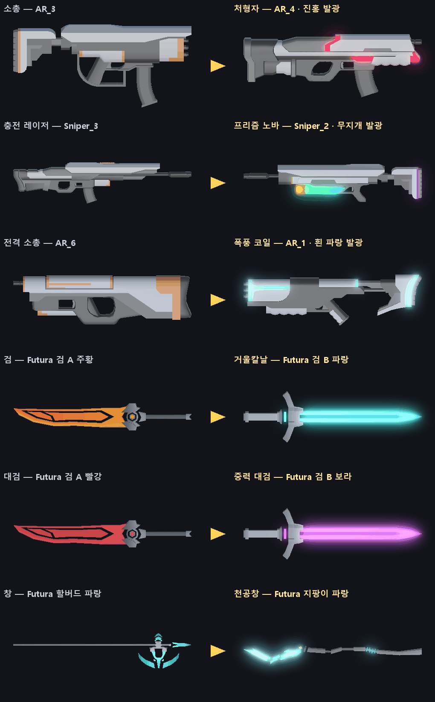

- 만든 방법: 프로젝트의 모델을 그대로 렌더링하고(왼쪽), 오른쪽은 **안 쓰는 후보 모델**의 강조 부위 색을 바꾸고 빛 번짐을 합성했다. 실제 게임의 Bloom 결과와는 다를 수 있다 — 방향을 보여 주는 그림
- 검은 넓적한 칼날(검 A) → **에너지 검신(검 B)** 으로 바뀌어 실루엣 차이가 가장 크다. 총은 같은 팩이라 실루엣이 비슷해서 **발광 색과 부속**으로 차이를 만들어야 한다

#### B-14-3. 모델 — 이미 가진 팩에서 고른다 (새로 받지 않아도 된다)

**Futura 원본 zip** (`Desktop/NoName_Proj/Futura Weapons.zip`) — 84개 중 5개만 쓰고 있다

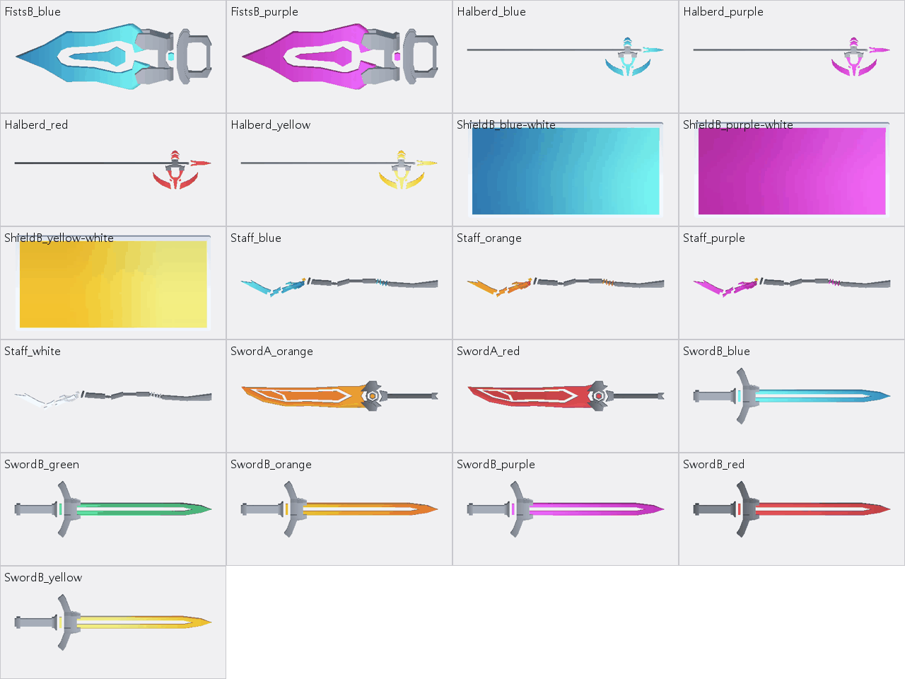

| 원래 | 상위 무기 | 후보 모델 | 이유 |
|---|---|---|---|
| 검 (검 A 주황) | 거울칼날 · 사슬검 | **검 B** 파랑 · 초록 | 넓적한 칼날 → 가드 달린 에너지 검신. 실루엣이 확 바뀐다 |
| 대검 (검 A 빨강, 크게) | 중력 대검 · 성채 대검 | **검 B** 보라 · 노랑을 대검 크기로 + 검신 두께 ×1.6 (축별 크기) | 검 B 는 가늘어서 그대로면 대검답지 않다 — 두께를 키운다 |
| 창 (할버드 파랑) | 천공창 | **지팡이** 파랑 (끝에 결정) | 할버드는 색만 다른 변형이라 차이가 작다 |
| 창 | 팔랑크스 | 할버드 빨강 + 왼팔에 **방패 B** (직사각 방벽) | 방패 B 는 평평한 판 — 탑실드 모양으로 쓴다 |
| 그랩 갈고리 (주먹 A) | 사슬검의 사슬 끝 | **주먹 B** (큰 칼날 모양) | |

- 라이선스는 지금 쓰는 Futura 모델과 같은 조건 (⚠ 정식 문구 없음 — `MODEL_LICENSES.md`)

**GunPack** — 20개 중 6개만 쓰고 있다 (소총 AR_3 · 기관단총 SMG_1 · 샷건 Grenade_2 · 스나이퍼 Sniper_1 · 충전 레이저 Sniper_3 · 전격 소총 AR_6)

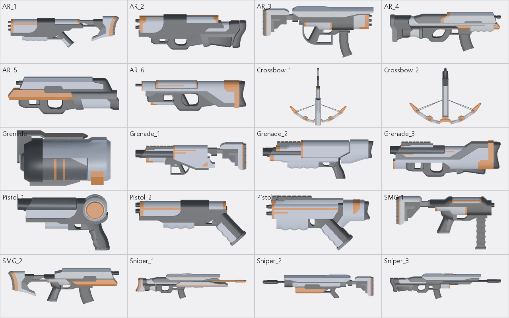

| 원래 (모델) | 상위 무기 | 후보 모델 + 부속 |
|---|---|---|
| 소총 (AR_3) | 처형자 / 스웜 카빈 | **AR_4** (탄창 달린 묵직한 몸통) / AR_2 + 총열 아래 미사일 포드 |
| 기관단총 (SMG_1) | 회전 기관포 / 파편 폭풍 | **AR_5** (두꺼운 몸통) + 다총열 뭉치 / SMG_2 |
| 샷건 (Grenade_2) | 공성포 / 용의 포효 | **Grenade_3** + 큰 포구 / Grenade_1 + 화염 노즐 · 연료통 |
| 스나이퍼 (Sniper_1) | 궤도 레일캐논 / 다중 표적 | **Sniper_2** + 위아래 레일 두 줄 / Sniper_2 + 큰 조준경 |
| 전격 소총 (AR_6) | 폭풍 코일 / 뇌운 | **AR_1** (뼈대 개머리판 — 코일을 감기 좋다) + 전기 코일 고리 |
| 충전 레이저 (Sniper_3) | 프리즘 노바 / 태양창 | Sniper_2 + **떠 있는 프리즘 결정 3개** / Sniper_3 + 총구 앞 큰 집광 고리 |

- 안 쓰는 모델: AR_1 · AR_2 · AR_4 · AR_5 · Grenade_1 · Grenade_3 · SMG_2 · Sniper_2 (권총 3종 · 석궁 2종 · Grenade 는 작거나 모양이 맞지 않는다)
- 팩 전체가 **회색 + 주황 강조**라 실루엣만으로는 구분이 약하다 → 발광 색(14-4)과 부속(아래)이 필요하다
- ⚠ GunPack 은 **출처 미상** (`MODEL_LICENSES.md`) — 상위 무기에 더 쓰기 전에 받은 사람에게 확인. 확인이 안 되면 CC0 팩으로 바꾸는 길이 15-2 에 있다

**부속 오브젝트** — 모델이 없어도 실루엣을 바꾼다 (도구가 기본 도형으로 만든다)

| 부속 | 상위 무기 | 만드는 법 |
|---|---|---|
| 총구 둘레를 도는 프리즘 결정 3개 | 프리즘 노바 | 팔면체 메시 · 무지개 발광 · 충전할 때 빨리 돈다 |
| 총열에 감긴 코일 고리 + 번쩍이는 전기 | 폭풍 코일 · 뇌운 | 링 메시 + `FxLine` 지그재그 |
| 다총열 뭉치 (쏠 때 회전) | 회전 기관포 | 원기둥 6개 — 연사 배율에 맞춰 회전 속도 |
| 위아래 레일 두 줄 + 충전 빛 | 궤도 레일캐논 | 상자 2개 · 쏘기 전 빛이 앞으로 흐른다 |
| 검신 둘레를 떠도는 파편 · 중력 고리 | 중력 대검 | 파티클 + 링 |
| 손잡이에서 늘어진 사슬 마디 | 사슬검 | 작은 상자 연결 (휘두를 때 사슬로 늘어난다) |
| 왼팔 직사각 방벽 | 팔랑크스 | Futura 방패 B |

#### B-14-4. 재질 — 강조 부위만 빛나게

| 할 일 | 내용 |
|---|---|
| **발광 마스크** | 도구가 텍스처에서 강조색 칸(GunPack 주황 · Futura 색칸)만 골라 흰색, 나머지는 검은색인 마스크를 만든다 → Emission 맵. 몸통 회색은 빛나지 않는다 (컨셉 그림처럼) |
| 상위 무기 재질 | 원래 재질 복사 + 강조색을 테마 색으로 + Emission (HDR 강도 2 ~ 4) |
| 흐르는 빛 띠 | 셰이더 하나(`EvolvedGlow`, Shader Graph) — 마스크 위로 밝은 띠가 1.5초마다 지나간다. 상위 무기 공통 표시 (8-2 의 "빛이 흐르는 테두리"와 같은 느낌) |
| 진화 순간 | 같은 셰이더의 **디졸브** — 새 모델이 손잡이 쪽에서 끝 쪽으로 빛나며 나타난다 (8-1 의 0.0 ~ 0.3초) |
| Bloom | HDR 색이 번지려면 게임 씬의 URP 볼륨에 Bloom 이 켜져 있어야 한다 — **확인 필요** (`Settings/DefaultVolumeProfile` 에 Bloom 항목이 있다). 문턱값이 1 근처면 HDR 강도가 1 을 넘는 것만 번져 UI · 바닥과 섞이지 않는다 |
| 캐릭터 | 상위 무기를 든 동안 발밑에 테마 색 고리 · 손 주변 작은 빛 입자 — 탑다운에서 무기보다 잘 보인다 |

#### B-14-5. 공격 이펙트 — 상위 무기별

**1차 4종 — 자세히**

| 상위 무기 (색) | 쏘기 · 휘두르기 | 맞을 때 | 특수 · 처치 | 소리 |
|---|---|---|---|---|
| **처형자** (진홍) | 총구 진홍 섬광 · 짧고 굵은 탄 꼬리 | 작은 진홍 불똥 | 처치하면 적 자리에 진홍 고리가 0.15초 **안으로 줄어든 뒤** 폭발(빛 · 파편). 연쇄는 0.08초씩 늦게 터뜨려 **도미노가 눈에 보이게** | 저음 "쿵" 한 층 · 연쇄마다 음 높이 반음씩 올림 |
| **프리즘 노바** (무지개) | 무기 둘레를 돌던 결정 3개가 빨강 · 초록 · 파랑 **빛**이 되어 꼬리를 끌며 전방 적 사이를 튕긴다 → 총구로 빨려 들어가 흰 섬광 → 세 색이 흰 중심을 감고 도는 **굵은 빔 2초** (커서를 따라 휘두른다) | 빛이 맞힌 자리 · 빔에 맞은 자리에 색 고리 | 수렴 순간 섬광 · 흔들림 | 빛 발사음 → 차오르는 소리 → 큰 레이저 |
| **거울칼날** (청록) | 검신 길이의 청록 궤적 | 청록 불똥 | 되돌린 탄이 청록으로 바뀌고 꼬리가 생긴다. 네 번째 휘두르기 — **반투명 초승달 검기 3개**가 날아가며 조금씩 커지고, 지나간 바닥에 얇은 자국 | 고음 "슝" |
| **중력 대검** (보라) | 보라 궤적 · 내려찍는 자리 바닥 충격 | 보라 불똥 | 바닥에 **회전하는 소용돌이 원판** + 안쪽으로 빨려드는 입자 · 끌려가는 적 뒤로 짧은 선 → 붕괴: 0.1초 안으로 줄어든 뒤 바깥으로 폭발 고리 | 저음 "웅" → "쾅" |

**나머지 16종 — 한 줄씩**

| 상위 무기 (색) | 쏘기 · 휘두르기 | 특수 · 처치 |
|---|---|---|
| 스웜 카빈 (주황) | 꼬리 연기를 단 소형 미사일 3발이 곡선을 그리며 흩어진다 | 작은 폭발 · 연기 |
| 회전 기관포 (노랑) | 총구 불꽃 + 굵은 예광탄 줄기 · 탄피 분수 — 연사가 오를수록 불꽃이 커진다 | 다총열 회전 · 오래 쏘면 총열이 붉어진다 |
| 파편 폭풍 (흰 주황) | 일반 탄 | 맞은 자리에서 불꽃 선 2줄이 옆 적으로 튄다 |
| 공성포 (금색) | 총구 충격파 고리 · 빛나는 큰 포탄 | 지나가며 연속 폭발 · 사거리 끝 큰 폭발 · 큰 흔들림 |
| 용의 포효 (주황 빨강) | 화염 원뿔 입자 · 바닥 그을음 | 불붙은 적 몸에 불꽃 · 옮겨붙을 때 불꽃 선 |
| 궤도 레일캐논 (흰 파랑) | 쏘기 전 레일에 빛이 앞으로 흐름 → 화면 끝까지 굵은 빔 · 잔상 | 0.4초 뒤 빔 자리를 따라 폭발 줄 |
| 다중 표적 (빨강) | 일반 탄 | 맞은 적 머리 위 붉은 조준 표식 → 5발째 6줄기 동시 섬광 |
| 폭풍 코일 (흰 파랑) | 굵어진 지그재그 전격선 · 연쇄마다 가지 | 하늘에서 떨어지는 낙뢰 · 착탄 섬광 |
| 뇌운 (남색) | 장전할 때 플레이어 머리 위 먹구름 | 구름에서 연속 낙뢰 |
| 태양창 (흰 금색) | 충전하는 동안 예고선이 앞으로 뻗어 나간다 → 다 모으면 한 방짜리 굵은 빛 기둥 | 바닥 그을음 자국 · 지나간 적 화상 |
| 사슬검 (초록) | 사슬이 호를 그리며 휘날리는 긴 궤적 | 끌려오는 적에 사슬 선 |
| 성채 대검 (노랑) | 노랑 궤적 | 바닥 균열 고리 · 먼지 · 큰 흔들림 · 막은 피해가 모일수록 검신이 밝아진다 |
| 천공창 (청록) | 찌르기 끝에서 빛의 창이 10m 뻗는다 (빠르게 늘었다 사라짐) | 끌려오는 적에 와이어 선 |
| 팔랑크스 (빨강) | 빠른 찌르기 잔상 여러 줄 | 돌격 궤적 · 부딪힌 적 불똥 |
| 폭격 편대 (주황) | 드론 3기 · 떨어지는 폭탄에 낙하선 | 폭발 |
| 위성 방벽 (청록) | 반투명 방패를 단 드론이 가까이 돈다 | 탄을 막을 때 방패면 번쩍 |

**공통 부품** — 한 번 만들어 여러 상위 무기가 나눠 쓴다

| 부품 | 쓰는 상위 무기 | 만드는 법 |
|---|---|---|
| 굵은 빔 (폭 · 흐르는 텍스처 · 끝 섬광) | 레일캐논 · 프리즘 · 태양창 · 천공창 | `FxLine` 확장 — 폭 곡선 · UV 스크롤 |
| 지그재그 전기 | 폭풍 코일 · 뇌운 · 테슬라 노바 | `FxLine` (전격 소총 것 재사용) + 세로 낙뢰 |
| 탄 꼬리 | 스웜 · 기관포 · 공성포 · 처형자 | 탄 프리팹에 `TrailRenderer` (탄 색 통로가 이미 있다) |
| 휘두르기 궤적 · 검기 | 근접 6종 | 초승달 메시 + 알파 텍스처 (도구가 그린다) 또는 15-1 의 Slash Effects FREE |
| 충격파 고리 · 바닥 균열 | 성채 대검 · 공성포 · 진화 순간 | 고리(충격 방출기 것) + 균열 텍스처 (도구가 그린다) |
| 폭발 | 처형자 · 스웜 · 공성포 · 폭격 | `vfx_Explosion_01` 복사 → 색만 바꿈, 또는 Cartoon FX Remaster Free |
| 화염 · 연기 | 용의 포효 · 회전 기관포 | 파티클 + Kenney Particle Pack 텍스처, 또는 Cartoon FX |
| 소용돌이 | 중력 대검 | 회전 원판 텍스처 (도구가 그린다) + 안쪽으로 가는 파티클 |
| 타격 섬광 | 전부 | 기존 `Hit` 프리팹 색 바꾸기, 또는 Hit Effects FREE |

#### B-14-6. 구현에 더할 것 (10장 보충)

| 할 일 | 내용 |
|---|---|
| 모습 데이터 | 상위 무기 데이터에 묶음 하나 — 모델 프리팹 · 크기 · 테마 색 · 발광 강도 · 부속 프리팹 · 탄 · 궤적 · 타격 · 처치 효과 · 소리. **테마 색 하나를 바꾸면 전부 따라 바뀌게** |
| 셰이더 | `EvolvedGlow` 하나 (URP Lit 바탕 + 마스크 발광 + 흐르는 띠 + 디졸브) |
| 도구 | `EvolutionSetup` 에 — 발광 마스크 · 상위 재질 · 부속 메시 · 초승달 / 소용돌이 / 균열 텍스처 · 프리팹 조립 (없을 때만 만든다) |
| 아이콘 | `WeaponIconRender` 에 상위 무기 추가 — 발광 재질 그대로 찍힌다 |
| 설정 | 설정창에 "효과 줄이기" (발광 · 파티클 절반) — 저사양 · 멀미 대비 (나중) |
| 검증 | 캡처 — 진화 전 · 후 · 1차 4종 공격 장면 / 적 70마리에서 프레임 |

---

### B-15. 에셋 조사

> 무료 · URP 호환 · 라이선스가 분명한 것 위주. 2026-10-08 확인 — 버전 · 호환은 받기 전에 다시 볼 것.

#### B-15-1. 이펙트 (VFX)

| 팩 | 제작 · 곳 | 들어 있는 것 | 파이프라인 | 라이선스 · 가격 | 우리 쓰임 | 추천 |
|---|---|---|---|---|---|---|
| **Cartoon FX Remaster Free** | Jean Moreno · Asset Store | 폭발 · 연기 · 불 · 물 · 마법 · 전기 · 폭죽 등 50개 이상 + 변형. 전용 셰이더(UV 왜곡 · 디졸브), 카메라 흔들림 · 빛, Bloom 과 어울리는 HDR | 내장 · URP (2D · Forward) | Asset Store EULA · 무료 | 폭발 · 화염 · 전기 · 처치 연출 | ★ |
| **Slash Effects FREE** | Matthew Guz · Asset Store | 휘두르기 궤적 | 내장 · URP (2022.3.10 이상) | Asset Store EULA · 무료 · 12.9 MB | 근접 상위 무기 궤적 · 검기 | ★ |
| Hit Effects FREE | Matthew Guz · Asset Store | 타격 효과 | 내장 · URP | Asset Store EULA · 무료 · 12.4 MB | 상위 무기 타격 섬광 | |
| Status and Auras FREE | Matthew Guz · Asset Store | 상태 · 오라 | 내장 · URP | Asset Store EULA · 무료 · 4.4 MB | 상위 무기를 든 캐릭터 오라 · 발밑 고리 | |
| Magic Effects FREE | Hovl Studio · Asset Store | 마법 효과 | 내장 · URP · HDRP | Asset Store EULA · 무료 · 36.4 MB | 프리즘 · 소용돌이 참고 | |
| Particle Pack | Unity Technologies · Asset Store | 불 · 폭발 등 기본 효과 | URP (Unity 6 기준) | 무료 · 157 MB | 화염 · 폭발 | 크다 — 필요한 것만 |
| **Kenney Particle Pack** | Kenney | 파티클 그림 80장 (불 · 연기 · 마법 · 하트 · 불꽃 · 전기) + Unity 예제 | 텍스처라 무관 | **CC0** · 무료 | 우리 파티클의 텍스처 재료 | ★ |
| Zap VFX — Unity URP | Vefects · itch.io | 번개 7색 · 소리 포함 | **URP 만** · Unity 2023 이상 | 무료(원하는 만큼 지불) · ⚠ **라이선스 문구가 페이지에 없다** | 폭풍 코일 · 뇌운 | 확인 후 |
| (이미 있음) Free Quick Effects Vol. 1 | Gabriel Aguiar · Asset Store | 전기 · 폭발 · 충격 · 투사체 2 · 회오리 | URP | Asset Store EULA | 스킬 쪽이 쓰는 중 — **복사해서 색만 바꿔** 쓴다 | |
| (참고) Sword slashes PRO | Hovl Studio · Asset Store | 휘두르기 22종 + 콤보 11 | URP · HDRP | 유료 ($20) | 무료 팩이 부족할 때만 | |

- **URP 주의 (Cartoon FX)**: 재질 대부분이 URP 에셋의 **Depth Texture · Opaque Texture** 를 켜야 빌드에서 보인다 (에디터에서는 보이는데 빌드에서 안 보이는 함정)
- 무료 팩을 여러 개 섞으면 **화풍이 갈린다** — 한 팩(Cartoon FX)을 바탕으로 하고, 나머지는 색 · 크기를 맞춰 보탠다

#### B-15-2. 모델

| 팩 | 곳 | 들어 있는 것 | 라이선스 | 우리 쓰임 | 추천 |
|---|---|---|---|---|---|
| **Futura Weapon Pack** (이미 있음) | moisturizedfish · itch.io | 검 B · 지팡이 · 주먹 B · 방패 B 등 — 84개 중 79개 안 씀 | ⚠ 정식 문구 없음 (제작자 댓글로 허락) | 근접 상위 무기 전부 (14-3) | ★ |
| **GunPack** (이미 있음) | ? | 안 쓴 총 8개 (14-3) | ⚠ **출처 미상** | 사수 상위 무기 — 확인되면 | 확인 후 |
| Quaternius Sci-Fi Gun Pack | quaternius.com | SF 총 7종 — 권총 · 롱 권총 · 소총 · 저격총 · **번개총 · 광선총** 등 · FBX / OBJ / Blend · 텍스처 없음(단색 재질) | **CC0** | 폭풍 코일(번개총) · 프리즘 노바(광선총) | GunPack 대체 |
| **Quaternius Sci-Fi Modular Gun Pack** | quaternius.com | 부품 + 조립된 SF 총 78조각 · FBX / OBJ / glTF / Blend · 텍스처 없음 | **CC0** | 부속(총열 · 코일 · 조준경)을 떼어 붙이기 좋다 | ★ GunPack 대체 1순위 |
| Kenney Blaster Kit | kenney.nl | 블래스터 · 탄 · 탄창 · 소음기 등 40개 (v2.1) | **CC0** | 장난감 같은 화풍 — 우리와 다름 | 참고만 |

#### B-15-3. 받기 · 넣기 규칙

| 규칙 | 내용 |
|---|---|
| 받는 곳 | **공식 Asset Store · 제작자 페이지에서만**. 팩 이름으로 검색하면 무단 배포 사이트가 섞여 나온다 — 쓰지 않는다 |
| Asset Store 좌석 | Standard EULA 는 **좌석(사람) 단위** — 무료 팩도 에디터에서 쓰는 팀원은 각자 계정에 추가 (무료라 비용 없음) |
| 폴더 | 받은 위치 그대로 둔다 (외부 에셋 규칙). 상위 무기 프리팹 · 재질 · 복사본만 우리 폴더에 |
| 기록 | 모델은 `MODEL_LICENSES.md`, 이펙트는 같은 형식의 표에 한 줄 (팩 · 곳 · 라이선스 · 받은 날 · 쓰는 곳) |
| 표기 | CC0 는 의무 없음(권장). Futura 는 크레딧 권장 |

#### B-15-4. 추천 조합

| 단계 | 쓰는 것 | 새로 받을 것 |
|---|---|---|
| **1차 (바로)** | Futura 검 B · 지팡이 (이미 있음) · GunPack 안 쓴 모델 (확인 후) · 발광 마스크 도구 · `FxLine` · 고리 · Gabriel Aguiar 복사 | **없음** — 1차 4종은 가진 것으로 된다 |
| 더 화려하게 | + Cartoon FX Remaster Free (폭발 · 불 · 전기) · Slash Effects FREE (검 궤적) · Kenney Particle Pack (텍스처) | 무료 3개 |
| GunPack 확인 실패 시 | Quaternius Sci-Fi Modular Gun Pack 으로 총 6종 + 상위 총을 다시 맞춘다 | 무료 1개 (CC0) |

---

### B-16. 구현 결과 — 상위 무기 20종 (1차 4종 2026-10-09 · 나머지 16종 2026-10-11) → 8종 보관 · 혈검 추가 · 다중 표적 · 천공창 보관 · 지금 11종 (16-11 · 16-12 · 16-15)

> 요청: "1차 4종 끝까지" (2026-10-08 작성 → 중단 → 2026-10-09 재개). **처형자 · 프리즘 노바 · 거울칼날 · 중력 대검** 구현 · 검증 완료.
> 요청: "남은 상위무기 계획한대로 개발진행" (2026-10-11, 중단 → 재개). **나머지 16종** (총 10 · 근접 4 · 드론 2) 구현 · 검증 완료 — 4 · 5 · 6장 표의 상위 무기가 모두 들어갔다. 커밋은 하지 않았다.

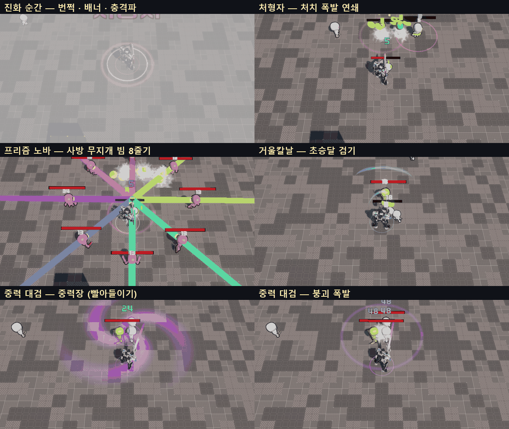

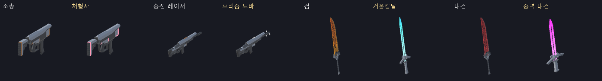

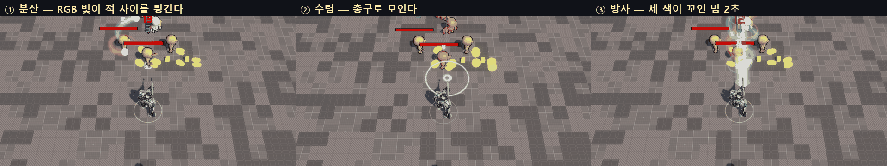

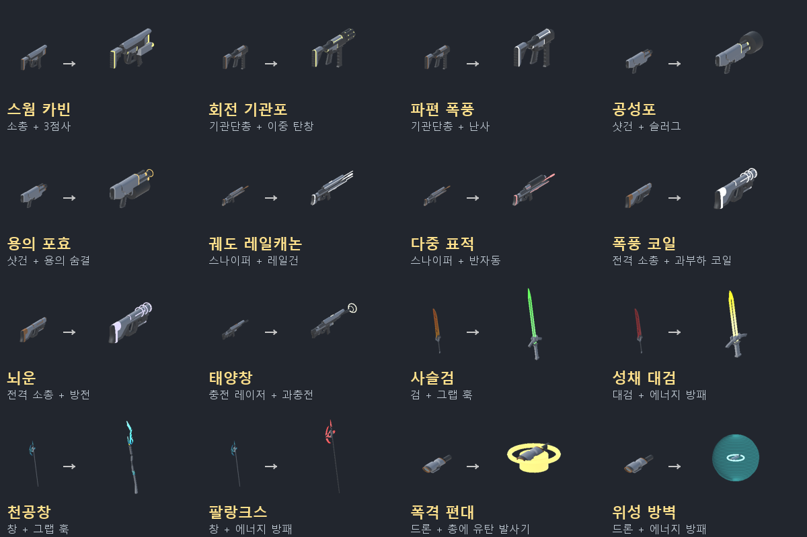

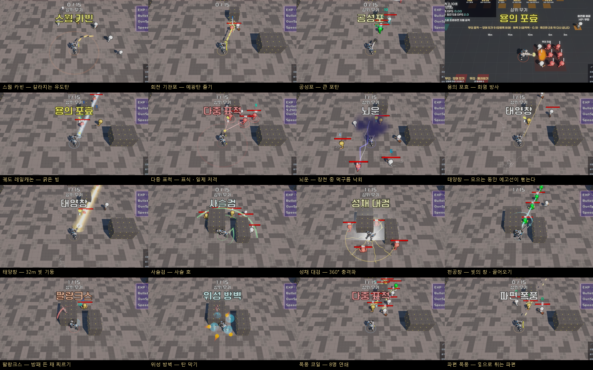

#### B-16-1. 정한 것 (사용자 결정 2026-10-08 — 3장 · 13장의 처음 추천보다 이것이 우선)

| 항목 | 결정 |
|---|---|
| **무기 최대 레벨** | **모든 무기 5 → 3** · 레벨당 강화량은 그대로 (진화 전 무기는 예전 Lv5 보다 약하고, 그 차이를 상위 무기가 메운다). `WD_*` 10개 · `WeaponData` 기본값 |
| **진화 조건** | **최대 레벨(Lv3) + 짝 장비가 "있기만" 하면** — 사수: 그 총에 개조 / 검사: 서브 능력 보유(Lv1 이상) / 폭격 편대: 가진 총 하나에 유탄 발사기 |
| 받는 방식 | 보상 카드 반드시 1장(최대 2장, 카드가 여러 장이면 한 장은 무작위) + 정비 창 무기 줄 맨 앞 (무료) · 거절 가능 |
| 개조 칸 | 상위 무기가 이어받고 잠금 — 개조는 그대로 달려 있고 바꿀 수 없다 |
| 연출 시간 | 슬로 모션은 쓰지 않는다 — 카드 · 정비 창의 시간 정지와 엉키지 않게. 시간이 다시 흐를 때(보통 다음 스테이지 시작) 연출된다 |

- 개조는 Lv3 부터라 사수는 **"Lv3 에 개조를 사면 곧바로 진화 가능"** 이다. 9-1 의 시점은 Stage 2 ~ 3 으로 당겨진다 (측정 필요)

#### B-16-2. 된 것

| 상위 무기 | 조합 | 동작 (지금 값) | 모습 |
|---|---|---|---|
| **처형자** | 소총 Lv3 + 지정사수 | 피해 ×1.25 · 치명타 +5%p. 탄으로 처치하면 0.15초 뒤 반경 2m 폭발(처치한 탄 피해 ×1.2) → 그 폭발로 죽은 적도 터진다 (3단, 단마다 ×0.85, 0.08초씩 늦게) | 소총 모델 · 주황 강조 → **진홍 발광** · ×1.1 · 진홍 탄 · 진홍 고리 + 폭발 |
| **프리즘 노바** | 충전 레이저 Lv3 + 분광 프리즘 | 피해 ×1.2. 한 발(탄 1발) = **① 분산 1초**: R · G · B 빛 3개가 전방 140° 의 적 사이를 튕기며 맞힌다 (빛마다 최대 4명 · 공격력 ×0.4) → **② 수렴 0.3초** → **③ 방사 2초**: 굵은 빔, 커서를 초당 120° 로 따라간다, 0.1초마다 빔 위 적 전부 ×0.35. 끝나면 충전을 처음부터 (2026-10-10 변경) | 무지개로 도는 발광 · **결정 3개가 빛이 되어 날아갔다 돌아온다** · 세 색이 꼬인 빔 |
| **거울칼날** | 검 Lv3 + 에너지 방패 | 피해 ×1.25. 휘두를 때마다 정면 150° · 사거리+1.2m 안 몬스터 탄을 되돌린다(공격력 ×1). 네 번째마다 **초승달 검기 3개** (8m · 관통 · 공격력 ×2) | **Futura 검 B(파랑) 에너지 검신** · 칼끝 궤적 · 청록 검기 |
| **중력 대검** | 대검 Lv3 + 그랩 훅 | 피해 ×1.2. 내려찍기마다 앞 3m 에 **중력장** 1.2초 — 반경 6m 적을 끌어와 경직 → 붕괴 폭발 반경 3m (공격력 ×2 · 경직 0.6초) | **Futura 검 B(보라) · 두께 ×1.7** · 칼끝 궤적 · 바닥 보라 소용돌이 |

**나머지 16종 (2026-10-11)** — 수치는 전부 에셋 (고유 동작 `Data/Evolutions/Effects/AE_EVO_*`, 무기 `Data/Weapons/WD_EVO_*`)

| 상위 무기 | 조합 | 동작 (처음 값) | 고유 동작 |
|---|---|---|---|
| 스웜 카빈 | 소총 + 3점사 | 점사 3발이 유도탄 — 가까운 적 4명을 돌아가며 쫓는다(초당 360°, 가까울수록 더 꺾음), 맞으면 반경 1.2m 폭발 60% · 피해 ×1.2 · 미사일 모양 탄 | `ExplodeOnHitEffect`(AE_EVO_SwarmBlast) + 데이터 `homingTurnRate` |
| 회전 기관포 | 기관단총 + 이중 탄창 | 탄창 무한(장전 없음) · 쏘는 동안 2초에 걸쳐 연사 ×3, 멈추면 1초에 내려감 · 다총열이 연사에 맞춰 돈다 · 굵은 예광탄 | `SpinUpEffect` |
| 파편 폭풍 | 기관단총 + 난사 | 명중마다 파편 2개가 4m 안 다른 적에게 (40%, 다시 튀지 않음) | `FragmentOnHitEffect` |
| 공성포 | 샷건 + 슬러그 | 관통 무제한 큰 포탄(사거리 약 15m) · 맞은 적마다 반경 1.5m 폭발 60% + 2m 밀치기 · 사거리 끝 반경 3m 큰 폭발(공격력 ×1.5) · 총구 충격파 | `SiegeShellEffect` |
| 용의 포효 | 샷건 + 용의 숨결 | 탄 대신 화염 방사 — 0.1초마다 정면 6m · 50° 피해 + 화상(공격력 ×2/초, 3초) · 화상 중 죽은 적은 2m 안에 불을 옮긴다 · 탄창 40 | `FlameConeEffect` + 데이터 `spawnProjectiles = false` |
| 궤도 레일캐논 | 스나이퍼 + 레일건 | 탄 대신 32m 굵은 빔(관통 무제한, 맞은 적마다 명중 알림) · 0.4초 뒤 빔 자리 폭발 줄(50%) | `RailLineEffect` + `spawnProjectiles = false` |
| 다중 표적 | 스나이퍼 + 반자동 | 맞힌 적에 붉은 조준 고리 3초 · 5발마다 표식 있는 적 최대 6명 동시 저격(치명타 확정) | `MarkVolleyEffect` |
| 폭풍 코일 | 전격 소총 + 과부하 코일 | 연쇄 8명 · 연쇄 거리 ×1.5 · 연쇄된 적마다 20% 낙뢰(반경 1.5m · ×2) | `LightningStrikeEffect` + 데이터 `notifyEveryChain` |
| 뇌운 | 전격 소총 + 방전 | 장전하는 동안 머리 위 먹구름 → 8m 안 적에게 초당 4번 낙뢰(×1.5 · 경직 0.3초) | `ThunderCloudEffect` |
| **태양창** | 충전 레이저 + 과충전 | **사용자 요청 반영** — 쿨다운이 끝나면 0.8초 더 모은다(충전 지연). 그동안 바닥 예고선이 **10m → 32m** 로 앞으로 뻗고, 다 모으면 굵은 흰 금빛 기둥 한 방(기둥 위 적 전부 · 화상 · 바닥 그을음 · 큰 흔들림). 모으는 동안 다른 발은 막힌다(`IsBusy`). `earlyReleaseRange`(기본 0 = 끔)를 켜면 적이 붙었을 때 모은 만큼만 일찍 쏜다 | `SunLanceBurst` + `ChargeBeamWeaponData.sunLance` |
| 사슬검 | 검 + 그랩 훅 | 사거리 6m · 150° · 대상 10 · 사슬 호 연출 · 세 번째 휘두르기마다 맞은 적 중 먼 3명을 앞으로 끌어옴 | `ChainWhipEffect` |
| 성채 대검 | 대검 + 에너지 방패 | 내려찍기가 360° 충격파(반경 5m · ×1.5 · 밀치기 2m · 경직 0.8초) · 방패로 막은 피해 ×3 을 모아(최대 공격력 ×5) 다음 충격파에 더함 | `BastionSlamEffect` (+ `ShieldAbility.OnAbsorbed`) |
| 천공창 | 창 + 그랩 훅 | 찌르기 끝에서 빛의 창이 10m 더(관통 · ×1.2) · 가장 먼 적을 앞으로 끌어옴 · Futura 지팡이 모델 | `LanceExtendEffect` |
| 팔랑크스 | 창 + 에너지 방패 | 방패를 든 채 찌르기 ×2.5 · 떼면 6m 돌격 찌르기(×3) · 붉은 잔상 · Futura 할버드 빨강 | `PhalanxEffect` + 데이터 `attackWhileShielding` |
| 폭격 편대 | 드론 + **가진 총 하나에** 유탄 발사기 | 드론 +2기 · 피해 ×1.3 · 탄이 폭탄(반경 1.5m · 100%) | `ExplodeOnHitEffect`(AE_EVO_BomberBlast) + 조건 `requiredAnyGunAttachment` |
| 위성 방벽 | 드론 + 에너지 방패 | 드론 +1기 · 반경 1.6m 로 빠르게 돈다 · 닿은 몬스터 탄을 밖으로 튕겨 냄 · 부딪힌 적 ×2 · 밀치기 | `SatelliteGuardEffect` |

16종의 모습 — 총은 원래 모델 + 테마 색 발광 + **기본 도형 부속** (미사일 포드 · 다총열 · 큰 포구 · 연료통 · 레일 · 조준경 · 코일 고리 · 집광 고리, `EvolutionSetupMore.AddGunParts`), 근접은 Futura 검 B 초록 · 노랑 / 지팡이 파랑 / 할버드 빨강, 드론은 발광 고리 + 폭탄통 / 반투명 방패 구. 탄도 테마 색.

공통

| 항목 | 내용 |
|---|---|
| 진화 순간 | 화면 번쩍 · 배너 "상위 무기 — 이름" · 충격파 고리 두 겹 · 주변 4.5m 적 밀치기 + 경직 · 화면 흔들림 · 소리 |
| 상위 무기를 든 동안 | 발밑 테마 색 고리 (숨 쉬듯) |
| HUD | 무기 칸 글자 **★** / 진화할 수 있으면 **"진화!"** · 장비 판 머리글 "· 진화 가능: 처형자" · 상세(Z)면 다음 목표 "→ 처형자 (Lv3 + 개조: 지정사수)" |
| 보상 · 정비 | 진화 카드는 보상 뽑기 6번 모두 들어왔다 · 정비 창 무기 줄 맨 앞 · 백금색 카드 |
| 넘겨받는 것 | 같은 칸 · 손에 든 상태 · 레벨 · 범용 강화 누적분 · 부착물 5부위 + 개조(잠김) · 하부 E 능력(오브젝트째 — 쿨타임 유지). 원래 무기는 "이미 가진 무기"로 다시 안 나온다 |

#### B-16-3. 계획과 달라진 점

| 항목 | 계획 | 구현 |
|---|---|---|
| 조건 | Lv5 + 개조 / 서브 능력 Lv2 | **Lv3 + 있기만** (16-1) |
| 총 모델 | GunPack 안 쓴 모델 (AR_4 · Sniper_2) | **원래 모델 + 발광 재질 + 부속(결정)** — GunPack 출처가 확인될 때까지 새 모델을 늘리지 않았다 |
| 슬로 모션 | 0.2배 시간 | 없음 — 화면 연출 · 충격파만 (시간 배율 충돌 방지) |
| 흐르는 빛 띠 · 디졸브 셰이더 | `EvolvedGlow` 셰이더 | **스크립트(`EvolvedGlow`)가 발광 밝기를 숨 쉬듯 바꾼다** · 무지개는 색상환을 돈다. 셰이더는 나중 |
| 근접 발광 | 마스크 발광 | 계획대로 — Futura 색상표에서 채도 높은 칸만 남긴 마스크(`EVO_FuturaGlowMask.png`) |
| 크기 튜닝 | — | 캡처를 보고 처형자 폭발 ×1.3 · 검기 폭 3 · 진홍 발광 1.6 으로 낮춤 (2.5 는 톤매핑에서 분홍으로 날아갔다) |
| 총 모델 (16종) | 14-3 의 GunPack 다른 모델 · 부속 메시 | **원래 모델 + 발광 + 기본 도형 부속** (원기둥 · 상자 · 고리 메시를 도구가 만든다) — 실루엣은 바뀌지만 모델링 수준은 아니다 |
| 용의 포효 · 궤도 레일캐논 | 산탄 대신 화염 / 굵은 빔 | 계획대로 — 무기 데이터의 `spawnProjectiles` 를 끄면 탄 없이 쏘는 알림 · 탄약 · 소리만 남고, 고유 동작이 공격한다. 레일 빔은 맞은 적마다 명중 알림을 보내 다른 부착물 효과도 돈다 |
| **태양창** (2026-10-10 사용자 요청) | 충전 빔 한 방 | **충전 지연 0.8초 + 그동안 사거리 10 → 32m**. 자동 공격 게임이라 "오래 누를수록"이 아니라 "쿨다운 뒤 정해진 지연 동안 늘어난다". 적이 붙으면 모은 만큼만 일찍 쏘는 옵션(`earlyReleaseRange`)은 만들어 두고 껐다 |
| 폭격 편대 | 탄 대신 소형 폭탄 낙하 (유탄 포탄 재사용) | 드론 탄이 **폭발탄** (반경 1.5m · 100%) — 떨어지는 폭탄 · 낙하선 연출은 아직 |
| 위성 방벽 | 닿은 몬스터 탄을 막는다 | 막고 **바깥으로 튕겨 낸다** (반사판 · 거울칼날과 같은 길) — 튕겨 낸 탄이 적을 맞힌다 |
| 팔랑크스 모습 | 할버드 빨강 + 왼팔 방패 B | 할버드 빨강만 — 방패는 에너지 방패 서브 능력의 방패 면이 보인다 |
| 다중 표적 표식 | `TargetMarker` 프리팹 | 무기마다 도는 붉은 고리(LineRenderer)를 돌려 쓴다 |
| **프리즘 노바 방식** (2026-10-10) | 사방 8줄기 즉발 빔 | **분산 → 수렴 → 2초 방사** — "적 사이를 튕기는 빔"(A) 과 비교해 B 를 골랐다: 모았다 터뜨리는 흐름이 더 기억에 남고, 전격 소총 · 튕김탄과 겹치지 않는다. A 의 장점(튕김)은 ① 분산의 빛이 맡는다. 예전 옵션(`extraBeams` · `beamsAllAround` …)은 코드에 남아 있고 데이터에서 껐다 |

#### B-16-4. 바꾸고 싶을 때

| 바꿀 것 | 고칠 곳 |
|---|---|
| 진화 조건 (레벨 · 짝 장비) · 카드 문구 · 배너 색 · 소리 · 정비 창 가격 | `Scripts/Data/Evolutions/EVO_*` |
| 상위 무기 수치 (피해 · 치명타 · 빔 갈래 · 빔 폭 …) | `Scripts/Data/Weapons/WD_EVO_*` |
| 프리즘 노바 한 발 (분산 · 수렴 · 방사 시간, 빛 수 · 색 · 튕김 수 · 피해, 빔 굵기 · 따라가는 속도 · 틱 피해) | `WD_EVO_PrismNova` 의 `prismBurst` 묶음 |
| 태양창 한 발 (모으는 시간 · 처음 · 끝 사거리 · 일찍 쏘기 · 피해 · 화상 · 굵기 · 그을음) | `WD_EVO_SunLance` 의 `sunLance` 묶음 |
| 유도 (스웜 카빈) · 탄 없이 쏘기 (용의 포효 · 레일캐논) · 연쇄마다 알림 (폭풍 코일) · 방패 든 채 공격 (팔랑크스) | 각 `WD_EVO_*` 의 `homingTurnRate` · `spawnProjectiles` · `notifyEveryChain` · `attackWhileShielding` |
| 총 부속 크기 · 자리 | 코드 — `EvolutionSetupMore.AddGunParts` (프리팹을 지우고 도구를 다시 돌린다) |
| 고유 동작 수치 (폭발 반경 · 연쇄 단 · 중력장 반경 · 검기 수 · 되돌리기 범위 …) | `Scripts/Data/Evolutions/Effects/AE_EVO_*` |
| 발광 세기 · 색 · 무지개 | 프리팹 `Prefabs/Weapons/W_EVO_*` 의 `EvolvedGlow`, 재질 `Prefabs/Evolution/EVO_*` |
| 배너 · 충격파 · 발밑 고리 | `Resources/Evolution/EvolutionFx` (도구가 매번 다시 만든다 — 수치는 `EvolutionPresenter` 기본값) |
| 새 상위 무기 | 고유 동작(`AttachmentEffect` 상속, `OnKill` · `OnAttack` · `OnHit` · `OnProjectileExpired` · `Tick`) → `WD_EVO_*`(원래 무기 복제 + `evolvedFrom` · `innateEffects` · `themeColor`) → `EVO_*` → `EvolutionCatalog` · 보상 카드 |
| 처음 값으로 되돌리기 | `Tools/커스터마이징/상위 무기 다시 만들기 (처음 값으로)` |

- `Tools/커스터마이징/상위 무기 만들기` 는 **없는 것만** 만든다 — 손으로 고친 수치를 덮어쓰지 않는다 (아이콘 · 연출 프리팹만 다시 만든다)

#### B-16-5. 파일

| 구분 | 파일 |
|---|---|
| 새 스크립트 | `Scripts/Player/Evolution/` — `WeaponEvolutionData` · `EvolutionCatalog` · `EvolutionService` · `EvolutionPresenter` · `EvolvedGlow` · `EvolvedOrbit` · `BladeTrail` · `Effects/` (`KillChainExplosionEffect` · `GravityWellEffect` · `GravityWell` · `MirrorEdgeEffect` · `CrescentWave`), `Scripts/Stage/Reward/EvolutionReward`, `Scripts/Shop/EvolutionSource`, `Editor/EvolutionSetup` · (2026-10-10) `Scripts/Player/Evolution/PrismNovaBurst` · `Scripts/Data/PrismBurstSettings` |
| 고친 — Data | `WeaponData` (진화 칸 · 최대 레벨 기본 3) · `ChargeBeamWeaponData` (사방 빔 · 무지개 · 예고선) · `WD_*` 10개 최대 레벨 3 |
| 고친 — Player | `AttachmentEffect` (`Killed` · `WeaponAttack` · `OnKill` · `OnAttack`) · `AttachmentData` (`Fits` 원래 무기 기준) · `WeaponBase` (고유 동작 · 잠금 · `InheritFrom`) · `WeaponController` (`Evolve` · `Find`) · `MeleeWeapon` · `Bullet` · `ChainBeamWeapon` · `ChargeBeamWeapon` · `WeaponSlotUI` · `EquipmentHud` |
| 고친 — 보상 · 정비 | `StageReward` (`Guaranteed`) · `StageRewardPool` (먼저 뽑기) · `ShopOffer` (`Evolution`) · `ShopCardView` (백금색) · `MaintenanceUI` (무기 줄) |
| 고친 — 도구 | `CharacterSetup` (`BuildMeleeVariant`) · `WeaponIconRender` (`RenderOnly`) |
| 에셋 | `Data/Weapons/WD_EVO_*` 4 · `Data/Evolutions/EVO_*` 4 · `Effects/AE_EVO_*` 3 · `Prefabs/Weapons/W_EVO_*` 4 · `Prefabs/Evolution/` (재질 4 · 마스크 · 소용돌이 · 결정 메시) · `Resources/Evolution/` (EvolutionCatalog · EvolutionFx) · `Stage/Rewards/RW_EVO_*` 4 (+ StageRewardPool) · `Resources/Shop/ShopSource_Evolution` (+ ShopCatalog 맨 앞) · `Sprites/WeaponIcons/WD_EVO_*` 4 · `FuturaWeapons/Models/Sword_B_Blue · Purple.fbx` |
| 새 스크립트 (2026-10-11) | `Scripts/Player/Evolution/Effects/` — `EvoStrikes`(낙뢰 · 폭발 · 끌기 공용) · `SpinUpEffect` · `FragmentOnHitEffect` · `SiegeShellEffect` · `FlameConeEffect` · `RailLineEffect` · `MarkVolleyEffect` · `LightningStrikeEffect` · `ThunderCloudEffect` · `ChainWhipEffect` · `BastionSlamEffect` · `LanceExtendEffect` · `PhalanxEffect` · `SatelliteGuardEffect`, `Scripts/Player/Evolution/SunLanceBurst`, `Scripts/Data/SunLanceSettings`, `Editor/EvolutionSetupMore` |
| 고친 것 (2026-10-11) | `WeaponBase` (`FireRateBoost` 연사 배율 · `NotifyProjectileExpired`) · `AttachmentEffect` (`OnProjectileExpired`) · `WeaponStats` · `Bullet` (유도 — 가까울수록 세게 꺾기 · 사거리 끝 알림) · `ProjectileWeaponData` · `ProjectileWeapon` (유도 목표 돌려 고르기 · `spawnProjectiles`) · `ChainBeamWeaponData` · `ChainBeamWeapon` (`notifyEveryChain`) · `ChargeBeamWeaponData` · `ChargeBeamWeapon` (`sunLance`) · `DroneWeapon` · `DroneUnit` (`Units` · 드론 탄 출처 = 무기 → 명중 효과가 돈다) · `MeleeWeaponData` (팔랑크스 칸) · `MeleeWeapon` (판정 지연 ÷ 연사 배율) · `ShieldAbility` (팔랑크스 · `OnAbsorbed` · 돌격 거리 · 배율) · `WeaponEvolutionData` (`requiredAnyGunAttachment`) · `EvolutionCatalog` · `EvolutionService` · `EquipmentHud` · `FxLine` (`Arc`) · `TestRoomManager` (문구) |
| 고친 도구 (2026-10-11) | `EvolutionSetup` (partial · 아이콘 20종) · `CharacterSetup.BuildMeleeVariant` (창 · 지팡이 — 넓은 끝이 머리, 원래 창처럼 자루 뒤쪽을 쥔다) · `WeaponIconRender.RenderOnly` (드론은 유닛 모델) · `WeaponGrantWindow` · `TestRoomEvolutionSetup` (3줄 배치) |
| 에셋 (2026-10-11) | `WD_EVO_*` 16 · `EVO_*` 16 · `AE_EVO_*` 15 · `RW_EVO_*` 16 · `W_EVO_*` 14 · `Prefabs/Weapons/DroneUnit_EVO_Bomber · Satellite` · `Prefabs/Evolution/` (발광 재질 12 · `EVO_Flame` · `EVO_Cloud` · `EVO_SoftDot` · `EVO_Torus` · 탄 `Bullet_EVO_Missile · Tracer · Shell`) · 아이콘 16 · `FuturaWeapons/Models/Sword_B_Green · Sword_B_Yellow · Staff_Blue · Halberd_Red.fbx` (`MODEL_LICENSES.md`) · `Scenes/TestRoom.unity` |
| **고치지 않은 것** | `Enemy*` · `Boss*` · `GameManager` · `GameEvents` · 씬 · 스킬 · 업그레이드 |

#### B-16-6. 검증

배치 모드 임시 테스트 (Stage1, 멈춘 과녁) — 확인 뒤 지웠다.

| 테스트 | 결과 | 확인한 것 |
|---|---|---|
| 상위 무기 · 사수 | **36 항목 통과** | 최대 레벨 3 · 개조 없으면 진화 불가 → 지정사수를 달면 가능 · HUD "진화 가능" · 칸 "진화!" · 보상 뽑기 6/6 · 정비 창 맨 앞 무료 · 교체(같은 칸 · Lv3 · 부착물 3부위 · E 능력 같은 오브젝트 · 개조 잠금 · 소총 다시 안 팜) · 연출 1회 · ★ · 처형자 연쇄 3단(1.5m 간격 적 셋이 차례로 죽고 4m 밖 적은 그대로) · 프리즘 노바 (2026-10-10 새 방식) — 발사하면 한 발 주기 시작 · 도는 동안 다음 발 없음 · 빛이 적 사이를 9 ~ 10번 튕김 · 뒤쪽 적은 안 노림 · 수렴 → 빔 · 빔이 커서를 제한된 속도로 따라감 · 약 2초(21틱) · 빔 피해 · 탄 1발 · 끝나면 충전부터 |
| 상위 무기 · 검사 | **25 항목 통과** | 방패 없으면 불가 → 방패 Lv1 이면 가능 · 보상 6/6 · 교체 · 칼끝 궤적 · 발광 · 연출 · 탄 되돌리기 1 · 검기 3개 · 정면선 밖 7m 적에 검기 피해 18.6 · 그랩 없으면 불가 · 중력장 생성 · 4m · 3.4m 적이 0.8 · 1.2m 까지 끌림 · 경직 · 9m 적은 그대로 · 붕괴 피해 48 |
| 기존 사수 커스터마이징 | 53 / 53 | 부착물 · E 능력 · 개조 (최대 레벨 3 에서도 그대로) |
| 기존 검사 서브 능력 변형 | 29 / 29 | 그랩 · 방패 변형 |
| `TestRoomValidation` | 통과 | |
| **나머지 16종 · 사수** (2026-10-11) | **87 항목 통과** | 20종 에셋 (조합 · 결과 · 보상 카드 · 풀 · 목록 · 아이콘 · 프리팹) · 사수로 10종 + 폭격 편대 진화 (짝을 실제로 채워서) · 유도탄이 3/4 적에게 갈라짐 · 기관포 ×3.0 · 장전 없음 · 다총열 회전 · 멈추면 ×1.0 · 파편이 옆 적에게 · 포탄 관통 폭발 3 + 사거리 끝 폭발이 줄 밖 적에 16.4 · 화염 0.1초 틱 · 화상 · 뒤 적 무사 · 불 옮김 · 레일 빔 1발 1탄 · 20m 까지 관통 · 폭발 줄 · 줄 밖 무사 · 탄 없음 · 표식 3 → 일제 저격 3 · 전격 8명 · 낙뢰 8 · 장전 중 먹구름 · 낙뢰 7 · 장전 끝나면 멈춤 · 태양창 모으는 동안 다른 발 없음 · 절반에 예고선 19.9m · 32m 발사 · 5 · 14 · 28m 적 피해 · 화상 · 줄 밖 무사 · 탄 1발 · 드론 5기 폭발탄 |
| **나머지 16종 · 검사** (2026-10-11) | **36 항목 통과** | 사슬검 6m · 5m 부채꼴 5/5 · 세 번째에 끌기 2 · 끌린 적 1.1m · 성채 대검 막은 20 → 60 모음 · 360° 충격파가 뒤 · 왼 · 오른쪽에 96 (×1.5 + 60) · 경직 · 비움 · 천공창 7 · 10 · 13.5m 관통 · 줄 밖 무사 · 13.5m 적이 1.1m 로 끌려옴 · 팔랑크스 방패 든 채 ×2.5 · 찌르기 3 · 떼면 4.1m 돌격 52 (×3) · 배율 원래대로 · 위성 방벽 4기 1.5m · 탄 4/6 막음 · 들이받기 |
| 1차 사수 · 1차 검사 · 사수 커스터마이징 · 검사 변형 (2026-10-11 다시) | 46 · 25 · 53 · 29 — 모두 통과 | 유도 · 연사 배율 · 근접 판정 지연 · 방패 · 드론 탄 출처를 바꾼 뒤에도 그대로 |

- 시험 중 잡은 버그 (2026-10-11): ① 유도탄이 표적 둘레를 맴돌기만 함 (회전 반경 약 2.7m) → 가까울수록 최대 ×5 로 꺾고 1m 안이면 곧장. ② 팔랑크스 — ×2.5 로 빨라진 다음 찌르기(0.36초)가 판정(0.42초) 전에 이전 찌르기를 버려 한 번도 안 맞음 → 근접 판정 지연을 연사 배율로 나눈다. ③ 화염이 밝은 바닥에서 안 보임 → 반투명 입자 · 18개. ④ 총 부속이 몸통에 묻힘 → 총 높이 기준 배치
- 기존 검사 테스트는 대화 기록에서 되살렸는데, 처음에는 방패 돌진 · 원반 2개가 실패했다 — 테스트의 플레이어 초기화에 회전 속도 0 이 빠져 플레이어가 돌면서 엉뚱한 쪽으로 던졌다 (예전에 고쳤던 것). 넣고 나니 통과 — 게임 코드 문제가 아니다
- 캡처: `Logs/evolution/gunner` · `Logs/evolution/sword` · (16종) `Logs/evolution2/gunner` · `Logs/evolution2/sword` (Logs 는 git 에 안 올라간다 — 문서용은 `images/evo-result.png` · `images/evo-result-16.png`)
- 임시 테스트 사본은 `Logs/evo_resume/` (`kept_*.cs` — `Assets/Editor/_이름.cs` 로 복사해 배치 모드로 돌리고 지운다)

#### B-16-7. 시험하는 법 — 테스트 룸 · Tools (2026-10-10)

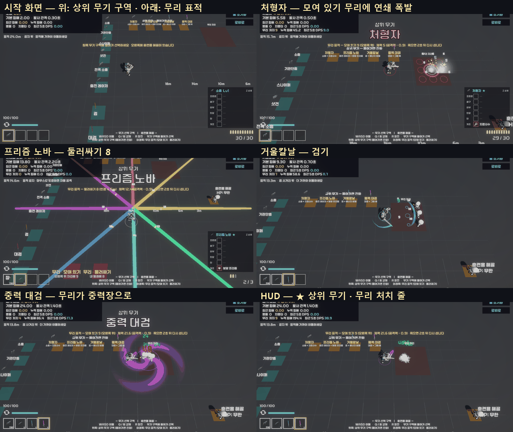

**테스트 룸** (로비 오른쪽 위 "테스트 룸" 또는 TestRoom 씬을 바로 Play)

| 구역 | 하는 일 |
|---|---|
| **위쪽 금색 구역 — 상위 무기** (조합마다 하나, 20개를 7개씩 3줄 — 2026-10-11) | 들어가면 원래 무기를 들고 → 최대 레벨 → 짝 장비(개조 · 서브 능력)를 채우고 → 진화. 이미 진화했으면 꺼내 든다. 사수가 검사 조합을 밟으면 서브 능력 칸이 없으니 **짝 없이 시험 진화** (상위 무기 동작은 짝과 상관없다) |
| 왼쪽 무기 선반 (기존) | 진화한 무기를 가진 채 그 원래 무기를 밟으면 **원래 무기(Lv1)로 되돌린다** — 원래 · 상위 비교 |
| **아래쪽 빨간 구역 — 무리 표적** | "모여 있기" = 남동쪽 무리 자리(14, 0, −16 — 2026-10-12 넓힌 배치)에 3 × 3 (처형자 연쇄 · 검기 · 붕괴) / "둘러싸기" = 내 총구 둘레 반경 4.5m 에 8 (중력장 · 사방 시험). 프리즘 노바는 앞쪽 적을 노리므로 "모여 있기" 앞에서 본다. 같은 구역을 다시 밟으면 치운다 |
| 무리 표적 규칙 | 체력 = **손에 든 무기 공격력 × 0.9** (한 방에 쓰러져야 연쇄 · 붕괴가 보인다) · 죽으면 2초 뒤 제자리에 다시 선다 · 중력장에 끌린다 · 훈련용 해골 측정과 따로 센다 |
| HUD | 무기 줄에 "★ 상위 무기" · 무리가 있으면 "무리 처치 · 누적 피해 · 최근 5초 DPS" 한 줄 |

**Tools / 주무기 지급** (또는 **Tools / 상위 무기 시험** — 같은 창). Play 중 스테이지 · 테스트 룸 어디서나

| 버튼 | 하는 일 |
|---|---|
| [조건] | 원래 무기 · 최대 레벨 · 짝 장비만 채운다 — 실제 판의 **보상 카드 · 정비 창 진화 흐름**을 볼 때 (스테이지 클리어 · 정비 창을 열면 진화 카드가 나온다) |
| [진화] / [들기] | 이어서 바로 진화 (연출 포함) / 이미 진화했으면 꺼내 든다 |
| 상태 | "진화함" · "진화 가능" · "소총 Lv1/3 · 짝 없음" |

- **2026-10-12 테스트 룸을 넓혔다** (사용자 요청 — 지나다니다 옆 무기로 바뀐다): 방 36 × 26 → 60 × 48m, 무기 선반 간격 2.6 → 4.5m, 금색 구역 간격 3.6 × 2.7 → 5 × 4m, 해골 x 14 → 22. 자리 값은 `Editor/TestRoomLayout.cs` 한 곳 (TestRoomSetup · CharacterSetup · TestRoomEvolutionSetup · TestRoomValidation 이 같이 쓴다), 지금 장면에 옮기는 도구 `Tools / Test Room / 넓은 배치 적용` (장면을 다시 짓지 않는다 — 몇 번 돌려도 같다)
- 폭격 편대 구역은 손에 든 총(없으면 가진 총)에 유탄 발사기를 달고 진화한다. 총이 없는 검사는 짝 없이 시험 진화
- 총 · 근접 목록에서 상위 무기 데이터(`WD_EVO_*`)는 뺐다 — 레벨 1 · 부착물 없이 받으면 진화한 무기와 달라진다
- 진화 조합을 새로 만들면 `Tools / Test Room / 상위 무기 구역 추가` 를 한 번 더 돌린다 (테스트 룸 장면을 다시 짓지 않고 `EvolutionArea` 만 다시 만든다 — 대검 · 창 픽업은 그대로). Tools 창은 저절로 목록에 넣는다

| 구분 | 파일 |
|---|---|
| 새 스크립트 | `Scripts/TestRoom/` `TestEvolutionPickup` · `TestCrowdPad` · `TestRoomCrowd` · `TestRoomCrowdDummy`, `Scripts/Player/Evolution/IPullable`, `Editor/TestRoomEvolutionSetup` |
| 고친 것 | `EvolutionService` (`PrepareForTest`) · `WeaponController` (연습 선택에서 진화 무기 → 원래 무기, 교체 코드 정리) · `GravityWell` (IPullable 도 끈다) · `TestRoomManager` (진화 · 무리 큐) · `TestRoomHUD` · `WeaponGrantWindow` (상위 무기 칸) · `TestRoomSetup` (배치 함수를 internal 로 — 동작 그대로) |
| 에셋 | `Scenes/TestRoom.unity` (EvolutionArea · CrowdClusterPoint), `Prefabs/TestRoom/` EvolutionPickup · CrowdPad · CrowdSkeleton 프리팹 + 재질 3 |

검증 (임시 테스트, 확인 뒤 지움)

| 테스트 | 결과 |
|---|---|
| 테스트 룸 상위 무기 시험 | **23 항목 통과** — 구역 4 · 무리 구역 2 · 처형자 구역 → Lv3 + 지정사수 진화 · HUD ★ · 모여 있기 9 (체력 = 공격력 × 0.9) · 처형자 연쇄 처치 9 · 폭발 9 · 2초 뒤 다시 섬 · 소총 구역 → 원래 소총 Lv1 · [조건] 은 진화 없이 Lv3 + 개조 · 프리즘 노바 모여 있기 앞에서 한 주기에 5 처치 (빛 6번 · 빔 21틱) · 거울칼날 시험 진화(사수 — 방패 없이) · 검기 3 · 중력장이 무리를 끌어옴(3.2 → 0.7m) · 붕괴 9 처치 |
| `TestRoomValidation` | 통과 (121 항목) |
| 테스트 룸 (2026-10-11, 20개 구역) | **27 항목 통과** — 구역 20 · 처형자 연쇄 9 · 프리즘 노바 4 처치(빔 한 줄이 3 × 3 의 가운데 줄만 지나가 4 ~ 6 으로 흔들린다 — 기대를 4 로) · 거울칼날 · 중력 대검 그대로 · 용의 포효가 모여 있기를 3틱 만에 7 처치 · 폭격 편대 구역 → 드론 5기 · 천공창 구역 (사수 시험 진화) · 장면 자동 검증 통과 |
| 상위 무기 사수 · 검사 (16-6) | 다시 통과 — 검사는 한 번 실패(탄 되돌리기 타이밍 · 맵에 막힌 끌기) 뒤 두 번 연속 통과. 절차 생성 맵 · 타이밍에 따라 가끔 흔들리는 테스트다 |

- 처음 만든 무리 표적은 0.85배로 줄였더니 몸통 판정이 총구 높이보다 낮아 탄이 머리 위로 지나갔다 — 훈련용 해골 크기 그대로 둔다
- "둘러싸기" 가운데를 몸이 아니라 **총구 아래**로 잡는다 — 사방 빔이 총구에서 나가 몸 가운데 기준이면 8갈래 중 절반이 비껴갔다


#### B-16-8. 남은 것

- [ ] **손으로 해 보기** — 진화 시점(Lv3 이 언제 닿나), 상위 무기 화력 체감, 보스전 길이 (9-2 목표)
- [ ] 최대 레벨 3 의 영향 — 무기 강화 · 레벨업 보상이 일찍 끝나 보상 후보가 줄어드는지, 드론이 3기에서 멈추는 것이 괜찮은지
- [x] **작은 조합 7종** (7장) — 2026-10-11 구현 (16-9)
- [ ] 서브 능력 변형 연동 (5장 아래 표 — 작살 → 끌어오는 적 5명 등) · 일시정지 조합표 (11장 3차 — 조합 안내 HUD 가 무기마다 보여 주는 것을 한 화면에 모은 표)
- [ ] 폭격 편대 떨어지는 폭탄 · 낙하선 연출 (지금은 폭발탄) · 팔랑크스 왼팔 방패 B (14-3)
- [ ] 16종 수치는 처음 값 — 손으로 해 보고 조정 (`00-핵심-정리.md` 2장 · 6장 표 — 2026-10-13 13종 기준으로 새로 정리)
- [ ] GunPack 출처 확인 → 되면 처형자 · 프리즘 노바 모델을 AR_4 · Sniper_2 로 (14-3)
- [ ] 흐르는 빛 띠 · 디졸브 셰이더 (14-4) — 지금은 밝기만 숨 쉰다
- [x] **태양창** — 사용자 요청(2026-10-10) 충전 지연 + 그만큼 사거리 증가 → 2026-10-11 구현 (16-2 · 16-3)
- [ ] 팀에 알리기 — 보스 체력(상위 무기 기준), 무기 최대 레벨 3 (업그레이드 쪽에서 무기 레벨을 보는 곳이 있으면)
- [ ] 작은 조합 · 조합 안내 HUD 손으로 해 보기 — 알림 · 조합식 판이 전투를 가리지 않는지, 수치 (작은 조합은 `00-핵심-정리.md` 8장 · 조합식 판은 `00-핵심-정리.md` 1-5)

#### B-16-9. 작은 조합 7종 · 조합 안내 HUD · 테스트 룸 연습 규칙 (2026-10-11)

> 요청: "작은 조합 7종 개발 · 주무기(검이나 총기류)를 먹었을 때 조합식에 해당되는 서브능력들을 표기해주는 HUD" · "테스트룸 안에서는 스테미나 무한, 여러 스킬 쿨타임 1초 정도로". 구현 · 검증 완료, 커밋 안 함.

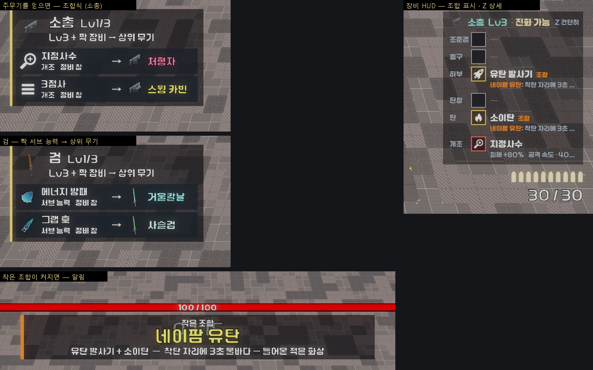

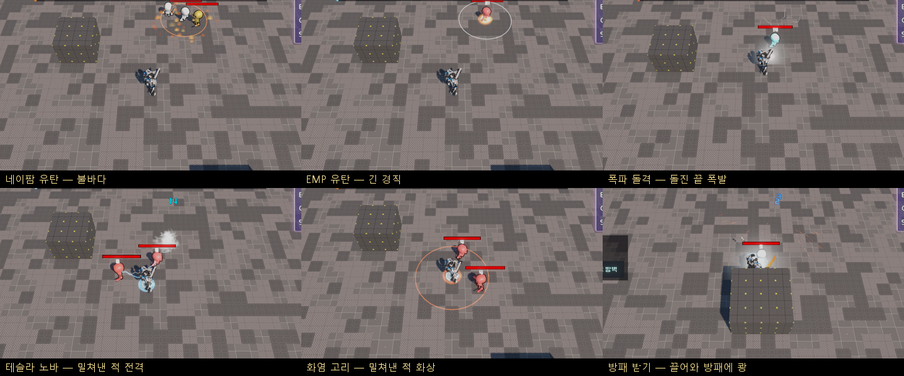

**작은 조합 7종** — 장비 두 개가 만나면 자동으로 켜진다 (무기는 그대로). 수치는 `Data/Synergies/SYN_*`, 목록은 `Resources/Evolution/SynergyCatalog`

| 조합 | 조건 | 효과 (처음 값) | 거는 곳 |
|---|---|---|---|
| 네이팜 유탄 | 같은 총에 유탄 발사기 + 소이탄 | 착탄 자리 3초 불바다 (반경 2.5m) — 안에 있거나 걸어 들어온 적 화상 (초당 공격력 × 1.5) | `GrenadeLauncherAbility` 폭발 → `FireField` |
| EMP 유탄 | 유탄 발사기 + 전격탄 | 폭발에 맞은 적 경직 1.5초 + 전격 줄기 | 〃 |
| 폭파 돌격 | 총검 돌격 + 폭발탄 | 돌진이 끝난 자리 앞에서 폭발 (반경 2.5m · 공격력 × 3 · 밀치기). 끊긴 돌진은 안 터진다 | `BayonetChargeAbility` |
| 테슬라 노바 | 충격 방출기 + 전격탄 | 밀쳐낸 적 모두에게 전격 (방출기 피해 × 2) · 경직 +0.5초 | `ShockEmitterAbility` |
| 화염 고리 | 충격 방출기 + 소이탄 | 밀쳐낸 적 모두 화상 4초 (초당 방출기 피해 × 1.5) · 불 고리 세 겹 | 〃 |
| 방패 받기 | 그랩 훅 + 에너지 방패 | **방패를 든 채 그랩을 쏠 수 있다** (서로 끊지 않는다) — 끌려온 적이 방패에 부딪혀 공격력 × 1.5 · 경직 +1초. 넘기기(뒤로)는 해당 없음 | `GrappleAbility` 끌기 끝 · `SubAbilitySlot` |
| 거울 패링 | 패링 + 방패 Lv2 A(반사판) | 패링으로 되돌린 탄 피해 × 2 · 고리 | `ParryController` |

- 효과 코드는 `SynergyEffects` 한 곳 — 능력이 동작하는 순간 "지금 이 조합이 켜져 있나"를 묻는다 (`SynergyCatalog.On(총, 종류)` · `For(플레이어, 종류)`). 사수 조합은 **그 E 능력을 주는 총**의 탄을 본다 (`SubAbility.SourceWeapon`)
- 경직이 있는 조합은 원래 경직에 **더한다** — 경직은 새로 거는 값으로 덮이므로, 짧은 경직을 걸면 오히려 줄어든다 (시험에서 잡음: 테슬라 노바가 충격 방출기 1초 경직을 0.5초로 줄였다)

**조합 안내 HUD** (`ComboHud` — `Resources/UI/ComboHud`, 장비 HUD 와 같이 게임 시작 때 생겨 씬을 넘어 산다)

| 화면 | 언제 · 무엇 |
|---|---|
| **조합식** (왼쪽 가운데) | 주무기(검 · 총 · 드론)를 **새로 얻으면 6초** — "[짝 그림] 에너지 방패 · 서브 능력 · 정비 창 → [상위 무기 그림] 거울칼날". 짝을 가지면 "가짐", 진화할 수 있으면 "진화 가능 — 거울칼날 (보상 카드 · 정비 창)". 캐릭터가 가질 수 없는 짝은 뺀다 (검사의 드론 → 위성 방벽만). 연달아 얻으면 2초 뒤 새 무기로 바뀐다. **장비 HUD 상세(Z)를 켜 두면** 지금 든 무기의 조합식을 계속 |
| **작은 조합 알림** (화면 위, 체력바 · 처치 수 아래) | 조합이 켜지면 "작은 조합 — 네이팜 유탄 / 유탄 발사기 + 소이탄 — 착탄 자리 …" 2.6초. 여럿이면 1.2초 뒤 다음 것으로. 진화 배너가 뜨는 동안은 기다린다 |
| **장비 HUD** (오른쪽 아래) | 조합에 든 두 줄 이름 옆에 "조합", 상세(Z)면 효과 줄 앞에 "네이팜 유탄: …". 머리글은 "소총 Lv3 · 진화 가능" 한 줄 (상위 무기 이름은 조합식이 보여 준다 — 판이 좁아 두 줄로 넘쳤다) |

- 보상 카드 · 정비 창이 시간을 멈춘 동안 생긴 안내 · 알림은 시간이 다시 흐를 때 (진화 연출과 같은 규칙)
- 같은 판(같은 플레이어)이 다음 스테이지로 넘어가도 이미 알린 무기 · 조합은 다시 알리지 않는다

**테스트 룸 연습 규칙** (`PracticeRules` — TestRoomManager 가 장면에 있는 동안만 켠다, 인스펙터 "Practice Rules")

| 항목 | 원래 | 테스트 룸 |
|---|---|---|
| 스태미나 | 달리면 준다 | 무한 |
| 쿨타임 — 그랩 · 방패(밀치기 · 돌진 · 던지기 · 부서진 뒤) · 유탄 · 총검 · 충격 방출기 · 패링 · 구르기 | 2.5 ~ 8초 | **1초 이하** (`practiceCooldown`) |

- 화면 아래 안내에 "연습 규칙 — 스태미나 무한 · 능력 쿨타임 1초". 팀원 쪽 자동 스킬(파이어볼 · 표창 …)은 레벨업으로 얻는 것이라 테스트 룸에 없고, 건드리지 않았다
- 테스트 룸에는 부착물을 달 곳이 없어 **`Tools / 상위 무기 시험` 창에 "작은 조합" 칸**을 더했다 — [갖추기] 가 손에 든 총(안 맞으면 맞는 총)에 두 부착물 / 서브 능력 둘 · 변형을 채운다 (`SynergyCatalog.PrepareForTest`)

**시험 중 잡은 버그** (작은 조합과 별개로 전부에 영향)

- **범위 판정이 바닥 타일에 막혀 적을 놓침** — 맵 바닥이 타일마다 충돌체(Ground 레이어)라, 반경이 크면 `CombatFx` 의 64칸 버퍼가 바닥으로 차 적이 빠졌다 (충격파 · 화염 · 중력장 · 폭발 등 범위 효과 전부). 바닥 레이어를 빼고 버퍼 256 으로. 전격 소총의 다음 연쇄 찾기(32칸 · 모든 레이어)도 같이
- 테슬라 노바 경직이 원래 경직을 줄임 → 더하기로 (위)

**파일**

| 구분 | 파일 |
|---|---|
| 새 스크립트 | `Scripts/Player/Synergy/` `SynergyData` · `SynergyCatalog` · `SynergyEffects` · `FireField`, `Scripts/Player/UI/ComboHud`, `Scripts/Player/PracticeRules`, `Editor/SynergySetup` (`Tools/커스터마이징/작은 조합 · 조합 안내 HUD 만들기`) |
| 고친 것 | `GrenadeLauncherAbility` · `BayonetChargeAbility` · `ShockEmitterAbility` · `GrappleAbility` · `ShieldAbility` · `SubAbility` (`SourceWeapon`) · `SubAbilitySlot` (방패 받기 · 서로 안 끊기) · `ParryController` · `PlayerMove` (연습 규칙) · `EquipmentHud` · `EquipmentRowView` (조합 표시 · 머리글 한 줄) · `EvolutionPresenter` (`IsPlaying`) · `CombatFx` · `ChainBeamWeapon` (바닥 레이어) · `TestRoomManager` · `TestRoomHUD` · `WeaponGrantWindow` (작은 조합 칸) |
| 에셋 | `Data/Synergies/SYN_*` 7 · `Resources/Evolution/SynergyCatalog` · `Resources/UI/ComboHud.prefab` |

**검증** (배치 임시 테스트, 확인 뒤 지움 — 사본 `Logs/evo_resume/kept_SynergyTest.cs`)

| 테스트 | 결과 |
|---|---|
| 작은 조합 · 사수 | **39 항목 통과** — 조합 7 · HUD 생김 · 실제 판은 연습 규칙 꺼짐 · 소총 조합식(지정사수 → 처형자 · 3점사 → 스웜 카빈, 정비 창) · 샷건을 얻으면 2초 뒤 샷건 조합식 · 다시 들어도 또 알리지 않음 · Lv3 + 지정사수 → "가짐" · 상세(Z)면 계속 · 네이팜(알림 · 장비 두 줄 표시 · 상세 줄 · 불바다 · 들어온 적도 화상 · 3초 뒤 꺼짐) · EMP(소이탄 없으면 불바다 없음 · 1초 뒤에도 경직) · 폭파 돌격(3m 돌진 끝 폭발 −14) · 테슬라 노바(밀쳐낸 둘 다 방출기 × 3 피해) · 화염 고리(전격탄 없으면 테슬라 없음 · 화상) |
| 작은 조합 · 검사 | **26 항목 통과** — 검 조합식(에너지 방패 → 거울칼날 · 그랩 훅 → 사슬검, 서브 능력 · 정비 창) · 드론 → 위성 방벽만 · 방패 받기(알림 · 두 줄 표시 · 방패를 든 채 그랩 · 끌려온 적 −12 · 1.4초 뒤에도 경직 · 방패 없으면 없음) · 거울 패링(방패 Lv2 A → 알림 · 되돌린 탄 9 → 18) |
| 테스트 룸 | **36 항목 통과** — 기존 + 연습 규칙 켜짐 · 스태미나 바로 참 · 유탄 쿨타임 1초 · 1초 뒤 다시 씀 · 구르기 쿨타임 1초 · [갖추기]로 네이팜 켜짐 · 사수에게 검사 조합 거절 · 알림 |
| 상위 무기 1차 · 16종 · 사수 커스터마이징 · 검사 변형 (다시) | 46 · 25 / 87 · 36 / 53 / 29 — 모두 통과 |

- 시험 쪽 함정 (게임 문제 아님): 자폭형 몬스터를 과녁에서 빼기만 하고 두면 플레이어를 쫓아와 돌진 · 판정을 가린다 → 끈다 / 맵 가장자리로 치우면 옮기기가 실패해 제자리에 남는다 → 실제로 멀어졌는지 본다 / 블록과 겹친 자리에 만든 몬스터 탄은 바로 사라진다 → 트인 자리에서

#### B-16-10. 팀원 스킬 병합 — Drain · 연쇄 번개 · 블랙홀 (2026-10-12)

main(PR #5 ~ #7)을 player 에 병합. 글자 충돌은 `MeleeWeapon.cs` 한 곳 — 같은 자리에 상위 무기 명중 알림(우리)과 Drain 처치 회복(팀원)이 들어왔다.

**처치 판정을 한 곳으로** — `WeaponBase.CheckDirectKill(root, wasAlive)`

- 맞히기 **전** 살아 있었고 맞은 뒤 쓰러졌으면 true. 적(`Enemy`)이면 `DrainSkill.Active?.OnKill()`
- 팀원 원래 판정(`TakeDamage` 뒤 `state == Dead`)은 **죽는 동작 중인 적(콜라이더가 남는다)을 다시 맞혀도** 참이라 탄 · 휘두르기마다 또 회복됐다 → 맞기 전 판정으로
- 같은 값이 상위 무기 · 부착물 처치 동작(`WeaponHit.Killed`)으로도 간다 — 두 판정이 어긋나지 않는다
- 부르는 곳 = **직접 공격**: 탄(`Bullet`) · 휘두르기(`MeleeWeapon`) · 전격 소총(퍼진 전기 포함) · 충전 레이저 빔 · 프리즘 노바 · 태양창(`DealPrismDamage`) · 탄 대신 쏘는 상위 무기 공격(용의 포효 불길 · 궤도 레일)
- 부르지 않는 곳: 명중 효과(폭발 · 번개 · 파편 · 화상) · 서브 능력 · 패링 반사 — Drain 설명의 "스킬 공격으로 처치한 경우에는 호출하지 않는다"
- 팀원 파일(`Skill/` · `Upgrade/` · `Enemy/`)은 고치지 않았다. 연쇄 번개 · 블랙홀은 우리 코드와 겹치는 곳이 없다 (`OverlapSphere` + `Enemy.TakeDamage`)

**검증** (배치 임시 테스트, 확인 뒤 지움 — 사본 `Logs/evo_resume/kept_DrainTest.cs`)

| 테스트 | 결과 |
|---|---|
| Drain · 사수 | **20 항목 통과** — 소총 1킬 = 회복 1번(+3) · 쓰러지는 중인 적을 0.8초 더 쏴도 더 없음 · 전격 소총(퍼진 전기로 둘) 2번 · 충전 레이저(관통 둘) 2번 · 용의 포효 불길 1번 · 효과 피해(`CombatFx.Damage`)로 쓰러뜨리면 0번 |
| Drain · 검사 | **11 항목 통과** — 검 한 번에 둘 = 2번 · 쓰러진 몸을 1.2초 더 베도 더 없음 · 사슬검 1번 (사슬검 보관 뒤 천공창으로 다시 — 통과) |
| 상위 무기 16종 · 사수 / 1차 · 검사 / 사수 커스터마이징 / 작은 조합 사수 · 검사 (다시) | 87 / 25 / 53 / 39 · 26 — 모두 통과 |

#### B-16-11. 겹치거나 애매한 8종 보관 (2026-10-12)

> 요청: "상위무기들 중, 계획들은 남겨두되, 컨셉이 겹치거나 공격방식이 비슷한 것들, 또는 애매한 것들은 따로 보관 (사슬검 · 팔랑크스 · 위성 방벽 · 폭격 편대도 제거) · 보관한 소스랑 에셋들은 캡스톤 사운드집 폴더에 따로 폴더 생성해서"
> **이 문서의 계획(4 ~ 6 · 14장 표)과 결과(16-2 ~ 16-6)는 그대로 둔다** — 되살릴 때 그대로 쓴다.

| 보관 | 조합 | 이유 |
|---|---|---|
| 사슬검 | 검 + 그랩 훅 | 사용자 지정 · 끌어오기가 천공창 · 중력 대검과 겹친다 |
| 팔랑크스 | 창 + 에너지 방패 | 사용자 지정 · 방패를 든 채 찌르기 — 조작이 바뀌어 애매 |
| 위성 방벽 | 드론 + 에너지 방패 | 사용자 지정 · 몸 둘레를 도는 방식이 팀원 표창 스킬과 겹친다 |
| 폭격 편대 | 드론 + 유탄 발사기 | 사용자 지정 · 드론 +2기 · 폭발탄뿐이라 애매 |
| 폭풍 코일 | 전격 소총 + 과부하 코일 | 같은 전격 소총의 뇌운과 '하늘 낙뢰'가 겹치고, 연쇄 강화는 팀원 연쇄 번개와 겹친다 |
| 궤도 레일캐논 | 스나이퍼 + 레일건 | 태양창과 같은 '화면 끝까지 닿는 일직선 빔 한 방' (태양창은 사용자 요청이라 남김) |
| 파편 폭풍 | 기관단총 + 난사 | 맞으면 옆 적으로 튀는 방식이 전격 소총 연쇄 · 프리즘 노바 튕김과 겹친다 |
| 성채 대검 | 대검 + 에너지 방패 | 중력 대검과 같은 '내려찍기 범위' · 막은 피해를 모으는 것이 잘 느껴지지 않는다 |

**남은 12종** — 처형자 · 스웜 카빈 (소총) / 회전 기관포 (기관단총) / 공성포 · 용의 포효 (샷건) / 다중 표적 (스나이퍼) / 뇌운 (전격 소총) / 프리즘 노바 · 태양창 (충전 레이저) / 거울칼날 (검) / 중력 대검 (대검) / 천공창 (창). **드론은 상위 무기가 없다** (조합식 판도 띄우지 않는다)

- 남은 것 중 더 볼 것: 중력 대검(빨아들이고 붕괴 폭발)은 팀원 **블랙홀**(끌어당기고 끝에 폭발)과 비슷하다 · 프리즘 노바의 빛 튕김은 연쇄 번개와 조금 닮았다 — 플레이해 보고 정한다

**보관 위치** — `바탕화면/캡스톤 사운드 집/상위무기 보관 2026-10-12/` (안의 `README.md` 에 같은 내용)

| 폴더 | 내용 |
|---|---|
| `에셋/Assets/…` | 옮긴 60개 (.meta 포함 — GUID 그대로): 조합 `EVO_*` · 상위 무기 `WD_EVO_*` · 보상 카드 `RW_EVO_*` · 아이콘 각 8 · 고유 동작 `AE_EVO_*` 8 · 무기 프리팹 `W_EVO_*` 6 · 드론 유닛 2 · 발광 재질 5 · 고유 동작 코드 7 (`ChainWhip` · `Phalanx` · `SatelliteGuard` · `LightningStrike` · `RailLine` · `FragmentOnHit` · `BastionSlam` + `Effect.cs`) |
| `수정 전 원본/Assets/…` | 고치기 전 파일 7개 — `EvolutionCatalog` · `StageRewardPool` · `ShieldAbility` · `MeleeWeaponData` · `EvolutionSetupMore` · `WeaponBase` · `TestRoom.unity` |

**프로젝트에서 바꾼 것**

- `EvolutionCatalog` · `StageRewardPool` 에서 8개를 뺐다 → 보상 카드 · 정비 창 · 조합식 판 · Tools 창 · 테스트 룸 모두 12종
- `ShieldAbility` — 팔랑크스(방패를 든 채 찌르기 · 떼면 돌격) · 성채 대검(막은 피해 알림 `OnAbsorbed`) 연결을 뺐다 · `MeleeWeaponData` — 팔랑크스 전용 칸 4개를 뺐다
- `EvolutionSetupMore` (상위 무기 도구) — 8종을 만들지 않는다 (자리에 보관 주석). 드론 도우미(`DroneVariant` · `SetDrone`) · 색은 되살릴 때를 위해 남겼다
- 테스트 룸 금색 구역 20 → 12 (`TestRoomEvolutionSetup` 다시 돌림 — 7 + 5 두 줄)
- 짝이던 개조(난사 · 레일건 · 과부하 코일)는 개조로서 그대로 판다

**되살리는 법** (한 종 또는 전부)

1. `에셋/Assets` 의 그 무기 파일들을 같은 경로로 프로젝트에 복사 (.meta 같이 — GUID 가 같아 참조가 그대로 붙는다)
2. 팔랑크스 · 성채 대검이면 `수정 전 원본` 의 `ShieldAbility.cs` · `MeleeWeaponData.cs` 에서 그 부분을 되돌린다
3. `EvolutionCatalog` · `StageRewardPool` 에 다시 넣는다 (인스펙터) · 도구에도 넣으려면 `수정 전 원본/…/EvolutionSetupMore.cs` 의 그 블록
4. `Tools / Test Room / 상위 무기 구역 추가` 로 테스트 룸 구역을 다시 만든다

**검증** (배치 임시 테스트 — 사본 `Logs/evo_resume/kept_*.cs`, 20종 때 사본은 `*_20.cs`)

| 테스트 | 결과 |
|---|---|
| 상위 무기 나머지 · 사수 / 검사 | 57 / 7 항목 통과 (보관 8종 구역을 빼고 목록 12) |
| 1차 4종 · 사수 / 검사 | 46 / 25 |
| 작은 조합 · 사수 / 검사 | 39 / 26 — 검 조합식은 거울칼날 하나 · 드론은 조합식 판을 띄우지 않는다 |
| 테스트 룸 상위 무기 구역 | 36 — 구역 12 · 보관 8종 구역 없음 |
| 검사 변형 (방패에서 팔랑크스 연결을 뺀 뒤) | 29 |
| Drain · 사수 / 검사 | 20 / 11 (검사의 상위 무기 시험을 천공창으로) |
| 테스트 룸 장면 검증 | 통과 ("All integration checks passed") |
| 끊긴 참조 | 보관한 60개 GUID 를 참조하는 에셋 · 장면 0 |

#### B-16-12. 혈검 — 팀원 스킬을 짝으로 (검 + 흡혈, 2026-10-12)

> 요청: "흡혈이나 다른 여러 서브유닛들을 merge 한 상태 — 이것들을 조합해서 상위무기 설계" → 추천 2개(혈검 · 선풍 대검) 중 "혈검 구현"

**스킬 짝 (새 조건)** — 무기 Lv3 + **팀원 스킬(레벨업 카드)을 가지고 있음**

- `WeaponEvolutionData.requiredSkill` (카드 `UpgradeData`) — 비우면 보지 않는다. 사수 · 검사 모두 받는 카드라 캐릭터 제한이 없다
- `SkillPairs` — 카드의 효과 종류로 스킬 컴포넌트를 알아보고(흡혈 · 파이어볼 · 전격 샷 · 토네이도 · 표창 · 연쇄 번개 · 블랙홀) 플레이어에 붙어 있으면 "가짐". 우리 쪽 이름(흡혈 …)으로 보여 준다. **팀원 코드는 고치지 않았다** (컴포넌트가 있는지 · 회복량을 읽기만)
- 진화해도 스킬은 그대로 돈다 · 조합식 판 "흡혈 · 레벨업 카드" (카드 그림) · 조건 글 "Lv3 + 흡혈" · 시험(테스트 룸 구역 · Tools 창 · `PrepareForTest`)은 팀원 카드 효과의 `Apply` 로 스킬을 준다
- 도구: `EvolutionSetup.Recipe(..., skill: "DrainUpgrade")`

**혈검** — `WD_EVO_BloodBlade` (검 × 1.15) · 고유 동작 `BloodFrenzyEffect` (`AE_EVO_BloodFrenzy`) · 모델 Futura `Sword_A_Red` (원래 검 A 주황과 같은 모양의 붉은 검)

| | 값 | 왜 |
|---|---|---|
| 혈기 | 처치마다 10 + 흡혈 회복량 × 1.7 (카드 1장 ≈ 15) · **HP 가득이면 × 2** · 보스 타격마다 +2 | HP 가득일 때 버려지던 흡혈이 혈기가 된다 · 흡혈 카드를 더 모을수록 빨리 찬다 · 보스는 처치가 없다 |
| 폭주 (혈기 100) | 6초 · 공격 속도 ×1.5 · 사거리 +1m · 맞힌 피해의 **10%** 회복 (초당 최대 8) · 폭주 중 처치 +0.5초 (최대 10초) | 회복 · 지속 컨셉은 다른 상위 무기에 없다. 4% 로 시작했다가 검 한 번이 약 7 이라 초당 1 남짓 → 10% (무리를 베면 상한에 닿는다) |
| 연출 | 발밑 붉은 혈기 고리(차오르는 호 — 카메라 쪽에서 시작) · 폭주 시작 고리 두 겹 + 낮은 굉음 · 폭주 중 0.5초마다 퍼지는 고리 · 고리가 맥박처럼 · 회복 때 적 → 몸 피 줄기 | |

- `WeaponBase.RangeBonus` 추가 — 실행 중 사거리 보너스 (폭주가 켜고 끈다). `FireRateBoost` 와 같은 방식
- 다른 무기로 바꾸면 폭주는 끝난다 (혈기는 남는다)

**검증** (배치 임시 테스트 — 사본 `Logs/evo_resume/kept_BloodBladeTest.cs`)

| 테스트 | 결과 |
|---|---|
| 혈검 · 검사 | **20 항목 통과** — 목록 13 · 조합(검 + 흡혈 카드) · 결과 · 보상 카드 · 조건 글 / 흡혈 없이 Lv3 → 안 됨 · 시험 준비가 흡혈 카드를 준다(회복 3) → 됨 · 카드 나옴 / 진화 · 흡혈 그대로 / 처치 +15.1 · HP 가득 +30.2 / 폭주 · ×1.5 · 사거리 3 → 4 · 회복 2 (1.6초, 한 명) · 처치 2번으로 7.0초 · 끝나면 되돌아감 · 다시 쌓임 |
| 작은 조합 · 검사 | 26 — 검 조합식 두 줄 "에너지 방패 → 거울칼날 · 흡혈 [레벨업 카드] → 혈검" |
| 테스트 룸 상위 무기 구역 | 37 — 구역 13 · 사수가 [혈검] 을 밟으면 흡혈 카드까지 채워 진화 |
| 다시 — 상위 무기 나머지 · 사수 / 1차 · 검사 / 작은 조합 · 사수 / Drain · 검사 / 테스트 룸 장면 | 57 / 25 / 39 / 11 / 통과 |

- 시험 쪽 함정: 처치를 많이 하면 레벨업 카드가 열려 **시간이 멈춘다** → 시험은 `expToNextLevel` 을 크게 둔다

**남은 것** — 추천 2 선풍 대검(대검 + 토네이도) · 드론 후보 뇌망 편대(드론 + 전격 샷)는 설계만 (구현 안 함)

#### B-16-13. 개선 사항 — 2026-10-13 사용자 피드백 (→ 같은 날 적용, 16-15)

> 받은 메모 그대로:
> 프리즘 노바 — 최종 레이저를 쏠 때 저음역대의 "두우우웅" 효과음 추가 / 거울칼날 — 검의 날카로움, 마법적인 에너지 느낌의 사운드 /
> 중력 대검 — 좀 더 낮은 사운드대 (엘든링 중력 마법처럼) / 혈검 — 피를 연상시키는 검기가 주위를 베는 듯 (엘든링 말레니아) / 다중 표적 — 삭제 / 천공창 — 삭제

| # | 상위 무기 | 개선 | 지금 | 바꿀 것 · 방법 | 크기 |
|---|---|---|---|---|---|
| 1 | **다중 표적** | **삭제 (보관)** | 스나이퍼 + 반자동 | 16-11 의 8종과 같은 절차 — 소스 · 에셋을 `캡스톤 사운드 집/상위무기 보관` 으로 옮기고 계획은 남긴다. 고유 동작 `MarkVolleyEffect` 도 같이 | 작음 |
| 2 | **천공창** | **삭제 (보관)** | 창 + 그랩 훅 | 〃 — `LanceExtendEffect` 와, 이것만 쓰던 끌어오기 도우미 `EvoStrikes.PullTo` 도 같이. Drain 시험은 검사의 상위 무기 시험을 혈검으로 바꾼다 | 작음 |
| 3 | **거울칼날** | 날카로운 칼 + 마법 에너지 소리 | 휘두르기 = 원래 검 소리 · 검기 `laserRetro_002` · 되돌리기 `impactMetal_000/001` | 휘두를 때 금속 날 "슈잉"(Kenney RPG `drawKnife` · `knifeSlice2`) 위에 반짝이는 고음 한 겹(Interface `glass` · `maximize` 피치 1.2 ~ 1.4) · 검기 날아갈 때 "위잉—"(SciFi `forceField` 피치 올림) · 되돌리기 "챙" + 유리 울림(Impact `impactGlass_light` · `impactBell_heavy` 피치 올림) | 작음 — 에셋 소리 · 피치(`pitchRange`)만. 두 소리를 겹치려면 소리 칸 하나 더 |
| 4 | **중력 대검** | 더 낮은 소리 (엘든링 중력 마법) | 열림 `forceField_002` · 붕괴 `lowFrequency_explosion_000/001` (피치 그대로) | 열릴 때 낮게 깔리는 "우웅—"(SciFi `spaceEngineLow` 피치 0.55 ~ 0.65) · 끌려오는 1.2초 동안 낮은 울림이 이어짐 · 붕괴 "쿵" 은 더 깊게(`lowFrequency_explosion` 피치 0.6 ~ 0.7 + Impact `impactPunch_heavy` 피치 0.6) — "무겁게 빨아들였다 터진다" | 작음 ~ 중간 — 피치는 에셋, 끌리는 동안 이어지는 울림은 코드 조금 |
| 5 | **프리즘 노바** | 최종 빔(③ 방사)에 저음 "두우우웅" | 빔 시작에 `laserLarge_002` 한 번 | 빔이 켜지는 순간 낮은 "붐"(`lowFrequency_explosion` 피치 0.6 · Impact `impactBell_heavy` 피치 0.5) + 2초 빔 동안 낮게 울리는 "웅—"(`spaceEngineLow` 피치 0.6, 끝으로 갈수록 작아짐) | 작음 ~ 중간 — `PrismBurstSettings` 에 저음 · 울림 소리 칸 + 빔 동안 이어 재생 |
| 6 | **혈검** | 피 검기가 몸 둘레를 휘감아 벤다 (말레니아 "물새의 춤") | 폭주 = 고리 · 피 줄기 · 공격 속도 · 사거리 | **혈풍 베기** — 폭주가 시작될 때 0.6초 동안 붉은 검기 6 ~ 8줄이 몸 둘레(반경 4m)를 사방으로 연달아 벤다 · 폭주 중 세 번째 휘두르기마다 앞쪽 반원에 3줄. 날아가지 않고 **내 둘레를 휘감는 짧은 호**가 잔상처럼 남았다 사라진다 · 피 방울 입자 (거울칼날의 앞으로 날아가는 초승달과 다르게) · 직접 공격으로 셈 (흡혈 · 폭주 회복 연동) | 중간 — `BloodFrenzyEffect` 에 연출 · 판정 추가, 칸: 줄 수 · 반경 · 피해 배율 · 몇 번째 휘두르기마다 |

**삭제 뒤** — 11종 (사수 8 · 검사 3). 스나이퍼 · 창 · 드론은 상위 무기가 없다 → 나중에 팀원 스킬 짝으로 새로 만들지 정한다 (예: 창 + 토네이도, 16-12 설계 후보)

**소리 고르기** — 프로젝트 안 Kenney 묶음(`Assets/Kenney`)과 바탕화면 `캡스톤 사운드 집`(Kenney Impact · Interface · Sci-Fi · RPG, Snake 총소리, 음악 루프 — 모두 이미 받아 둔 것)에서 고른다. 새로 받을 때는 CC0 · 라이선스 확인

**추천 순서** — 1 · 2 (보관, 바로) → 3 · 4 (소리 — 에셋 위주) → 5 (프리즘 저음) → 6 (혈풍 베기)

**같이 바꾼 것 (2026-10-13 — 구현함)**

- 테스트 룸 무리 표적 체력 — 기본 **튼튼** (무기 공격력 × 1000, 최소 1만) · **H 키로 한 방** (× 0.9) ↔ 튼튼. 서 있는 무리는 바꾼 체력으로 다시 세운다 (`TestRoomCrowd` · `TestRoomManager`)
- 구르기 (사수) — **이동 속도를 따라** 빠르게 · 멀리: 걸을 때 4m · 1.5초 → **6m · 0.75초** (처음 0.55초는 "너무 빠르다" — 같은 날 조금 느리게, 모션 ×2.0), 달리면 9.6m (속도 비율, 최대 ×1.6) · 속도 업그레이드도 반영 · 둔화 중이면 짧게(최소 절반). Roll 클립은 그 시간에 맞춰 빨리 재생, 무적 = 구르는 동안, 다시 쓰기까지 그대로 4초 (`PlayerMove` · 플레이어 프리팹)

#### B-16-14. 조합식을 개연성에 맞게 — 팀원 스킬 짝 (2026-10-13, 구현함)

> 요청: "블랙홀이나 체인 라이트닝 같은 여러 스킬들이 있으니 주무기와 조합식을 개연성에 맞게 — 예: 중력검 → 대검 + 블랙홀"

| 상위 무기 | 예전 짝 | **새 짝 (레벨업 카드)** | 왜 |
|---|---|---|---|
| 중력 대검 | 그랩 훅 (서브 능력) | **블랙홀** | 중력장 ↔ 블랙홀 — 사용자 예시 |
| 뇌운 | 방전 (개조) | **연쇄 번개** | 번개 ↔ 번개 (전격 소총의 연쇄와도 맞다) |
| 용의 포효 | 용의 숨결 (개조) | **파이어볼** | 불 ↔ 화염 방사 |
| 혈검 | (흡혈 — 16-12) | 흡혈 | 그대로 |

- 그대로 둔 것 — 개조 짝(처형자 지정사수 · 스웜 카빈 3점사 · 회전 기관포 이중 탄창 · 공성포 슬러그 · 다중 표적 반자동 · 프리즘 노바 분광 프리즘 · 태양창 과충전)은 이미 이름 · 동작이 맞고, 거울칼날(에너지 방패 — 되돌리기)도 맞다. 천공창 · 다중 표적은 삭제 예정(16-13)이라 손대지 않았다
- 짝이 아니게 된 것 — 그랩 훅(천공창만 남음) · 방전 · 용의 숨결 개조는 장비로는 그대로 쓴다
- 아직 짝이 없는 팀원 스킬 — 토네이도 · 표창 · 전격 샷. 상위 무기가 비는 스나이퍼 · 창 · 드론에 새로 붙일 후보 (예: 창 + 토네이도 = 회오리 창, 스나이퍼 + 전격 샷 = 경직 저격) — 정하면 만든다
- 좋아진 점 — 레벨업 카드는 레벨마다 3장씩 나와, 정비 창 3칸 무작위로 32종 중 개조를 찾는 것보다 짝을 만나기 쉽다. 두 캐릭터 모두 받는다
- 진화 뒤에도 그 스킬은 따로 계속 돈다 (중력장 + 블랙홀 · 먹구름 낙뢰 + 연쇄 번개 · 화염 + 파이어볼) — 같은 계열이 겹치는 손맛을 실제 판에서 본다

**바꾼 것** — `EVO_GravityCleaver` · `EVO_Thundercloud` · `EVO_DragonRoar` 의 짝 칸 (`requiredSkill`), 상위 무기 도구의 조합(`skill:` — 다시 만들어도 같은 짝), 테스트 룸 구역 이름("대검 + 블랙홀" …, 구역 다시 만듦). 런타임 코드는 바꾸지 않았다 (16-12 스킬 짝 그대로)

**같이 고친 것 — 구르기 모션** — 구르기를 0.55초로 줄인 뒤, 프레임이 밀려 구르기 모션이 덜 끝난 채 다음 구르기를 누르면 트리거가 남았다가 **나중에 한 번 더 구르는** 문제를 배치 시험이 찾았다 (그동안 총구가 흔들려 프리즘 노바 빛이 빗나감). 구르기 시작 때 모션이 아직 구르기면 처음부터 다시 틀고, 끝날 때 남은 트리거를 지운다 (`PlayerMove`)

**검증** (배치)

| 테스트 | 결과 |
|---|---|
| 테스트 룸 (구역 · 구르기 · 무리 체력) | **46 통과** — 중력 대검 구역 → 블랙홀 카드까지 · 용의 포효 구역 → 파이어볼 카드까지 / 구르기 걷기 5.8m · 달리기 9.4m (예상 6 · 9.6) · 모션 ×2.73 → ×1 · 쿨타임 합 4초 / 무리 기본 튼튼 1만 · H → 한 방 다시 세움 / 프리즘 노바 빛 3번 (구르기 모션 고친 뒤) |
| 1차 4종 · 검사 | 26 — 대검 Lv3 + 블랙홀 없으면 안 됨 · 짝 글 "블랙홀" · 블랙홀 카드 → 진화 · 중력장 · 붕괴 |
| 상위 무기 나머지 · 사수 | 57 — 짝에 스킬도 셈 · 용의 포효 · 뇌운 (시험은 준 스킬을 꺼 두고 잰다) |
| Drain · 사수 / 작은 조합 · 사수 · 검사 / 테스트 룸 장면 | 20 / 39 · 26 / 통과 |

- 시험 쪽: Stage1 은 맵이 무작위라 가끔 몬스터가 늦게 나와 "targets gathered (0)" 로 실패한다 (다시 돌리면 통과) · 시험 준비가 준 팀원 스킬은 저절로 쏴서 수치를 가리므로 `MuteSkills` 로 끈다

#### B-16-15. 피드백 반영 — 소리 · 혈풍 베기 · 다중 표적 · 천공창 삭제 · 구르기 4m (2026-10-13, 구현함)

> 요청: "구르기가 약 7m 나가는데 4m 정도만 / (16-13 의 개선 사항) 적용"

**삭제 (보관)** — 다중 표적 · 천공창 → `바탕화면/캡스톤 사운드 집/상위무기 보관 2026-10-13/` (`에셋` 15개 · `수정 전 원본` 4개 · `README.md`). 16-11 과 같은 절차 — 계획은 남긴다. 끊긴 참조 0

- 고유 동작 `MarkVolleyEffect` · `LanceExtendEffect` · 발광 재질 `EVO_Glow_Scarlet` 도 같이. 끌어오기 도우미 `EvoStrikes.PullTo` 는 쓰는 곳이 없지만 되살릴 때를 위해 남김. Futura 지팡이 모델은 팩 그대로
- 지금 **11종** — 사수 8 (처형자 · 스웜 카빈 · 회전 기관포 · 공성포 · 용의 포효 · 뇌운 · 프리즘 노바 · 태양창) · 검사 3 (거울칼날 · 혈검 · 중력 대검). **스나이퍼 · 창 · 드론은 상위 무기 없음**
- 테스트 룸 금색 구역 13 → 11 (7 + 4)

**소리** — 모두 프로젝트 안 Kenney CC0 (`Assets/Kenney` — SciFi · Impact · Interface · RPG). 새 소리 칸 + 피치(`pitchRange`)로

| 상위 무기 | 바꾼 것 | 소리 |
|---|---|---|
| 프리즘 노바 | ③ 빔이 켜질 때 **저음 "두우우웅"** — `beamBassSound` · `beamHumSound` (새 칸) | 낮은 폭발 `lowFrequency_explosion_000` 피치 0.55 ~ 0.6 + 낮은 종 `impactBell_heavy_000/001` 피치 0.45 ~ 0.5 (빔 2초보다 조금 길게 사그라듦) |
| 거울칼날 | **날카로운 칼 + 마법 에너지** — 휘두를 때마다 두 겹 `swingEdgeSound` · `swingMagicSound` (새 칸), 검기 · 되돌리기 바꿈 · 되돌릴 때 `deflectShimmerSound` (새 칸) | 칼 뽑는 소리 `drawKnife1~3` 피치 1.05 ~ 1.2 + 유리 · 반짝임 `glass_001/004` · `maximize_004/005` 피치 1.25 ~ 1.45 / 검기 `forceField` 피치 1.3 ~ 1.45 / 되돌리기 `impactBell_heavy_002/003` 피치 1.45 ~ 1.6 + `impactGlass_light` |
| 중력 대검 | **더 낮게** (엘든링 중력 마법) — 열림 · 붕괴 피치를 낮추고 `openRumbleSound` · `collapseBassSound` (새 칸) | 열림 `forceField_002` 피치 0.55 ~ 0.62 + 땅울림 `lowFrequency_explosion_001` 피치 0.48 ~ 0.55 (끌려오는 1.2초 동안 이어짐) / 붕괴 `lowFrequency_explosion_000/001` 피치 0.6 ~ 0.7 + 둔탁한 타격 `impactPunch_heavy` 피치 0.55 ~ 0.62 |

- 도구: 소리는 `EvolutionSetup` 의 `MirrorSounds` · `GravitySounds` · `PrismSounds` · `BloodSounds` 한 곳 (`SoundP` — 피치를 정하는 소리). 이미 있는 에셋에 소리만 다시 넣는 메뉴 **`Tools / 커스터마이징 / 상위 무기 소리 다시 넣기`** (수치는 그대로 — 이번에도 이것으로 넣었다)

**혈검 — 혈풍 베기** (말레니아 "물새의 춤"처럼) — `BloodFrenzyEffect`

- 폭주가 시작되면 **0.6초 동안 붉은 검기 7줄**이 몸 둘레를 황금각(137.5°)씩 돌며 사방으로 연달아 벤다 — 반경 4m · 한 줄이 100° · 피해 공격력 × 0.6
- 폭주 중 **세 번째 휘두르기마다** 앞쪽 반원(-60 · 0 · +60°)에 3줄
- 모습: 굵은 붉은 호 + 안쪽 밝은 호 두 겹 · 피 방울 줄기 4개 · 높이를 조금씩 달리해 휘감는 느낌 / 소리: 칼바람 `knifeSlice` · `knifeSlice2` · `drawKnife3` + 젖은 피 `slime_000` (피치 높게, 0.12초 간격)
- 검의 직접 공격으로 센다 — 흡혈(팀원) · 폭주 회복 · 처치로 폭주 연장
- 칸: `flurryCount` 7 · `flurryTime` 0.6 · `swingSlashEvery` 3 · `swingSlashCount` 3 · `slashRadius` 4 · `slashArc` 100 · `slashDamageMul` 0.6 · `slashCoreColor` · `slashSound` · `bloodSound`

**구르기** — 걸을 때 6m → **4m** (`rollDistance`), 달려도 **5m** (`rollMaxScale` 1.6 → 1.25), 시간 0.75초 그대로

**검증** (배치)

| 테스트 | 결과 |
|---|---|
| 혈검 · 검사 | **26 통과** — 목록 11 · 혈풍 베기 설정 · 폭주 시작에 검기 7줄 (0.6초) · 휘두르기 검기가 앞 적을 벰 · 새 소리 칸 (프리즘 저음 피치 0.55 ~ 0.6 · 거울칼날 칼 + 유리 · 중력 대검 열림 0.55 ~ 0.62 · 붕괴 0.6 ~ 0.7) |
| 테스트 룸 | **45 통과** — 구역 11 · 보관 10종 구역 없음 · 구르기 걷기 3.9m · 달리기 4.9m (예상 4 · 5) |
| 상위 무기 나머지 6종 · 사수 / 1차 4종 · 사수 · 검사 | 50 / 46 · 26 |
| Drain · 사수 / 검사 (검사는 혈검으로) · 작은 조합 · 사수 / 검사 · 테스트 룸 장면 | 20 / 11 · 39 / 26 · 통과 |

- 소리는 들어 있는지 · 피치까지만 자동으로 봤다 — **어떻게 들리는지는 옛 `00-핵심-정리.md`(→ 이 문서 본문) 2-7 · 2-9 · 2-11 에서 직접**. 혈풍 베기 모습은 2-10

#### B-16-16. 혈검 — 혈풍 베기 → 혈풍 난무 (2026-10-13, 구현함)

> 요청: "혈검이 폭주할 때, 엘든링 말레니아의 물새난격과 같이 붉은 검격이 360도 전 방향으로 난무하는 흐름(무작위로)"

| | 혈풍 베기 (16-15) | **혈풍 난무 (지금)** |
|---|---|---|
| 언제 | 폭주 시작에 한 번 (7줄) + 세 번째 휘두르기마다 앞쪽 3줄 | 폭주 시작에 **12줄 (0.7초)** + 폭주가 끝날 때까지 **0.8초(±25%)마다 6줄 (0.4초)** — 폭주 내내 |
| 방향 | 황금각으로 고르게 · 앞쪽 반원 | **360° 무작위** — 앞쪽 반원 검기는 끔 (`swingSlashEvery` 0) |
| 모양 | 바닥과 나란한 호 | 줄마다 **크기 55 ~ 95% · 길이 60 ~ 100% · 사선 기울기 ±55° · 높이 0.5 ~ 1.5m · 옆으로 ±0.5m** 무작위 — 칼로 사방을 난도질하는 자국 |
| 간격 | 일정 | 줄 사이 간격도 0.4 ~ 1.6배로 흔든다 |
| 피해 | 줄마다 × 0.6 | 줄마다 **× 0.4** (촘촘한 만큼 — 폭주 한 번 합계는 비슷) |

- 기울어진 호는 `FxLine.SlashArc` (새 — `Arc` 에 forward 축 기울기)
- 폭주가 끝나면 남은 검격도 바로 멈춘다 · 다른 무기로 바꾸면 폭주와 함께 끝
- 칸 (`AE_EVO_BloodFrenzy`): `flurryCount` 12 · `flurryTime` 0.7 · `stormWaveInterval` 0.8 · `stormWaveCount` 6 · `stormWaveTime` 0.4 · `slashRadius` 4 · `slashArc` 110 · `slashTilt` 55 · `slashDamageMul` 0.4 · `swingSlashEvery` 0

**검증** — 혈검 · 검사 **28 통과**: 시작 12줄 · 앞 · 뒤 · 양옆에 세운 적이 모두 베임 (한 번 시험에서 47 · 7 · 0 · 7 — 무작위라 매번 다르다, 앞이 큰 것은 휘두르기 피해) · 폭주 동안 계속 (34줄 ≥ 12 + 6) · 폭주가 끝나면 멈춤 · 회복 상한 그대로 / Drain · 검사 11 · 테스트 룸 45

---

#### B-16-17. 스나이퍼 · 창 상위 무기 — 돌풍 저격총 · 아킬레우스의 창 (2026-10-31, 구현함)

> 요청: "스나이퍼나 창 관련 상위 무기들을 타게임들의 무기를 기반으로 어떻게 구성하면 좋을지" → 후보 S1 ~ S3 · P1 ~ P3 제시 → "스나이퍼는 돌풍저격총으로, 창은 아킬레우스의 창으로 개발 진행"
> 이로써 상위 무기 **13종** — 주무기 9종 모두 하나 이상 (드론만 없음)

| | 돌풍 저격총 | 아킬레우스의 창 |
|---|---|---|
| 조합 | 스나이퍼 + **토네이도** ★ (팀원 스킬) | 창 + **표창** ★ (팀원 스킬) |
| 바탕 | 원신 벤티 활의 바람 차지 샷 · 엘든링 폭풍 계열 전회 | 하데스 「바라타(Varatha)」 — 던지고 불러들이는 창 |
| 하는 일 | 쏠 때마다 탄이 지나간 길(총구 → 벽 · 최대 14m)에 2초 바람길 — 폭 1.8m, 길 위 적 이동 ×0.6 (벗어나도 0.35초), 0.3초마다 공격력 ×0.15 · 길 끝에 회오리 | 4번째 찌르기마다 빛의 창을 10m 던짐 (지나간 적 ×1.5) → 떨어진 자리에서 1.5초 돌며 반경 3m 를 0.3초마다 ×0.35 → 손으로 돌아오며 한 번 더 (×1.0). 한 번에 하나 — 돌아오기 전엔 다음 던지기를 미룬다 |
| 모습 | 민트색 바닥 띠(가운데 진하고 가장자리 흐림) + 길 따라 흐르는 바람 줄기 + 끝의 회오리 = **팀원 토네이도 스킬과 같은 이펙트**(vfx_Tornado_01, 팀원처럼 −90° 세움) | 손에 든 창 메시를 복제해 던짐 (창끝이 앞) + 창대를 따라 빛 줄기 + 궤적 · 돌 때 고리 |
| 소리 | 길마다 **팀원 토네이도 소리**(Tornado.wav) 반복 0.22 × 효과음 음량 — 들어오고 빠짐 | 던지기 drawKnife · 박힘 impactPlate_heavy · 돌기 knifeSlice(최소 간격 0.15초) · 받기 impactTin_medium |
| 모델 | 스나이퍼 + 큰 조준경 부속 · 민트 발광 | Futura 할버드 빨강 · 청동색 궤적 |
| 공격력 | 12 → 14.4 | 9 → 10.8 |
| 진화 확률 (evo_odds 같은 방식) | 새로고침 없이 71% · 활용 74% | 80% (대검 · 중력 대검과 같은 수준) |

**짝을 표창으로 바꾼 이유** — 제안 표에서는 두 무기 모두 토네이도를 짝으로 적었는데, 그러면 서로 다른 캐릭터라도 조합식 · 로비 안내에 같은 스킬이 두 번 나온다. 창은 "던지는 무기"라 표창이 더 잘 맞아 표창으로 했다. 되돌리려면 `EvolutionSetupMore.cs` 의 `EVO_AchillesSpear` 줄 `skill: "ShurikenUpgrade"` → `"TornadoUpgrade"` (에셋은 `EVO_AchillesSpear.requiredSkill`)

**새로 생긴 것**

| 파일 | 내용 |
|---|---|
| `Evolution/Effects/GaleLaneEffect.cs` · `GaleLane.cs` | 바람길 동작 · 실행 중 한 줄 (동시 3줄, 넘으면 오래된 것부터) — 총은 `Range` 가 0 이라 탄 속도 × 수명을 사거리로 쓴다 |
| `Evolution/Effects/EnemySlow.cs` | 적 둔화 — NavMeshAgent 속도만 잠깐 낮췄다 되돌린다 (적 코드는 안 고침 · 풀에서 나올 때 속도가 데이터 값으로 돌아오므로 안전) |
| `Evolution/Effects/AchillesSpearEffect.cs` · `ThrownSpear.cs` | 던지기 횟수 · 날아감 → 돌기 → 돌아옴 |
| 데이터 | `EVO_GaleSniper` · `EVO_AchillesSpear` · `WD_EVO_*` · `AE_EVO_GaleLane` · `AE_EVO_AchillesSpear` · `RW_EVO_*` · `W_EVO_*` 프리팹 · 아이콘 · 테스트 룸 구역 13개 |

**검증 (배치 시험 — `Logs/evo_resume/kept_NewEvoTest.cs`)**
- 돌풍 저격총 27항목 PASS — 한 발에 길 하나 · 바람 소리 · 회오리(세워짐 · 입자) · 길 위 셋 둔화 4.5 → 2.7 · 길 밖 그대로 · 1.7초에 18번 벰 · 2초 뒤 사라지고 속도 복구 · 벽 10.2m 앞에서 길이 8.6m 로 끊김
- 아킬레우스의 창 25항목 PASS — 4번째 찌르기(3.1초)에 던짐 · 복제한 창 5m · 창끝이 앞 · 날며 꿰뚫음 · 9.7m 에 떨어져 돌며 벰 · 돌아와 받음 · 길 위 적 57.4(던지기 + 돌아오기) · 떨어진 자리 옆 23.6 · 멀리 옆 0 · 한 번에 하나
- 기존 시험 회귀 없음 — 사수(처형자 · 프리즘 노바) · 검사(거울칼날 · 중력 대검) · 테스트 룸 구역 13개
- 처음 캡처에서 바람길 · 던진 창이 거의 안 보여 고침: 바닥 띠 UV 가 선 재질과 반대라 투명하게 찍혔다(U 길이 · V 폭으로), 창대 빛 줄기 추가, 길 최대 22 → 14m · 던지기 12 → 10m (화면 안에서 끝나게)

**남은 것**: 실제 손맛 조정 (바람길 피해 · 둔화 세기, 창 던지기 주기) · 진화 순간 소리는 다른 상위 무기처럼 forceField_001 그대로

**2026-11-01 변경 (사용자 요청)** — "바람길 줄기가 전기처럼 보인다 · 길 끝 회오리 대신 총알 둘레로 바람이 돌게 (로스트아크 니나브 에스더 스킬처럼)", "창은 던지면 손에 없게 · 던진 거리 끝에서 캐릭터를 중심으로 2바퀴 돌고 손으로"

| | 전 (10-31) | 지금 (11-01) |
|---|---|---|
| 돌풍 — 탄 | 기본 탄 | **`Bullet_EVO_Gale`** — 자식 `WindVortex` 가 탄 둘레 바람 나선을 매 프레임 직접 그린다 (안쪽 3줄 반경 0.6m · 5m · 1.5바퀴 / 바깥 2줄 반대 회전 1.15m · 4m). 궤적(TrailRenderer)은 60 m/s 에서 나선이 깨져 쓰지 않음 |
| 돌풍 — 길 | 지그재그 줄기(`FxLine.Bolt` — 전기 같음) + 끝 회오리(vfx_Tornado_01) | 부드러운 S 자 **바람 줄기**가 길 방향으로 9 m/s 흘러가며 굵어졌다 사라진다 (`GaleLane.Gust`, 돌려 씀) · 회오리 없음 (`tornadoPrefab` 비움 — 넣으면 다시 선다) · 바닥 띠 · 바람 소리 · 판정은 그대로 |
| 창 — 손 | 손의 창 그대로 | 던지면 손 창 렌더러를 끄고 `WeaponBase.HeldAway` 로 공격을 막는다 → 받으면 되살림 (창이 지워져도 `OnDestroy` 에서 되살림) |
| 창 — 동작 | 떨어진 자리에서 1.5초 제자리 회오리 (반경 3m) | 던진 거리(6.5m, 벽이면 짧게) 끝에서 **캐릭터를 중심으로 2바퀴** (1.4초, 캐릭터를 따라감, 창끝은 도는 방향) → 손으로. 바퀴마다 원 위 적 1번 ×0.8 · 날아감 ×1.5 · 돌아옴 ×1.0 |
| 창 — 소리 | 도는 동안 0.3초마다 | 궤도 들어설 때 쿵 · 반 바퀴마다 칼바람 (`spinSound` → `orbitSound`, 값 유지) |

- 시험 (`kept_NewEvoTest.cs`): 돌풍 30항목 · 창 28항목 PASS — 돌풍: 날아가는 탄 둘레 나선 5줄 · 탄 축에서 0.44m 떨어져 뒤로 감김 · 바람 줄기 6개 · 회오리 · 지그재그 없음 + 기존 항목 / 창 — 손 렌더러 7 → 0 · 공격 막힘 · 궤도 반경 6.2m 일정 · 2.00바퀴 · 받은 뒤 7/7 · 원 위 적 바퀴마다 · 원 밖 0 / 회귀 사수 · 검사 PASS
- 진화 확률 영향 없음 (조합은 그대로)

### B-17. 참고

- Vampire Survivors — [Evolution (Wiki)](https://vampire.survivors.wiki/w/Evolution)
- HoloCure — [Collab (Wiki)](https://holocure.wiki.gg/wiki/Collab)
- Enter the Gungeon — [Synergy (나무위키)](https://en.namu.wiki/w/Enter%20the%20Gungeon/%EC%8B%9C%EB%84%88%EC%A7%80)
- Deep Rock Galactic: Survivor 오버클럭 · Hades 듀오 축복 · 그 밖의 게임 조사는 옛 `00-핵심-정리.md`(→ 이 문서 본문) 3장

**에셋 (15장)**

- [Cartoon FX Remaster Free — Asset Store](https://assetstore.unity.com/packages/vfx/particles/cartoon-fx-remaster-free-109565) · [제작자 페이지 (Qookie Games)](https://qookie.games/cartoon-fx-remaster-free/)
- Matthew Guz — [Slash Effects FREE](https://assetstore.unity.com/packages/vfx/particles/spells/slash-effects-free-295209) · [Hit Effects FREE](https://assetstore.unity.com/packages/vfx/particles/hit-effects-free-284613) · [Status and Auras FREE](https://assetstore.unity.com/packages/vfx/particles/spells/status-and-auras-free-289450)
- Hovl Studio — [Magic Effects FREE](https://assetstore.unity.com/packages/vfx/particles/spells/magic-effects-free-247933) · [Sword slashes PRO (유료)](https://assetstore.unity.com/packages/vfx/particles/sword-slashes-pro-173450)
- [Particle Pack — Unity Technologies](https://assetstore.unity.com/packages/vfx/particles/particle-pack-127325)
- Kenney — [Particle Pack](https://kenney.nl/assets/particle-pack) · [Blaster Kit](https://kenney.nl/assets/blaster-kit)
- [Zap VFX — Unity URP (Vefects)](https://vefects.itch.io/zap-vfx-unity-urp)
- [Free Quick Effects Vol. 1 — Gabriel Aguiar](https://assetstore.unity.com/packages/vfx/particles/free-quick-effects-vol-1-304424)
- Quaternius — [Sci-Fi Gun Pack](https://quaternius.com/packs/scifigun.html) · [Sci-Fi Modular Gun Pack](https://quaternius.com/packs/scifimodularguns.html)
- [Futura Weapon Pack (itch.io)](https://moisturizedfish.itch.io/futura-weapon-pack)

---

## 부록 C. 옛 문서 찾기 (2026-11-11 통합 — 옛 파일은 git 이력에 있다)

| 옛 문서 | 새 위치 |
|---|---|
| `00-핵심-정리.md` | 이 문서 본문 (장 번호가 대부분 같다 — 코드 주석 "00-핵심-정리.md 8장" = 본문 8장 로비) |
| `정리/핵심정리.md` | 본문 3 · 4 · 6 · 7 · 8 · 9 · 14장 |
| `정리/총기부착물-종류.md` | 본문 6-1 |
| `정리/최종-상위무기.md` | 본문 7장 |
| `정리/게임흐름-밸런스-변경.md` | 본문 5장 (옛 0 · 1 · 2장 → 5 · 5-1 · 5-2 / 3장 → 4-2 · 4-3 / 4장 → 5-5 / 5장 → 5-4 / 6장 → 5-6 / 7장 → 5-7 / 8장 → 13-1 / 9장 → 9-2 / 10장 → 11장) — 코드 주석 "게임흐름-밸런스-변경.md" (보급 · 코인 · 중간 정비) = 본문 5-1 · 5-2 |
| `정리/게임흐름-밸런스-요약.md` | 본문 5장 |
| `정리/사운드-효과.md` · `정리/사운드-전체목록.md` | [플레이어 사운드](플레이어-사운드.md) (개선 후보는 9장에 합침) |
| `플레이어-주무기-개선작업.md` | 1장 → 본문 11-1 · 2장 → 11-2 · 10-5 · 3장 → 11-3 (소리는 사운드 10장) · 4장 → 사운드 9장 · 5 · 6 · 7장 → 11-4 · 12장 · 11-6 |
| `스킬-무기-역할-개선안.md` | 본문 10장 |
| `팀피드백-반영-작업순서.md` | 본문 10-6 |
| `주무기-보조무기-개편안.md` · `근접무기-개편안.md` | [무기 개편 — 주무기 · 보조 무기](무기-개편-보조무기.md) |
| `커스터마이징-구현계획.md` | 부록 A (절 번호 앞에 A-) |
| `상위무기-계획.md` | 부록 B (절 번호 앞에 B-) |
| `정리/상위무기-연출-개선계획.md` (11-10 지움) | 본문 11-3 · 사운드 10장 |
